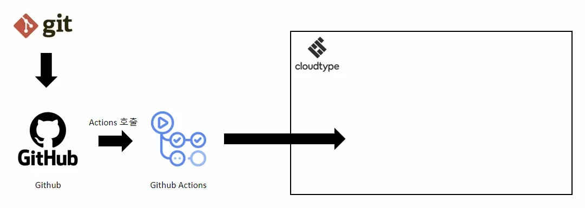
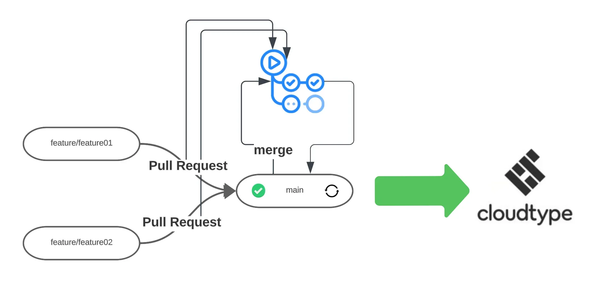

<a id="1c3eda9b0fe1817d92a9dceebbc26edd"></a>

## CI/CD 실습

---

> 📖 
> 
> <a id="1c3eda9b0fe18147bff7f7ea74c67360"></a>
> 
> github actions 와 Cloud type을 활용한 CI/CD 실습

<details>
<summary>CI/CD &#45;  Github Actions로 테스트 자동화 및  배포(cloudtype) 자동화</summary>



<details>
<summary>전체 흐름</summary>

1. <code>feature</code> 브랜치 생성 및 작업 진행( 기능 구현 작업, 테스트코드, workflow 설정 ) 

1. 이후   remote feature 브랜치에 push, 정의한 action 진행 (자동화)

1.  Pull Request 생성 →  해당 브랜치에 대해 <code>gradle test</code>를 수행 (자동화)

1. Pull Request 코드의 test가 실패한 경우 →  작업을 수정(code, test code)
    - 테스트 코드가 정상 수행이 될때까지 진행 

<a id="1c3eda9b0fe181f7a76aeeba40610e7b"></a>

5&#46; Pull Request 코드의 test가 성공한 경우, 다른 개발자들의 승인을 기다림 ( 코드 리뷰 )

- Pull Request의 코드를 승인하거나 댓글로 소통

1. 승인이 되면 main 브랜치에 merge 되면 해당 브랜치를 클라우드 서버에 배포  (자동화)
    - 해당 실습에서는 cloudtype 사용

    

</details>

<details>
<summary>ex) Pull Request가 만들어지면 test를 수행하는 Github Action</summary>

<a id="1c3eda9b0fe181aab961f87827bc4591"></a>

```yaml
name: test every pr
on:
  workflow_dispatch:
  pull_request:
permissions:
  contents: read
  pull-requests: read
jobs:
  deploy:
    runs-on: ubuntu-latest
    steps:
      - name: Checkout
        uses: actions/checkout@v3
      - name: setup jdk
        uses: actions/setup-java@v3
        with:
          java-version: '17'
          distribution: 'temurin'
          cache: gradle
      - name: Grant execute permission for gradlew
        run: chmod +x ./gradlew
      - name: gradlew test
        run: ./gradlew test
```

</details>

<details>
<summary>ex) cloudtype에 main 브랜치를 배포하는 Github Action</summary>

<a id="1c3eda9b0fe1812798b1ce867d6aceaa"></a>

```yaml
name: Deploy to cloudtype
on:
  workflow_dispatch:
  push:
    branches:
      - main
jobs:
  deploy:
    runs-on: ubuntu-latest
    steps:
      - name: Checkout
        uses: actions/checkout@v3
      - name: Connect deploy key
        uses: cloudtype-github-actions/connect@v1
        with:
          token: ${{ secrets.CLOUDTYPE_TOKEN }}
          ghtoken: ${{ secrets.GHP_TOKEN }}
      - name: Deploy
        uses: cloudtype-github-actions/deploy@v1
        with:
          token: ${{ secrets.CLOUDTYPE_TOKEN }}
          project: nbc.docker/cicd
          stage: main
          yaml: |
            name: cicd
            app: java@17
            options:
              ports: 8080
            context:
              git:
                url: git@github.com:${{ github.repository }}.git
                ref: ${{ github.ref }}
              preset: java-springboot
```

</details>

</details>

<details>
<summary>실습 1 &#45; CloudType CD  실습</summary>

[cicd-sample](https://github.com/nbcdocker/cicd-sample)

<a id="1c3eda9b0fe181e6b5adc402d88f5068"></a>

<a href="#/post/1c3eda9b-0fe1-8186-a036-d6c5af416fe1">페이지</a> 

<a id="1c3eda9b0fe181298d98cc814b182c61"></a>

<a href="#/post/1c3eda9b-0fe1-8114-a6b3-c20271564094">페이지</a> 

</details>
