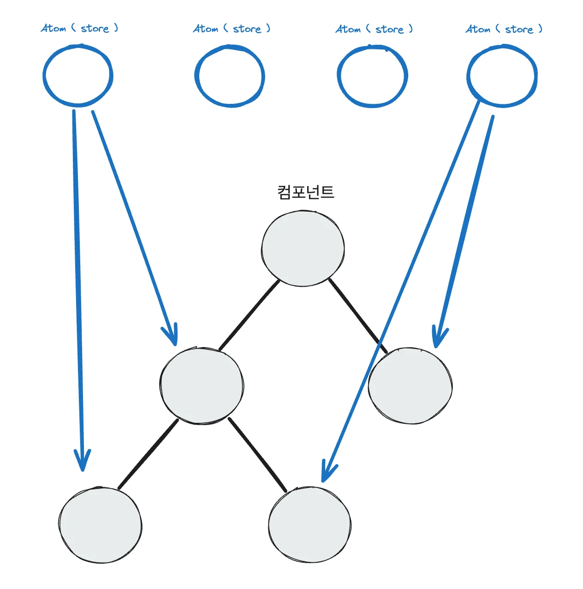
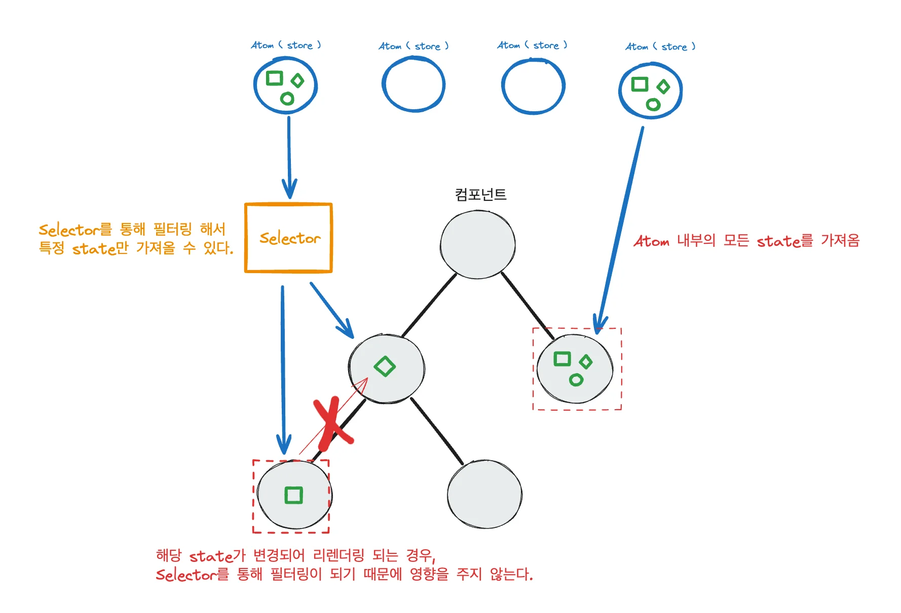
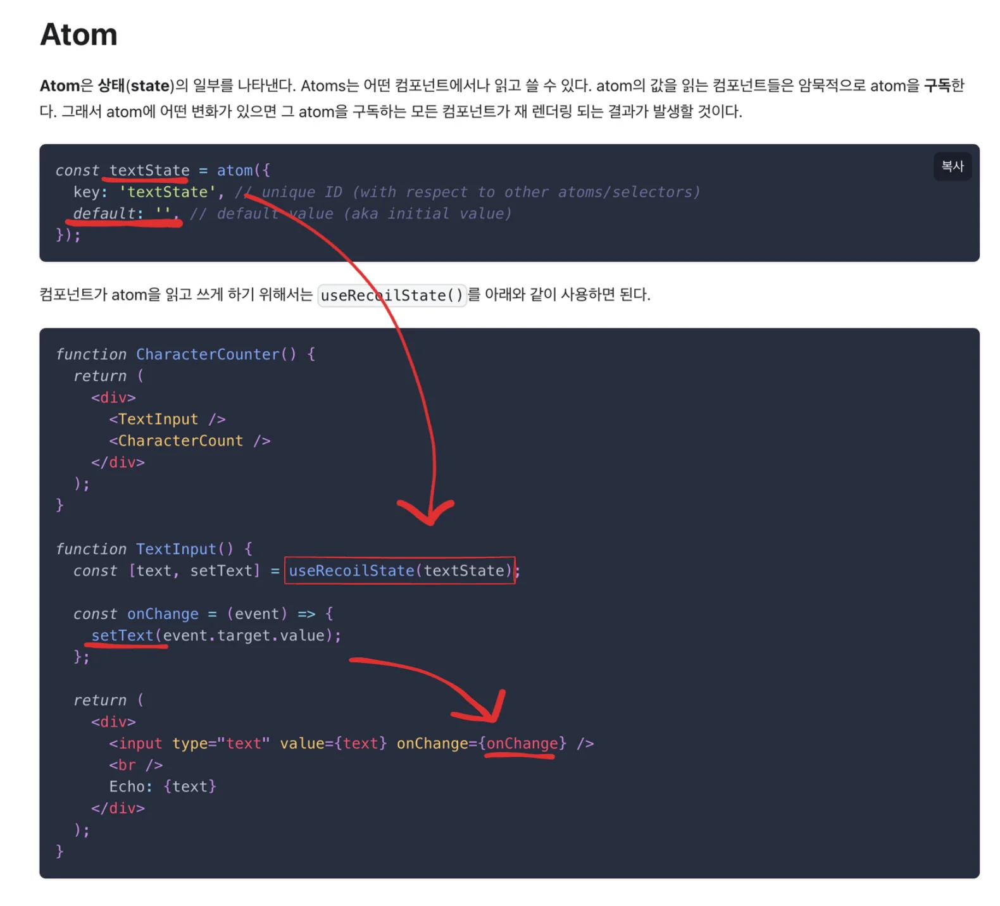
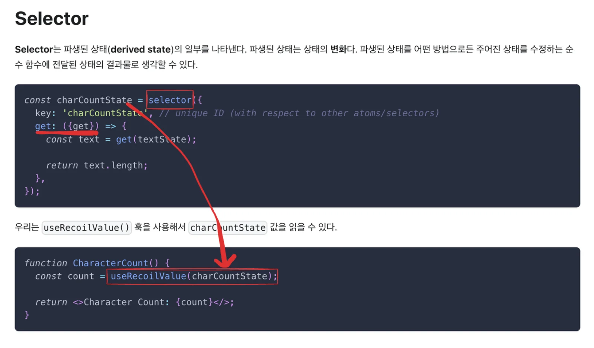
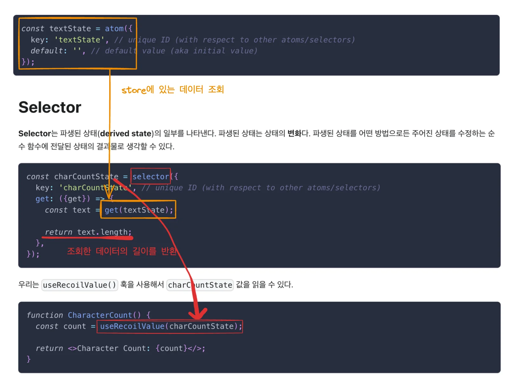
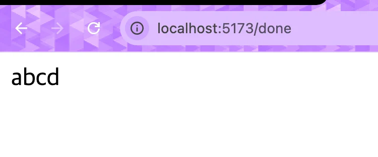
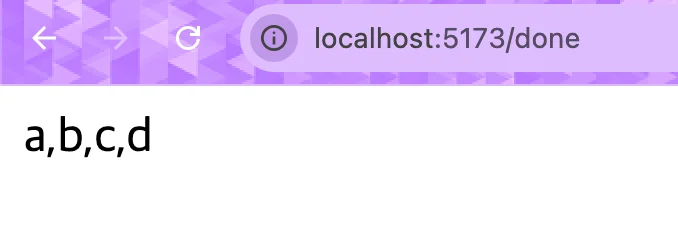

<a id="1c3eda9b0fe18176bac1f8dade4a939d"></a>

# Recoil

---

<a id="1c3eda9b0fe18148a0d7c385e6b49d04"></a>

### 등장 배경

<a id="1c3eda9b0fe18144a336c0d4fa7a770e"></a>

전역 상태 관리 라이브러리 중 하나로, 2020년에 처음 등장했다&#46; 

- recoil 등장 전에는 redux를 사용해서 전역 상태 관리를 했다&#46;
    - redux는 사용에 따라, 코드의 복잡성이나 양이 많아져 유지보수 하기 어렵다&#46; 
        <a id="1c3eda9b0fe181edaa37c430616d2fe7"></a>

        또한, 동시성 이슈 등의 문제가 발생될 수 있다&#46;

    - 이런 단점을 해결하기 위해서 recoil이 등장했다&#46;

<a id="1c3eda9b0fe18188a8b9ff8add3512e3"></a>

### Recoil

[설치 &#124; Recoil]()

<details>
<summary>recoil 설치 </summary>

<a id="1c3eda9b0fe1818d8463d88a6e9f551f"></a>

```bash
npm install recoil
```

</details>

<details>
<summary>Atom ( Store )</summary>



- Atom 이라는 전역 상태 저장소(store)를 가진다&#46;

- Atom은 여러개가 있을 수 있다&#46; 

</details>

<details>
<summary>Selector &#45; state 필터링</summary>



- Atom의 state를 필터링 및 가공해서, 컴포넌트에 전달할 수 있다&#46;

- selector를 통해 필터링이 되기 때문에, 같은 Atom에 속한 state여도 컴포넌트 내부에서 사용하는 state가 아니면 리렌더링이 일어나지 않는다&#46; 

</details>

<details>
<summary>사용법</summary>

- atom
    

- selector
    

    

</details>

> ✏️ 
> 
> <a id="1c3eda9b0fe18199bd4df48275b40248"></a>
> 
> ### 주요 함수
> 
> - <code>useRecoilState()</code>&#58; getter, setter
> 
> - <code>useSetRecoilState()</code>&#58; setter
> 
> - <code>useRecoilValue()</code>&#58; getter

<a id="1c3eda9b0fe18153952ff6acabf8b948"></a>

### 코드

> ☝🏻 
> 
> <a id="1c3eda9b0fe1819a80f7cca81cb7e4c0"></a>
> 
> <code>useRecoilValue()</code> 훅에서는 <code>useRecoilState()</code> 와는 다르게 atom의 값을 설정(갱신) 하는 함수는 제공하지 않는다&#46;

<details>
<summary>root 컴포넌트(<code>main&#46;tsx</code>)기본 설정 </summary>

<a id="1c3eda9b0fe181bf8a2ec9dd4f5dd5d6"></a>

```javascript
import { StrictMode } from "react";
import { createRoot } from "react-dom/client";
import App from "./App.tsx";
import { BrowserRouter } from "react-router-dom";
import { RecoilRoot } from "recoil";

createRoot(document.getElementById("root")!).render(
  <StrictMode>
    <RecoilRoot>
      <BrowserRouter>
        <App />
      </BrowserRouter>
    </RecoilRoot>
  </StrictMode>
);
```

</details>

<details>
<summary>1&#46; recoil state 가져오기 </summary>

- stores/test/atom&#46;ts
    <a id="1c3eda9b0fe18126b4bdebc6595d3ce3"></a>

    ```javascript
    import { atom } from "recoil";

    const testState = atom({
      key: "testState",
      default: ["a", "b", "c", "d"],
    });

    export default testState;

    ```

- index&#46;tsx
    <a id="1c3eda9b0fe181a08898c3fcb70e99e9"></a>

    ```javascript
    import styled from "styled-components";
    import { useRecoilValue } from "recoil";
    import testState from "../../stores/test/atom";

    const CompletionPage = () => {
      const test = useRecoilValue(testState);
      return <CompletionPageWrapper>{test}</CompletionPageWrapper>;
    };

    const CompletionPageWrapper = styled.div``;

    export default CompletionPage;

    ```

- 결과 확인
    - value를 구분 없이 가져오는 것을 알 수 있다&#46;

    

</details>

<details>
<summary>2&#46; selector를 사용하여 atom 내부의 state 가공해서 가져오기</summary>

- selector 사용
    <a id="1c3eda9b0fe1816986fccbe0151d0f7a"></a>

    ```javascript
    import { selector } from "recoil";
    import testState from "./atom";

    const testWithComma = selector({
      key: "testWithComma",
      get: ({ get }) => {
        const adcArr = get(testState);

        return adcArr.join(",");
      },
    });

    export default testWithComma;

    ```

- selector 변환값 조회
    <a id="1c3eda9b0fe181769585c289d6ec6256"></a>

    ```javascript
    import styled from "styled-components";
    import { useRecoilValue } from "recoil";
    import testWithComma from "../../stores/test/testWithComma";

    const CompletionPage = () => {
      const test = useRecoilValue(testWithComma);
      return <CompletionPageWrapper>{test}</CompletionPageWrapper>;
    };

    const CompletionPageWrapper = styled.div``;

    export default CompletionPage;

    ```

- 결과 확인
    

</details>

<a id="1c3eda9b0fe18193bac9ce335d1ecb5e"></a>

### 코드 &#45; typescript 적용

<a id="1c3eda9b0fe181459779d2621ea5a3ef"></a>

‣

<details>
<summary>ex) atom 데이터 타입 선언</summary>

<a id="1c3eda9b0fe181a79139ec27cb87a314"></a>

```javascript
src/todoListState.ts

import {atom} from 'recoil';

export type TodoItemType = {
    id: number;
    text: string;
    isComplete: boolean;
}

export const todoListState = atom<TodoItemType[]>({
    key:'todoListState',
    default: [],
})
```

</details>

<details>
<summary>추가 예시</summary>

- atoms
    [Atoms &#124; Recoil]()

- Selectors
    [Selectors &#124; Recoil]()

</details>
