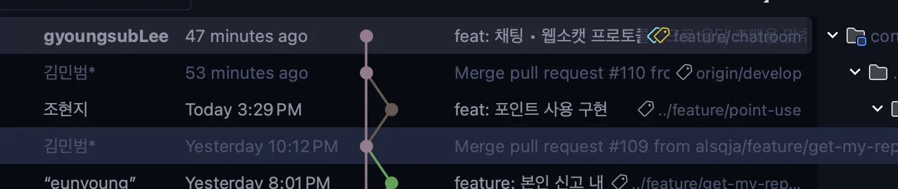

<a id="1c3eda9b0fe181898dc4f1a920f6763f"></a>

```bash
# 최신 내역을 가져올 로컬 브랜치로 이동
git checkout feature/~~

# git pull [원격 저장소 / 브랜치] (--rebase: merge 내역 없이 합침)
git pull origin develop --rebase
```

- 작업 내역이 있는 경우 
    <a id="1c3eda9b0fe1814a9369ec3a9e6e2a27"></a>

    ```bash
    git stash 

    # git pull [원격 저장소 / 브랜치] (--rebase: merge 내역 없이 합침)
    git pull origin develop --rebase

    git stash pop
    ```

    - rebase 사용 시
        - merge commit 내역 X

        - 로컬 작업 내역을 맨 앞으로 불러옴

        
