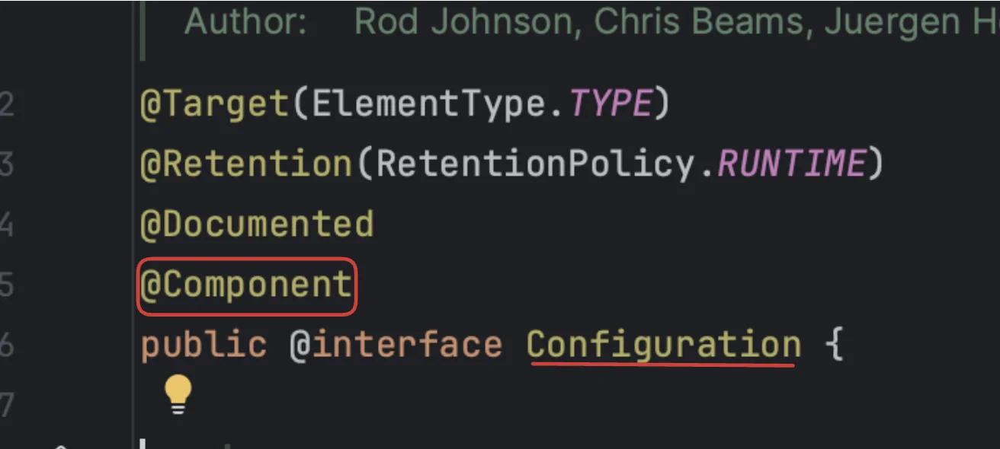
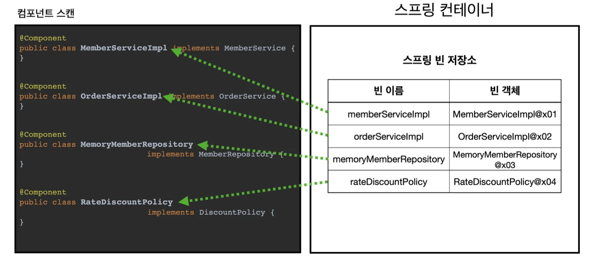
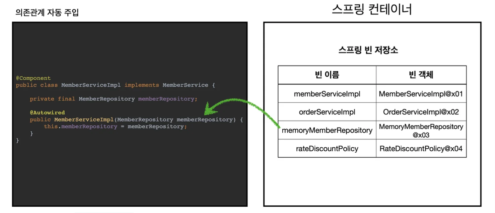
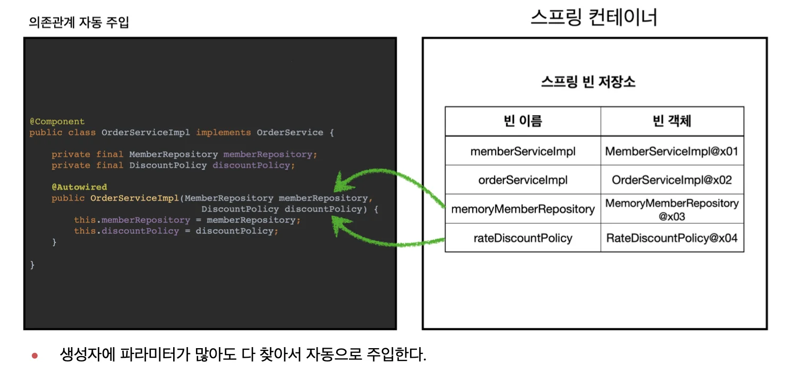

> 지금까지 스프링 빈 등록 시, <code>자바 코드 &#45; &#64;Bean</code>, <code>XML&#45; &#60;Bean&#62;</code> 과 같이 설정 정보에 직접 등록할 스프링 빈을 나열했다&#46;<br> <br>예제의 빈은 몇개 안되었지만, 실제 스프링 빈이 수백개 가 있으면 일일이 등록하기는 너무 번거롭고, 설정 정보도 방대해진다&#46; 무엇보다 귀찮음<br>⇒ <strong>설정 정보 없이, 자동으로 스프링 빈을 등록</strong>하는<strong> </strong><strong><code>컴포넌트 스캔</code></strong><strong> </strong>이라는 기능을 제공함&#46; 또한 <strong>의존관계도 자동으로 주입</strong>하는 <strong><code>&#64;Autowired</code></strong> 기능도 제공

---

<a id="1c3eda9b0fe181178482e74e29a13532"></a>

### 컴포넌트 스캔

<a id="1c3eda9b0fe18116a152d43d5952c21f"></a>

컴포넌트 스캔은 이름 그대로 <code>&#64;Component</code> 애노테이션이 붙은 클래스를 스캔해서 빈으로 등록하는 방법이다&#46; <strong>해당 애노테이션이 붙은 클래스</strong>는 <strong>자동으로 스프링이 빈으로 관리</strong>한다&#46; 

<details>
<summary><code>&#64;Component</code>를 포함하는 애노테이션</summary>

> <strong>• </strong><code>&#64;Configuration</code><br><strong>• </strong><code>&#64;Controller</code> <br><strong>• </strong><code>&#64;Service</code>
> 
> <a id="1c3eda9b0fe181b29f18d914516b349d"></a>
> 
> <strong>• </strong><code>&#64;Repository</code>

<a id="1c3eda9b0fe18117bd79d690b516889b"></a>

해당  애노테이션들의 소스 코드를 보면 모두 다 <code>&#64;Component</code> 애노테이션이 포함되어 있는 것을 확인 할 수 있다&#46; 




</details>

<a id="1c3eda9b0fe181d18833e26b6d3a60c0"></a>

### 자동 의존관계 주입(<strong><code>&#64;Autowired</code></strong><strong>)</strong>

<a id="1c3eda9b0fe181658b0de94a2ffa7075"></a>

이전에는 AppConfig 직접 빈을 등록하고, 의존관계도 직접 명시했다&#46; 

<a id="1c3eda9b0fe1814c8a46d293ee4ad67f"></a>

그러나 이제는 이런 설정 정보 자체가 없기 때문에, 의존관계 주입도 이 클래스 안에서 해결해야 한다&#46; 

<a id="1c3eda9b0fe181af827cf4641d0202c5"></a>

→ <strong><code>&#64;Autowired</code></strong><strong> 을 통해 </strong><strong>자동</strong><strong>으로 </strong><strong>의존관계를 주입</strong>

---

<a id="1c3eda9b0fe181b688c4c3c33b0a51e6"></a>

### 자동 스캔 처리할 구성정보 생성

> 자동으로 처리할 새로운 구성 정보(config) 생성<br>→ 컴포넌트 스캔 시, 기존에 작성한 config 도 포함됨, 따라서 필터로 제거(<code>excludeFilters</code>)

<a id="1c3eda9b0fe181aab8b3f66956f972a7"></a>

```java
package hello.core;

import org.springframework.context.annotation.ComponentScan;
import org.springframework.context.annotation.ComponentScan.Filter;
import org.springframework.context.annotation.Configuration;
import org.springframework.context.annotation.FilterType;

@Configuration
@ComponentScan(
        excludeFilters = @Filter(type = FilterType.ANNOTATION, classes = Configuration.class)
)
public class AutoAppConfig {
}
```

- 컴포넌트 스캔을 사용하려면, 먼저 설정 정보에 <code>&#64;ComponentScan</code>을 명시한다&#46;
    <a id="1c3eda9b0fe181a4966ed5b11fd1d972"></a>

    → 이전 직접 빈 정보를 등록한 config와는 다르게 등록한 Bean 이 없음

    <a id="1c3eda9b0fe18195b282c196b804a98d"></a>

    ⇒ <code>&#64;Component</code> 애노테이션을 통해 자동으로 등록해주기 때문에 명시할 필요가 없음&#46;

<a id="1c3eda9b0fe181cd8f68c2a7edd0da23"></a>

### <strong>각 클래스가 컴포넌스 스캔 대상이 되도록 </strong><strong><code>&#64;Component</code></strong><strong> 추가,<br>자동 의존관계 추가(</strong><strong><code>&#64;Autowired</code></strong><strong>)</strong>

> <strong>MemoryMemberRepository </strong><strong><code>&#64;Component</code></strong><strong> 추가<br></strong>

<a id="1c3eda9b0fe18166b395f16bd1c73180"></a>

```java
@Component
 public class MemoryMemberRepository implements MemberRepository {}
```

> <strong>RateDiscountPolicy </strong><strong><code>&#64;Component </code></strong><strong>추가</strong>

<a id="1c3eda9b0fe181438202c2cb0d797f86"></a>

```java
@Component
 public class RateDiscountPolicy implements DiscountPolicy {}
```

> <strong>MemberServiceImpl </strong><strong><code>&#64;Component</code></strong><strong>, </strong><strong><code>&#64;Autowired </code></strong><strong>추가<br></strong>

<a id="1c3eda9b0fe18152ab62c7fc06ac59e4"></a>

```java
@Component
 public class MemberServiceImpl implements MemberService {
     private final MemberRepository memberRepository;

     @Autowired
     public MemberServiceImpl(MemberRepository memberRepository) {
         this.memberRepository = memberRepository;
     }
}
```

> <strong>OrderServiceImpl </strong><strong><code>&#64;Component</code></strong><strong>, </strong><strong><code>&#64;Autowired</code></strong><strong> 추가</strong>

<a id="1c3eda9b0fe18121bf07f4d5ed4eae50"></a>

```java
@Component
 public class OrderServiceImpl implements OrderService {
     private final MemberRepository memberRepository;
     private final DiscountPolicy discountPolicy;

		 @Autowired
     public OrderServiceImpl(MemberRepository memberRepository, DiscountPolicy discountPolicy) {
         this.memberRepository = memberRepository;
         this.discountPolicy = discountPolicy;
     }
}
```

<a id="1c3eda9b0fe181ada107ca913ad2fdfd"></a>

### 빈 등록 검증 테스트

<a id="1c3eda9b0fe181b5be8ec9f034a3d14b"></a>

```java
package hello.core.scan;

import hello.core.AutoAppConfig;
import hello.core.member.Member;
import hello.core.service.MemberService;
import org.assertj.core.api.Assertions;
import org.junit.jupiter.api.DisplayName;
import org.junit.jupiter.api.Test;
import org.springframework.context.annotation.AnnotationConfigApplicationContext;

import static org.junit.jupiter.api.Assertions.*;

class AutoAppConfigTest {

    @Test
    @DisplayName("자동 빈 등록 검증")
    void basicScan() {
        AnnotationConfigApplicationContext ac = new AnnotationConfigApplicationContext(AutoAppConfig.class);

        MemberService memberService = ac.getBean(MemberService.class);

        Assertions.assertThat(memberService).isInstanceOf(MemberService.class);
    }
}
```

---

<a id="1c3eda9b0fe1813687cdf25aeafaa63f"></a>

## 컴포넌트 스캔, 의존관계 주입 동작 과정

<a id="1c3eda9b0fe1811595c4efa47c14b627"></a>

### 1&#46; ComponentScan

---



> <code>&#64;ComponentScan</code> 은 <code>&#64;Component</code> 가 붙은 모든 클래스를 스프링 빈으로 등록함<br>이때,<strong> 스프링 빈의 기본 이름</strong>은 <strong><u>클래스명을 사용하되, 맨 앞글자만 소문자를 사용</u></strong>함&#46;
> 
> - <strong>빈 이름 기본 설정</strong>&#58; <strong>MemberServiceImpl</strong> 클래스 → <strong><code>m</code></strong><code>emberServiceImpl</code>
> 
> - <strong>빈 이름 직접 지정&#58; </strong>직접 지정도 가능, <code>&#64;Component(”이름”)</code>  ex) &#64;Component(”memberService2”)

<a id="1c3eda9b0fe1817fb7a3d8f46681b995"></a>

### 2&#46; &#64;Autowired, 자동 의존관계 주입

---



> <strong>생성자에 </strong><strong><code>&#64;Autowired</code></strong><strong>를 지정</strong>하면, <strong>스프링 컨테이너가 자동으로 해당 스프링을 찾아 주입</strong>한다&#46;<br>이때, 기본 조회 전략은 <strong>타입이 같은 빈을 찾아 주입</strong>한다&#46;
> 
> <a id="1c3eda9b0fe1816d9a53f10cf93aac40"></a>
> 
> ( <code>getBean(MemberRepository&#46;class</code><strong><code>)</code></strong><strong> </strong>와 같다고 생각하면 된다고 한다<strong> , </strong>자세한 내용은 다시 설명한다고 함) 


