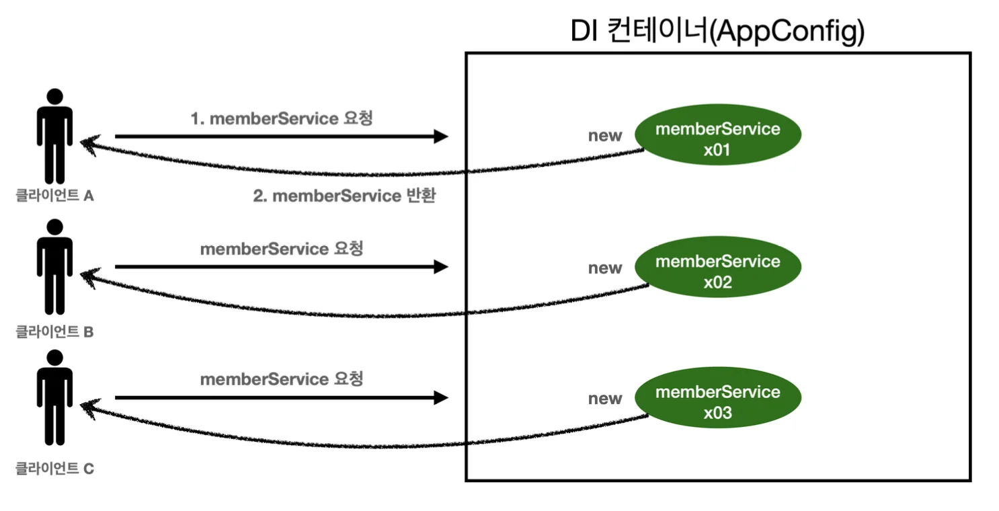

> 스프링은 태생이  기업용 온라인 서비스 기술을 지원하기 위해 탄생함&#46;<br>대부분 스프링 애플리케이션은 웹 애플리케이션임 (웹이 아닌 애플리케이션도 얼마든지 개발 가능)<br><strong>웹 애플리케이션은 보통 </strong><strong><u>여러 고객이 동시에 요청</u></strong><strong>을 한다&#46;</strong>



<a id="1c3eda9b0fe1818eadb6fbf5ce4ced27"></a>

### 스프링이 없는 순수한 DI 컨테이너 테스트

<a id="1c3eda9b0fe1819f8f8ac56c7267f4b6"></a>

```java
package hello.core.singleton;

import hello.core.AppConfig;
import hello.core.service.MemberService;
import org.junit.jupiter.api.DisplayName;
import org.junit.jupiter.api.Test;

import static org.assertj.core.api.Assertions.assertThat;

public class SingletonTest {

    @DisplayName("스프링 없는 순수한 DI 컨테이너")
    @Test
    void pureContainer() {
        AppConfig appConfig = new AppConfig();

        // 1. 조회: 호출할 때 마다 객체를 생성
        MemberService memberService1 = appConfig.memberService();

        // 2. 조회: 호출할 때 마다 객체를 생성
        MemberService memberService2 = appConfig.memberService();;

        // 참조값이 다른 것을 확인
        System.out.println("memberService1 = " + memberService1);
        System.out.println("memberService2 = " + memberService2);

        // memberService1 != memberService2
        assertThat(memberService1).isNotSameAs(memberService2);
    }
}

```

<a id="1c3eda9b0fe18110b4c9fe8cf45aaddb"></a>

해당 테스트를 통해  요청 시 마다, 객체를 새로 생성한다는 것을 알 수 있다&#46; 

<a id="1c3eda9b0fe181a581fed61143e185e4"></a>

이는, 고객 트래픽이 초당 100이 나오면, 초당 100개의 객체가 생성되고 소멸된다는 것이며, 이는 큰 메모리가 낭비로 이어진다&#46;

<a id="1c3eda9b0fe18110be02c063cb0de153"></a>

따라서 <strong>동일한 객체는 1개만 생성하고, 참조(공유)</strong>하는 <strong>싱글톤 패턴</strong>으로 설계함으로써 이를 해결한다&#46;
