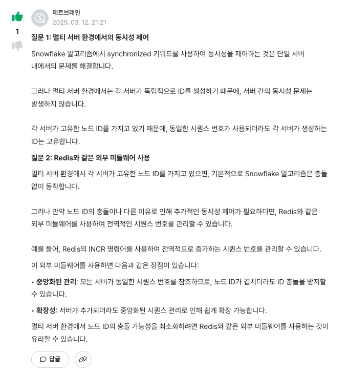

‣

### 질문

- 질문1) snowflake 알고리즘에서 synchronized를 활용하여 동시성 제어를 하는데,
    

    만약 각 도메인 모듈마다 멀티 서버를 구상한다면 동시성 제어가 가능한가요?

- 질문2) 만약 안된다면, redis 와 같은 외부 미들웨어를 통해서 동시성제어를 하는 방식으로 해당 알고리즘을 수정해야 될까요?

### 답변 

### 정리 

<strong>synchronized 는 JVM 내에서 동시성제어를 하는 방법으로 단일 서버환경에서 사용은 적절하나, 분산 서버 환경에서는 동시성제어에 있어 문제가 발생된다&#46; </strong>

<strong>그러나 snowflake 알고리즘</strong>(총 64 비트 이뤄짐)은 노드ID를 사용하는데, 각 서버마다 고유한 노드ID를 가진다면 <strong>synchronized  사용이 유효하다</strong>

- 극히 드문 확률로 nodeId가 동일하더라도 DB레벨에서 식별자에 대한 유니크 제약조건이 성립되기 때문에, 재처리 정도면 충분하다&#46;

<strong>각 서버가 고유의 ID를 가지지 않는다면 외부 미들웨어(redis …)를 사용하여 관리할 필요성이 있다&#46;</strong>

- 위에서 설명했듯이 재처리만으로 충분하다&#46; ( 검증 필요 )
