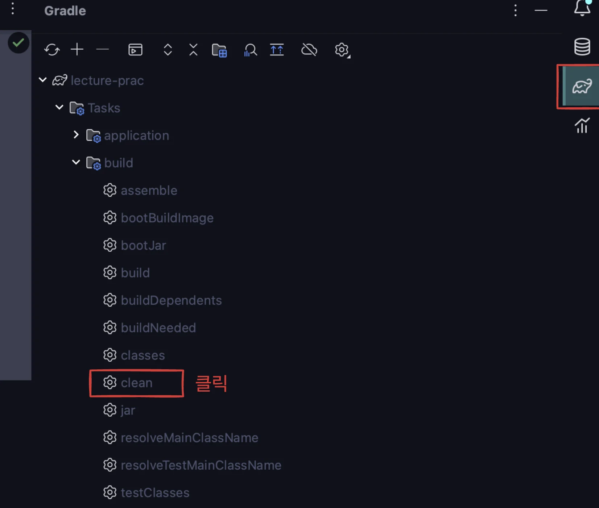
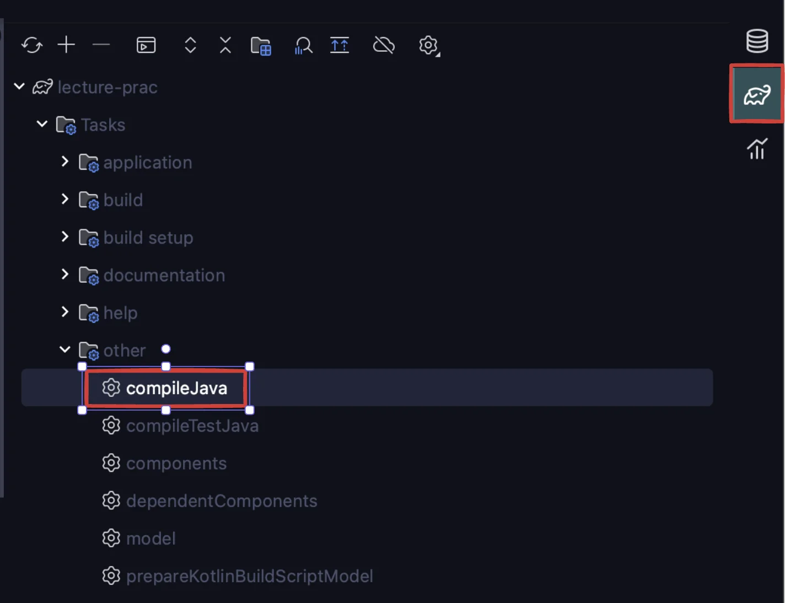
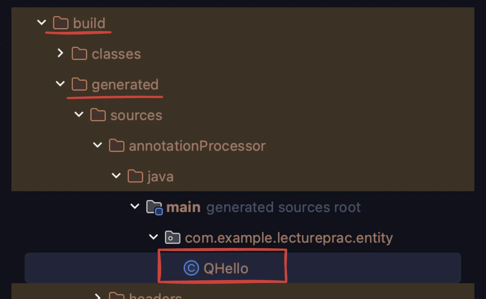

> 
> 
> <a id="1c3eda9b0fe181c1b67ffc6c004a164a"></a>
> 
> <strong>&#91; 인프런 &#93; 김영한 JPA 로드맵 QueryDSL</strong>
> 
> - 강의&#58; ‣
> 
> - 기간&#58; 24&#46;12&#46;13 &#126;24&#46;12&#46;16

> 
> 
> <a id="338eda9b0fe180f99d63e3b27deed8c1"></a>
> 
> 목차
> 
> - [프로젝트 설정](#1c3eda9b0fe181088821fb680ee1079a)
> - [환경변수 설정](#1c3eda9b0fe181e19f16f90127af9f8b)
> - [QueryDSL 설정 및 검증](#1c3eda9b0fe1816bbbc9c08badd635e9)
> - [H2 데이터베이스 설치](#1c3eda9b0fe1813f8e86dd512c300ab5)
> - [스프링 부트 설정 - JPA, DB](#1c3eda9b0fe181a3af79d4627bc058ff)
> - [쿼리 파라미터 로그 남기기](#1c3eda9b0fe1814a9821d47a04d5af9a)
> - [1. 기본 문법](#1c3eda9b0fe1817db354dd4ea52016cd)
> - [2.  중급 문법](#1c3eda9b0fe181e2bffbfa43300e6de5)
> - [3. 실무 활용 - 순수 JPA, QueryDSL](#1c3eda9b0fe1814da97bc6d72d940ec4)
> - [4. 실무 활용 - 스프링 데이터 JPA, QueryDSL](#1c3eda9b0fe181f0b360d637965aa510)
> - [5. 스프링 데이터 JPA가 제공하는 QueryDSL 기능](#1e5eda9b0fe180a3b116e71587a51d56)

<a id="1c3eda9b0fe181088821fb680ee1079a"></a>

### 프로젝트 설정

> 📌 
> 
> <a id="1f7eda9b0fe1804198a6d5b58f5148e2"></a>
> 
> 라이브러리 의존성
> 
> - Lombok
> 
> - MySQL ( H2 )
> 
> - Spring Date JPA
> 
> - MVC ( Web )

<a id="1c3eda9b0fe181e19f16f90127af9f8b"></a>

### 환경변수 설정

- <code>&#46;gitignore</code> 에 <code>&#46;env</code> 등록

<details>
<summary>application&#46;yml</summary>

<details>
<summary>🧐 환경변수 경로 설정 </summary>

- application&#46;properties
    <a id="1c3eda9b0fe181798d0ee79a61dbfc50"></a>

    ```yaml
    spring.config.import=optional:file:.env[.properties]
    ```

- application&#46;yml
    <a id="1c3eda9b0fe181419e5bcdd477ca4538"></a>

    ```yaml
    spring:
      config:
        import: optional:file:.env[.properties]
    ```

- <code>optional&#58;file&#58;&#46;env&#91;&#46;properties&#93;</code>
    - <code>optional</code>&#58;<strong> 키워드</strong>
        - 파일이 없어도 애플리케이션이 정상 작동 가능

        - 파일이 필수인 경우, <code>optional&#58;</code> 생략

    - <code>&#46;env</code> 확장자
        - <code>&#46;env&#91;&#46;properties&#93;</code>를 지정하면 <code>&#46;env</code>와 <code>&#46;env&#46;properties</code> 둘 다 자동으로 처리
            - Spring Boot는 &#46;properties 형식을 지원하므로 &#46;env 파일을 &#46;env&#46;properties로 이름을 변경하는 것도 가능<br>

- 파일 경로 기준
    > ✏️ 
    > 
    > - <code>file&#58;</code>
    >     - 현재 작업 디렉터리를 기준으로 파일을 찾는다&#46;
    > 
    > - 파일이 다른 경로에 있다면
    >     -  절대 경로
    > 
    >     - <code>spring&#46;config&#46;location</code>

    <details>
    <summary><strong>현재 작업 디렉터리 (Working Directory)</strong></summary>

    - <code>file&#58;</code> 경로는 애플리케이션을 실행한 디렉터리(<u>보통</u><u><code> java &#45;jar</code></u><u> 명령이 실행된 위치</u>)에서 파일을 찾는다&#46;
        <a id="1c3eda9b0fe181cca452f22bd6e8625a"></a>

        ```yaml
        java -jar myapp.jar
        ```

        - <code>file&#58;&#46;env</code>는 <u><code>myapp&#46;jar</code></u><strong><u>가 실행된 디렉터리</u></strong><u>에서 </u><u><code>&#46;env </code></u><u>파일</u>을 찾는다&#46;

    </details>

    <details>
    <summary><strong>절대 경로로 지정 가능</strong></summary>

    - file&#58; 뒤에 절대 경로를 명시
        -  특정 디렉터리에 있는 파일을 명확히 지정 가능하다&#46; 

    - &#46;env 파일이 특정 디렉터리에 고정되어 있다면, 절대 경로를 사용하는 것이 안전하다&#46;

    <a id="1c3eda9b0fe1814f9198c6615950f939"></a>

    ```yaml
    spring:
      config:
        import: optional:file:/home/user/config/.env
    ```

    </details>

    <details>
    <summary><strong>기본 위치가 아닌 다른 디렉터리에서 파일 지정</strong></summary>

    - <code>spring&#46;config&#46;location</code>을 사용하여 다른 디렉터리를 기본 경로로 지정할 수도 있다&#46;

    <a id="1c3eda9b0fe1818fb51bc5d45bae63db"></a>

    ```yaml
    java -jar -Dspring.config.location=file:/path/to/config/ myapp.jar
    ```

    </details>

</details>

<a id="1c3eda9b0fe181a997e1c349a8858c8a"></a>

```yaml
spring:
  config:
    import: optional:file:.env[.properties]
  datasource:
    url: ${DB_URL}
    username: ${DB_USERNAME}
    password: ${DB_PASSWORD}
    driver-class-name: com.mysql.cj.jdbc.Driver

  jpa:
    hibernate:
      ddl-auto: create-drop
    properties:
      hibernate:
        dialect: org.hibernate.dialect.MySQLDialect
        format_sql: true
        use_sql_comments: true
        show_sql: true
    show-sql: true
```

</details>

<details>
<summary>&#46;env</summary>

<a id="1c3eda9b0fe181adb85fed972c604c11"></a>

```java
DB_URL=jdbc:mysql://localhost:3306/querydsl
DB_USERNAME=root
DB_PASSWORD=12345678
```

</details>

<a id="1c3eda9b0fe1816bbbc9c08badd635e9"></a>

### QueryDSL 설정 및 검증

> QueryDSL은 Gradle 설정 및 Gradle 빌드 과정 속에서 Q타입을 파일을 생성해야 된다&#46; 

<details>
<summary>QueryDSL 의존성 추가 ( build&#46;gradle )</summary>

- reference&#58; ‣

<a id="1c3eda9b0fe181fa969ac29935176672"></a>

```groovy
buildscript {
    ext {
        queryDslVersion = "5.0.0"
    }
}

dependencies {

    //querydsl 설정 추가
    implementation 'com.querydsl:querydsl-jpa:5.0.0:jakarta'
    annotationProcessor "com.querydsl:querydsl-apt:${dependencyManagement.importedProperties['querydsl.version']}:jakarta"
    annotationProcessor "jakarta.annotation:jakarta.annotation-api"
    annotationProcessor "jakarta.persistence:jakarta.persistence-api"

}

def generated = 'src/main/generated'

sourceSets {
    main.java.srcDirs += [generated]
}

tasks.withType(JavaCompile).configureEach {
    options.annotationProcessorPath = configurations.annotationProcessor
}

clean {
    delete file(generated)
}
```

<details>
<summary>main &#45; queryDSL </summary>

<a id="1c3eda9b0fe181ccad21fd881a341a0e"></a>

```groovy
//querydsl 추가 시작
def querydslDir = 'src/querydsl/generated'

// querydsl QClass 파일 생성 위치를 지정
tasks.withType(JavaCompile) {
    options.getGeneratedSourceOutputDirectory().set(file(querydslDir))
}

jacoco {
    toolVersion = '0.8.12'
}

jacocoTestReport {
    dependsOn tasks.named('test')
    reports {
        xml.required = false
        csv.required = false
        html.outputLocation = layout.buildDirectory.dir('jacocoHtml')
    }

    // QueryDsl Q Class 제외
    def Qdomains = []
    for(qPattern in "**/QA" .. "**/QZ"){
        Qdomains.add(qPattern+"*")
    }

    // QueryDsl Q Class 제외
    afterEvaluate {
        getClassDirectories().setFrom(classDirectories.files.collect {
            fileTree(dir: it, exclude: ['**/*Application*',
                                        '**/*Exception*',
                                        '**/dto/**',
                                        "GlobalConstants"] + Qdomains)
        })
    }

    finalizedBy 'jacocoTestCoverageVerification' // 추가
}
```

</details>

</details>

<details>
<summary>Q클래스 생성 확인</summary>

> 최신버전에서는 <code>compileQuerydsl</code>이 사라짐

<details>
<summary>1&#46; 검증용 Entity 생성 </summary>

<a id="1c3eda9b0fe181348453c8092555931b"></a>

```groovy
package com.example.lectureprac.entity;

import lombok.Getter;
import lombok.Setter;
import jakarta.persistence.Entity;
import jakarta.persistence.GeneratedValue;
import jakarta.persistence.Id;

@Entity
@Getter @Setter
public class Hello {
    @Id @GeneratedValue
    private Long id;
}
```

</details>

<details>
<summary>2&#46; build 파일 재생성</summary>

<details>
<summary>cmd</summary>

- build 파일 삭제
    <a id="1c3eda9b0fe1818bbb1cf2e611782d89"></a>

    ```shell
    ./gradlew clean
    ```

- build 파일 재생성
    <a id="1c3eda9b0fe18165b091ca585f47f8a3"></a>

    ```shell
    ./gradlew compileJava
    ```

</details>

<details>
<summary>intelliJ</summary>

- build 파일 삭제
    > Gradle &#45; Tasks &#45; build &#45; clean

    

- build 파일 재생성
    > Gradle &#45; Tasks &#45; other &#45; compileJava

    

</details>

</details>

<details>
<summary>3&#46; build 파일 내부 Q클래스 생성 확인</summary>



</details>

</details>

<details>
<summary>테스트 코드로 검증</summary>

- DB 와 연동까지 하는 테스트이다&#46; 따라서 해당하는 DB가 실행되고 있어야 한다&#46; 

<a id="1c3eda9b0fe181788fb1e28bfc8102b1"></a>

```java
package com.example.lectureprac;

import com.example.lectureprac.entity.Hello;
import com.example.lectureprac.entity.QHello;
import com.querydsl.jpa.impl.JPAQueryFactory;
import jakarta.persistence.EntityManager;
import org.assertj.core.api.Assertions;
import org.junit.jupiter.api.Test;
import org.springframework.beans.factory.annotation.Autowired;
import org.springframework.boot.test.context.SpringBootTest;
import org.springframework.transaction.annotation.Transactional;

@SpringBootTest
@Transactional
class LecturePracApplicationTests {

    @Autowired
    EntityManager em;

    @Test
    void contextLoads() {

        Hello hello = new Hello();
        em.persist(hello);

        JPAQueryFactory query = new JPAQueryFactory(em);
        QHello qHello = QHello.hello;  //Querydsl Q타입 동작 확인

        Hello result = query
                .selectFrom(qHello)
                .fetchOne();

        Assertions.assertThat(result).isEqualTo(hello);
        //lombok 동작 확인 (hello.getId())
        Assertions.assertThat(result.getId()).isEqualTo(hello.getId());
    }

}

```

</details>

<details>
<summary>config 설정</summary>

- <code>JPAQueryFactory</code>를 Spring Bean으로 등록

<a id="1c3eda9b0fe181909743cf68e9ee8d51"></a>

```groovy
import com.querydsl.jpa.impl.JPAQueryFactory;
import jakarta.persistence.EntityManager;
import org.springframework.context.annotation.Bean;
import org.springframework.context.annotation.Configuration;
import org.springframework.beans.factory.annotation.Autowired;

@Configuration
public class QueryDslConfig {

    @Autowired
    private EntityManager entityManager;

    @Bean
    public JPAQueryFactory jpaQueryFactory() {
        return new JPAQueryFactory(entityManager);
    }
}
```

</details>

<a id="1c3eda9b0fe1813f8e86dd512c300ab5"></a>

### <del>H2 데이터베이스 설치</del>

<a id="1c3eda9b0fe181a3af79d4627bc058ff"></a>

### <del><strong>스프링 부트 설정 </strong></del><del>&#45; JPA, DB</del>

<a id="1c3eda9b0fe1814a9821d47a04d5af9a"></a>

### <strong>쿼리 파라미터 로그 남기기</strong>

<details>
<summary>yml</summary>

<a id="1c3eda9b0fe1817cb673f476ae895f2e"></a>

```yaml
spring:
  config:
    import: optional:file:.env[.properties]
  datasource:
    url: ${DB_URL}
    username: ${DB_USERNAME}
    password: ${DB_PASSWORD}
    driver-class-name: com.mysql.cj.jdbc.Driver

  jpa:
    hibernate:
      ddl-auto: create-drop
    properties:
      hibernate:
        format_sql: true
        use_sql_comments: true
        show_sql: true
    show-sql: true

logging.level:
  org.hibernate.SQL: debug
```

</details>

- 스프링 부트 3&#46;0 이상을 사용하면 라이브러리 버전을 1&#46;9&#46;0 이상을 사용해야 한다

<a id="1c3eda9b0fe18182a5cae3e7910e85c3"></a>

```groovy
 implementation 'com.github.gavlyukovskiy:p6spy-spring-boot-starter:1.9.0'
```

> ☝🏻 
> 
> <a id="1c3eda9b0fe181379c5af89f0fb5997d"></a>
> 
> 참고&#58; 쿼리 파라미터를 로그로 남기는 외부 라이브러리는 시스템 자원을 사용하므로, 개발 단계에서는 편하게 사 용해도 된다&#46; 하지만 운영시스템에 적용하려면 꼭 성능테스트를 하고 사용하는 것이 좋다&#46;

<a id="1c3eda9b0fe1817db354dd4ea52016cd"></a>

## 1&#46; 기본 문법

- 페이징, fetch JOIN 강의 보고 추가 정리하기 

[도메인 기본 세팅](#/post/1c3eda9b-0fe1-814b-84fd-d4c6e836b2a2)

[JPQL vs QueryDSL](#/post/1c3eda9b-0fe1-8100-b401-c34b7d4d3e1c)

[Q-Type 활용](#/post/1c3eda9b-0fe1-81bd-82da-f46c8b4f46ea)

[검색 조건 쿼리](#/post/1c3eda9b-0fe1-816d-89c3-e058f3b0eeea)

[결과 조회](#/post/1c3eda9b-0fe1-81c4-b200-fc583910d2cc)

[정렬](#/post/1c3eda9b-0fe1-81a9-8b1e-cfa8792e448e)

[페이징](#/post/1c3eda9b-0fe1-8124-bc07-ce4659a18884)

[집합](#/post/1c3eda9b-0fe1-8126-89ab-ff98d5171e2a)

[조인 - 기본 조인](#/post/1c3eda9b-0fe1-8102-bf40-c468208b8d19)

[조인  - on 절](#/post/1c3eda9b-0fe1-8190-b18d-d6153b6c76ad)

[조인 - 페치 조인](#/post/1c3eda9b-0fe1-817b-bc19-d2006e8cfb43)

[서브 쿼리](#/post/1c3eda9b-0fe1-81cb-ae28-ea33ea157aeb)

[Case 문](#/post/1c3eda9b-0fe1-81d0-a03d-c69e022c37a3)

[상수, 문자 더하기](#/post/1c3eda9b-0fe1-819e-881f-f54db70b4a8c)

[중복 제거 - distinct](#/post/1c3eda9b-0fe1-81ea-b756-e76742c04146)

<a id="1c3eda9b0fe181e2bffbfa43300e6de5"></a>

## 2&#46;  중급 문법

[프로젝션, 결과 반환 - 기본](#/post/1c3eda9b-0fe1-81f6-8c0a-e59114d345ea)

[프로젝션, 결과 반환 - DTO 조회](#/post/1c3eda9b-0fe1-8128-aefe-dca73a8c1e28)

[프로젝션, 결과 반환 - @QueryProjection](#/post/1c3eda9b-0fe1-8173-9ab6-cde2f9d4992a)

[동적 쿼리 -  BooleanBuilder](#/post/1c3eda9b-0fe1-81d0-ae09-e4cfd84cd6eb)

[동적 쿼리 - Where 다중 파라미터](#/post/1c3eda9b-0fe1-8111-bd2b-ec89d0fb8a21)

[수정 삭제 벌크 연산](#/post/1c3eda9b-0fe1-8158-9e9c-f044fb08dd14)

[SQL function 호출](#/post/1c3eda9b-0fe1-8105-a3f8-d4212be1b8e6)

<a id="1c3eda9b0fe1814da97bc6d72d940ec4"></a>

## 3&#46; 실무 활용 &#45; 순수 JPA, QueryDSL

[순수 JPA 리포지토리와 Querydsl](#/post/1c3eda9b-0fe1-81b5-bd7a-c75b7a30c5b6)

[동적 쿼리와 성능 최적화 조회 - Builder](#/post/1c3eda9b-0fe1-8143-b6e6-d3854b9b689e)

[동적 쿼리와 성능 최적화 조회 - Where 절 파라미터 사용](#/post/1c3eda9b-0fe1-811a-abe3-e3993867e8ac)

[조회 API 컨트롤러 개발](#/post/1c3eda9b-0fe1-81ad-a47d-ea4328f4c63a)

<a id="1c3eda9b0fe181f0b360d637965aa510"></a>

## 4&#46; 실무 활용 &#45; 스프링 데이터 JPA, QueryDSL

[Spring Data JPA repository](#/post/1c3eda9b-0fe1-81e5-a30a-dbc65bd17de5)

[사용자 정의 repository](#/post/1c3eda9b-0fe1-81e0-b8fb-fe07939131d4)

[Spring Data 페이징 활용1 - Querydsl 페이징 연동](#/post/1c3eda9b-0fe1-812e-a442-f44784d28745)

[Spring Data 페이징 활용2 - CountQuery 최적화](#/post/1c3eda9b-0fe1-81aa-a138-db36b214b1ef)

[Spring Data 페이징 활용3 - 컨트롤러 개발](#/post/1c3eda9b-0fe1-8114-b53e-f893101592e8)

<a id="1e5eda9b0fe180a3b116e71587a51d56"></a>

## <strong>5&#46; 스프링 데이터 JPA가 제공하는 QueryDSL 기능</strong>

> ☝🏻 
> 
> <a id="1e5eda9b0fe18097bfc2d474d867634b"></a>
> 
> 해당 챕터에서 소개하는 <u>기능은 제약이 커, 복잡한 실무 환경에서 사용하기에는 부족</u>하다&#46; <br>그래도 스프링 데이터에서 제공하는 기능이므로 간단한 소개 및 제약점을 다룬다&#46;

[인터페이스 지원 - QuerydslPredicateExecutor](#/post/1c3eda9b-0fe1-811f-bf24-d8256c8eccec)

[Querydsl Web 지원](#/post/1c3eda9b-0fe1-8115-a89f-dc9aaf9b8ff4)

[리포지토리 지원 - QuerydslRepositorySupport](#/post/1c3eda9b-0fe1-81f4-bfb3-fffdbbdcd64f)

[Querydsl 지원 클래스 직접 만들기](#/post/1c3eda9b-0fe1-81b2-a7cb-dfddd1327578)
