

## IAM 

---

AWS 계정 및 권한 관리하는 서비스이다&#46; 

AWS 서비스와 리소스에 대한 <strong>엑세스를 관리</strong>하며 사용자, 그룹, 역할, 정책으로 구성된다&#46;

<strong>리전에 속하는 서비스가 아닌</strong> <strong>글로벌 서비스</strong>로 계정 보안 강화를 위해 루트 계정(AWS 회원가입 시 만들어지는 계정)은 최초 사용자 계정 생성 이후 가능하면 사용하지 않는다&#46; 

사용자 계정(IAM 계정)으로 서비스를 사용하고 사용자는 필요한 최소한의 권한만 부여(최소 권한의 원칙)

루트 계정과 개별 사용자 계정에 강력한 암호 정책과 멀티팩터 인증(MFA) 적용 사용자의 암호에 대한 복잡성 요구 사항과 의무 교체 주기를 정의

<strong>액세스 키(Access Key)</strong>는 공유하면 안된다&#33;

## IAM 루트 사용자 자격 증명을 요구하는 작업

---

계정 설정을 변경(계정 이름, 이메일 주소, 루트 사용자 암호 및 루트 사용자 액세스 키), 연락처 정보, 결제 통화 기본 설정 및 리전과 같은 기타 계정 설정에는 루트 사용자 자격 증명이 필요하지 않음&#46;

IAM 사용자 권한을 복원, IAM 관리자가 실수로 권한을 취소하면 루트 사용자로 로그인하여 정책을 편집하고 해당 권한을 복원

Biling and Cost Management 콘솔에 대한 IAM 액세스 활성화

특정 세금 계산서를 조회

AWS 계정을 닫음f

AWS 지원 플랜(Support Plan)을 변경하거나 AWS 지원 플랜을 취소

예약 인스턴스 마켓플레이스에 판매자로 등록

MFA(멀티 팩터 인증) Delete를 활성화하도록 Amazon S3 버킷을 구성

잘못된 VPC ID 또는 VPC 엔드포인트 ID가 들어 있는 Amazon S3 버킷 정책을 편집하거나 삭제

GovCloud 등록

## IAM &#45; 액세스 관리

---

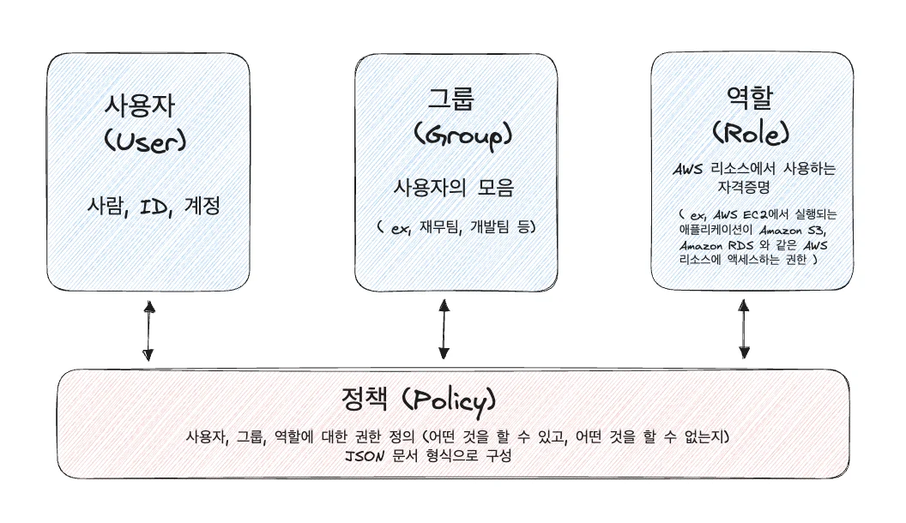

## IAM &#45; 정책

---

AWS 리소스에 대한 액세스 권한을 정의 한 것

사용자, 그룹, 역할에 정책을 연결하여 사용

가능하면 정책을 개별 사용자에게 직접 부여하지 말고 사용자가 속한 그룹에 권한 부여

IAM 정책 종류

• AWS 관리형 정책&#58; AWS에서 생성 및 관리하는 정책

• 고객 관리형 정책(사용자 지정 정책)&#58; 사용자가 직접 생성 및 관리하는 정책

• 인라인 정책&#58; 사용자, 그룹, 역할에 직접 생성하는 정책

• 대부분의 경우 관리형 정책을 사용하는 것을 권장

## IAM &#45; 역할

---

AWS 리소스에서 사용하는 자격증명

특정 AWS 서비스가 다른 AWS 서비스에 액세스 하여 작업을 수행할 때 필요한 권한

정책을 연결하여 IAM 역할에 작업 수행에 필요한 권한을 부여

만일, EC2에서 실행되는 애플리케이션이 AWS S3와 AWS RDS 액세스 권한이 필요할 때 역할 사용

> 📌 검색창에 ‘<strong>IAM</strong>’ 입력 

### 암호정책 변경 

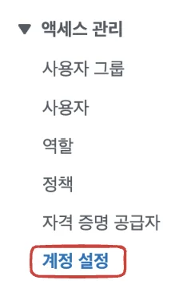

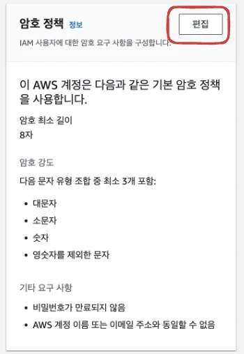

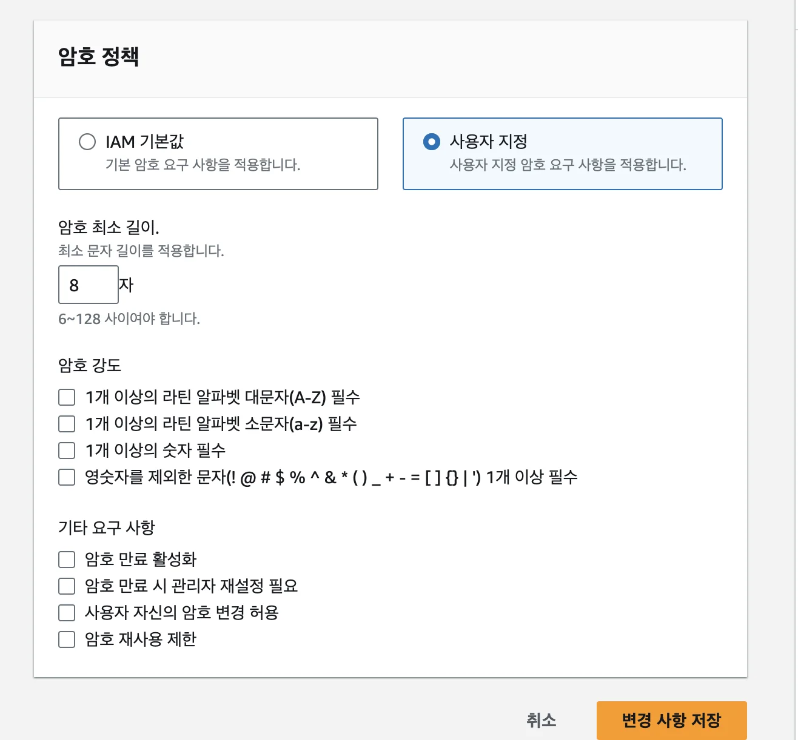

### MFA ( Multi Factor Access) 인증

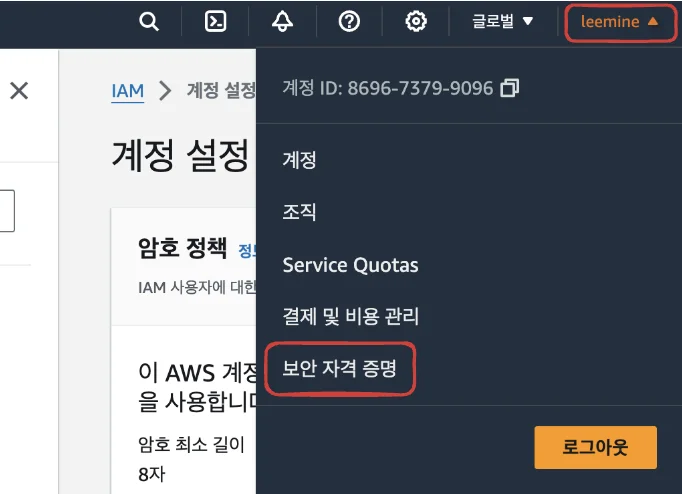

추가 디바이스 할당을 통해 보안 강화 가능

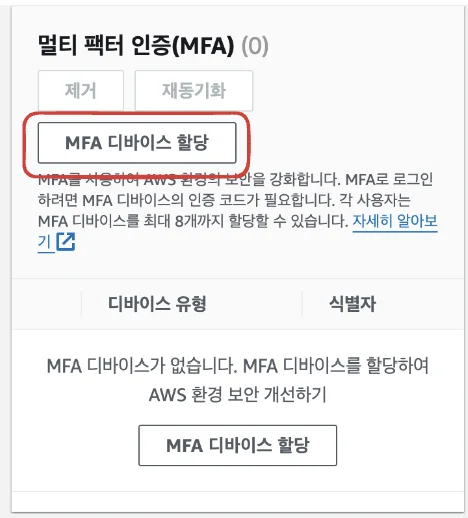

## 사용자

### 사용자 생성

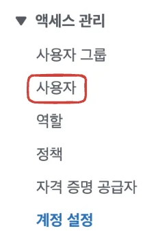

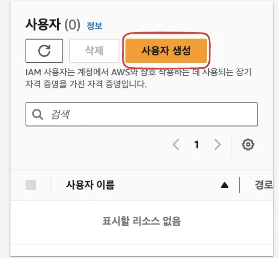

AWS 콘솔에 로그인 가능한 권한을 줌 

- Identity Center&#58; 계정을 관리하는 서비스

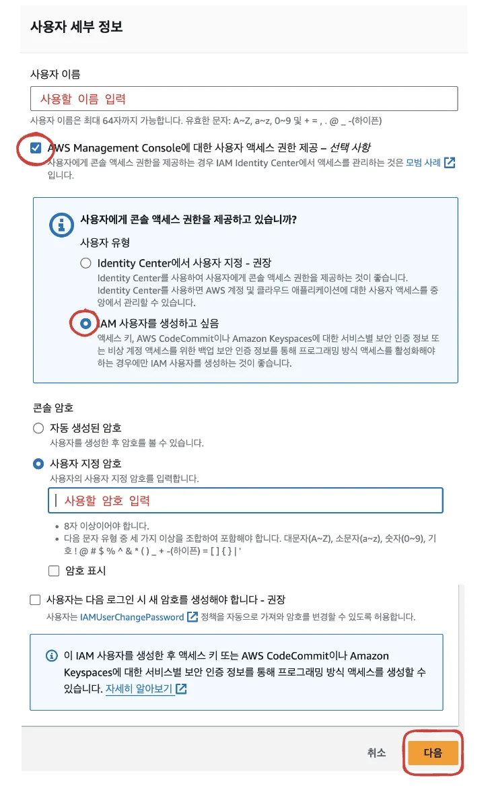

### 권한(정책) 설정

> 정책 파트에서 상세하게 다룸 커스텀도 가능

선택한 정책들을 가지는 그룹을 생성하고 

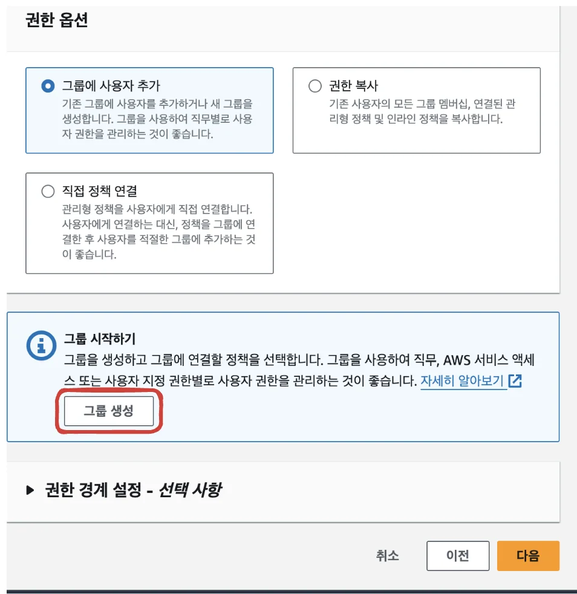

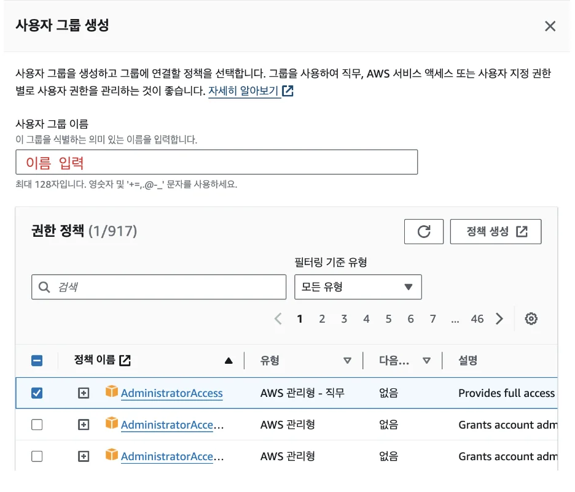

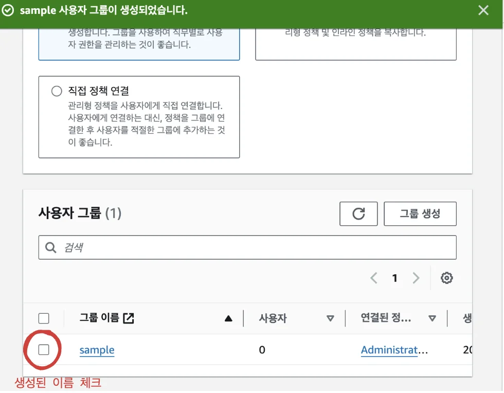

### IAM &#45; 정책 문서 구조

JSON  문서 형식으로 이루어짐

정책이 명시되지 않는 경우 기본적으로 모든 요청이 거부(Deny)됨

IAM 정책 JSON 문서 구조

Effect&#58; Statement에 대한 Access 또는 Deny

Action&#58; 권한에 대한 작업 목록

Resource&#58; 권한이 적용되는 리소스

Condition&#58; 정책이 적용되는 세부 조건(옵션사항)

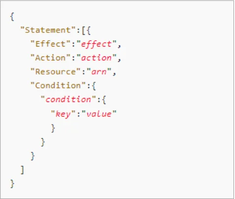

### 액세스 키 생성 

> 사용자 &#45;  보안 자격 증명 &#45; 액세스 키

프로그래밍 방식으로 로그인 시 액세스 키 필요

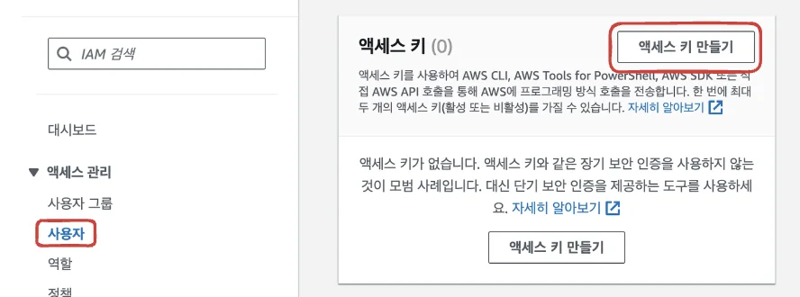

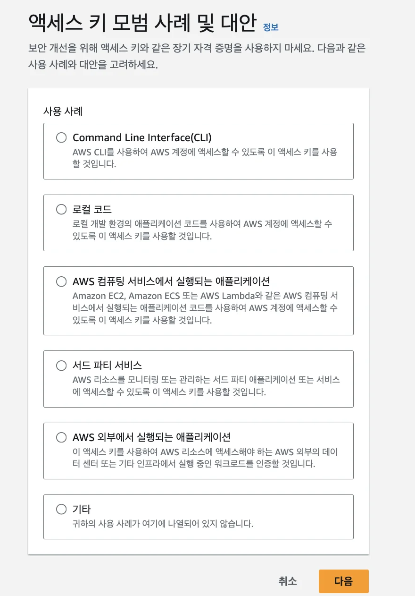

강의에선 두번째 ‘로컬 코드’ 선택함

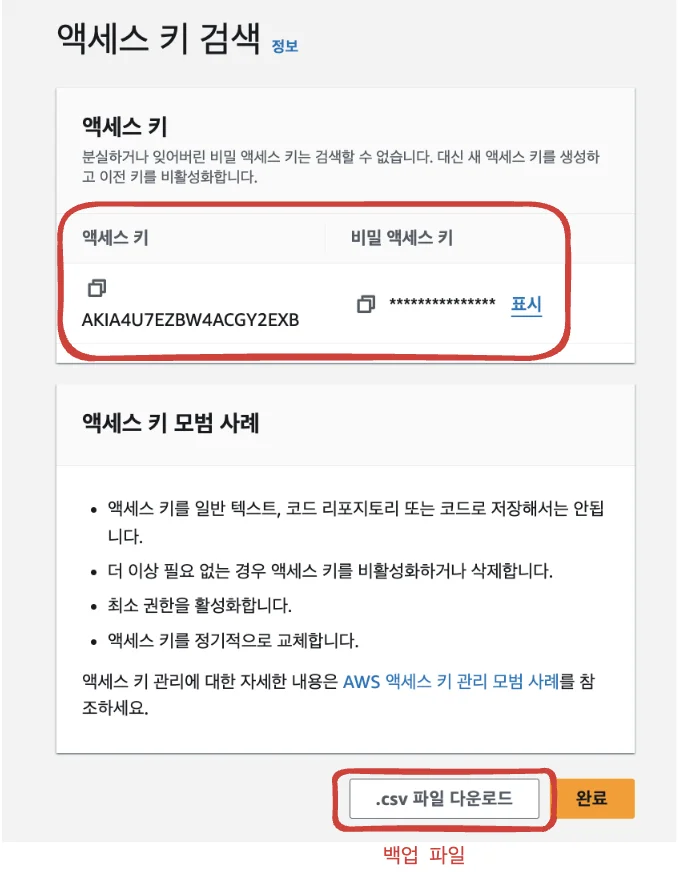

아래와 같이 액세스 키 생성됨

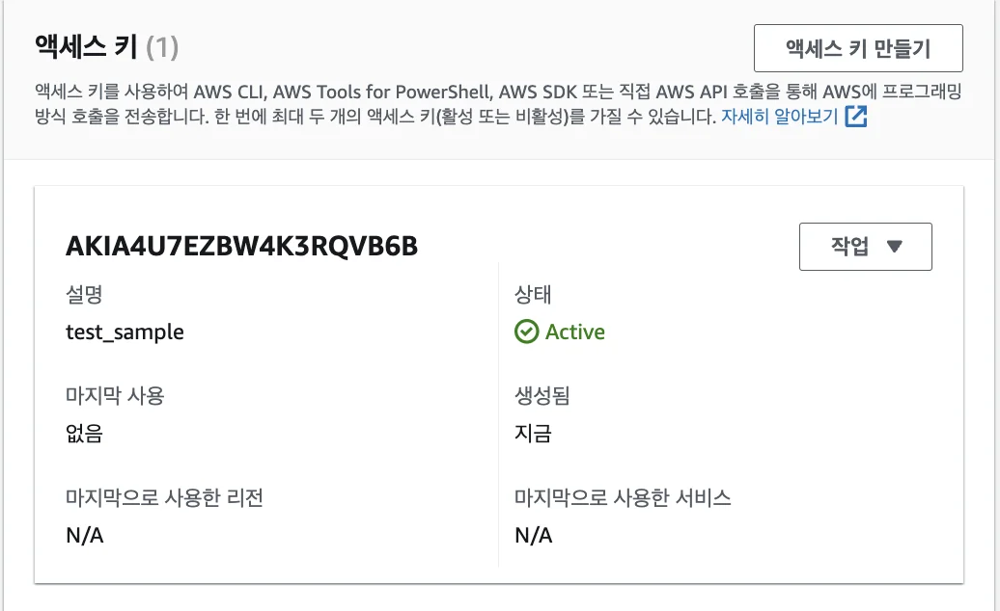

삭제는 비활성화 해야 가능함

> ☝🏻 SSH 퍼블릭 키, HTTPS Git 자격  증명, Keyspaces 인증서 등을 통해서도 로그인 가능하다&#46;

콘솔 로그인 

> 사용자 &#45;  보안 자격 증명 &#45; 콘솔 로그인

콘솔&#58; 웹 브라우저(크롬 등)로 로그인 하는 방법

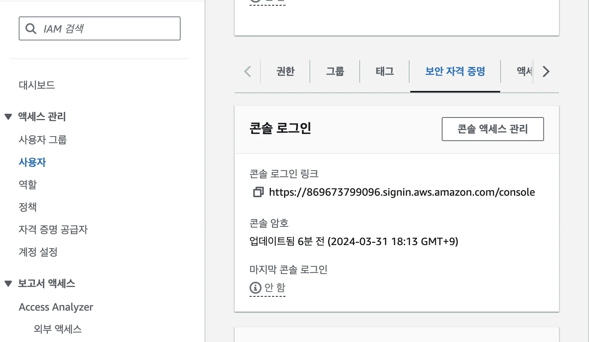

