<a id="1c3eda9b0fe181c5817fe442f2b8bb32"></a>

<a href="#/post/1c3eda9b-0fe1-8103-b16c-ff13884ad0ba">페이지</a> 

<details>
<summary>intelliJ 에서의 테이블 <code>drop</code></summary>

<a id="1c3eda9b0fe18119b7dff542d0e64fc9"></a>

<a href="https://beautiful-college-c84.notion.site/f3ffa564426e4585b6d45040f767f441">페이지</a> 

</details>

<a id="1c3eda9b0fe18182a649da6db3dace5f"></a>

엔티티 필드 제약조건 

<a id="1c3eda9b0fe181aeb8ffd2fc5df4d1b7"></a>

<a href="#/post/1c3eda9b-0fe1-8189-9f31-fb44df5e5970">페이지</a> &#45; 컬런 매핑 참조

<a id="1c3eda9b0fe1817bb7aeef4a278b1554"></a>

## JPA

<a id="1c3eda9b0fe18166a16ae00b1ad6ff95"></a>

### DB를 직접 다룰 시, 문제점

<details>
<summary>🧐 <strong>1&#46; 애플리케이션에서 아래 형태의 객체 데이터를 DB에 저장해서 관리해야한다면?</strong></summary>

<a id="1c3eda9b0fe181908fe2d5e880f4c3fa"></a>

```java
public class Memo {
    private Long id;
    private String username;
    private String contents;
}
```

<details>
<summary>1) DB 테이블 만들기  </summary>

<a id="1c3eda9b0fe181499bcbe064119d61f9"></a>

```sql
create table memo (
       id bigint not null auto_increment,
        contents varchar(500) not null,
        username varchar(255) not null,
        primary key (id)
);
```

- 이처럼 직접 DB로 접속해서 SQL을 호출

</details>

<details>
<summary>2) 애플리케이션에서 SQL 작성</summary>

<a id="1c3eda9b0fe1817fa5dac8ea49fc338a"></a>

```java
String sql = "INSERT INTO memo (username, contents) VALUES (?, ?)";
String sql = "SELECT * FROM memo";
```

</details>

<details>
<summary>3) SQL을 JDBC를 사용해서 직접 실행</summary>

<a id="1c3eda9b0fe18102ad2bc0425031d5e4"></a>

```java
jdbcTemplate.update(sql, "Robbie", "오늘 하루도 화이팅!");
jdbcTemplate.query(sql, ...);
```

</details>

<details>
<summary>4) SQL 결과를 객체로 직접 만들어야 한다&#46;</summary>

<a id="1c3eda9b0fe181adbf79cc7901551776"></a>

```java
@Override
public MemoResponseDto mapRow(ResultSet rs, int rowNum) throws SQLException {
		// SQL 의 결과로 받아온 Memo 데이터들을 MemoResponseDto 타입으로 변환해줄 메서드
		Long id = rs.getLong("id");
		String username = rs.getString("username");
		String contents = rs.getString("contents");
		return new MemoResponseDto(id, username, contents);
}
```

</details>

<a id="1c3eda9b0fe1816d9be7c342d49e3e7f"></a>

위와 같이 굉장히 번거롭다&#46; 

</details>

<details>
<summary>🧐 <strong>2&#46; SQL 의존적이라 변경에 취약하다&#33;</strong></summary>

> <strong>메모 데이터에 비밀번호 추가</strong>

<details>
<summary><strong>Memo</strong></summary>

<a id="1c3eda9b0fe1812b8942f0f0557e5bd8"></a>

```java
public class Memo {
    private Long id;
    private String username;
    private String contents;
		
		// 비밀번호 추가
		private String password;
}
```

</details>

<details>
<summary>1) SQL을 직접 수정</summary>

<a id="1c3eda9b0fe181c78d7fc337cdc286e8"></a>

```java
String sql = "INSERT INTO memo (username, contents, password) VALUES (?, ?, ?)";
```

</details>

<details>
<summary>2) MemoResponseDto 객체에 값 추가</summary>

<a id="1c3eda9b0fe181debb60e34bfe457650"></a>

```java
@Override
public MemoResponseDto mapRow(ResultSet rs, int rowNum) throws SQLException {
		// SQL 의 결과로 받아온 Memo 데이터들을 MemoResponseDto 타입으로 변환해줄 메서드
		Long id = rs.getLong("id");
		String username = rs.getString("username");
		String contents = rs.getString("contents");
		String password = rs.getString("password");
		return new MemoResponseDto(id, username, contents, password);
}
```

</details>

</details>

> 🤔 단순히 메모장에 비밀번호 하나 더 추가했는데도 엄청 번거로운 작업들이 많다&#46;  이처럼 <strong>ORM 이 없는 환경</strong>에서는 백엔드 개발자가 <strong>비즈니스 로직 개발보다,  </strong><strong><u>SQL 작성 및 수정에 더 많은 비용</u></strong>이 들었다&#46; 

<a id="1c3eda9b0fe181639456f359a3087a41"></a>

### ORM이란?

> 📌 <strong>ORM</strong> &#58; <strong>O</strong><strong>bject&#45;</strong><strong>R</strong><strong>elational </strong><strong>M</strong><strong>apping</strong>
> 
> - <strong>Object</strong> &#58; <strong>&#34;객체&#34;</strong>지향 언어 (자바, 파이썬)
> 
> - <strong>Relational</strong> &#58; <strong>&#34;관계형&#34;</strong> 데이터베이스 (H2, MySQL)

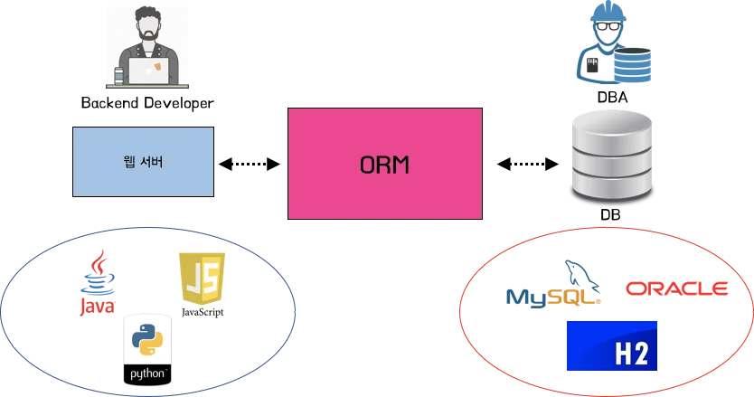

<a id="1c3eda9b0fe181de8a94dde30f97440a"></a>

반복적이고 번거로운 애플리케이션 단에서의 SQL 작업을 줄여주기 위해서 ORM(객체 관계 매핑)기술들이 등장하였다&#46; 

> <code>객체</code> ←  <strong>ORM 매핑 </strong> →<code>관계형 데이터 베이스</code>

<a id="1c3eda9b0fe181938a47db7a8b27e9ca"></a>

ORM은 이름 그대로 객체와 DB의 관계를 매핑 해주는 기술이다&#46;

<a id="1c3eda9b0fe1814eb616e6e120e75333"></a>

객체 즉,<strong> </strong><strong><code>자바의 클래스</code></strong>와 <strong><code>DB의 데이터</code></strong>를 <strong><u>직접 매핑</u></strong><strong> </strong>하려면 앞서 살펴본 것 처럼 <strong><u>매우 번거롭게 작업</u></strong>했지만 <strong>ORM을 사용</strong>하면 이를 <strong>자동</strong>으로 처리할 수 있다&#46;

<a id="1c3eda9b0fe181b4b3ddc42cfdd2fa15"></a>

### JPA란?

> 📌 <strong>JPA</strong><strong>&#58; </strong><strong>J</strong><strong>ava </strong><strong>P</strong><strong>ersistence </strong><strong>A</strong><strong>PI</strong>
> 
> - <strong>자바 ORM 기술에</strong> 대한 <strong><u>표준 명세</u></strong>

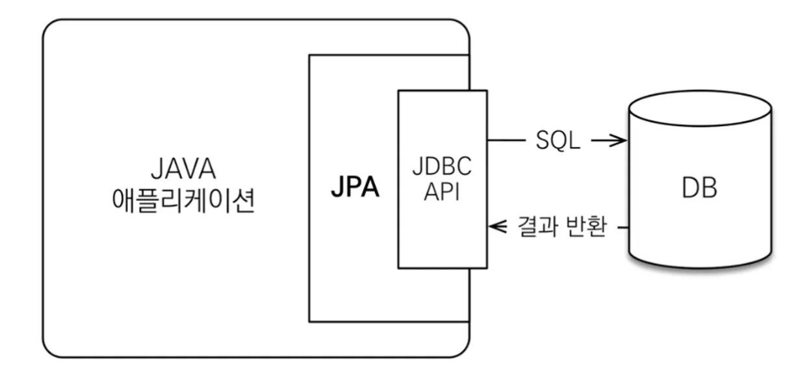

<a id="1c3eda9b0fe181b9aeffe986e0e69a79"></a>

JPA는 <strong><u>Java ORM 기술의 대표적인 표준 명세</u></strong>로 <code>애플리케이션</code>과 <code>JDBC</code> <u>사이에서 동작</u>된다&#46; 

<a id="1c3eda9b0fe181188ee1da1c1d2a0d78"></a>

JPA를 사용하면 DB 연결 과정을 직접 개발하지 않아도 자동으로 처리할 수 있고 <strong>객체</strong>를 통해 <strong><u>간접적으로 DB 데이터를 다룰 </u></strong>수 있기 때문에 <strong><u>매우 쉽게 DB 작업을 처리</u></strong>할 수 있습니다&#46;

<details>
<summary><strong>🧐 </strong><strong>하이버네이트(Hibernate)</strong>란?</summary>

- <strong>JPA</strong>를 <strong><u>실제 구현한 프레임워크</u></strong> 중 <strong>사실상 표준</strong>이 <strong>하이버네이트</strong>이다&#46;

- <strong><u>스프링 부트</u></strong>에서는 기본적으로<strong><u> ‘하이버네이트’ 구현체를 사용</u></strong> 중 이다&#46;<br>

> 🤔 <strong>사실상 표준 (de facto, 디팩토)</strong><br>보통 기업간 치열한 경쟁을 통해 시장에서 결정되는 비 공식적 표준<br>출처&#58; <a href="https://ko.wikipedia.org/wiki/사실상_표준">위키백과</a>

</details>

<a id="1c3eda9b0fe181178cbfc260529e10ad"></a>

## Entity

> 📌 <strong>JPA에서 관리되는 클래스(객체)<br> </strong><strong>DB의 테이블과 매핑</strong>되어 <strong>JPA에 의해 관리</strong>

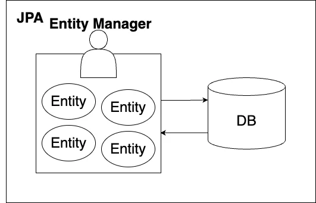

- <strong>엔티티 등록&#58; </strong><strong><code>&#64;Entity</code></strong><strong> </strong>
    > 📌 <strong>클래스를 Entity 등록시킨다&#46;</strong>

<details>
<summary><strong><code>엔티티(객체)</code></strong><strong> 와 </strong><strong><code>테이블</code></strong><strong> 매핑 (</strong><strong><code>&#64;Table</code></strong><strong> )</strong></summary>

> 📌 엔티티와 매핑할 테이블 지정

- &#64;Table 속성
    | 속성 | 기능 | 기본값 |
    | --- | --- | --- |
    | name | 매핑할 테이블 이름 | 엔티티 이름을 사용 |
    | catalog | 데이터베이스 catalog 매핑 |  |
    | schema | 데이터베이스 shema 매핑 |  |
    | uniqueConstraints | DDL 생성 시에 유니크 제약 조건 생성 |  |

    > ☝🏻 클래스 명이 중복되지 않는 경우 name 속성 명시하지 않는다&#46; 

- ex) <code>&#64;Table(name=&#34;memo&#34;)</code>
    <details>
    <summary><strong>🧐 DB에 해당 테이블이 생성되지 않았다면 쿼리가 실행되지 않는다&#46;</strong></summary>

    <a id="1c3eda9b0fe181b7bd02f338377847d5"></a>

    ⇒ 설정한 이름으로 JPA가 쿼리를 날려 테이블을 생성함<br><br>따라서 의문에 대한 대답은 No 이다&#46; 

    </details>

</details>

<details>
<summary><strong><code>필드</code></strong><strong> </strong><strong>와 </strong><strong><code>컬럼</code></strong><strong>  매핑 (</strong><strong><code>&#64;Column</code></strong><strong>, </strong><strong><code>&#64;Enumerated</code></strong><strong>, …)</strong></summary>

> 📌 <strong><code>필드</code></strong> 와 <strong><code>매핑</code></strong>될 컬럼 지정
> 
> | Anotation | 설명 |
> | --- | --- |
> | <code>&#64;Column</code> | 컬럼 매핑 |
> | <code>&#64;Enumerated</code> | enum 타입 매핑 |
> | <del>&#64;Temporal<br></del>→ <br>• LocalDate(연월), <br>• LocalDateTime(연월일) | 날짜 타입 매핑 |
> | <code>&#64;Lob</code> | BLOB, CLOB 매핑 |
> | <code>&#64;Transient</code> | 특정 필드를 컬럼에 매핑하지 않음(매핑 무시) |

<details>
<summary><code>&#64;Colunm</code> 속성</summary>

| 속성 | 설명 | 예시 |
| --- | --- | --- |
| <strong>nullable</strong> | <strong>null 허용 여부</strong> | <code>nullable=false</code> |
| <strong>unique</strong> | <strong>unique</strong> 제약조건 지정 | <code>unique=true</code> |

</details>

<details>
<summary><code>&#64;Enumerate</code> 속성</summary>

> 📌 <strong>자바 enum 타입을 매핑 시 사용</strong>
> 
> > DB에는 enum 타입이 존재하지 않는다&#46; <br>따라서   enum 타입 사용시 <code>&#64;Enumerated</code>를 통해 사용함

| 속성  | 설명  | 기본값 |
| --- | --- | --- |
| <strong>value </strong> | • EnumType&#46;<strong>ORDINAL</strong>&#58; enum <strong>순서</strong>를 데이터베이스에 저장<br><br>• EnumType&#46;<strong>STRING</strong>&#58; enum <strong>이름</strong>을 데이터베이스에 저장 | EnumType&#46;<strong>ORDINAL</strong> |

<details>
<summary>default&#58; <code>EnumType&#46;ORDINAL;</code> </summary>

<a id="1c3eda9b0fe181479954c50e13e3ccb0"></a>

```java
@Target({ElementType.METHOD, ElementType.FIELD})
@Retention(RetentionPolicy.RUNTIME)
public @interface Enumerated {
    EnumType value() default EnumType.ORDINAL;
}
```

</details>

> ⚠️ <strong>STRING 사용</strong><strong> </strong><strong>(ORDINAL </strong><strong>사용 </strong><strong>❌ )</strong>
> 
> <details>
> <summary><code>&#64;Enumerated(</code><strong><code>EnumType&#46;</code></strong><em><strong><code>STRING</code></strong></em><strong><code>)</code></strong></summary>
> 
> <a id="1c3eda9b0fe1810b94eced62f94764c6"></a>
> 
> ```java
> @Entity
> public class Member {
>    .  .  .
> 	
> 		@Enumerated(EnumType.STRING)
> 		private RoleType roleType;
> ```
> 
> </details>
> 
> <a id="1c3eda9b0fe1819dbe72c32cb66538c5"></a>
> 
> String 사용 시, 아래와 같이 String 타입으로 저장되어 값이 추가되어도 기존의 값과 충돌하지 않음
> 
> 
> 
> <details>
> <summary><strong>사용 X </strong><strong>&#45;</strong><strong> </strong><strong>&#64;Enumerated(EnumType&#46;</strong><strong>ORIDINAL</strong><strong>)</strong></summary>
> 
> > oridinal 타입은<strong> Integer 타입으로 생성</strong>된다&#46; 따라서 추가 요구사항(guest)을 더하여 DB 값을 저장할 경우 <strong>기존의 값과 충돌</strong>되는 오류가 발생한다&#46; <br>→ 운영 서버에서 사용 시, 해결 불가능한 버그 발생함
> 
> 
> 
> </details>

</details>

> 자세한 내용은 &#91;<a href="#/post/1c3eda9b-0fe1-8189-9f31-fb44df5e5970">페이지</a> &#45; 필드와 컬럼 매핑 &#93; 참조

</details>

<details>
<summary><strong>기본키 매핑</strong></summary>

<details>
<summary><strong>직접 할당 ( </strong><strong><code>&#64;id</code></strong><strong> )</strong></summary>

> <code>setter</code>를 통해 id 설정 

<a id="1c3eda9b0fe181fb9952c1a499e4fdbd"></a>

```java
@Entity
public class Memo {
  @Id
  private Long id;
  
	 .  .  .
	 
	public void setId(String id) {
      this.id = id;
  }
```

</details>

<details>
<summary><strong>권장) 자동 할당 ( </strong><strong><code>&#64;GeneratedValue</code></strong><strong> )</strong></summary>

> <strong><code>&#64;GeneratedValue ( strategy = GenerationTyoe&#46;&#91;옵션&#93; )</code></strong>

> 📌 <strong>옵션</strong>
> 
> - <strong>TABLE</strong>&#58;  키 생성용 테이블 사용, 모든 DB에서 사용
> 
> - <strong>SEQUENCE</strong>&#58; 데이터베이스 시퀀스 오브젝트 사용, <code>ORACLE</code>
>     - <code>&#64;SequenceGenerator</code> 필요
> 
> - <strong>IDENTITY&#58; </strong>데이터베이스 위임, <code>MySQL</code>
>     - <code>&#64;TableGenerator </code> 필요
> 
> - <strong>AUTO</strong>&#58; 방언에 따라 자동 지정, <strong>default</strong>

<details>
<summary><strong>GeneratedValue</strong></summary>

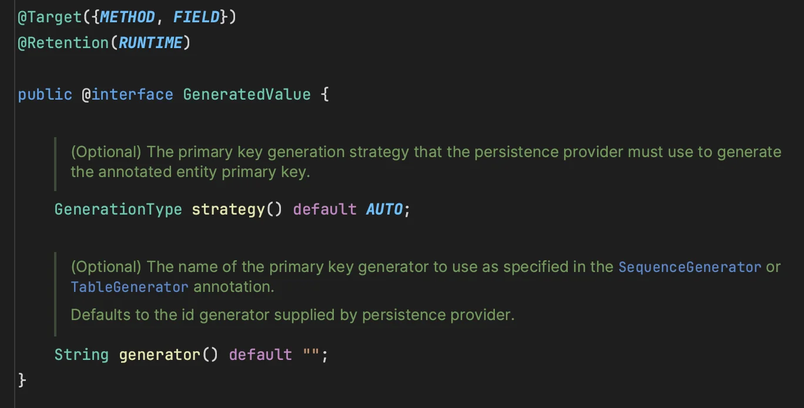

</details>

<details>
<summary><strong>GenerationType</strong></summary>

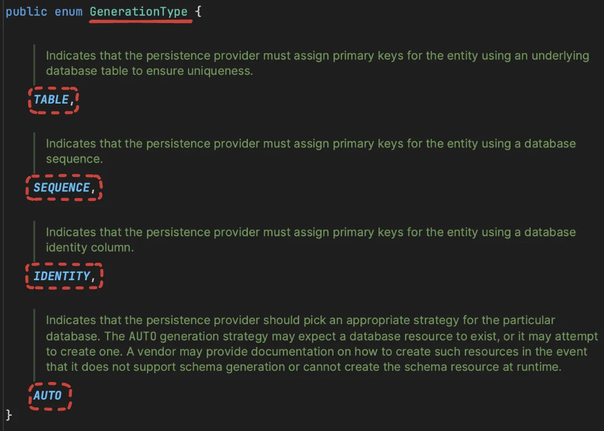

</details>

> 전략에 대한 자세한 내용은 <a href="#/post/1c3eda9b-0fe1-8189-9f31-fb44df5e5970">페이지</a>  참조

</details>

</details>

<details>
<summary>🤔 id에 어떤 타입을 지정해야 하나? <strong><code>Long</code></strong></summary>

- <code>int</code>&#58; 0이 들어가 애매하다

- <code>Integer</code>&#58; 10억 넘어가면 다시 1부터 시작하기 때문에 이것도 애매하다&#46;

<a id="1c3eda9b0fe181889f91c1675c8d8f59"></a>

10억을 넘어갈때, 타입을 바꾸는 것이 오히려 더 힘들다&#46; 또한 요즘은 애플리케이션 전체로 볼때  Long을 사용하는 것은 성능에 거의 영향을 주지 않는다&#46; 

<a id="1c3eda9b0fe18192be7af5d755df918e"></a>

따라서 <code>Long</code> 타입으로 지정한다&#46;  

</details>

<a id="1c3eda9b0fe18161a1fdd7ed77afd3c7"></a>

### 코드

<details>
<summary><strong>프로젝트 설정추가</strong></summary>

<details>
<summary><code>persistence&#46;xml</code> 추가</summary>

> src/mian/resources/META&#45;INF/<code>persistence&#46;xml</code>

<a id="1c3eda9b0fe18174883cf061fc0dd358"></a>

```java
<?xml version="1.0" encoding="UTF-8"?>
<persistence version="2.2"
             xmlns="http://xmlns.jcp.org/xml/ns/persistence" xmlns:xsi="http://www.w3.org/2001/XMLSchema-instance"
             xsi:schemaLocation="http://xmlns.jcp.org/xml/ns/persistence http://xmlns.jcp.org/xml/ns/persistence/persistence_2_2.xsd">
    <persistence-unit name="memo">
        <class>com.sparta.entity.Memo</class>
        <properties>
            <property name="jakarta.persistence.jdbc.driver" value="com.mysql.cj.jdbc.Driver"/>
            <property name="jakarta.persistence.jdbc.user" value="root"/>
            <property name="jakarta.persistence.jdbc.password" value="{비밀번호}"/>
            <property name="jakarta.persistence.jdbc.url" value="jdbc:mysql://localhost:3306/memo"/>

            <property name="hibernate.hbm2ddl.auto" value="create" />

            <property name="hibernate.show_sql" value="true"/>
            <property name="hibernate.format_sql" value="true"/>
            <property name="hibernate.use_sql_comments" value="true"/>
        </properties>
    </persistence-unit>
</persistence>
```

</details>

<details>
<summary><strong>JPA, MySQL 의존성 추가 ( </strong><strong><code>bulid&#46;gradle</code></strong><strong> )</strong></summary>

<a id="1c3eda9b0fe18131aab2c41dfd40b842"></a>

```groovy
// JPA 구현체인 hibernate
implementation 'org.hibernate:hibernate-core:6.1.7.Final'
// MySQL
implementation 'mysql:mysql-connector-java:8.0.28'
```

</details>

<details>
<summary><strong>IntelliJ &#45; Database 연동 순서</strong></summary>

1. Database 탭을 클릭하시고 &#43; 버튼을 누릅니다&#46;
    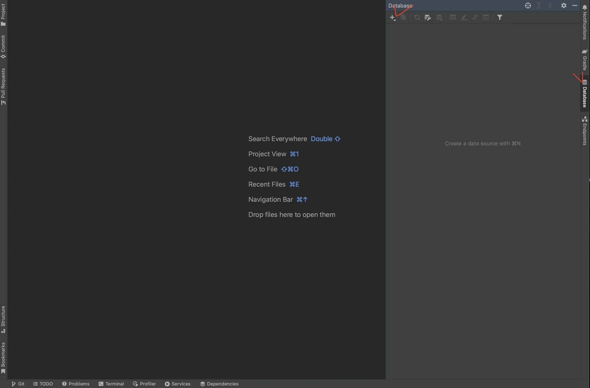

1. Data Source &#62; MySQL 를 클릭합니다&#46;
    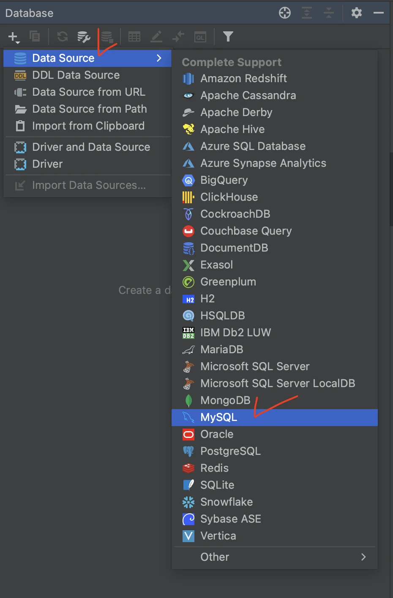

1. User, Password, Database 정보를 추가한 후 Ok를 클릭합니다&#46;
    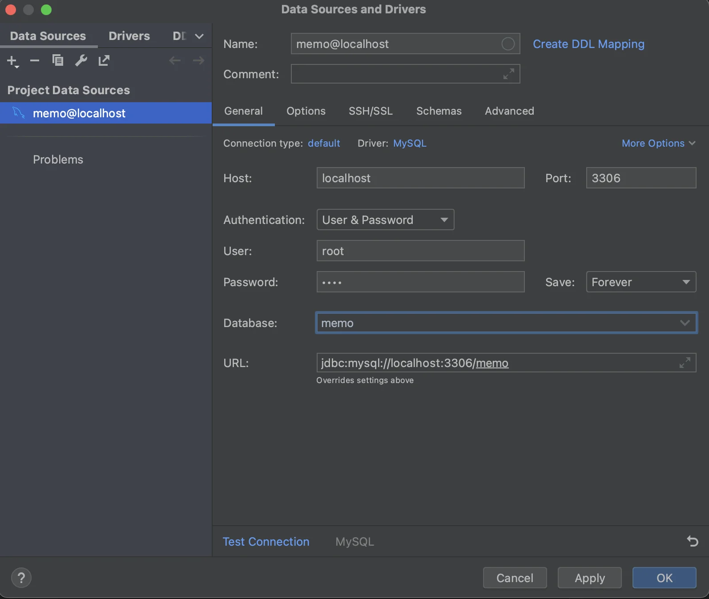

1. MySQL Database에 연결이 완료되었습니다&#46;
    

</details>

<details>
<summary><strong>EntityTest</strong></summary>

<a id="1c3eda9b0fe18172a32bde4fc3223f92"></a>

```java
import jakarta.persistence.EntityManager;
import jakarta.persistence.EntityManagerFactory;
import jakarta.persistence.Persistence;
import org.junit.jupiter.api.BeforeEach;
import org.junit.jupiter.api.Test;

public class EntityTest {

    EntityManagerFactory emf;
    EntityManager em;

    @BeforeEach
    void setUp() {
        emf = Persistence.createEntityManagerFactory("memo");
        em = emf.createEntityManager();
    }

    @Test
    void test1() {

    }
}
```

</details>

</details>

<details>
<summary>🧐<strong> Error) calling Driver&#35;connect</strong></summary>

> <strong>오류) DB 접근 거부</strong><br><strong>Caused by&#58; java&#46;sql&#46;SQLException&#58; Access denied for user &#39;root&#39;&#64;&#39;localhost’</strong>

> <strong>원인1) persistence&#46;xml 파일을 추가하지 않았음</strong>

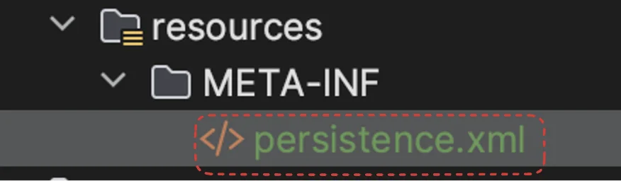

> <strong>원인2) persistence&#46;xml 파일에 비밀번호를 입력하지 않았음</strong>

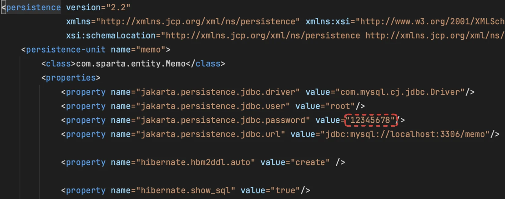

</details>

<details>
<summary><strong>Entity &#45; Memo</strong></summary>

<a id="1c3eda9b0fe181378469de8a95b9b04d"></a>

```java
package com.sparta.entity;

import jakarta.persistence.*;

@Entity
@Table(name = "memo")
public class Memo {
    @Id
    private Long id;

    // nullable: null 허용 여부
    // unique: 중복 허용 여부 ( false 일 때 중복 허용 )
    @Column(name = "username", nullable = false, unique = true)
    private String username;

    // length: 컬럼 길이 지정
    @Column(name = "contents", nullable = false, length = 500)
    private String contents;
}

```

</details>

<details>
<summary><strong>SQL</strong></summary>

> JPA가 Entity 정보를 읽고 아래와 같이 자동으로 <code>create</code> 한다&#46;

<a id="1c3eda9b0fe18172acc7eb48af1b2feb"></a>

```sql
Hibernate: 

create table memo (
   id bigint not null,
    contents varchar(500) not null,
    username varchar(255) not null,
    primary key (id)
) engine=InnoDB
```

> 컬럼(<code>&#64;Column</code>) 속성에 unique 값을 지정하여 아래와 같이 unique 제약 조건을 생성하는 것을 확인할 수 있다&#46;

<a id="1c3eda9b0fe18111a546fbd851f196d6"></a>

```java
@Column(name = "username", nullable = false, unique = true)
private String username;
```

<a id="1c3eda9b0fe18187a590d950dfd08561"></a>

```sql
Hibernate: 
    alter table memo 
       add constraint UK_n3qr0n9og6katwb84yqcia5ib unique (username)
```

</details>

<details>
<summary><strong>id에 </strong><strong><code>Auto Increment</code></strong><strong> 적용</strong></summary>

- Entity &#45; Memo
    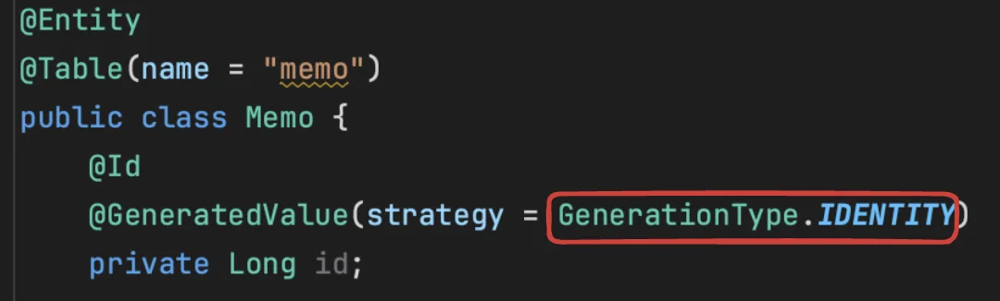

- SQL
    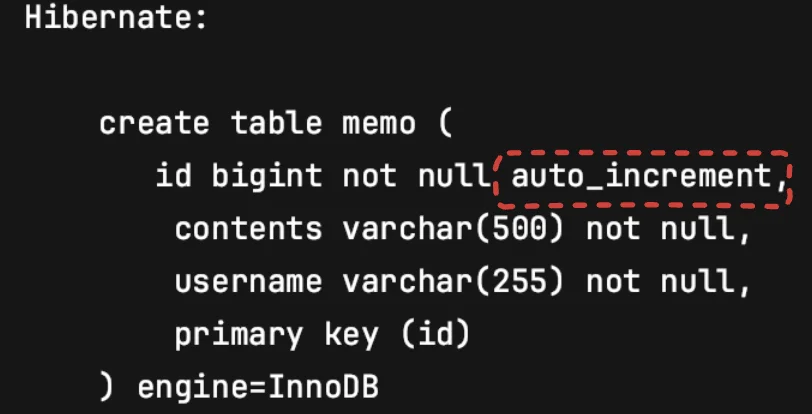

- database
    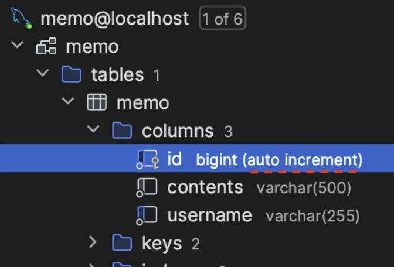

<details>
<summary><strong>Entity &#45; </strong><strong><code>Memo</code></strong></summary>

<a id="1c3eda9b0fe1819baddaebe918551861"></a>

```java
package com.sparta.entity;

import jakarta.persistence.*;

@Entity
@Table(name = "memo")
public class Memo {
    @Id
    @GeneratedValue(strategy = GenerationType.IDENTITY)
    private Long id;

    // nullable: null 허용 여부
    // unique: 중복 허용 여부 ( false 일 때 중복 허용 )
    @Column(name = "username", nullable = false, unique = true)
    private String username;

    // length: 컬럼 길이 지정
    @Column(name = "contents", nullable = false, length = 500)
    private String contents;
}

```

</details>

</details>

<a id="1c3eda9b0fe18131b1f2f9ba7b444dbf"></a>

## 영속성 컨텍스트 ( Persistence Context)

> 📌 영속성 컨텍스트는  <strong><u>엔티티를 영구 저장하는 환경</u></strong>을 말하는 <strong><u>논리적인 개념</u></strong>이다
> 
> 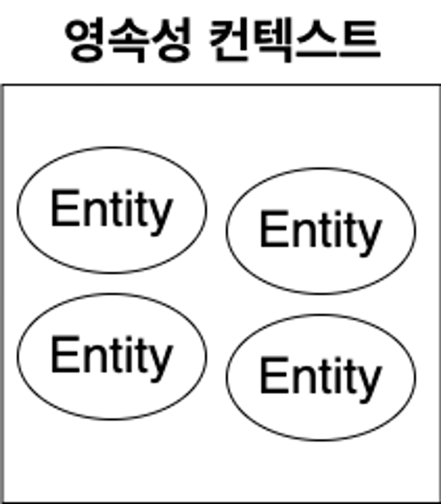
> 
> <a id="1c3eda9b0fe181a8bd2dcb6bb6fc784e"></a>
> 
> <strong> Persistence</strong>는 <code>영속성</code>, <code>지속성</code>  이라는 의미이다&#46; 
> 
> > Persistence를 객체 관점으로 해석해 보자면 <strong>‘객체가 생명(객체가 유지되는 시간)이나 공간(객체의 위치)을 자유롭게 유지하고 이동할 수 있는 객체의 성질</strong>’을 의미한다&#46; 
> 
> <a id="1c3eda9b0fe181679febc3c8b7153a9c"></a>
> 
> 즉 ,<strong>Entity 객체를 효율적으로 관리하기 위해 만들어진 공간 이다&#46;</strong>

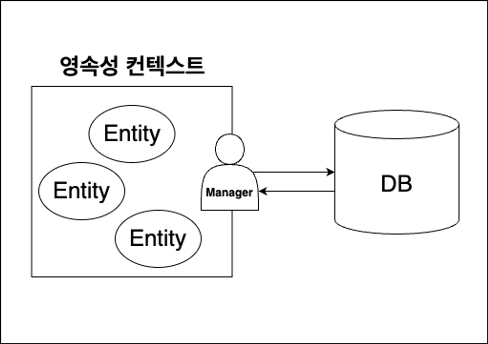

<a id="1c3eda9b0fe181bfb84bd8e77ca7ffb7"></a>

<strong><u>JPA를 사용</u></strong>하면 <strong><u>직접 SQL을 작성하지 않</u></strong>아도 <strong>DB에 데이터를 저장, 조회, 수정, 삭제 할</strong> 수 있다&#46;

<a id="1c3eda9b0fe1815588e5ebd7a9fd3cdb"></a>

 이러한 일련의 과정을 효율적으로 처리하기 위해 JPA는 <strong>영속성 컨텍스트에 Entity 객체들을 저장</strong>하여<strong> </strong><strong>관리</strong>하면서 <strong>DB와 소통</strong>한다

<details>
<summary>EntityManager</summary>

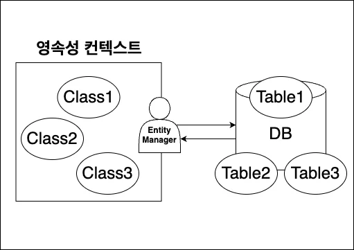

- EntityManager를 통해 영속성 컨텍스트에 접근하여 Entity 객체들을 조작할수 있다&#46;
    > EntityManager는 이름 그대로 Entity를 관리하는 관리자이다&#46;

- 개발자들은 <strong>EntityManager</strong>를 사용해서 <strong>Entity</strong>를 저장, 조회, 수정, 삭제 (<code>CRUD</code>) 할 수 있습니다&#46;

- EntityManager는 EntityManagerFactory를 통해 생성된다&#46;

</details>

<details>
<summary>EntityManagerFactory</summary>

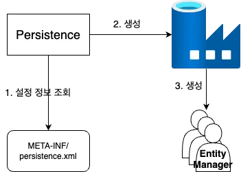

- EntityManagerFactory는 일반적으로 DB 하나에 하나만 생성되어 애플리케이션이 동작하는 동안 사용된다&#46;

- EntityManagerFactory를 만들기 위해서는 DB에 대한 정보를 전달해야 하는데 정보를 전달하기 위해서는 <strong><code>/resources/META&#45;INF/</code></strong><strong>  </strong>위치에 <strong><code>persistence&#46;xml</code></strong><strong> </strong>파일을 만들어 정보를 넣어두면 된다&#46;
    <a id="1c3eda9b0fe1819a8fdbe16cfd9fb1a8"></a>

    ```xml
    <?xml version="1.0" encoding="UTF-8"?>
    <persistence version="2.2"
                 xmlns="http://xmlns.jcp.org/xml/ns/persistence" xmlns:xsi="http://www.w3.org/2001/XMLSchema-instance"
                 xsi:schemaLocation="http://xmlns.jcp.org/xml/ns/persistence http://xmlns.jcp.org/xml/ns/persistence/persistence_2_2.xsd">
        <persistence-unit name="memo">
            <class>com.sparta.entity.Memo</class>
            <properties>
                <property name="jakarta.persistence.jdbc.driver" value="com.mysql.cj.jdbc.Driver"/>
                <property name="jakarta.persistence.jdbc.user" value="root"/>
                <property name="jakarta.persistence.jdbc.password" value="{비밀번호}"/>
                <property name="jakarta.persistence.jdbc.url" value="jdbc:mysql://localhost:3306/memo"/>

                <property name="hibernate.hbm2ddl.auto" value="create" />

                <property name="hibernate.show_sql" value="true"/>
                <property name="hibernate.format_sql" value="true"/>
                <property name="hibernate.use_sql_comments" value="true"/>
            </properties>
        </persistence-unit>
    </persistence>
    ```

<a id="1c3eda9b0fe1816cb3a1e579fa38a771"></a>

```java
EntityManagerFactory emf = Persistence.createEntityManagerFactory("memo");
EntityManager em = emf.createEntityManager();
```

> <code>EntityManagerFactory emf = Persistence&#46;createEntityManagerFactory(&#34;memo&#34;);</code>

- 해당 코드를 호출하면 JPA는 <strong>persistence&#46;xml </strong>의 정보를 토대로 EntityManagerFactory를 생성한다&#46; 

- 인자 값으로 <code>persistence&#45;unit name</code>에 명시된 값을 넣어준다&#46;

> <code>EntityManager em = emf&#46;createEntityManager();</code> 

-  해당 코드 호출 시,  EntityManagerFactory를 사용하여 EntityManager를 생성한다&#46;


</details>

<details>
<summary>JPA의 트랜잭션</summary>

<a id="1c3eda9b0fe18104b8b7d3fa68cecfe0"></a>

### 트랜잭션이란?

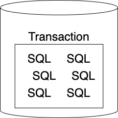

<a id="1c3eda9b0fe181049ed4c7465b44607d"></a>

트랜잭션은 DB 데이터들의 <code>무결성</code>과 <code>정합성</code>을 유지하기 위한 하나의 <strong><u>논리적 개념</u></strong>이다&#46;

> 쉽게 표현하자면 DB의 데이터들을 안전하게 관리하기 위해서 생겨난 개념

<a id="1c3eda9b0fe1811fb539f747cce3294f"></a>

하나의 트랜잭션에 여러 개의 SQL이 포함될 수 있다&#46;

<a id="1c3eda9b0fe18166b7b4c466068a67ee"></a>

이때, 모든 SQL이 성공적으로 수행이 되면 DB에 영구적으로 변경을 반영하지만 SQL 중 단 하나라도 실패한다면 모든 변경을 되돌린다&#46;

<a id="1c3eda9b0fe18116864ff864a4af9184"></a>

JPA는 DB의 이러한 트랜잭션 개념을 사용하여 효율적으로 Entity를 관리한다&#46;

<details>
<summary>MySQL &#45; 트랜젝션 테스트</summary>

<a id="1c3eda9b0fe181e28d34d6e1c475126f"></a>

```sql
START TRANSACTION; # 트랜잭션을 시작합니다.

INSERT INTO memo (id, username, contents) VALUES (1, 'Robbie', 'Robbie Memo');
INSERT INTO memo (id, username, contents) VALUES (2, 'Robbert', 'Robbert Memo');
SELECT * FROM memo;

COMMIT; # 트랜잭션을 커밋합니다.

SELECT * FROM memo;
```

</details>

<a id="1c3eda9b0fe181dc9350e48fc78c28b8"></a>

### JPA의 트랜잭션

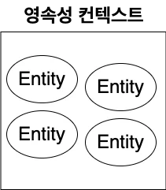

<a id="1c3eda9b0fe1815e8d44d9f29d9ee767"></a>

영속성 컨텍스트에 Entity 객체들을 저장했다고 해서 DB에 바로 반영 되지는 않는다&#46;

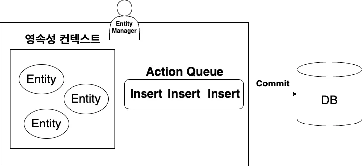

<a id="1c3eda9b0fe1817d8edcc9e70bb0a501"></a>

DB에서 하나의 트랜잭션에 여러 개의 SQL을 포함하고 있다가 마지막에 영구적으로 변경을 반영하는 것 처럼 JPA에서도 <strong><code>변경이 발생한 Entity(객체)들의 정보</code></strong>를<strong> </strong><strong><code>쓰기 지연 저장소</code></strong>에 전부 가지고 있다가 마지막 한번에 SQL을  DB에 요청하여 변경을 반영한다&#46;

> <code>EntityManager</code>에서 <strong><code>EntityTransaction</code></strong>을 가져와<strong><u> 트랜잭션을 적용</u></strong>

- <strong><code>EntityTransaction et = em&#46;getTransaction();</code></strong>
    - 해당 코드를 호출하여 EntityTransaction을 가져와 트랜잭션을 관리

- <strong><code>et&#46;begin();</code></strong><strong>&#58; </strong>트랜잭션 시작

- <strong><code>et&#46;commit();</code></strong><strong>&#58; </strong>트랜잭션의 작업들을 영구적으로 DB에 반영

- <strong><code>et&#46;rollback();</code></strong><strong>&#58;</strong>오류가 발생했을 때 트랜잭션의 작업을 모두 취소하고, 이전 상태로 되돌림

<details>
<summary>예제) 저장 성공 </summary>

<a id="1c3eda9b0fe181d78103cf192641e4ca"></a>

```java
@Test
@DisplayName("EntityTransaction 성공 테스트")
void test1() {
    EntityTransaction et = em.getTransaction(); // EntityManager 에서 EntityTransaction 을 가져옵니다.

    et.begin(); // 트랜잭션을 시작합니다.

    try { // DB 작업을 수행합니다.

        Memo memo = new Memo(); // 저장할 Entity 객체를 생성합니다.
        memo.setId(1L); // 식별자 값을 넣어줍니다.
        memo.setUsername("Robbie");
        memo.setContents("영속성 컨텍스트와 트랜잭션 이해하기");

        em.persist(memo); // EntityManager 사용하여 memo 객체를 영속성 컨텍스트에 저장합니다.

        et.commit(); // 오류가 발생하지 않고 정상적으로 수행되었다면 commit 을 호출합니다.
        // commit 이 호출되면서 DB 에 수행한 DB 작업들이 반영됩니다.
    } catch (Exception ex) {
        ex.printStackTrace();
        et.rollback(); // DB 작업 중 오류 발생 시 rollback 을 호출합니다.
    } finally {
        em.close(); // 사용한 EntityManager 를 종료합니다.
    }

    emf.close(); // 사용한 EntityManagerFactory 를 종료합니다.
}
```

</details>

<details>
<summary>예제) 저장 실패 </summary>

<a id="1c3eda9b0fe181fdadc7c9e2597b5bad"></a>

```java
@Test
@DisplayName("EntityTransaction 실패 테스트")
void test2() {
    EntityTransaction et = em.getTransaction(); // EntityManager 에서 EntityTransaction 을 가져옵니다.

    et.begin(); // 트랜잭션을 시작합니다.

    try { // DB 작업을 수행합니다.

        Memo memo = new Memo(); // 저장할 Entity 객체를 생성합니다.
        memo.setUsername("Robbert");
        memo.setContents("실패 케이스");

        em.persist(memo); // EntityManager 사용하여 memo 객체를 영속성 컨텍스트에 저장합니다.

        et.commit(); // 오류가 발생하지 않고 정상적으로 수행되었다면 commit 을 호출합니다.
        // commit 이 호출되면서 DB 에 수행한 DB 작업들이 반영됩니다.
    } catch (Exception ex) {
        System.out.println("식별자 값을 넣어주지 않아 오류가 발생했습니다.");
        ex.printStackTrace();
        et.rollback(); // DB 작업 중 오류 발생 시 rollback 을 호출합니다.
    } finally {
        em.close(); // 사용한 EntityManager 를 종료합니다.
    }

    emf.close(); // 사용한 EntityManagerFactory 를 종료합니다.
}
```

<a id="1c3eda9b0fe181a19921eca1cc2a8a61"></a>

식별자 값을 넣어주지 않아 오류가 발생하였다&#46;

<a id="1c3eda9b0fe1811db217d9175afc7436"></a>

 따라서 <code>et&#46;rollback();</code> 코드가 호출돼 트랜잭션 작업 내용들이 취소되었다&#46; DB를 확인해보면 해당 작업이 반영되어있지 않은 것을 확인할 수 있다&#46;

</details>

</details>

<details>
<summary>영속성 컨텍스트 Debugging으로 확인하기</summary>

1. 테스트 시작 위치 가장 왼쪽을 클릭하여 빨간색 원을 만듭니다&#46; 그리고 해당 원에 우측클릭 후 Thread 부분을 클릭한 다음 Make Default 클릭 후 Done을 누릅니다&#46;
    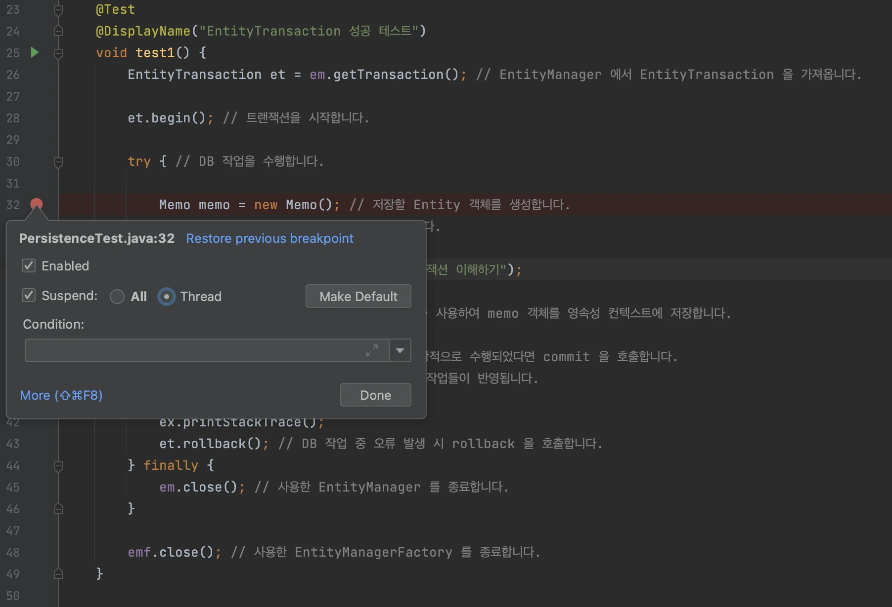

    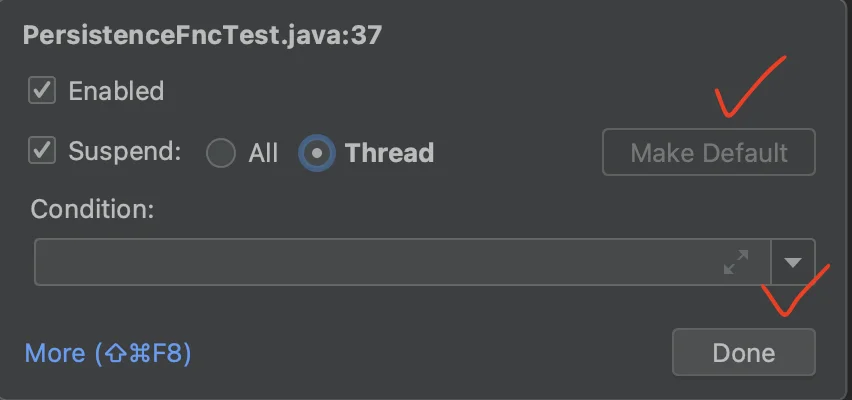

1. 초록색 화살표 시작 버튼을 클릭 후 Debug를 클릭합니다&#46;
    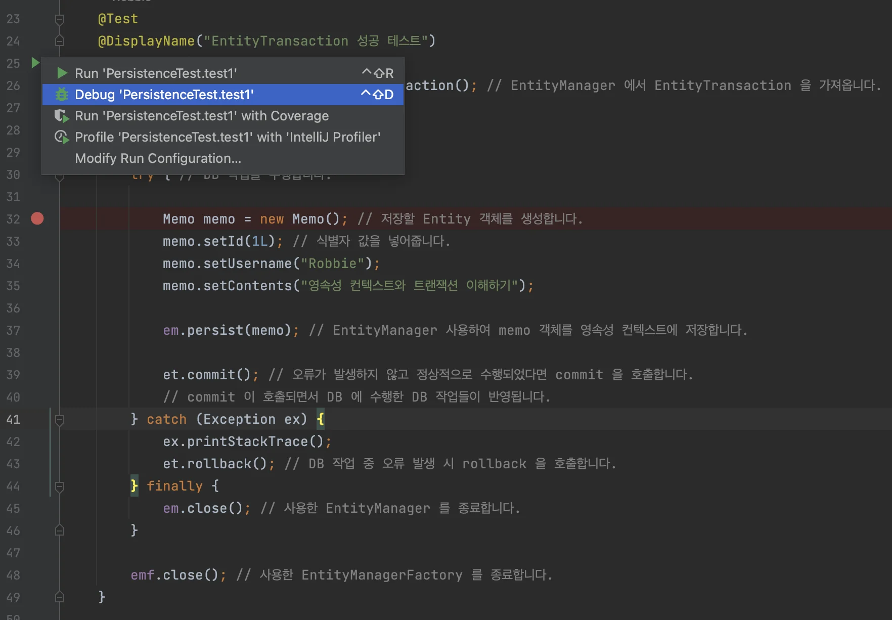

1. 체크 부분을 클릭하여 순차적으로 코드를 진행합니다&#46;
    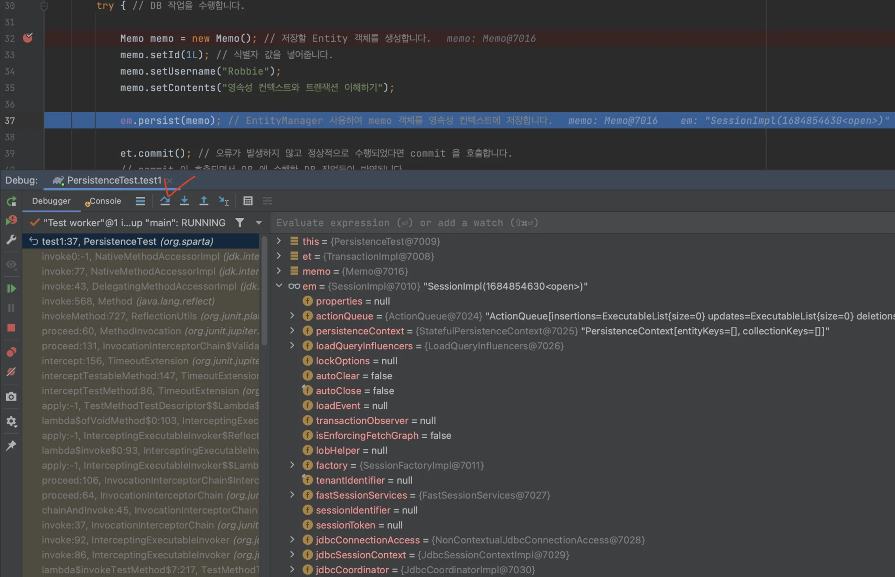

1. <code>em&#46;persist(memo);</code> 코드 호출 후 persistenceContext 위치에 memo 객체가 저장되어있음을 확인할 수 있습니다&#46;
    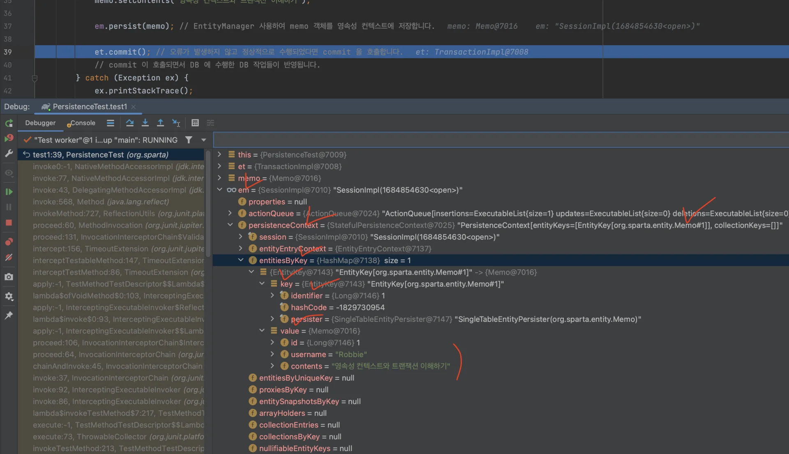

</details>

<a id="1c3eda9b0fe181e4a687c555ea0554ea"></a>

## 영속성 컨텍스트의 속성

> 📌 Entity Manager(영속성 컨텍스트)는 데이터 베이스 트랜젝션 단위로 생성되어 해당 데이터베이스  트랜젝션이 끝날 때, 종료 및 삭제된다&#46; <br><br>즉, 고객의 요청이 들어와서 비지니스가 끝나버리면 해당 영속성 컨텍스트(Entity Manager) 를 지운다&#46; ( 각 요청당 하나씩 생성되어 처리된다&#46; )<br><br>영속성 컨텍스트 내부에 존재하는 1차 캐시는 영속성 컨텍스트와 같이 데이터 베이스의 한 트랙젝션 안에서만 효과가 있기 때문에 성능적으로는 큰 이점은 없다&#46; (굉장히 짧은 시점에서만 존재)<br>성능적 이점 보다는 해당 컨셉(객체지향)으로 부터 이점이 있음

<a id="1c3eda9b0fe181cb9c9ad335b2f90bd4"></a>

### 1차 캐시

> ☝🏻 트렌젝션 종료 → 영속성 컨텍스트 종료  = 1차 캐시 삭제됨 

<a id="1c3eda9b0fe1811091c4e75bf8e4fe0a"></a>

### <strong>저장</strong>

> 생성된 entity 객체(비영속)를 영속 컨텍스트에 저장(영속) 시 1차 캐시에 해당 emtity가 저장된다&#46;

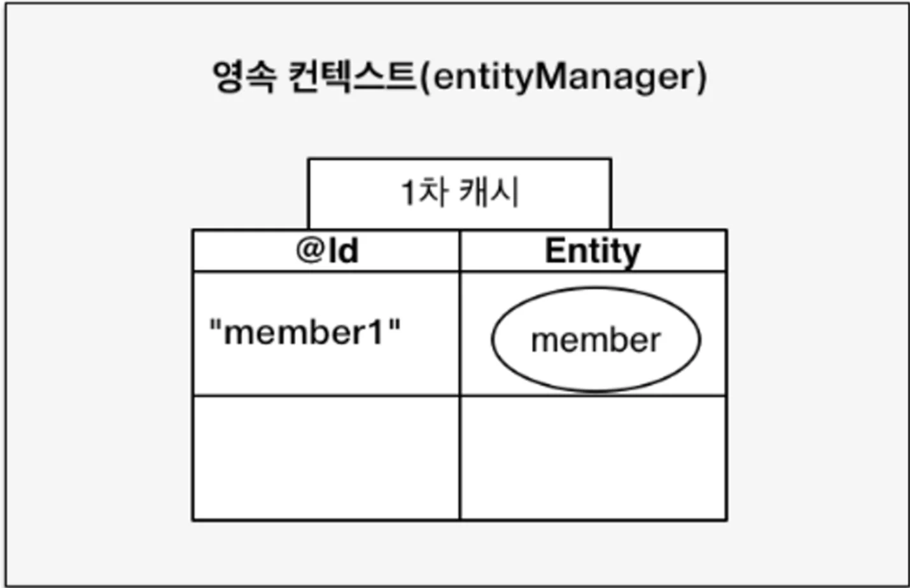

<a id="1c3eda9b0fe181f98ffbca7e417196b7"></a>

```java
//엔티티를 생성한 상태(비영속)
Member member = new Member();
member.setId("member1");
member.setUsername("회원1");

//엔티티(영속), 1차 캐시 저장됨
em.persist(member);
```

<a id="1c3eda9b0fe18173a51cceb3978260c5"></a>

### <strong>조회 &#45; 1차 캐시</strong>

> 📌 조회(<code>em&#46;find(type, key)</code>)  시 해당 값이 1차 캐시에  존재<br>→ 1차 캐시에서 가져옴


> ☝🏻  동일성(identity) 보장 ( 싱글톤? )

<a id="1c3eda9b0fe181fbababde971f45eea4"></a>

```java
Member member = new Member();
member.setId("member1");
member.setUsername("회원1");

//1차 캐시에 저장됨
em.persist(member);

//1차 캐시에서 조회
Member findMember = em.find(Member.class, "member1");
```

> ☝🏻 동일 트랜젝션 내에서, 조회한 엔티티를 재조회 시, DB가 아닌 1차 캐시에서 참조한다&#46;<br>→ DB에 쿼리를 날리지 않음&#46;

<a id="1c3eda9b0fe181d79305dee56fbe4715"></a>

### 조회 &#45; 데이터베이스

> 📌 조회 시 해당 값이 1차 캐시에 존재하지 않는 경우<br>→ DB 조회,<br>→ 해당하는 값이 있을 시 1차 캐시에 저장 및 반환

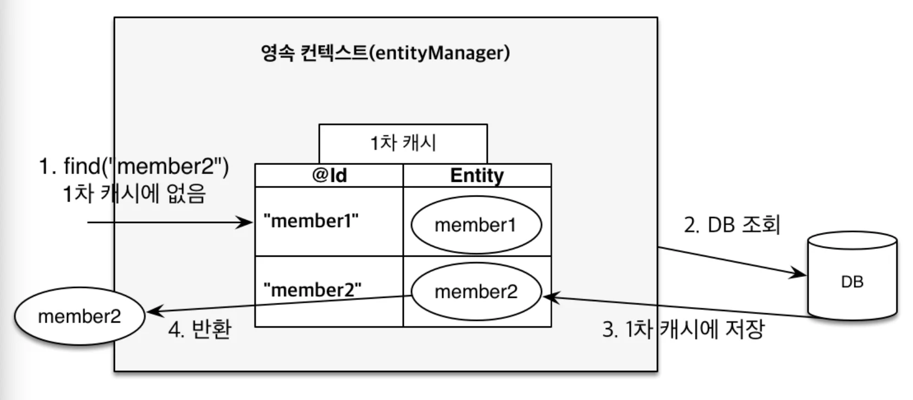

<a id="1c3eda9b0fe1818e8e37cd6912ce4906"></a>

```java
Member findMember2 = em.find(Member.class, "member2");
```

<a id="1c3eda9b0fe181c7bdf3ee40cd0ed046"></a>

### 동일성(identity) 보장

> 👉🏻 <strong>1차 캐시</strong><strong>로 반복 가능한 읽기(REPEATABLE READ) 등급의 트랜잭<br>션 격리 수준을 데이터베이스가 아닌 애플리케이션 차원에서 제공<br>&#45; 강의 PDF 발췌 &#45;</strong>

<details>
<summary>🧐 애플리케이션 차원에서 제공? 여기서 말하는 애플리케이션이란 무엇?</summary>

<a id="1c3eda9b0fe18155ac22d18925a6f5cc"></a>

JAP를 말하는 듯 하다&#46;

</details>

<details>
<summary>🧐 영속성 컨텍스트(EntityManager) 내부에 Transaction을 논리적으로 어떻게 구분하는가? </summary>

> 위 트랜젝션 파트 참조 

- <strong><code>et&#46;begin();</code></strong><strong>&#58; </strong>트랜잭션 시작

- <strong><code>et&#46;commit();</code></strong><strong>&#58; </strong>트랜잭션의 작업들을 영구적으로 DB에 반영

</details>

> 같은 트랜젝션 안에서 실행되는<strong><u> 동일한 Entity 참조값 비교</u></strong>(<code>==</code>)는 항상 일치(true)한다&#46; 


<a id="1c3eda9b0fe181669fd4fa33acfb93cf"></a>

```java
Member a = em.find(Member.class, "member1");
Member b = em.find(Member.class, "member1");

System.out.println(a == b); //동일성 비교 true
```

<a id="1c3eda9b0fe181469ed0cec71665f732"></a>

### 쓰기 지연( transactional write&#45;behind)  

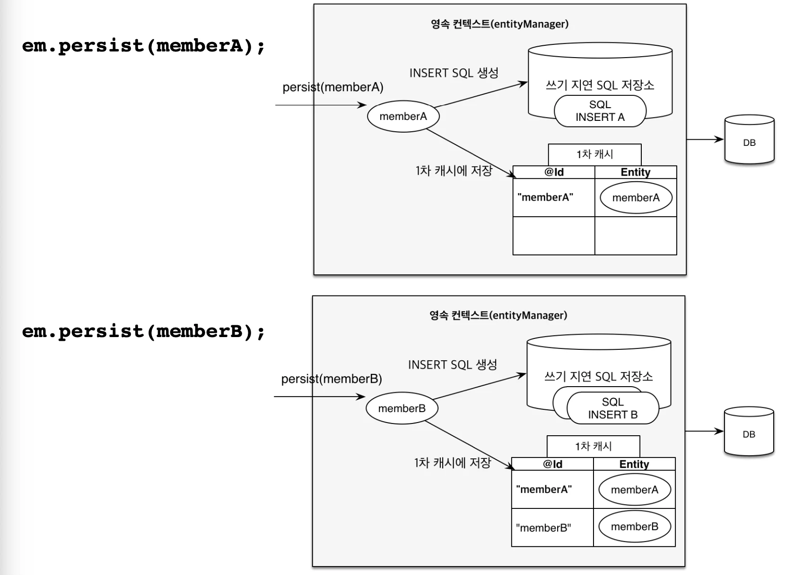


<a id="1c3eda9b0fe1813b8c36f67403f8f796"></a>

```java
EntityManager em = emf.createEntityManager();
EntityTransaction transaction = em.getTransaction();

// 모든 데이터 변경은 트렉젝션 안에서 이루어져야 한다. 
transaction.begin(); // 트랜젝션 시작
 
em.persist(memberA);    // 1차 캐시에 해당 Entity 저장 및 
em.persist(memberB);    // INSERT SQL 생성되고 쓰기지연 SQL 저장소에 저장
--------------------------------------
			    쓰기(SQL) 지연                
    -> persist() 시, Entity 객체가      
          1차 캐시에 저장되면서            
        해당하는 SQL문이 생성된다           
 생성된 SQL문은 쓰기 지연 SQL 저장소에 저장되고 
   commit() 시, 저장된 SQL 문이 실행된다.                     
--------------------------------------
transaction.commit(); // 트랜젝션을 커밋, 커밋 시 데이터베이스에 INSERT SQL을 보냄
```

<details>
<summary> 강의) 예제 코드 </summary>

> ☝🏻 JPA는 기본적으로 내부에서 리플렉션 등을 사용하기 때문에 동적으로 객체를 생성해야한다&#46;따라서 생성자 사용 시, 기본 생성자가 존재해야 한다&#46;
> 
> <details>
> <summary>ex)</summary>
> 
> <a id="1c3eda9b0fe181149a3cf5b599f10bd4"></a>
> 
> ```java
> @Entity
> public class Member {
> 
>     @Id
>     private Long id;
>     private String name;
> 
>     public Member() {
>     }
> 
>     public Member(Long id, String name) {
>         this.id = id;
>         this.name = name;
>     }
> ```
> 
> </details>

<a id="1c3eda9b0fe181a681cae6345ba0c735"></a>

```java
package hellojpa;

import jakarta.persistence.EntityManager;
import jakarta.persistence.EntityManagerFactory;
import jakarta.persistence.EntityTransaction;
import jakarta.persistence.Persistence;

import java.util.List;

public class JapMain {
    public static void main(String[] args) {
        EntityManagerFactory emf = Persistence.createEntityManagerFactory("hello");

        EntityManager em = emf.createEntityManager();

        EntityTransaction tx = em.getTransaction();
        tx.begin();

        try {
            // 영속
            Member member1 = new Member(150L, "A");
            Member member2 = new Member(160L, "B");

            em.persist(member1);
            em.persist(member2);

            System.out.println("==========================");

            tx.commit();

        } catch (Exception e){
            tx.rollback();
        } finally {
            em.close();

        }
        emf.close();
    }
}
```

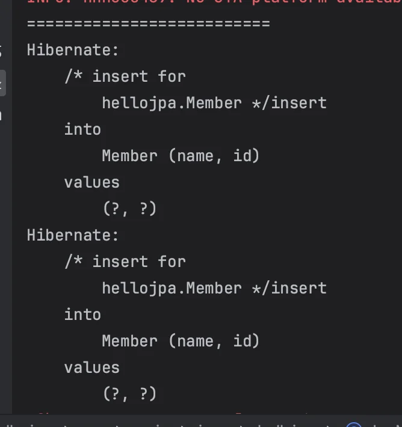

</details>

<details>
<summary>persistence&#46;xml 설정 &#45; <code>jdbc&#46;batch&#95;size</code></summary>

> 버퍼링, 해당 개수 만큼 모았다가 한번에 보냄 

<a id="1c3eda9b0fe181ec932cf6bdb61d7945"></a>

( 실제 여러개 entity를 DB에 저장하는 경우(버퍼링)는 거의 없음)


</details>

<a id="1c3eda9b0fe1814f8b1bdfa6c6d8962e"></a>

### 엔티티 수정 시, 변경 감지(Dirty Checking)

> 🧐 &#91; 수정 / 삭제 &#93; 시, 업데이트 (<code>em&#46;update(entity)</code> )  ❌
> 
> > JPA 목적&#58; java 컬렉션 다루듯이 Entity 객체를 다루는 것

> 🤔 <strong>(중요) </strong><strong><code>em&#46;update(member)</code></strong><strong>?,  자동 업데이트가 되는 이유는?<br></strong>엔티티 값을 가져와 변경만 하였는데도, 자동으로 update 쿼리를 날려 해당 데이터를 업데이트 함&#46;<br><br>JPA는 영속성 컨텍스트의 1차 캐시 안에 <strong><u>스냅샷</u></strong>이 존재하며 <br>스냅샷에 <strong><u>값을 읽어오는 최초  시점의 상태를 저장</u></strong>한다&#46; <br><br>JPA는 <strong><u>트랜젝션 커밋 발생</u></strong>하면 <strong><u>스냅샷과 비교하여 달라진 정보를 자동으로 업데이트</u></strong> 한다&#46;<br>
> 
> - 자동 업데이트 사용 (<code>tx&#46;commit()) </code>
>     > 수동 업데이트(<code>em&#46;update()</code>) 는 오류 발생 할수 있음,사용 ❌ 

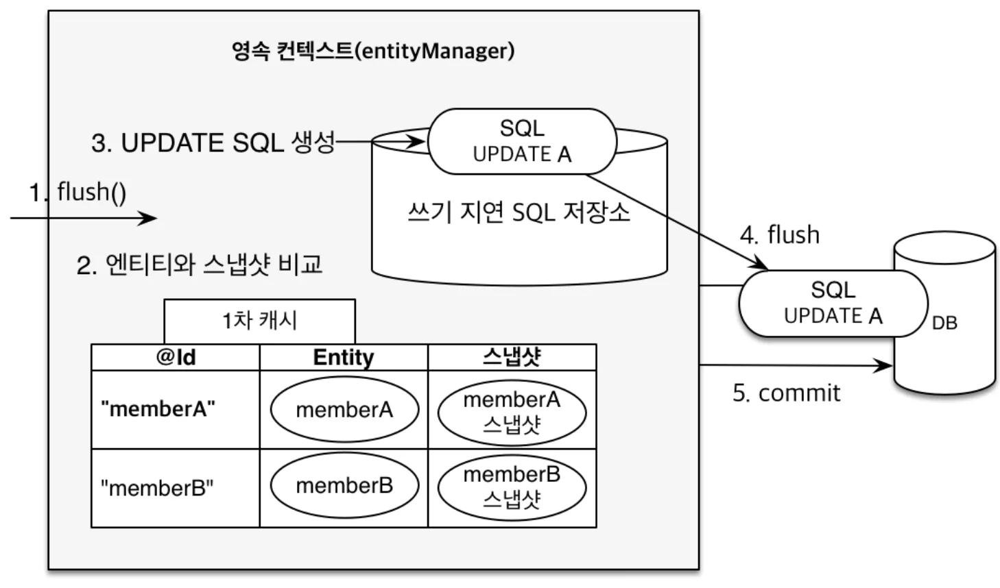

<details>
<summary>ex) 수정</summary>

<a id="1c3eda9b0fe18182875dca30b43015ca"></a>

```java
EntityManager em = emf.createEntityManager();
EntityTransaction transaction = em.getTransaction();

transaction.begin(); // [트랜잭션] 시작

//  조회
Member memberA = em.find(Member.class, "memberA");

// 수정
memberA.setUsername("hi");
memberA.setAge(10);

// em.update(memberA) 사용 X, commit 시 자동 업데이트 처리됨

transaction.commit(); // [트랜잭션] 커밋
```

</details>

<details>
<summary>ex) 삭제 </summary>

<a id="1c3eda9b0fe1816ca63df2548ea8c918"></a>

```java
EntityManager em = emf.createEntityManager();
EntityTransaction transaction = em.getTransaction();

transaction.begin(); // [트랜잭션] 시작
// 영속 엔티티 조회
Member memberA = em.find(Member.class, "memberA");

// 삭제
em.removee(memberA);

// em.update(memberA) 사용 X, commit 시 자동 업데이트 처리됨

transaction.commit(); // [트랜잭션] 커밋
```

</details>

<a id="1c3eda9b0fe18107bc11c0dea226004d"></a>

###  •  지연 로딩

> <strong>지연 로딩 (Lazy Loading) 4주차 연관관계 매핑에서 다룸</strong>

<a id="1c3eda9b0fe1815ca9bbcc6dddab1fef"></a>

## Entity Life Cycle (생명주기)

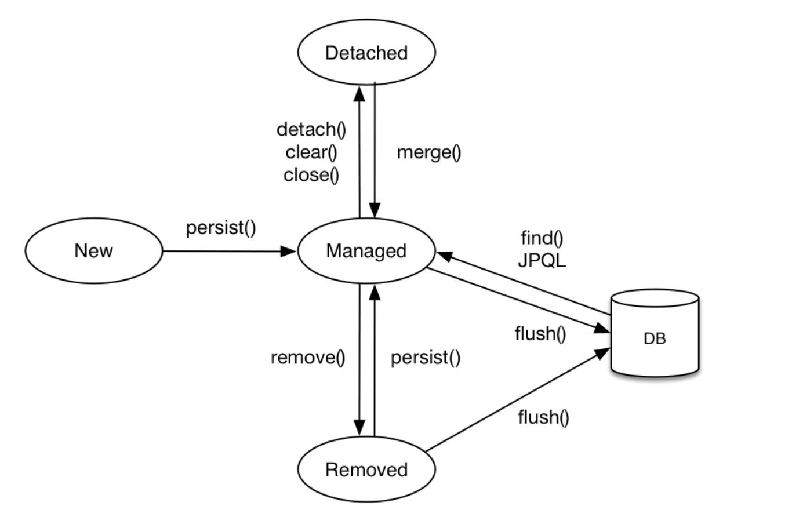

<a id="1c3eda9b0fe18125b1a2e7a2c7f7d429"></a>

### 비영속 (new/transient) 

> 영속성 컨텍스트와 전혀 관계가 없는 <strong>새로운</strong> 상태

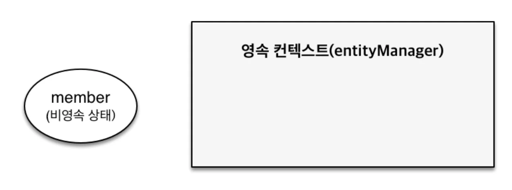

<a id="1c3eda9b0fe1814390e8c2cd30bf094f"></a>

```java
//객체를 생성한 상태(비영속)
Member member = new Member();
member.setId("member1");
member.setUsername("회원1");
```

<a id="1c3eda9b0fe1817092d5e3a4057ec685"></a>

### 영속 (managed)

> 영속성 컨텍스트에 <strong>관리</strong>되는 상태


<a id="1c3eda9b0fe1815f8474f46c42751fff"></a>

```java
//객체를 생성한 상태(비영속)
Member member = new Member();
member.setId("member1");
member.setUsername(“회원1”);

EntityManager em = emf.createEntityManager();
em.getTransaction().begin();

//객체를 저장한 상태(영속)
em.persist(member);
```

<a id="1c3eda9b0fe18162a14aca7b7aa8f267"></a>

###  준영속 (detached)

> 영속성 컨텍스트에 저장되었다가 <strong>분리</strong>된 상태

<a id="1c3eda9b0fe181028601cce4b8139595"></a>

```java
//회원 엔티티를 영속성 컨텍스트에서 분리(준영속)
em.detach(member);
```

> <strong>&#91; 영속 상태 → 준영속 상태 &#93;</strong> 

<details>
<summary><strong>detach(entity)</strong></summary>

<a id="1c3eda9b0fe181e78081debc0aeb9cd0"></a>

```java
em.detach(memo);
```

- <strong>detach(entity)</strong> &#58; 특정 Entity만 준영속 상태로 전환합니다&#46;
    - 영속성 컨텍스트에서 관리되다(<strong>Managed</strong>)가<strong> </strong>분리된 상태(<strong>Detached</strong>)로 전환됩니다&#46;

<a id="1c3eda9b0fe181b1830cd1cb0a800938"></a>

```java
@Test
@DisplayName("준영속 상태 : detach()")
void test2() {
    EntityTransaction et = em.getTransaction();

    et.begin();

    try {

        Memo memo = em.find(Memo.class, 1);
        System.out.println("memo.getId() = " + memo.getId());
        System.out.println("memo.getUsername() = " + memo.getUsername());
        System.out.println("memo.getContents() = " + memo.getContents());

        // em.contains(entity) : Entity 객체가 현재 영속성 컨텍스트에 저장되어 관리되는 상태인지 확인하는 메서드
        System.out.println("em.contains(memo) = " + em.contains(memo));

        System.out.println("detach() 호출");
        em.detach(memo);
        System.out.println("em.contains(memo) = " + em.contains(memo));

        System.out.println("memo Entity 객체 수정 시도");
        memo.setUsername("Update");
        memo.setContents("memo Entity Update");

        System.out.println("트랜잭션 commit 전");
        et.commit();
        System.out.println("트랜잭션 commit 후");

    } catch (Exception ex) {
        ex.printStackTrace();
        et.rollback();
    } finally {
        em.close();
    }

    emf.close();
}
```

<details>
<summary>&#91;코드 스니펫&#93; detach(entity)</summary>

<a id="1c3eda9b0fe1816d8f8feba4a9ad4fdd"></a>

```java
@Test
@DisplayName("준영속 상태 : detach()")
void test2() {
    EntityTransaction et = em.getTransaction();

    et.begin();

    try {

        Memo memo = em.find(Memo.class, 1);
        System.out.println("memo.getId() = " + memo.getId());
        System.out.println("memo.getUsername() = " + memo.getUsername());
        System.out.println("memo.getContents() = " + memo.getContents());

        // em.contains(entity) : Entity 객체가 현재 영속성 컨텍스트에 저장되어 관리되는 상태인지 확인하는 메서드
        System.out.println("em.contains(memo) = " + em.contains(memo));

        System.out.println("detach() 호출");
        em.detach(memo);
        System.out.println("em.contains(memo) = " + em.contains(memo));

        System.out.println("memo Entity 객체 수정 시도");
        memo.setUsername("Update");
        memo.setContents("memo Entity Update");

        System.out.println("트랜잭션 commit 전");
        et.commit();
        System.out.println("트랜잭션 commit 후");

    } catch (Exception ex) {
        ex.printStackTrace();
        et.rollback();
    } finally {
        em.close();
    }

    emf.close();
}
```

</details>

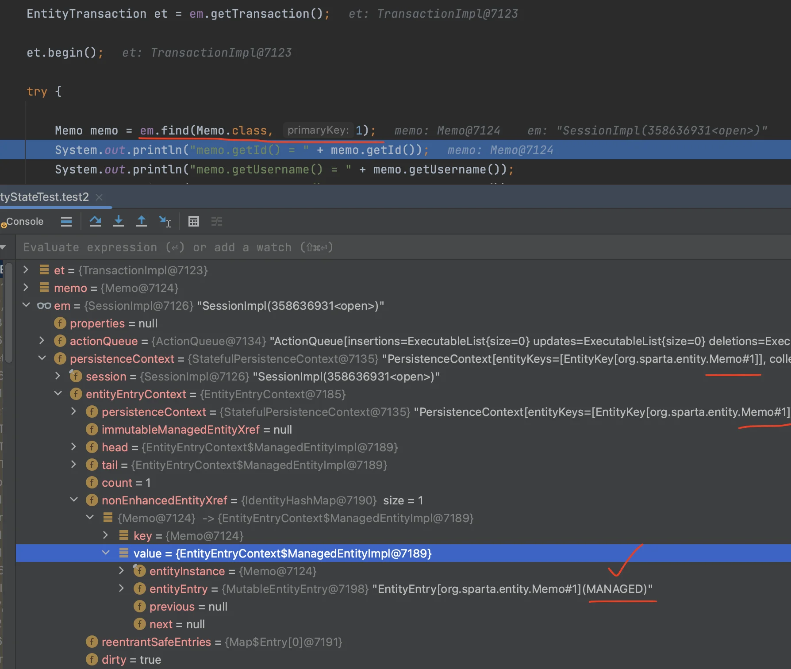

- <code>em&#46;find(Memo&#46;class, 1);</code> 메서드 호출 후 MANAGED 상태입니다&#46;

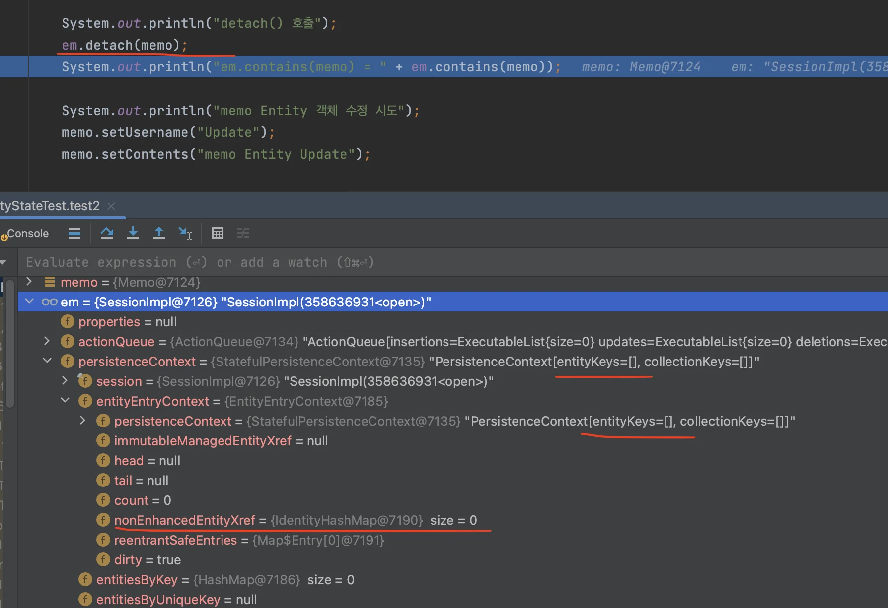

- <code>em&#46;detach(memo);</code> 메서드를 호출하여 특정 Entity 객체 Memo&#35;1를 영속성 컨텍스트에서 제거하였습니다&#46;

- 준영속 상태로 전환되면 1차 캐시 즉, 캐시 저장소에서 제거되기 때문에 JPA의 관리를 받지 못해 영속성 컨텍스트의 어떠한 기능도 사용할 수 없습니다&#46;

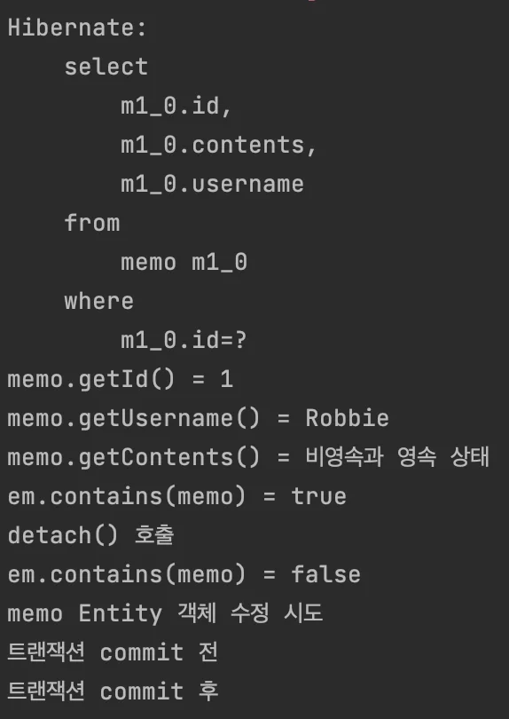

- 따라서 memo Entity 객체의 데이터를 수정해도 변경감지 기능을 사용할 수 없어 Update SQL이 수행되지 않았습니다&#46;

- <code>em&#46;contains(memo);</code> 는 해당 객체가 영속성 컨텍스트에 저장되어 관리되는 상태인지 확인하는 메서드로 <code>em&#46;detach(memo);</code> 이후 확인했을 때 false가 출력된 것을 확인할 수 있습니다&#46;

</details>

<details>
<summary><strong>clear()</strong></summary>

<a id="1c3eda9b0fe18159978de0ce4610736b"></a>

```java
em.clear();
```

- <strong>clear()</strong> &#58; 영속성 컨텍스트를 완전히 초기화합니다&#46;
    - 영속성 컨텍스트의 모든 Entity를 준영속 상태로 전환합니다&#46;

    - 영속성 컨텍스트 틀은 유지하지만 내용은 비워 새로 만든 것과 같은 상태가 됩니다&#46;

    - 따라서 계속해서 영속성 컨텍스트를 이용할 수 있습니다&#46;

<a id="1c3eda9b0fe18161a252c72d1026d2e5"></a>

```java
@Test
@DisplayName("준영속 상태 : clear()")
void test3() {
    EntityTransaction et = em.getTransaction();

    et.begin();

    try {

        Memo memo1 = em.find(Memo.class, 1);
        Memo memo2 = em.find(Memo.class, 2);

        // em.contains(entity) : Entity 객체가 현재 영속성 컨텍스트에 저장되어 관리되는 상태인지 확인하는 메서드
        System.out.println("em.contains(memo1) = " + em.contains(memo1));
        System.out.println("em.contains(memo2) = " + em.contains(memo2));

        System.out.println("clear() 호출");
        em.clear();
        System.out.println("em.contains(memo1) = " + em.contains(memo1));
        System.out.println("em.contains(memo2) = " + em.contains(memo2));

        System.out.println("memo#1 Entity 다시 조회");
        Memo memo = em.find(Memo.class, 1);
        System.out.println("em.contains(memo) = " + em.contains(memo));
        System.out.println("\n memo Entity 수정 시도");
        memo.setUsername("Update");
        memo.setContents("memo Entity Update");

        System.out.println("트랜잭션 commit 전");
        et.commit();
        System.out.println("트랜잭션 commit 후");

    } catch (Exception ex) {
        ex.printStackTrace();
        et.rollback();
    } finally {
        em.close();
    }

    emf.close();
}
```

<details>
<summary>&#91;코드 스니펫&#93; clear()</summary>

<a id="1c3eda9b0fe1814fba9cfdecc5d774c4"></a>

```java
@Test
@DisplayName("준영속 상태 : clear()")
void test3() {
    EntityTransaction et = em.getTransaction();

    et.begin();

    try {

        Memo memo1 = em.find(Memo.class, 1);
        Memo memo2 = em.find(Memo.class, 2);

        // em.contains(entity) : Entity 객체가 현재 영속성 컨텍스트에 저장되어 관리되는 상태인지 확인하는 메서드
        System.out.println("em.contains(memo1) = " + em.contains(memo1));
        System.out.println("em.contains(memo2) = " + em.contains(memo2));

        System.out.println("clear() 호출");
        em.clear();
        System.out.println("em.contains(memo1) = " + em.contains(memo1));
        System.out.println("em.contains(memo2) = " + em.contains(memo2));

        System.out.println("memo#1 Entity 다시 조회");
        Memo memo = em.find(Memo.class, 1);
        System.out.println("em.contains(memo) = " + em.contains(memo));
        System.out.println("\n memo Entity 수정 시도");
        memo.setUsername("Update");
        memo.setContents("memo Entity Update");

        System.out.println("트랜잭션 commit 전");
        et.commit();
        System.out.println("트랜잭션 commit 후");

    } catch (Exception ex) {
        ex.printStackTrace();
        et.rollback();
    } finally {
        em.close();
    }

    emf.close();
}
```

</details>

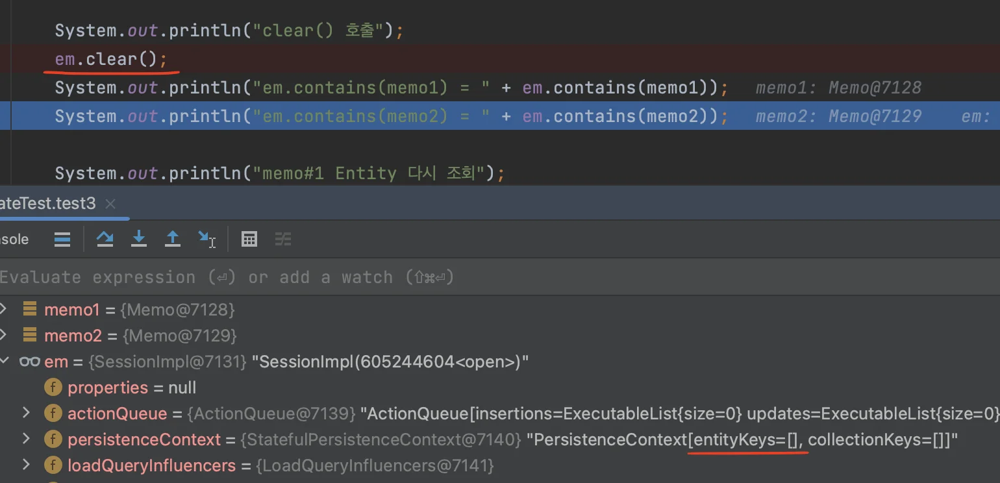

- <code>em&#46;clear();</code> 메서드 호출 후 완전히 비워진 영속성 컨텍스트를 확인할 수 있습니다&#46;

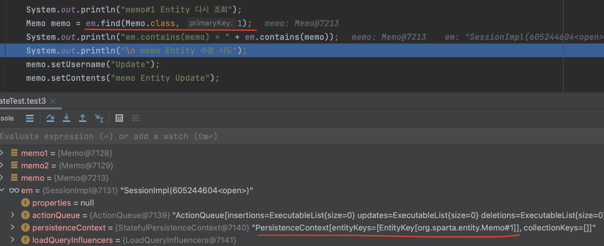

- 다시 memo&#35;1 Entity를 조회하여 영속성 컨텍스트에 저장된 것을 확인할 수 있습니다&#46;

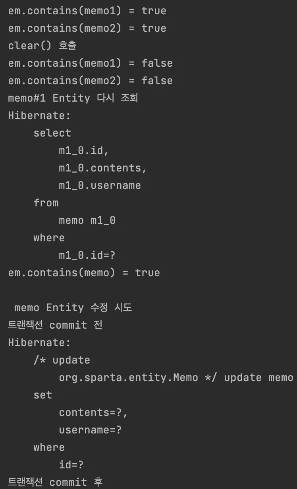

- <code>em&#46;clear();</code> 메서드 호출 후 <code>em&#46;contains(memo1,2);</code> 확인했을 때 false가 출력된 것을 확인할 수 있습니다&#46;

- 다시 memo&#35;1 Entity를 조회한 후 <code>em&#46;contains(memo);</code> 확인했을 때 true가 출력된 것을 확인할 수 있습니다&#46;

- 또한 memo Entity 객체의 데이터를 수정하자 트랜잭션 commit 후 Update SQL이 수행된 것을 확인할 수 있습니다&#46;

</details>

<details>
<summary><strong>close()</strong></summary>

<a id="1c3eda9b0fe18139a576f634ec5b8027"></a>

```java
em.close();
```

- <strong>close()</strong> &#58; 영속성 컨텍스트를 종료합니다&#46;
    - 해당 영속성 컨텍스트가 관리하던 영속성 상태의 Entity들은 모두 준영속 상태로 변경됩니다&#46;

    - 영속성 컨텍스트가 종료되었기 때문에 계속해서 영속성 컨텍스트를 사용할 수 없습니다&#46;

<a id="1c3eda9b0fe18136b92ad4959033a041"></a>

```java
@Test
@DisplayName("준영속 상태 : close()")
void test4() {
    EntityTransaction et = em.getTransaction();

    et.begin();

    try {

        Memo memo1 = em.find(Memo.class, 1);
        Memo memo2 = em.find(Memo.class, 2);

        // em.contains(entity) : Entity 객체가 현재 영속성 컨텍스트에 저장되어 관리되는 상태인지 확인하는 메서드
        System.out.println("em.contains(memo1) = " + em.contains(memo1));
        System.out.println("em.contains(memo2) = " + em.contains(memo2));

        System.out.println("close() 호출");
        em.close();
        Memo memo = em.find(Memo.class, 2); // Session/EntityManager is closed 메시지와 함께 오류 발생
        System.out.println("memo.getId() = " + memo.getId());

    } catch (Exception ex) {
        ex.printStackTrace();
        et.rollback();
    } finally {
        em.close();
    }

    emf.close();
}
```

<details>
<summary>&#91;코드 스니펫&#93; close()</summary>

<a id="1c3eda9b0fe181abbcf9f4c6f1f1f9dc"></a>

```java
@Test
@DisplayName("준영속 상태 : close()")
void test4() {
    EntityTransaction et = em.getTransaction();

    et.begin();

    try {

        Memo memo1 = em.find(Memo.class, 1);
        Memo memo2 = em.find(Memo.class, 2);

        // em.contains(entity) : Entity 객체가 현재 영속성 컨텍스트에 저장되어 관리되는 상태인지 확인하는 메서드
        System.out.println("em.contains(memo1) = " + em.contains(memo1));
        System.out.println("em.contains(memo2) = " + em.contains(memo2));

        System.out.println("close() 호출");
        em.close();
        Memo memo = em.find(Memo.class, 2); // Session/EntityManager is closed 메시지와 함께 오류 발생
        System.out.println("memo.getId() = " + memo.getId());

    } catch (Exception ex) {
        ex.printStackTrace();
        et.rollback();
    } finally {
        em.close();
    }

    emf.close();
}
```

</details>

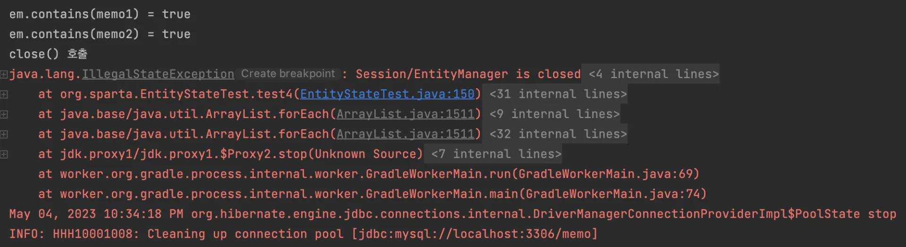

- <code>em&#46;close();</code> 메서드 호출 이후 EntityManager를 사용하려고 하자 오류가 발생했습니다&#46;
    - 영속성 컨텍스트가 종료되면 계속해서 영속성 컨텍스트를 사용할 수 없다는 것을 확인할 수 있습니다&#46;

</details>

> <strong>&#91; 준영속 상태 → 영속 상태 &#93;</strong> 

<details>
<summary><strong>merge(entity)</strong></summary>

<a id="1c3eda9b0fe181a1a1c2fa2fffb3e360"></a>

```java
em.merge(memo);
```

- <strong>merge(entity)</strong> &#58; 전달받은 Entity를 사용하여 새로운 영속 상태의 Entity를 반환합니다&#46;

- <strong>merge(entity) </strong>동작
    - 파라미터로 전달된 Entity의 식별자 값으로 영속성 컨텍스트를 조회합니다&#46;
        1. 해당 Entity가 영속성 컨텍스트에 없다면?
            1. DB에서 새롭게 조회합니다&#46;

            1. 조회한 Entity를 영속성 컨텍스트에  저장합니다&#46;

            1. 전달 받은 Entity의 값을 사용하여 병합합니다&#46;

            1. Update SQL이 수행됩니다&#46; (수정)

        1. 만약 DB에서도 없다면 ?
            1. 새롭게 생성한 Entity를 영속성 컨텍스트에 저장합니다&#46;

            1. Insert SQL이 수행됩니다&#46; (저장)

- 따라서 <strong>merge(entity) </strong>메서드는 비영속, 준영속 모두 파라미터로 받을 수 있으며 상황에 따라 ‘저장’을 할 수도 ‘수정’을 할 수도 있습니다&#46;


1. <strong>merge(entity)</strong> 저장

<a id="1c3eda9b0fe181eabf0dd81d7ae2052f"></a>

```java
@Test
@DisplayName("merge() : 저장")
void test5() {
    EntityTransaction et = em.getTransaction();

    et.begin();

    try {

        Memo memo = new Memo();
        memo.setId(3L);
        memo.setUsername("merge()");
        memo.setContents("merge() 저장");

        System.out.println("merge() 호출");
        Memo mergedMemo = em.merge(memo);

        System.out.println("em.contains(memo) = " + em.contains(memo));
        System.out.println("em.contains(mergedMemo) = " + em.contains(mergedMemo));

        System.out.println("트랜잭션 commit 전");
        et.commit();
        System.out.println("트랜잭션 commit 후");

    } catch (Exception ex) {
        ex.printStackTrace();
        et.rollback();
    } finally {
        em.close();
    }

    emf.close();
}
```

<details>
<summary>&#91;코드 스니펫&#93; merge(entity) 저장</summary>

<a id="1c3eda9b0fe18157bf9dc5703e3ac0f2"></a>

```java
@Test
@DisplayName("merge() : 저장")
void test5() {
    EntityTransaction et = em.getTransaction();

    et.begin();

    try {

        Memo memo = new Memo();
        memo.setId(3L);
        memo.setUsername("merge()");
        memo.setContents("merge() 저장");

        System.out.println("merge() 호출");
        Memo mergedMemo = em.merge(memo);

        System.out.println("em.contains(memo) = " + em.contains(memo));
        System.out.println("em.contains(mergedMemo) = " + em.contains(mergedMemo));

        System.out.println("트랜잭션 commit 전");
        et.commit();
        System.out.println("트랜잭션 commit 후");

    } catch (Exception ex) {
        ex.printStackTrace();
        et.rollback();
    } finally {
        em.close();
    }

    emf.close();
}
```

</details>

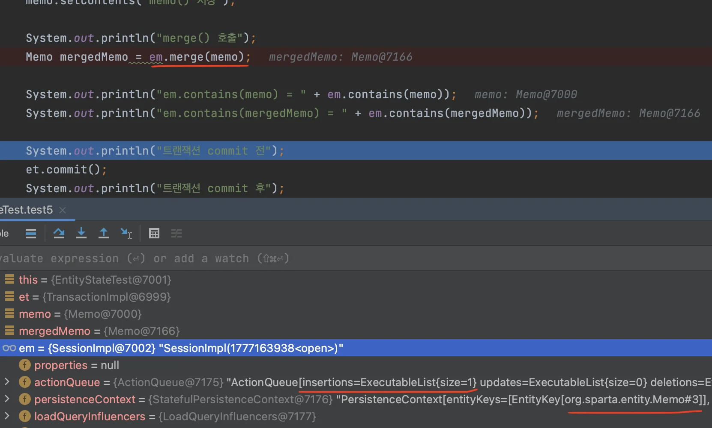

- <code>em&#46;merge(memo);</code> 호출 후 영속성 컨텍스트에 Memo&#35;3 객체가 저장되고 Insert SQL이 추가된 것을 확인할 수 있습니다&#46;

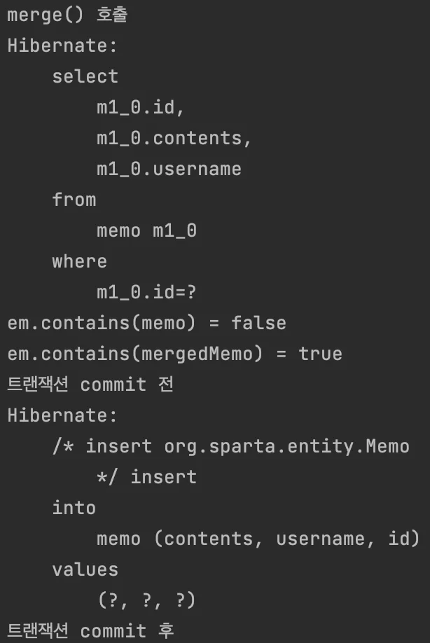

- <code>em&#46;merge(memo);</code> 호출 후 영속성 컨텍스트에 해당 값이 없어 DB에 조회 했는데도 해당 값이 없기 때문에 새롭게 생성하여 영속성 컨텍스트에 저장하고 Insert SQL이 수행되었습니다&#46;
    - 비영속 상태의 memo는 merge() 호출 후에 해당 memo 객체가 영속성 컨텍스트에 저장된게 아니라 새롭게 생성되어 영속성 컨텍스트에 저장되었기 때문에 false가 반환되었습니다&#46;

    - 새롭게 저장된 영속 상태의 객체를 반환받은 mergedMemo는 true가 반환되었습니다&#46;

1. <strong>merge(entity)</strong> 수정

<a id="1c3eda9b0fe181228777ffc92c3e89ea"></a>

```java
@Test
@DisplayName("merge() : 수정")
void test6() {
    EntityTransaction et = em.getTransaction();

    et.begin();

    try {

        Memo memo = em.find(Memo.class, 3);
        System.out.println("memo.getId() = " + memo.getId());
        System.out.println("memo.getUsername() = " + memo.getUsername());
        System.out.println("memo.getContents() = " + memo.getContents());

        System.out.println("em.contains(memo) = " + em.contains(memo));

        System.out.println("detach() 호출");
        em.detach(memo); // 준영속 상태로 전환
        System.out.println("em.contains(memo) = " + em.contains(memo));

        System.out.println("준영속 memo 값 수정");
        memo.setContents("merge() 수정");

        System.out.println("\n merge() 호출");
        Memo mergedMemo = em.merge(memo);
        System.out.println("mergedMemo.getContents() = " + mergedMemo.getContents());

        System.out.println("em.contains(memo) = " + em.contains(memo));
        System.out.println("em.contains(mergedMemo) = " + em.contains(mergedMemo));

        System.out.println("트랜잭션 commit 전");
        et.commit();
        System.out.println("트랜잭션 commit 후");

    } catch (Exception ex) {
        ex.printStackTrace();
        et.rollback();
    } finally {
        em.close();
    }

    emf.close();
}
```

<details>
<summary>&#91;코드 스니펫&#93; merge(entity) 수정</summary>

<a id="1c3eda9b0fe181359157d0f1cf409c15"></a>

```java
@Test
@DisplayName("merge() : 수정")
void test6() {
    EntityTransaction et = em.getTransaction();

    et.begin();

    try {

        Memo memo = em.find(Memo.class, 3);
        System.out.println("memo.getId() = " + memo.getId());
        System.out.println("memo.getUsername() = " + memo.getUsername());
        System.out.println("memo.getContents() = " + memo.getContents());

        System.out.println("em.contains(memo) = " + em.contains(memo));

        System.out.println("detach() 호출");
        em.detach(memo); // 준영속 상태로 전환
        System.out.println("em.contains(memo) = " + em.contains(memo));

        System.out.println("준영속 memo 값 수정");
        memo.setContents("merge() 수정");

        System.out.println("\n merge() 호출");
        Memo mergedMemo = em.merge(memo);
        System.out.println("mergedMemo.getContents() = " + mergedMemo.getContents());

        System.out.println("em.contains(memo) = " + em.contains(memo));
        System.out.println("em.contains(mergedMemo) = " + em.contains(mergedMemo));

        System.out.println("트랜잭션 commit 전");
        et.commit();
        System.out.println("트랜잭션 commit 후");

    } catch (Exception ex) {
        ex.printStackTrace();
        et.rollback();
    } finally {
        em.close();
    }

    emf.close();
}
```

</details>

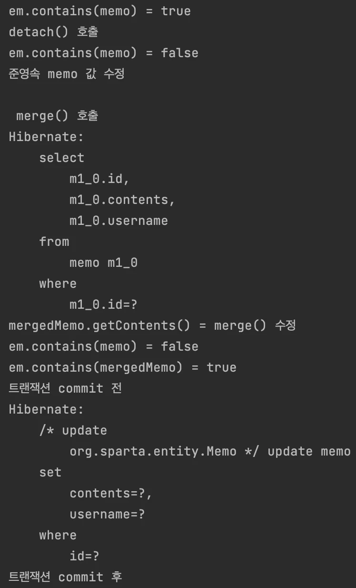

- detach() 메서드 호출로 조회해온 영속 상태의 memo 객체를 준영속 상태로 전환했습니다&#46;

- 준영속 상태의 memo의 값을 수정한 후 memo 객체를 사용해서 merge() 메서드를 호출했습니다&#46; 

- memo 객체는 준영속 상태이기 때문에 현재 영속성 컨텍스트에는 해당 객체가 존재하지 않습니다&#46;
    - 따라서 DB에서 식별자 값을 사용하여 조회한 후 영속성 컨텍스트에 저장하고 파라미터로 받아온 준영속 상태의 memo 객체의 값을 새롭게 저장한 영속 상태의 객체에 병합하고 반환합니다&#46;

    - 그 결과 반환된 mergedMemo의 contents를 출력하였을 때 변경되었던 내용인 “merge() 수정”이 출력되었습니다&#46;

    - 트랜잭션 commit 후 Update SQL이 수행됩니다&#46;

- 준영속 상태의 Entity memo는 merge() 호출 후에도 영속성 컨텍스트에 저장되어 있지 않기 때문에 false가 반환되었고

- 새롭게 저장된 영속 상태의 객체를 반환받은 mergedMemo는 true가 반환되었습니다&#46;

</details>

<a id="1c3eda9b0fe18135997ecfb5015ee6b6"></a>

### 삭제(<strong>Removed</strong>)

<a id="1c3eda9b0fe181a1aa86c609b51f8f39"></a>

```java
em.remove(memo);
```

- <strong>remove(entity)</strong> &#58; 삭제하기 위해 조회해온 영속 상태의 Entity를 파라미터로 전달받아 삭제 상태로 전환합니다&#46;

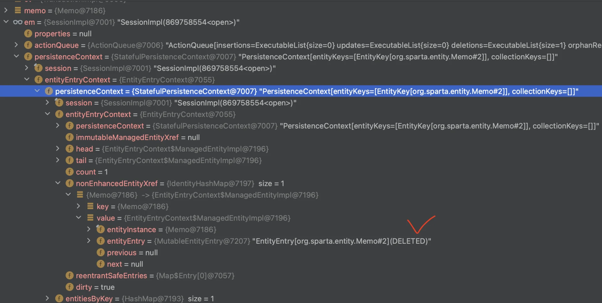

<a id="1c3eda9b0fe181a2b48bf21c39813a1f"></a>

### 데이터베이스 스키마(DDL) 자동 생성(<code>hibernate&#46;hbm2ddl&#46;auto</code>)

<details>
<summary><strong>🧐 데이터베이스 스키마?</strong></summary>

<details>
<summary>Reference</summary>

<a id="1c3eda9b0fe181edbb85f9ba3d8dd293"></a>

<a href="https://93jpark.tistory.com/23">https&#58;//93jpark&#46;tistory&#46;com/23</a><br><a href="https://dlwndms61.tistory.com/15">https&#58;//dlwndms61&#46;tistory&#46;com/15</a>

</details>

<details>
<summary>테이블 예시</summary>

| <strong>CUSTOMER&#95;ID</strong> | <strong>NAME</strong> | <strong>AGE</strong> | <strong>CLASS</strong> |
| --- | --- | --- | --- |
| 39827 | Lee | 30 | B |
| 39828 | Choi | 32 | B |
| 39829 | Park | 19 | C |
| 39830 | Kim | 41 | A |

</details>

---

<a id="1c3eda9b0fe181eba8f2f4ab9d863f13"></a>

### 스키마 Schema

<a id="1c3eda9b0fe1818faac2dcaeabb09992"></a>

스키마(Schema)는 전체적인 <strong><u>데이터베이스의 골격 구조</u></strong>를 나타내는 일종의 <strong><u>도면</u></strong>이다&#46; 

<a id="1c3eda9b0fe1817d9f2ae76396cddf10"></a>

<strong><u>테이블 이름, 필드, 데이터 유형, 그리고 이러한 엔티티 간의 관계, 테이블간의 관계</u></strong> 등 을 정의한다&#46; 

<a id="1c3eda9b0fe181b8889cc8386b04af9a"></a>

→ 엔티티와 그 엔티티들 간의 관계

<a id="1c3eda9b0fe1816b92cfec211ed5341f"></a>

→어떤 타입의 데이터가 어느 위치에 적재되어야 하는지

<a id="1c3eda9b0fe181a39f33dc700a4830e8"></a>

→ 다른 테이블이나 엔티티와 어떠한 관계를 맺는지

<a id="1c3eda9b0fe1810b9459ef3c648dc4ff"></a>

### 속성 Attribute

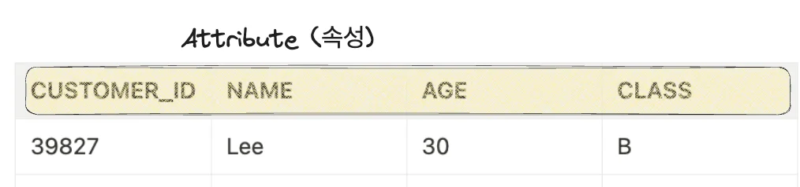

<a id="1c3eda9b0fe181a4ae92d2430967d7dc"></a>

### 필드 Fields ( 열 )

> 가장 작은 단위 데이터,  열 (column)

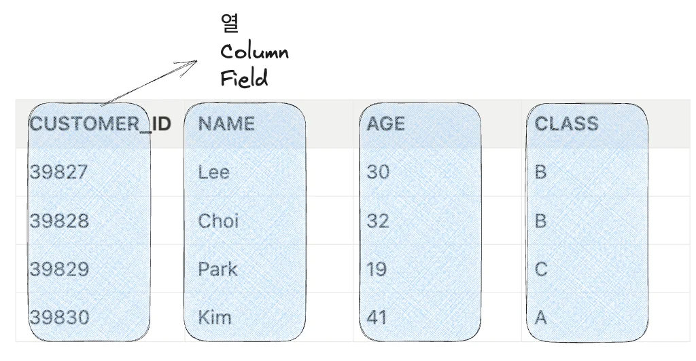

<a id="1c3eda9b0fe181789170ce6533989bd9"></a>

### 레코드 Records ( 튜플 Tuple, 행 )

> 논리적으로 연관된 필드의 집합, 행 row <br>여러 필드가 모여 한 레코드를 이룸

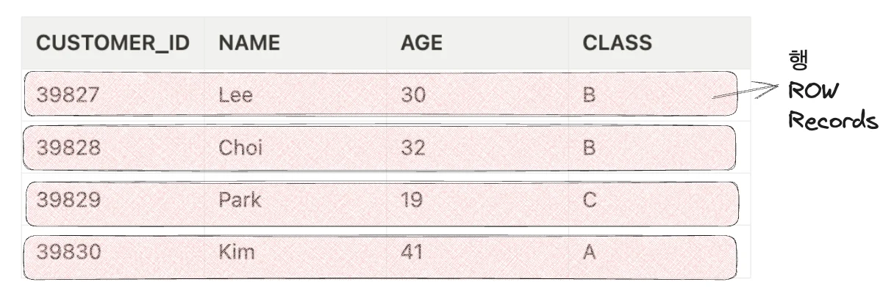

</details>

- 순수 자바 환경&#58; <code>persistence&#46;xml</code>

- 스프링 환경&#58; <code>application&#46;persistence</code>

| 옵션  | 설명 |
| --- | --- |
| <code>create</code> | 기존테이블 삭제 후 다시 생성<br>(DROP &#43; CREATE) |
| <code>create&#45;drop</code> | create와 같으나 종료시점에 테이블 DROP |
| <code>update</code> | 변경 내용만 반영 ( <strong>운영DB 사용X</strong> )<br>삭제 X, 추가만 가능 |
| <code>vaildate</code> | Entity 와 table이 정상 매핑되었는지 확인 |
| <code>none</code> | 사용하지 않음 ( 관례 ) |

> 🧐 ◦ 애플리케이션 실행 시점에서 DDL(create, alter, drop, truncate) 자동 생성 <br>   → DB,table이 생성, 변경, 삭제 시점에서 자동 생성<br>• 테이블 중심 → <strong>객체 중심</strong>으로 개발 가능<br>• 데이터베이스 방언(Diallect) 을 활용해서 데이터 베이스에 맞는 적절한 DDL 생성<br>   이렇게<strong> </strong><strong>생성된 DDL은 개발 장비에서만 사용</strong><br>       →  생성된 DDL은 운영 서버에서 사용하지 않거나, 수정 후 사용

<details>
<summary><strong>ex) create  </strong> →   <code>drop</code> &#43; <code>create</code></summary>

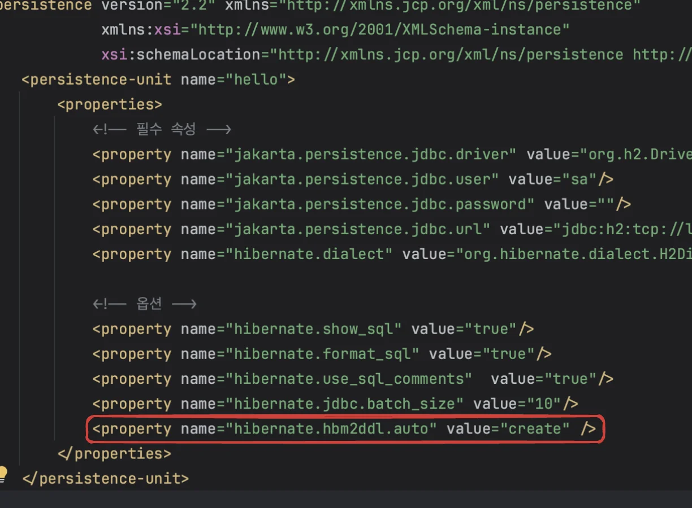

> drop, create 쿼리 날림


</details>

<details>
<summary><strong>ex) create&#45;drop </strong>  →   <code>drop</code> &#43; <code>create</code> &#43; <code>drop</code></summary>


<a id="1c3eda9b0fe181fda410e20c4f83edb9"></a>

```java
Member member = new Member(100L, "A");
em.persist(member);
tx.commit();
```

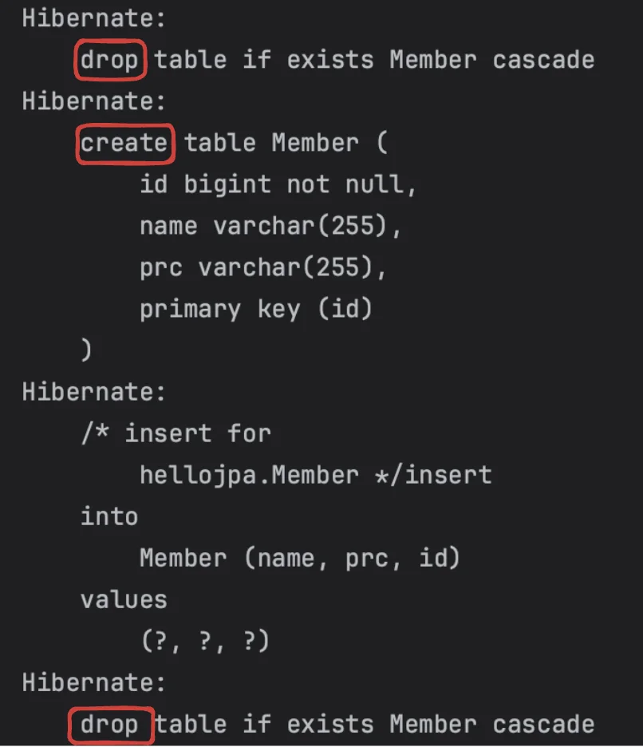

</details>

<details>
<summary><strong>ex) update </strong>  →  <code>alter</code> </summary>

<details>
<summary><code>&#64;Id</code> 필드 값 추가 →  <code>alter</code>(DDL) 테이블 컬럼 수정</summary>

<a id="1c3eda9b0fe1817f9f94d422475d4691"></a>

```java
// Member
@Entity
public class Member {

    @Id
    private Long id;
    private String name;
    private String prac;
```

<a id="1c3eda9b0fe181cdabe6cc27554ef99f"></a>

```java
// JapMain
Member member = new Member(100L, "A", "A");
em.persist(member);
tx.commit();
```

> <code>alter</code> SQL 실행됨

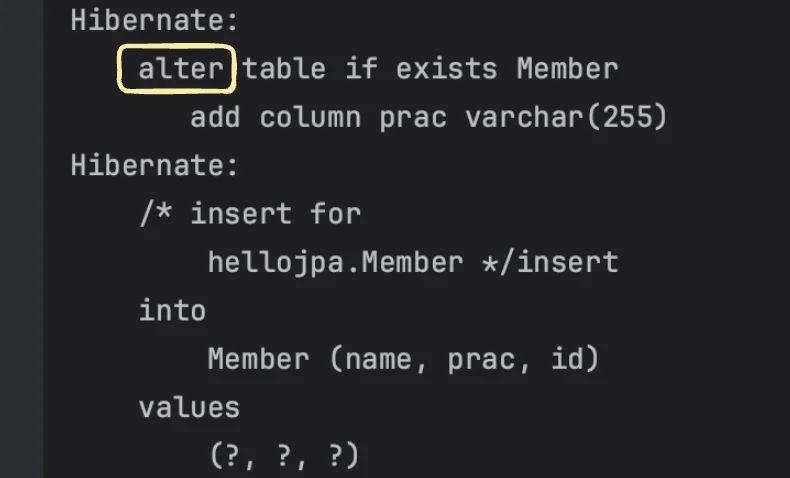

</details>

<details>
<summary>삭제(<code>em&#46;remove()</code>)  → <code>delete</code>(DML)</summary>

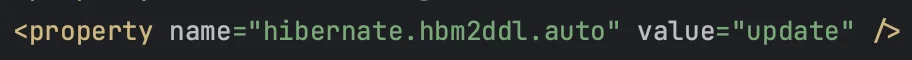

<a id="1c3eda9b0fe181bab262c1784e914ce0"></a>

```java
Member member1 = em.find(Member.class, 100L);
em.remove(member1);
tx.commit();
```


</details>

</details>

<details>
<summary><strong>ex) validate</strong>  →  테이블에 없는 필드값 정의 시 <strong><code>PersistenceException</code></strong><strong>, </strong><strong><code>SchemaManagementException</code></strong> </summary>


<a id="1c3eda9b0fe181389b0de85db68568a1"></a>

```java
@Entity
public class Member {

    @Id
    private Long id;
    private String name;
    private String prc;

  .   .   .
```

> 테이블에 없는 속성 값을 필드에 추가할 시 아래와 같은 오류가 발생된다&#46; <br>→ <strong><code>PersistenceException</code></strong><strong>, </strong><strong><code>SchemaManagementException</code></strong> 


</details>

<details>
<summary><strong>ex) none</strong></summary>


> auto 사용 ❌

<a id="1c3eda9b0fe181cb8e07edf8e50eac6d"></a>

관례상 none 이라고 표시, 막 적어도 동일

</details>

> ⚠️ <strong>운영 장비</strong><strong>에는</strong><strong> 절대 </strong><strong><code>create</code></strong><strong>, </strong><strong><code>create&#45;drop</code></strong><strong>, </strong><strong><code>update</code></strong><strong> </strong><strong>사용</strong><strong> ❌</strong>
> 
> - <strong> 로컬 개발 서버에서만 사용</strong>
> 
> - <strong><u>테스트 서버, 운영 서버</u></strong>에는<strong><u> 절대 사용 금지 </u></strong>
> 
> >  <strong>권장) 직접 스크립트 짜서 테스트 서버에 테스트 해보고 문제 없을 시, 운영 서버에 적용</strong>
> 
> > ☝🏻 <strong>가급적 </strong><strong><code>개발(로컬)서버</code></strong><strong>나, </strong><strong><code>테스트 서버</code></strong><strong>에서도 </strong>
> > 
> > <a id="1c3eda9b0fe181e5b61ef292f23a8f4a"></a>
> > 
> > <strong><code>create</code></strong><strong>, </strong><strong><code>create&#45;drop</code></strong><strong>, </strong><strong><code>update</code></strong><strong> 사용 ❌<br></strong>
> > 
> > - <strong><code>로컬 서버</code></strong><strong> (개발 초기 단계) </strong>
> >     <a id="1c3eda9b0fe181f2bcd0ea9512266b2f"></a>
> > 
> >     → <code>create</code>, <code>update</code> 
> > 
> > - <strong><code>테스트 서버</code></strong><strong> (여러명의 개발자가 함께 사용하는 중간 서버) </strong>
> >     <a id="1c3eda9b0fe18187ba6ecd7c3898d858"></a>
> > 
> >     → <code>update</code> or <strong><code>validate</code></strong> 
> > 
> >     > <strong>⚠️ 절대 </strong><strong><code>create</code></strong><strong> 사용 금지</strong>
> > 
> >     - <strong><code>create</code></strong> 사용 시<strong> 테이블</strong><u> </u><strong><u>DROP</u></strong><strong> 발생</strong>, 기존 테이블 데이터 다 날아감
> > 
> > - <strong><code>스테이징, 운영 서버</code></strong> 
> >     <a id="1c3eda9b0fe181339c03f2838b8b9599"></a>
> > 
> >     → <strong><code>vaildate</code></strong> or <strong><code>none</code></strong>

<a id="1c3eda9b0fe181338e40fb22ba29f874"></a>

### 데이터베이스 방언(Dialect) 값에 따른 변화 (<strong><code>hibernate&#46;dialect</code></strong><strong>) </strong>

> 방언에 따른 DB의 SQL을 적절하게 맞춰 실행해줌

<details>
<summary><strong>Oracle </strong>( <strong><code>org&#46;hibernate&#46;dialect&#46;OracleDialect</code></strong><strong> </strong>)  </summary>

<a id="1c3eda9b0fe18192b322c32c26e64a95"></a>

```java
<property name="hibernate.dialect" value="org.hibernate.dialect.OracleDialect"/>
```

> 오라클은 가변문자 기본값이 <strong><u>varchar2</u></strong>이기 때문에 아래와 같이 <strong><u>varchar2로 생성</u></strong>되는 것을 확인할 수 있다&#46; 


</details>

<a id="1c3eda9b0fe18139b49bfbf19b04d25b"></a>

### 코드) JPA &#45; Entity 와 테이블 매핑

<details>
<summary><strong>persistence&#46;xml</strong></summary>

> spring 환경이 아닌 <strong>순수한 자바 환경</strong>에서의 <strong>JPA 사용</strong><br><code>persistence&#46;xml</code>을 통해 설정 정보 명시

- springBoot 환경인 경우 application&#46;persistence 사용

<a id="1c3eda9b0fe181e59c91e0d237b24087"></a>

```java
<?xml version="1.0" encoding="UTF-8"?>
<persistence version="2.2"
             xmlns="http://xmlns.jcp.org/xml/ns/persistence" xmlns:xsi="http://www.w3.org/2001/XMLSchema-instance"
             xsi:schemaLocation="http://xmlns.jcp.org/xml/ns/persistence http://xmlns.jcp.org/xml/ns/persistence/persistence_2_2.xsd">
    <persistence-unit name="memo">
        <!--     Entity 경로 전달     -->
        <class>com.sparta.jpacore.entity.Memo</class>
        <properties>
            <!--      데이터베이스에 설정 정보 전달        -->
            <property name="jakarta.persistence.jdbc.driver" value="com.mysql.cj.jdbc.Driver"/>
            <property name="jakarta.persistence.jdbc.user" value="root"/>
            <property name="jakarta.persistence.jdbc.password" value="12345678"/>
            <property name="jakarta.persistence.jdbc.url" value="jdbc:mysql://localhost:3306/memo"/>

            <property name="hibernate.hbm2ddl.auto" value="create" />

            <property name="hibernate.show_sql" value="true"/>
            <property name="hibernate.format_sql" value="true"/>
            <property name="hibernate.use_sql_comments" value="true"/>
        </properties>
    </persistence-unit>
</persistence>
```

</details>

<details>
<summary><strong>Entity &#45; Memo</strong></summary>

<details>
<summary>id 값 직접 지정</summary>

<a id="1c3eda9b0fe181db9664c04b22059d95"></a>

```java
package com.sparta.jpacore.entity;

import jakarta.persistence.*;
import org.springframework.boot.autoconfigure.domain.EntityScan;

@Entity  // JPA가 관리할 수 있는 Entity 클래스
@Table(name = "memo")  // 매핑할 테이블의 이름 지정
public class Memo {
    @Id  // 엔티티 인스턴스화 시 기본생성자 사용
    private Long id;

    // nullabke: null 허용 여부
    // unique: 중복 허용 여부 (false 일때 중복 허용)
    @Column(name = "username", nullable = false, unique = true)
    private String username;

    // lenght: 컬럼 길이 지정
    @Column(name = "contents", nullable = false, length = 500)
    private String contents;
}
```

</details>

<details>
<summary><strong>id 값에 </strong><strong><code>Auto&#95;increment</code></strong><strong> 전략 추가</strong></summary>

<a id="1c3eda9b0fe1813d8982f9961399ce6c"></a>

```java
public class Memo {
    @Id
		@GeneratedValue(strategy = GenerationType.IDENTITY)
		private Long id;
```


</details>

</details>

<details>
<summary><strong>EntityTest</strong></summary>

<a id="1c3eda9b0fe1818f9629eaf64404ccd3"></a>

```java
package com.sparta.jpacore;

import jakarta.persistence.EntityManager;
import jakarta.persistence.EntityManagerFactory;
import jakarta.persistence.Persistence;
import org.junit.jupiter.api.BeforeEach;
import org.junit.jupiter.api.Test;

public class EntityTest {
		
    EntityManagerFactory emf;
    EntityManager em;

    @BeforeEach
    void setUp() {
        emf = Persistence.createEntityManagerFactory("memo");
        
        em = emf.createEntityManager();
    }

    @Test
    void test1() {

    }
}
```

</details>

<details>
<summary><strong>생성되는 SQL</strong></summary>

> EntityManagerFactory를 통한 EntityManager 생성 시 엔티티를 통한테이블과 매핑되는 쿼리를 날린다&#46; 

<a id="1c3eda9b0fe181f19902c3f52ae7fe32"></a>

```java
Hibernate: 
    create table memo (
        id bigint not null,
        contents varchar(500) not null,
        username varchar(255) not null,
        primary key (id)
    ) engine=InnoDB
15:14:14.060 [Test worker] INFO org.hibernate.orm.connections.access -- HHH10001501: Connection obtained from JdbcConnectionAccess [org.hibernate.engine.jdbc.env.internal.JdbcEnvironmentInitiator$ConnectionProviderJdbcConnectionAccess@721bf7ad] for (non-JTA) DDL execution was not in auto-commit mode; the Connection 'local transaction' will be committed and the Connection will be set into auto-commit mode.
```

</details>
