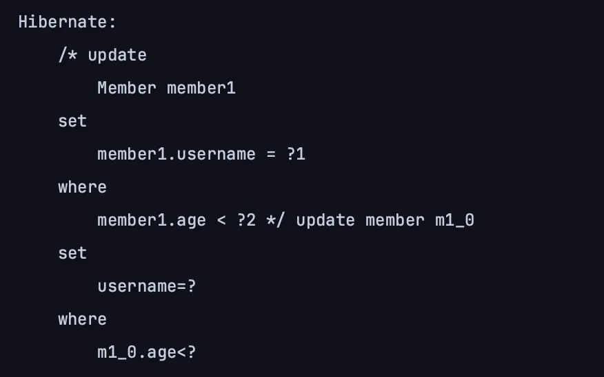
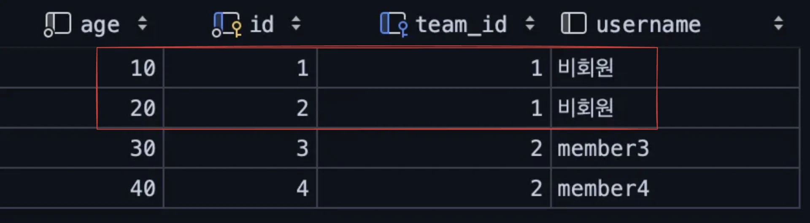
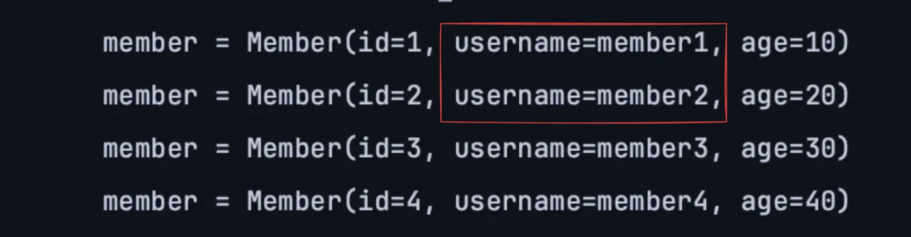
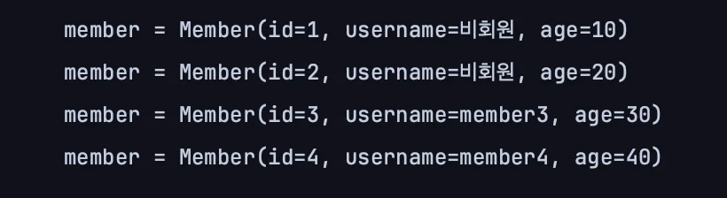
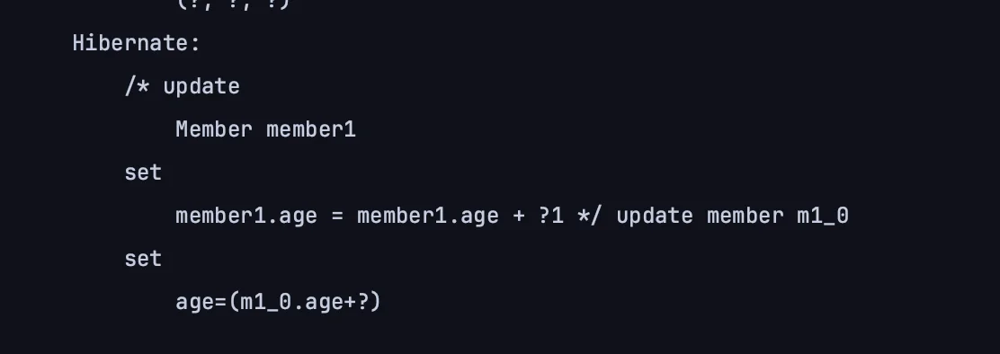
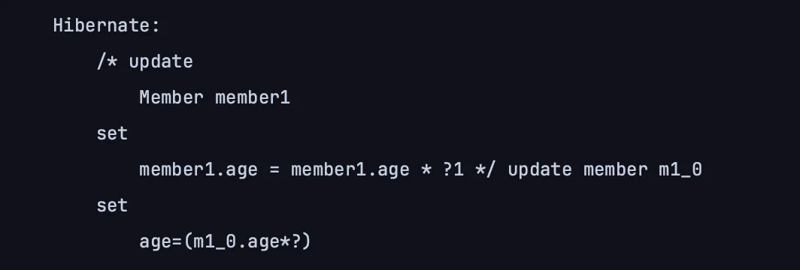
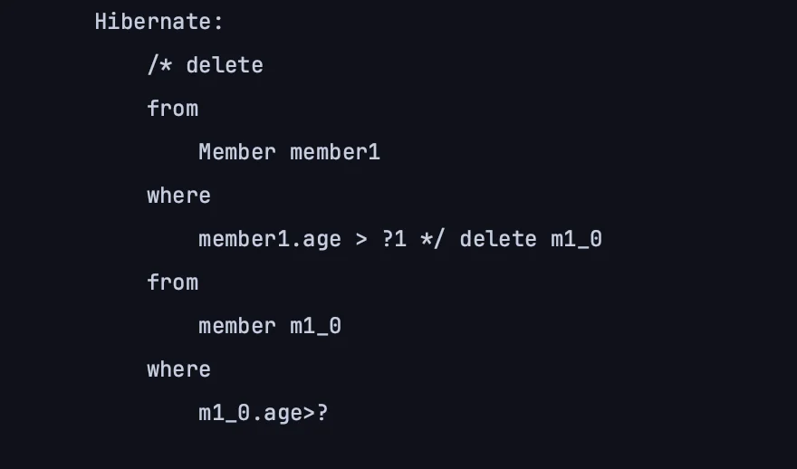

<a id="1c3eda9b0fe181f68b14e3cb8fc4fa49"></a>

## 수정, 삭제 &#45; 벌크(bulk) 연산 

---

> 📖 
> 
> <a id="1c3eda9b0fe181a8bd4cf5817b2b8902"></a>
> 
> 변경 감지(dirty checking)으로 업데이트 처리 시, 엔티티 한 건마다 쿼리를 날린다&#46; <br>따라서 여러 엔티티가 업데이트 되는 경우, 일일이 쿼리를 날린다&#46;
> 
> <a id="1c3eda9b0fe18103963acb88e40e21f8"></a>
> 
> 이를 성능 최적화를 위해 <u>한 번의 쿼리</u>로 처리할 수 있는데, 이러한연산을 <u>벌크(bulk) 연산</u>이라 한다&#46;
> 
> - 수정&#58; <code>queryFactory&#46;</code><u><code>update</code></u><code>(&#46;&#46;&#46;)&#46;</code><u><code>set</code></u><code>(&#46;&#46;&#46;)&#46;excute(…)</code>
> 
> - 삭제&#58; <code>queryFactory&#46;</code><u><code>delete</code></u><code>(&#46;&#46;&#46;)&#46;</code><u><code>where</code></u><code>(&#46;&#46;&#46;)&#46;excute(…)</code>

- Update &#45; 수정
    > <code>queryFactory&#46;</code><u><code>update</code></u><code>(&#46;&#46;&#46;)&#46;</code><u><code>set</code></u><code>(&#46;&#46;&#46;)&#46;excute(…)</code>

    <details>
    <summary>벌크 연산을 사용한 조건에 맞는 특정 엔티티의 모든 레코드 한번에 수정</summary>

    - 테스트 코드
        <a id="1c3eda9b0fe181999a64d5e312983b4d"></a>

        ```java
        @Test
        // @Commit
        public void bulkUpdate() {

            // member1.age = 10 -> username: 비회원
            // member2.age = 20 -> username: 비회원
            // member3.age = 30 -> username: 유지
            // member4.age = 40 -> username: 유지

            // update된 엔티티 숫자를 반환함
            long count = queryFactory
                    .update(member)
                    .set(member.username, "비회원")
                    .where(member.age.lt(28))
                    .execute();
        }
        ```

    - 쿼리 확인
        - 아래와 같이 update 쿼리 한번을 날리며

        


    - 생성된 member 테이블 중에서 조건에 해당하는 레코드가 모두 업데이트된 것을 확인할 수 있다&#46; 
        

    </details>

    <details>
    <summary>☝🏻 &#91; 중요&#33; &#93; <strong><u>벌크 연산</u></strong><strong> </strong>사용 시,<strong><u> 주의해야 할 점</u></strong></summary>

    <a id="1c3eda9b0fe1817bb986c84f0b8aeb3a"></a>

    ### 벌크 연산의 문제점 &#45;  DB, 영속성 컨텍스트 상태값 불일치 

    ---

    <a id="1c3eda9b0fe181da9737e377bca94ec0"></a>

    JPA에는 기본적으로 영속성 컨텍스트에 엔티티들이 다 올라가 있다&#46; 

    - 위 예시에서 사용하는 <code>member1, 2, 3, 4</code> 엔티티들 모두 영속성 컨텍스트에 올라가 있다&#46; 

    <a id="1c3eda9b0fe1815ba12ae0fa17b6270b"></a>

    <strong>벌크 연산</strong>은 <strong><u>영속성 컨텍스트를 무시</u></strong>하고 <strong><u>바로 DB로 쿼리를 날려 값을 변경한다&#46; </u></strong>

    <a id="1c3eda9b0fe181109c61cf374f9925bf"></a>

    따라서 <u>DB</u>와 <u>영속성 컨텍스트</u>의 <strong>엔티티의 상태(데이터)가 달라</strong>진다&#46; 

    - 영속성 컨텍스트 
        <a id="1c3eda9b0fe1819eb315fc00ff4e01f5"></a>

        ```java
        member1.age = 10 -> username: "member1"
        member2.age = 20 -> username: "member2"
        member3.age = 30 -> username: "member3"
        member4.age = 40 -> username: "member4"
        ```

    - DB 
        <a id="1c3eda9b0fe181299f81caab0009a4d7"></a>

        ```java
        member1.age = 10 -> username: "비회원"
        member2.age = 20 -> username: "비회원"
        member3.age = 30 -> username: "member3"
        member4.age = 40 -> username: "member4"
        ```

    <a id="1c3eda9b0fe181f99d36c02ade7b4273"></a>

    JPA는 DB에서 값을 가져왔어도 영속성 컨테스트에 해당 엔티티 값이 존재한다면 DB의 값을 버리고 영속성 컨텍스트의 값을 반환한다&#46; 

    - <strong><u>영속성 컨텍스트</u></strong> 내부의 상태 값이 항상 <strong><u>우선권을 가진다&#46;</u></strong>

    <a id="1c3eda9b0fe18120ac72d5029f5f3a97"></a>

    따라서 <u>벌크 연산으로 업데이트된 값</u>이 <strong>조회 시 영속성 컨텍스트에서 가져오기 때문</strong>에  <strong><u>반영되지 않</u></strong>는다&#46; 

    - 업데이트 벌크 연산 이후, 조회 
        <a id="1c3eda9b0fe181d5a7d5e1f7c86d264c"></a>

        ```java
        List<Member> result = queryFactory
        					.selectFrom(member)
        					.fetch();
        					
        for (Member member : result) {
        		System.out.println("member = " + member);
        }
        ```

    <a id="1c3eda9b0fe1813a831bedd9dc9f1fdf"></a>

    <br>아래와 같이 DB에는 정상 반영이 되었지만, 조회 시 우선권을 갖는 영속성 컨텍스트 내부의 상태 값을 가져오기 때문에, <strong><u>업데이트(벌크 연산) 연산이 반영되지 않은 값을 조회</u></strong>하여 가져오는 것을 확인할 수 있다&#46;

    - DB
        

    - 조회 시 출력값
        

    <a id="1c3eda9b0fe18137a8d5c1f6197905a8"></a>

    ### 해결 &#45; 영속성 컨택스트 초기화

    ---

    - 벌크 연산 실행 후 , 항상 <u>영속성 컨텍스트를 초기화</u> 한다
        <a id="1c3eda9b0fe181759dc5e307474e850c"></a>

        ```java
        em.flush();
        em.clear();
        ```

        <details>
        <summary>&#91; 전체 코드 &#93;</summary>

        <a id="1c3eda9b0fe18192b03bfd591ce991ea"></a>

        ```java
        @Test
        @Commit
        public void bulkUpdate() {

            // member1.age = 10 -> username: 비회원
            // member2.age = 20 -> username: 비회원
            // member3.age = 30 -> username: 유지
            // member4.age = 40 -> username: 유지

            // update된 엔티티 숫자를 반환함
            long count = queryFactory
                    .update(member)
                    .set(member.username, "비회원")
                    .where(member.age.lt(28))
                    .execute();

            // 영속성 컨테스트 초기화
            em.flush();
            em.clear();

            // 조회
            List<Member> result = queryFactory
                    .selectFrom(member)
                    .fetch();

            for (Member member : result) {
                System.out.println("member = " + member);
            }
        }
        ```

        </details>

    - 영속성 컨텍스트 초기화 이후, 정상적으로 업데이트 값이 조회되는 것을 확인할 수 있다&#46; 
        

    ---

    <a id="1c3eda9b0fe1813db1c9d1a4c7505252"></a>

    물론 바뀐 이후, 값을 조회하지 않는다면 비지니스 로직 상에서 큰 상관은 없다&#46; 

    <a id="1c3eda9b0fe181c09a6eda34f92e38e5"></a>

    그러나 연관이 있는 경우 큰 버그가 발생될 수 있기 때문에, 벌크 연산 사용 시에는 항상 주의를 해야한다&#46; 

    </details>

    <details>
    <summary>벌크 연산 &#45; 사직 연산 </summary>

    <details>
    <summary><code>&#43;</code>, <code>&#45;</code> </summary>

    - <code>&#46;add()</code> 를 통해 <code>&#43;</code> 연산 처리를 할 수 있다&#46; 

    - <code>&#45;</code> 연산은 <code>&#46;add()</code> 에 <strong><u>음수</u></strong>를 넘겨 처리한다&#46; 
        - ex) <code>&#46;add(&#45;1)</code>

    - 테스트 코드
        <a id="1c3eda9b0fe18152b822f571e09b6b22"></a>

        ```java
        @Test
        public void bulkAdd() {
            long count = queryFactory
                    .update(member)
                    .set(member.age, member.age.add(1))  // - 연산 시, 음수(ex. -1)를 인자로 넘기면 된다.
                    .execute();
        }
        ```

    - 쿼리 확인
        

    </details>

    <details>
    <summary><code>&#42;</code></summary>

    > <code>&#46;multiple()</code>

    - 테스트 코드
        <a id="1c3eda9b0fe18102acefe80331a10fd6"></a>

        ```java
        @Test
        public void bulkMultiple() {
            long count = queryFactory
                    .update(member)
                    .set(member.age, member.age.multiply(2))
                    .execute();
        }
        ```

    -  쿼리 확인
        

    </details>

    </details>

<details>
<summary>Delete &#45; 삭제</summary>

> <code>queryFactory&#46;</code><u><code>delete</code></u><code>(&#46;&#46;&#46;)&#46;</code><u><code>where</code></u><code>(&#46;&#46;&#46;)&#46;excute(…)</code>

- 테스트 코드
    <a id="1c3eda9b0fe181b7a2ccfc0cd5550714"></a>

    ```java
    @Test
    public void bulkDelete() {
        long count = queryFactory
                .delete(member)
                .where(member.age.gt(18))
                .execute();
    }
    ```

-  쿼리 확인
    

</details>
