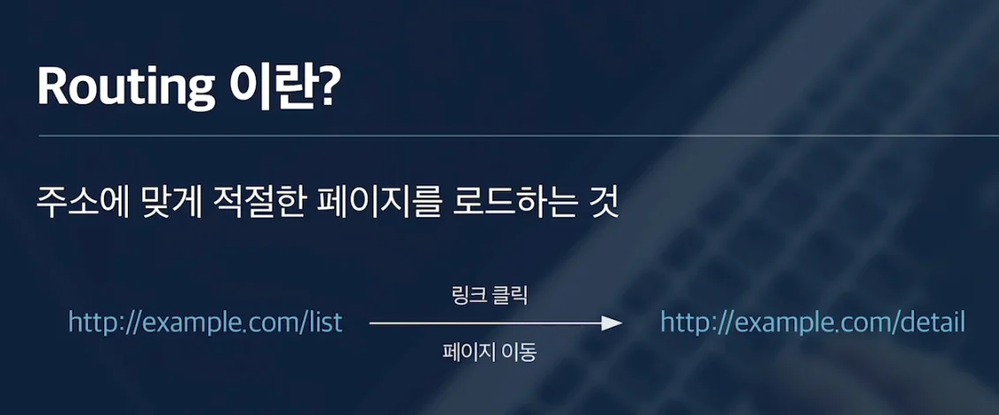
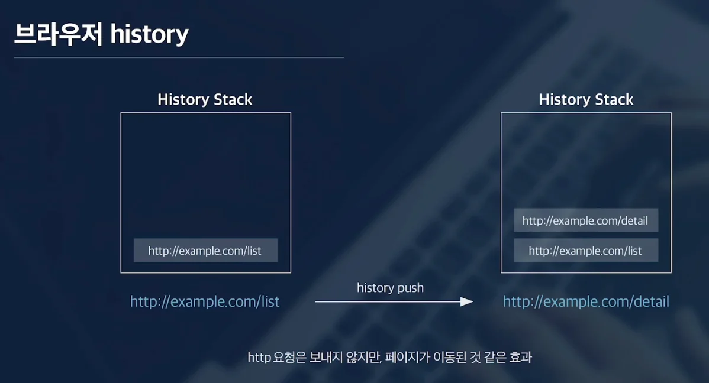

## Routing

---

프론트에서 라우팅이란, 주소에 맞게 적절한 페이지를 로드하는 것이다 

예를 들어, 특정 사이트의 리스트라는 경로에 있다가 화면에 있는 <u>링크를 클릭</u>해서 <strong>다른 페이지로 이동</strong>하는 경우, <code>라우팅</code> 이라 한다&#46;

전통적인 방식의 웹 서비스에서의 <code>라우팅</code>은 <strong><u>서버에 요청하는 주소에 따라 서로 다른 페이지의 HTML을 보여주는 방식</u></strong>이었다&#46; 

SPA 방식에서는 페이지가 여러 개가 아닌 말 그대로 싱글 페이지 애플리케이션이기 때문에,  SPA에서의 <code>라우팅</code>은 <strong><u>브라우저의 히스토리를 조작</u></strong>하는 방식으로 동작한다&#46; 

## 브라우저 history

---

브라우저는 <strong><u>페이지 이동에 대한 내용을 기록</u></strong>하기 위해 <code>히스토리 객체</code>를 가지고 있다&#46;

- 페이지를<strong><u> 앞으로 가기</u></strong>, <strong><u>뒤로 가기</u></strong> 하여 변경할 수 있는 것도 이 히스토리 객체 덕분이다 &#46;

히스토리 객체에서 제공하는 기능들을 활용해 실제 다른 링크로 페이지를 이동하지 않지만 즉, 해당하는 주소로 HTTP 요청을 보내지 않지만 히스토리를 직접 쌓음으로써 페이지가 이동하는 것과 같은 효과를 줄 수 있다&#46; 

## React&#45;router

---

<code>SPA</code>에서는 이 <strong><u>히스토리 객체를 사용</u></strong>하여 페이지가 변경(라우팅)되는 효과를 활용하며,  리액트에서는 <code>리액트 라우터</code>라는 라이브러리를 통해 구현할 수 있다&#46; 

즉, 리액트 라우터는 <strong><u>리액트에서 라우팅 기능을 구현</u></strong>한 라이브러리이다&#46;

따라서 내부적으로 히스토리 객체를 통해 주소를 변경하고, 변경된 주소에 대한 적절한 화면을 보여줄 수 있도록 도와준다&#46;
