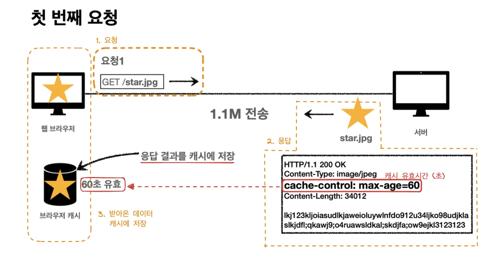
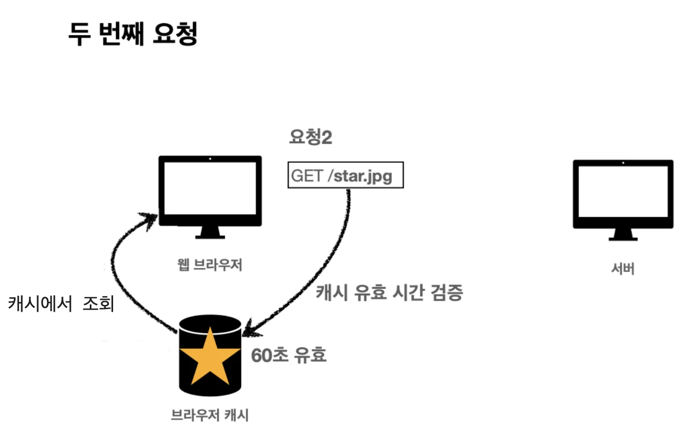
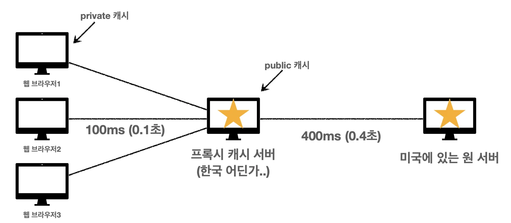
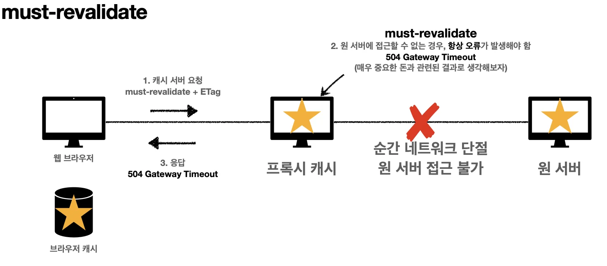

# 캐시 기본 동작

캐시가 없던 과거

데이터가 변경되지 않아도 같은 요청을 하면 계속 네트워크를 통해서 데이터를 받아와야 했다&#46; 

인터넷 네트워크는 매우 느리고  비싸다&#46; 따라서 위와 같은 요청을 계속해서 받아오는 불필요하고 비용이 큰 행위를 개선하기 위해  <code>캐쉬</code>라는 개념이 탄생했다&#46;

이전의 중복되는 다운로드를 통해 생기는 로딩 속도 저하와, 느린 사용자 경험을 캐쉬가 도입되므로써  해결되었다&#46; 

## 캐시 (cache)

캐시를 통해 동일 데이터 재요청 시 소모되는 불필요한 비용들을 제거했다&#46; 서버로부터 받아오는 데이터를 캐시에 저장하여, 해당 데이터의 캐시 유효기간이 유효할 경우, 서버 요청 없이 캐시에서 데이터를 불러온다&#46;

이를 통해, 브라우저 로딩 속도 향상 및 빠른 사용자 경험, 비싼 네트워크 사용량 감소 등의 이점을 가진다&#46;

### 유효 기간 내 요청

> 동일한 데이터 두번째 요청 시,  캐시 유효 시간 검증하고  기간이 유효하다면, 캐시에 있는 데이터 불러옴

### 유효 기간 외 요청

> 캐시 유효 시간이 초과되면, 서버에 해당 데이터를 요청 및 검증하여, 해당 캐시를 갱신 or 다운로드  한다&#46; ⇒ 마지막 수정일(Last&#45;Modified) 가 변경되었으면 재다운      아니면 유효기간 재갱신 후 캐쉬 데이터 사용

# 검증 헤더와 조건부 요청

> 📌 <strong>검증 헤더</strong>
> 
> | 클라이언트   | 서버 |
> | --- | --- |
> | <code>Last&#45;Modified</code> | <code>Last&#45;Modified</code> |
> | <code>ETag</code> | <code>ETag</code> |

## <code>if&#45;Modified&#45;Since</code>, <code>Last&#45;Modified</code>

> 데이터의 최종 수정 날짜 정보가 담긴 헤더

- 클라이언트&#58; <code>if&#45;Modified&#45;Since</code>

- 서버&#58; <code>Last&#45;Modified</code>

> 📌 <strong>1) Last&#45;Modified(클라&#46;&#46;) == Last&#45;Modified(서버)&#58;  데이터 최종 수정일 동일 (If&#45;Modified&#45;Since)</strong>
> 
> 
> 
> → 상태코드(304 Not Modified) &#43; 헤더만(바디X) 보내 캐시의 유효기간만 갱신
> 
> 
> 
> → 클라이언트는 갱신된 캐시 데이터 재활용
> 
> 
> 
> ⇒ 네트워크 다운로드가 발생하지만, 용량이 적은 헤더만 다운 받아 매우 효율적이다&#46;

> 📌 <strong>2)</strong> <strong>Last&#45;Modified(클라&#46;&#46;) &#33;= Last&#45;Modified(서버)</strong>&#58; 데이터 최종 수정일 다름(If&#45;Unmodified&#45;Since)
> 
> 
> 
> → 데이터 다운로드
> 
> 
> 
> →  정상 다운 (200 OK)

> ☝🏻 <strong>단점)</strong>
> 
> - <strong>1초 미만(0&#46;X 초) 단위로 캐시 조정 불가능</strong>
> 
> - <strong>날짜 기반의 로직  사용</strong>
>     - <strong>데이터를 수정하여 날짜가 다르지만, 같은 데이터를 수정해 결과가 같은 경우, 다른 데이터로 판단하여 재다운로드 발생</strong>
> 
> - <strong>서버에서 별도의캐시 로직을 관리하고 싶은 경우</strong>
>     - ex) 스페이스, 주석 처럼 크게 영향이 없는 변경에서 캐시를 유지하고 싶은 경우

## <code>ETag(Entity Tag)</code>

> 📌 캐시용 데이터에 임의의 고유한 명을 부여하여 구분
> 
> 
> 
>      ex) ETag&#58; “v1&#46;0”, ETag&#58; “a2jiodwjeljl3
> 
> 
> 
> 데이터가 변경되면, 이름을 변경하여 새로 생성된다(Hash 다시 생성)
> 
> 
> 
> ex)  예) ETag&#58; “aaaaa” → ETag&#58; “bbbbb”

단순하게 ETag value(이름)를 클라이언트와 서버끼리  Match 하여 갱신 및 다운로드 여부를 판단한다&#46;

> 동작은 I<code>f&#45;Modified&#45;Since, Last&#45;Modified</code> 와 동일

### 1) ETag(클라이언트) == ETag(서버)

→ 상태코드&#91; 304 Not Modified &#93; &#43; 헤더 ( 캐시 갱신 )

→ 클라이언트에서 갱신된 캐시 불러서 사용

2) ETag(클라이언트) &#33;= ETag(서버)

→ 재 다운로드 요청

→ 정상 다운, 상태코드 &#91; 200 OK &#93;

> 캐시 제어 로직을 서버에서 완전히 관리한다&#46; 클라이언트는 단순히 서버에서 받아오고 매치시 보내주기만 함(클라이언트는 캐시 메커니즘을 모름) 

ex) 서버는 배타 오픈 기간인 3일 동안 파일이 변경되어도 ETag를 동일하게 유지 (약간 어거지 예시라고 하심)

ex) 애플리케이션 배포 주기에 맞추어 ETag 모두 갱신

## 캐시 제어 헤더

> 📌 <strong>Cache&#45;Control&#58; 캐시 제어</strong>
> 
> 
> 
> Pragma&#58; 캐시 제어(하위 호환)  Expires&#58; 캐시 유효 기간(하위 호환)

### Cache&#45;Control 

> <strong>캐시 지시어(directives)</strong>

- Cache&#45;Control&#58; max&#45;age
    

    캐시 유효 시간, 초 단위

- Cache&#45;Control&#58; no&#45;cache
    

    데이터는 캐시해도 되지만, 항상 원(origin) 서버에 검증하고 사용

- Cache&#45;Control&#58; no&#45;store
    

    민감한 데이터 정보 캐시로 저장 ❌ 

Pragma( 있다는 거 정도만 )

> <strong>캐시 제어(하위 호환)</strong>

- Pragma&#58; no&#45;cache

- HTTP 1&#46;0 하위 호환

<strong>Expires( </strong>있다는 거 정도만)

> <strong>캐시 만료일 지정(하위 호환)</strong>

- expires&#58; Mon, 01 Jan 1990 00&#58;00&#58;00 GMT

- 캐시 만료일을 정확한 날짜로 지정

-  HTTP 1&#46;0 부터 사용

- 지금은 더 유연한 Cache&#45;Control&#58; max&#45;age 권장

- Cache&#45;Control&#58; max&#45;age와 함께 사용하면 Expires는 무시

# 프록시 캐시

> DNS 서버의 root 형태 처럼(CDN 서비스), 해당 지역 사용자들의 <u>빠른</u> 요청 처리 및 응답을 위한,  하위 서버에 저장되는 캐시들을 말한다&#46; (상위 서버에서 받아옴)

ex) 인기있는 유튜브 영상의 경우 빠르게 재생되지만, 사람들이 잘 안보는 기술관련 영상들은 원서버에서 받아오기 때문에, 시청까지(다운로드) 시간이 매우 길다&#46;

> 최초의 요청에는 캐시가 생성되지 않았기 때문에 origin 서버에서 데이터를 받아야 해서 느림

### <strong>Cache&#45;Control</strong>

> <strong>캐시 지시어(directives) &#45; 기타</strong>

- <strong>Cache&#45;Control&#58; public</strong>
    

    응답이 public 캐시에 저장되어도 됨

- <strong>Cache&#45;Control&#58; private (</strong>기본값)
    

    응답이 해당 사용자만을 위한 것임, private 캐시에 저장해야 함    → 중간 서버에 프록시 캐시로 저장 ❌

- <strong>Cache&#45;Control&#58; s&#45;maxage</strong>
    

    프록시 캐시에만 적용(중간 서버에서만 사용)되는 max&#45;age

- <strong>Age&#58; 60</strong> (HTTP 헤더)
    

    오리진 서버에서 응답 후 프록시 캐시 내에 머문 시간(초)

# 캐시 무효화

### 확실한 캐시 무효화 응답

> 웹브라우저들이 GET요청인 경우, 임의로 캐시를 처리함(휴리스틱) 따라서 캐시 처리를 하면 안되는 부분은 아래의 헤더 및 값 모두 적용해야 함

> /icons/checkmark-line_red.svg <strong>Cache&#45;Control&#58; no&#45;cache, no&#45;store, must&#45;revalidate</strong>
> 
> 
> 
> <strong>Pragma&#58; no&#45;cache  (HTTP 1&#46;0 하위 호환)</strong>

ex) 현재 사용자의 통장 잔고 등 → 계속 갱신되기 떄문

### 캐시 지시어(directives)  &#45; 확실한 캐시 무효화

- <strong>Cache&#45;Control&#58; no&#45;cache</strong>
    

    데이터는 캐시해도 되지만, <strong><u>항상 원 서버에 검증</u></strong>하고 사용해야 함 ( ※ 이름 주의)

- <strong>Cache&#45;Control&#58; no&#45;store</strong>
    

    <strong><u>민감한 정보의 데이터  캐시 저장  ❌ </u></strong> → 메모링서 사용하고 최대한 빨리 삭제 처리

- <strong>Cache&#45;Control&#58; must&#45;revalidate</strong>
    

    <strong>캐시 만료 후 </strong><strong><u>최초 조회</u></strong><u> </u>시 <strong><u>원 서버에 검증</u></strong>해야하며

    

    원 서버 접근 실패 시, 반드시 오류가 발생되어야 한다&#46;  

    

    → 504 (Gateway Timeout)

    

    (유효 시간 내는 캐시 사용함)

- <strong>Pragma&#58; no&#45;cache</strong>
    

     HTTP 1&#46;0 하위 호환 

    > 네이버의 경우 위 까지 지원함 구글의 경우는 글로벌하게 지원해야 하기 때문에, 엄청 오래된 브라우저들도 지원하기 위해  구닥다리 스펙들이 많이 들어가 있다고 함    ex) max&#45;age=0 등

### no&#45;cache 동작

> 원 서버에 접근할 수 없는 경우, 저장된 이전 캐시 데이터를 반환하여 오래된 정보를 보여줌   통장 잔고 등 이전 데이터를 보내면 안되는 case들이 존재 → must&#45;revalidate를 통해 무조건 <code>오류</code>만  발생되도록 동작 변경

### must&#45;revalidate 동작

