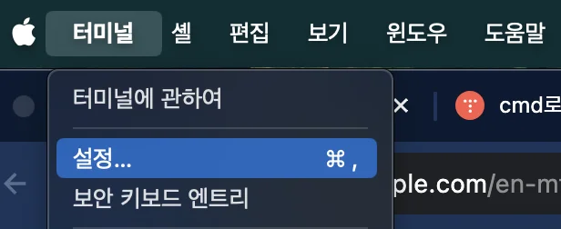
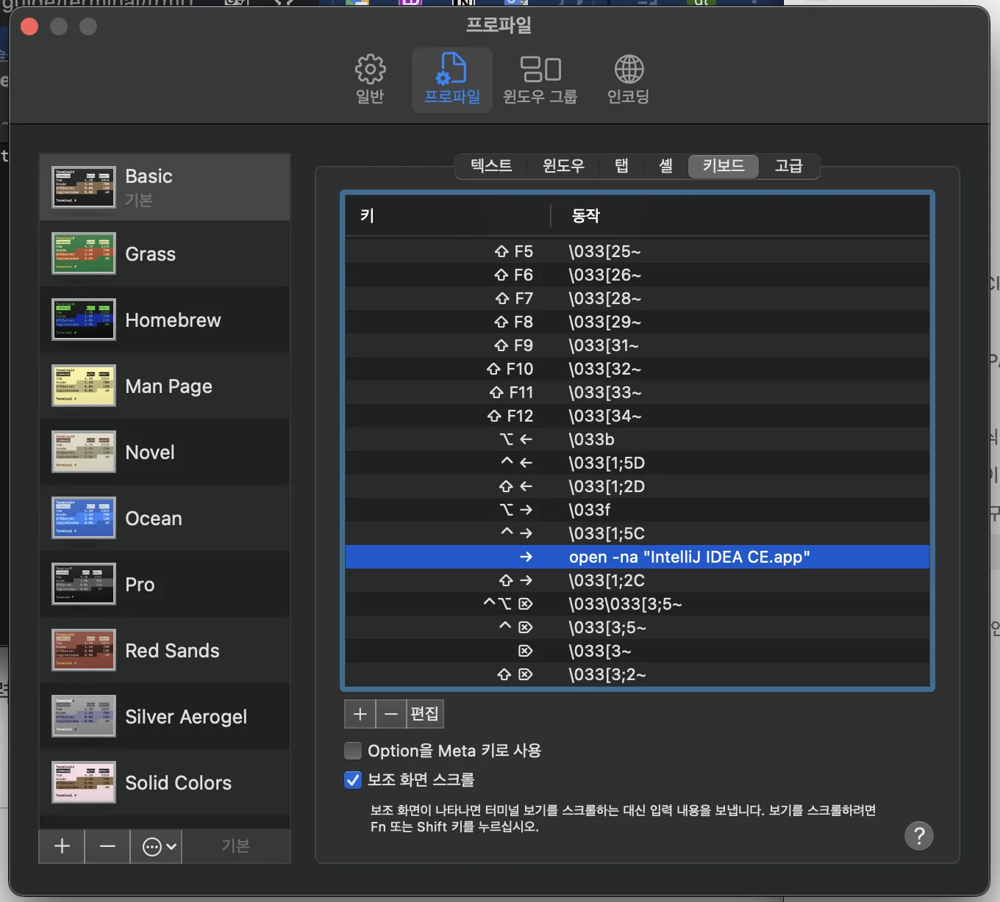
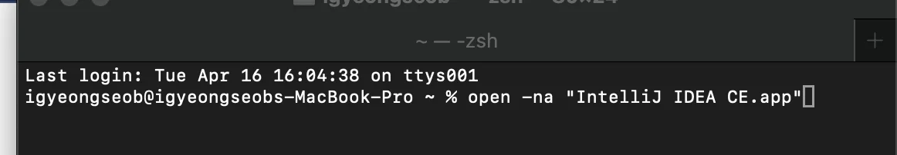
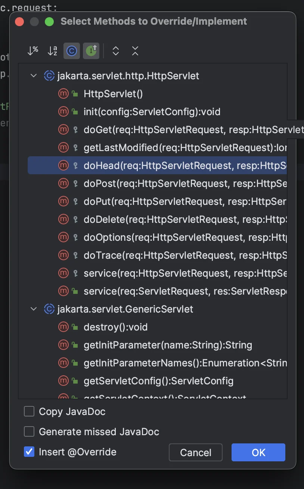
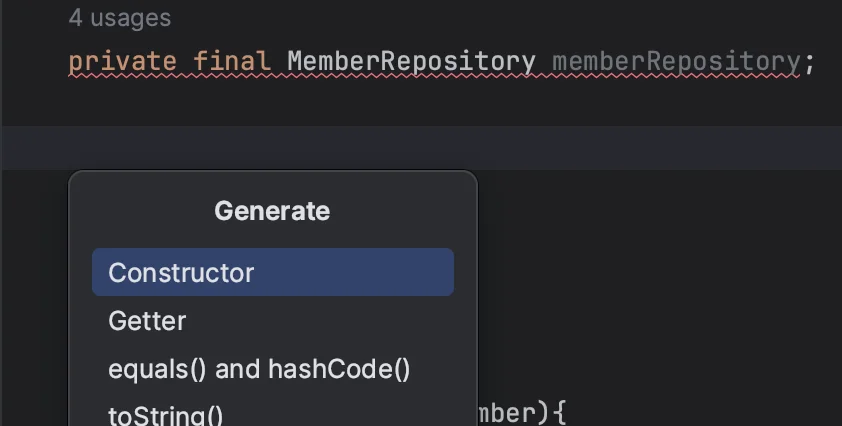
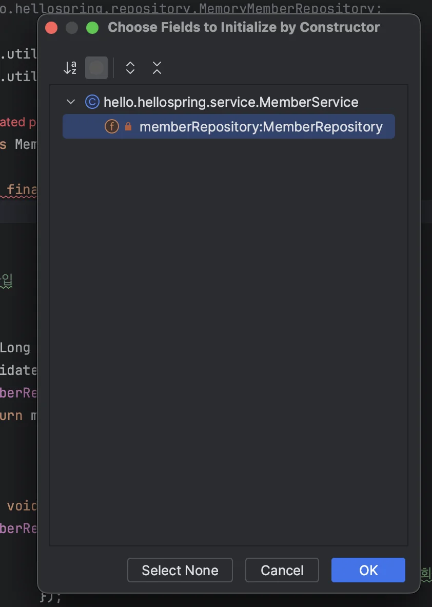
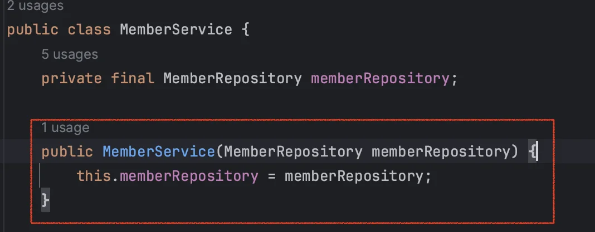
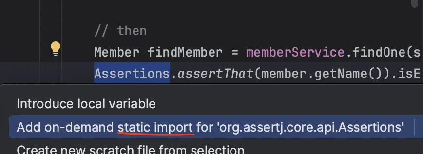

<details>
<summary>Reference</summary>

<a id="1c3eda9b0fe1812eb3a6fa7e5ff542c2"></a>

<a href="https://choichumji.tistory.com/124">https&#58;//choichumji&#46;tistory&#46;com/124</a> ← 단축키 아래 표시 (강의와 동일)

<a id="1c3eda9b0fe181d383dbda5f55134afe"></a>

<a href="https://secondmemory.kr/567">https&#58;//secondmemory&#46;kr/567</a>

<a id="1c3eda9b0fe181aab991fcc0c4d03930"></a>

<a href="https://mangkyu.tistory.com/139">https&#58;//mangkyu&#46;tistory&#46;com/139</a>

</details>

<details>
<summary><strong>코드 단축키워드로 자동완성 기능 &#45; 커스텀 </strong></summary>

- setting &#45; Editor &#45; Live Template

- &#43; 버튼 클릭 및 커스텀 설정 입력

- 적용 후
    > 우클릭 &#45; change context&#46;&#46; &#45; java 

    <a id="1c3eda9b0fe18154a79deb7f6406bcf8"></a>

    <del>이걸 해야지 사용 가능함… 왜그렇지?</del>

- <code>&#36; 명칭 &#36;</code> &#58; 생성 시 변수 커서 설정

</details>

<details>
<summary><strong>인텔리제이 &#45; 터미널에서 열기</strong></summary>

<a id="1c3eda9b0fe181bfb1cbc9250852ee4e"></a>

```bash
open -na "IntelliJ IDEA CE.app"
```

</details>

<details>
<summary><strong>맥 터미널 shorcut 설정</strong></summary>

1. 터미널 &#45; 설정 클릭



1. 프로파일 &#45; 키보드 &#45; <code>&#43;</code> 버튼 &#45; 실행하고 싶은 커스텀 추가 
    

1. 터미널에서 아래와 같이 <code>→</code>  단축키 한번으로 생성 가능
    

</details>

<a id="1c3eda9b0fe18112bf17fbe60948c5fd"></a>

## 맥 &#45;  &#91; <strong>IntelliJ 단축키 모음 &#93;</strong>

|  |  |
| --- | --- |
| 자동완성 | Command &#43; Enter |
| 메서드 오버라이드 | Ctrl &#43; O |
| 인터페이스 구현 | Ctrl &#43; I |
| 커서가 가리키는 부분 리팩터링 | Ctrl &#43; T |
| 커서가 가리키는 부분을 상수로 빼기 | Command &#43; Option &#43; C |
| 이름 일괄 변경(클래스, 변수, 기타 등등) | Shift &#43; F6 |
| 변수 생성 | Command &#43; Option &#43; V |
| 줄 제거 | Command &#43; X |
| 해당 코드를 사용중인 코드로 이동 | Command &#43; B |
| 구현 코드로 이동 | Command &#43; Option &#43; B |
| 코드 위 아래로 이동 | Command &#43; Shift &#43; 위/아래 |
| 최근 탭으로 이동 | Command &#43; E |
| 미리보기와 함께 최근 탭으로 이동 | Command &#43; Shift &#43; E |
| 좌우 탭으로 이동 | Command &#43; Shift &#43; &#91; or &#93; |
| 파일 안에서 탐색 | Command &#43; F |
| 전체 탐색 | Command &#43; Shift &#43; F |
| 파일 안에서 변경 | Command &#43; R |
| 전체 변경 | Command &#43; Shift &#43; R |
| 대소문자 구분 | Option &#43; C |
| 정규식 적용 | Option &#43; X |
| 일괄 대/소문자 전환 | Command &#43; Shift &#43; U |
| 현재 탭 끄기 | Command &#43; W |
| Import 정리 | Ctrl &#43; Option &#43; O |
| 코드(라인) 자동 정렬 | Command &#43; Option &#43; L |
| 실행 | Option &#43; R |
| 멀티 커서 | Option 2번 &#43; 위/아래 |
| 테스트 클래스 생성 | Command &#43; Shift &#43; T |
| 세미콜론과 함께 자동완성 | Command &#43; Shift &#43; Enter |
| 실행 | Ctrl &#43; R |
| 디버깅 | Ctrl &#43; D |
| 현재 메소드/클래스 실행 | Ctrl &#43; Shift &#43; R |
| 현재 메소드/클래스 디버깅 | Ctrl &#43; Shift &#43; D |
| 브레이크 포인트 내부 코드로 이동 | Command &#43; F7 |
| 브레이크 포인트 다음 코드로 이동 | Command &#43; F8 |
| 다음 브레이크 포인트로 이동 | Command &#43; F9 |
| 브레이크 포인트 다음 코드로 이동 | Command &#43; F8 |
| Run 창으로 이동 | Command &#43; 4 |
| Debug 창으로 이동 | Command &#43; 5 |
| Service 창으로 이동 | Command &#43; 6 |
| Getter, Setter 등 자동 생성 | Command &#43; N |
| 한줄 복사 | Command &#43; D |
| 한줄 자르기 | Command &#43; X |
| 한줄 붙여넣기 | Command &#43; V |
| 깃 커밋 | Ctrl &#43; K |
| 깃 커밋 후 푸시 | Ctrl &#43; Shift &#43; K |
| VCS 기능 | Ctrl &#43; V |
| 현재 열려있는 파일 포커싱 | Option &#43; F1 &#43; 1 |
| 프로젝트 창 닫기 | Shift &#43; ESC |
| 프로젝트 화면에 포커싱 | Command &#43; 1 |
| 모든 윈도우 창 닫기 | Command &#43; Shift &#43; F12 |
| 환경설정 창 열기 | Command &#43; , |
| 프로젝트 설정 창 열기 | Command &#43; ; |
| IntelliiJ 전체 검색 창 열기 | Shift &#43; Shift |
| 클래스 검색 창 열기 | Command &#43; O |
| 파일 검색 창 열기 | Command &#43; Shift &#43; O |
| 에러가 발생한 지점으로 이동 | F2 |
| 인라인으로 코드 수정 | Command &#43; Option &#43; N |
| 현재 커서가 있는 부분 선택 | Option &#43; 위 |
| Private 메소드 또는 변수 추출 | Command &#43; Option &#43; M |
| 클래스 계층 보기 | Control &#43; H |
| 메소드 호출 계층 보기 | Control &#43; Option &#43; H |
| 전/후 봤던 코드로 이동 | Command &#43; Option 좌/우 |
| 오버라이딩하는 메소드로 이동 | Command &#43; Option &#43; B |
| 파라미터 미리 보기 | Command &#43; P |
| 지역변수를 메소드 파라미터로 추출 | Command &#43; Option &#43; P |
| 다음 등장에 대한 멀티 커서 선택 | Control &#43; G |

<a id="1c3eda9b0fe181f89f1cfcce05ffe8a1"></a>

## git &#45; 단축키

- 깃 커밋 창 표시&#58; <code>ctrl</code> &#43; <code>k</code>

- 깃 푸쉬 창 표시&#58; <code>ctrl</code> &#43; <code>shift</code> &#43; <code>k</code>

<a id="1c3eda9b0fe181b39671db0229a352de"></a>

### <strong>&#91; LiveTemplate 설정 &#93;</strong>

<a id="1c3eda9b0fe18192bdfbfd82c41dbfb5"></a>

<a href="https://mangkyu.tistory.com/270">https&#58;//mangkyu&#46;tistory&#46;com/270</a>

---

<details>
<summary>연 파일 이동</summary>

<a id="1c3eda9b0fe181eca541ed1f5b4da9b0"></a>

왼쪽⭠ &#58;  ( cmd&#91;<code>⌘</code>&#93; &#43; shift&#91;<code>⇧</code>&#93; &#43; <code>&#91;</code> )

<a id="1c3eda9b0fe181e4b0e9e6831a5863b3"></a>

오른쪽⭢ &#58;  ( cmd&#91;<code>⌘</code>&#93; &#43; shift&#91;<code>⇧</code>&#93; &#43; <code>&#93;</code>)

</details>

<a id="1c3eda9b0fe18128a449f34331eafb8c"></a>

### 단축키 커스텀 설정

<a id="1c3eda9b0fe181dba5d0d96613482705"></a>

설정 열기&#58; <code>cmd</code> &#43; <code> ,</code>

<a id="1c3eda9b0fe181f18de0f99c79e5fdd6"></a>

화면이동&#58; <code>shift</code> &#43; <code>cmd</code> &#43; ( <code>&#91; </code>, <code>&#93; </code>)  (기본&#58; <code>ctrl</code> &#43; <code>←</code> , <code>→ </code>)

<a id="1c3eda9b0fe181b3b770e128445a4442"></a>

분할 화면 이동&#58; <code>cmd</code> &#43; <code>shift</code> &#43; &#91;<code>‘</code> , <code>&#58;</code> &#93;

<a id="1c3eda9b0fe1816c995ef720329a96c5"></a>

오른쪽으로 화면 분할&#58; <code>cmd</code> &#43; <code>shift</code> &#43; <code>/</code>

<details>
<summary><strong>Override/ implement Method&#58; </strong><strong><code>ctrl</code></strong><strong> &#43; </strong><strong><code>o</code></strong></summary>



</details>

- 프로젝트 전체에서 코드 검색&#58; <code>cmd</code> &#43; <code>shift</code> &#43; <code>f</code>

- 파일 rename&#58; <code>shift</code> &#43; <code>f6</code>

- 로직 외부 메서드로 추출(extract method)&#58; <code>apt</code> &#43; <code>cmd</code> &#43; <code>m</code>

- 모든 파일 검색&#58; <code>shift</code> x 2

- 참조 클래스 이동&#58;  <code>cmd</code> &#43; <code>click</code> or <code>cmd</code> &#43; <code>b</code>

- <strong><u>구현체 확인</u></strong>&#58; <code>cmd</code> &#43; <code>option</code> &#43; <code>b</code>  or  <code>cmd</code>  &#43; <code>click</code>

- 클래스 계층 구조 표시&#58; <code>ctrl</code> &#43; <code>h</code>

- 파일 실행 검책창 열기&#58; <code>ctrl</code> &#42; 2

- 리펙토링 창 열기&#58; ctrl &#43; t

<details>
<summary>현재 구문 완성&#58;  <code>cmd</code> &#43; <code>shift</code> &#43; <code>enter</code> </summary>

<a id="1c3eda9b0fe18131883ec11639153b64"></a>

→ 글 중간에  다음 라인으로 변경 가능, ; 생략된 경우 붙여줌

<a id="1c3eda9b0fe18144994ee62a55c191f1"></a>

→ for 문인 경우 중괄호 및 대괄호 자동 생성해줌

</details>

- 최근 실행한 파일 확인&#58; <code>cmd</code> &#43; <code>e</code>

- 에디터 포커스&#58; <code>esc</code>

<a id="1c3eda9b0fe181a5b775eac7884d5223"></a>

이전 실행한 코드 재실행&#58; <code>ctrl</code> &#43; <code>r</code>

<details>
<summary><strong>코드 인라인 변경, 코드 합침</strong>&#58; <code>cmd</code> &#43; <code>option</code>  &#43; <code>n</code> </summary>

<a id="1c3eda9b0fe18111929add28c23581e3"></a>

```java
int count = prototypeBean.getCount();
return count;

 코드 합침: cmd + option  + n
return prototypeBean.getCount();
```

</details>

- <code>cmd</code> &#43; <code>b</code> &#58;  &#91; <strong>인터페이스 ↔ 구현체 &#93; </strong>(외부 라이브러리도 포함)

- <code>cmd</code> &#43; <code>opt</code> &#43; <code>b</code> (<code>cmd</code> &#43; <code>b</code>)&#58; 인터페이서 → 구현체 목록 표시 or  구현체 → 인터페이스 이동

- <code>cmd</code> &#43; <code>e</code> &#58; 과거 히스토리 출력, 프로젝트 파일 검색

- <code>shift</code> x 2 &#58; search 창 열기

- <code>cmd</code> &#43; <code>enter</code> &#43; <code>e</code>&#58;  이전 작성 코드로 이동

- psvm &#43; <code>enter</code>&#58; <strong><u>public static void main() {}</u></strong> 단축 생성키 

- soutv &#43; <code>enter</code>&#58;<strong><u> System&#46;out&#46;println()</u></strong> 단축 생성키 

- 코드 자동 완성&#58; <code>cmd</code> &#43; <code>Shift</code> &#43; <code>enter</code>

- 이전 커서 위치 이동&#58; <code>⌘ </code> &#43; <code>&#91;</code>

- 다음 커서 위치로 이동&#58; <code>⌘</code> &#43; <code>&#91;</code>

- 파일 생성 <code>cmd &#43; n </code>, cmd &#43; shift &#43; n

<details>
<summary>constructor 생성 (<code>cmd</code> &#43; <code>n</code> → <code>constructor</code>)</summary>







</details>

- 현재 위치에서 바로 다음 줄로 변경&#58; <code>cmd</code> &#43; <code>shift</code> &#43; <code>enter</code>

- 해당하는 value 값에 변수 생성&#58; <code>cmd</code> &#43; <code>option</code> &#43; <code>v</code>

-  불러오지 못한 패키지 import  or static import 처리 &#58; <code>option</code> &#43; <code>enter</code>
    

- 리네임&#58; <code>shift</code> &#43; <code>F6</code>

- 리펙토링 단축키&#58; <code>ctrl</code> &#43; <code>t</code>   

- 외부함수로 추출&#58;<strong><code>cmd</code></strong><strong> &#43; </strong><strong><code>option</code></strong><strong>&#43; </strong><strong><code>m</code></strong>

- <strong>테스트 자동 생성</strong>&#58;  생성하려는 클래스 클릭, <code>cmd</code> &#43; <code>shift</code> &#43; <code>t</code>

- <strong>전에 실행한 테스트 재실행</strong>&#58; <code>ctrl </code>&#43; <code>r</code>

- <strong>설정한 인자 확인</strong>&#58; <code>cmd </code>&#43; <code>P</code>

- 기본 코드 완성&#58; cmd &#43; space

- 스마트 코드 완성&#58; cmd &#43; shift &#43; space

- 자동 완성&#58; cmd &#43; shift &#43; enter

- 같은 코드 중복 선택(차례로)&#58; ctl &#43; G

- ‘’(한번에)&#58; ctl &#43; cmd &#43; G

- 선택 코드 찾기&#58; cmd &#43; G

- 선택 코드 줄 이동&#58; cmd(or option) &#43; shift &#43; 화살표(위, 아래)

- 정의된 곳 이동&#58; cmd &#43; B

- 선택영역 확장 축소&#58; option &#43; 화살표(위, 아래)

- 선택 커서 영역 세로로 편집하기&#58; cmd &#43; shift &#43; 8 &#91;check box&#93;
