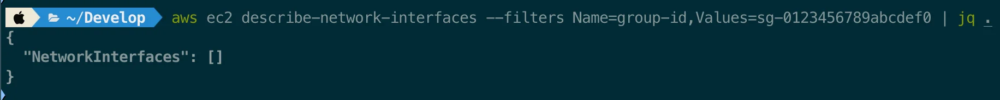
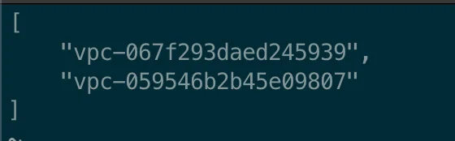
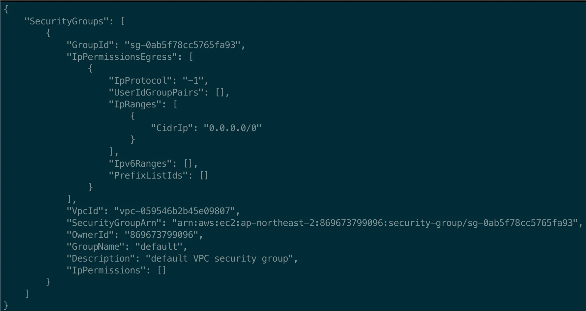
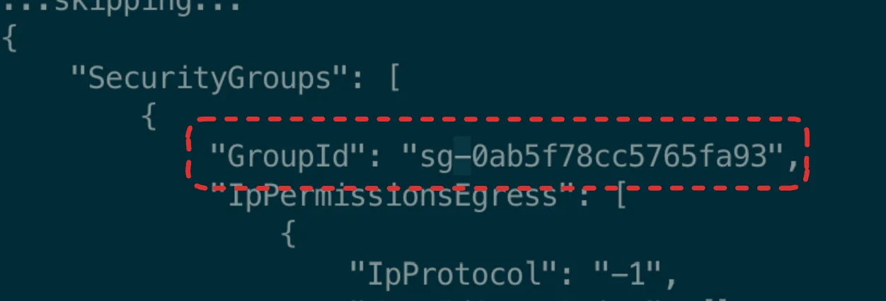
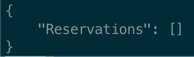
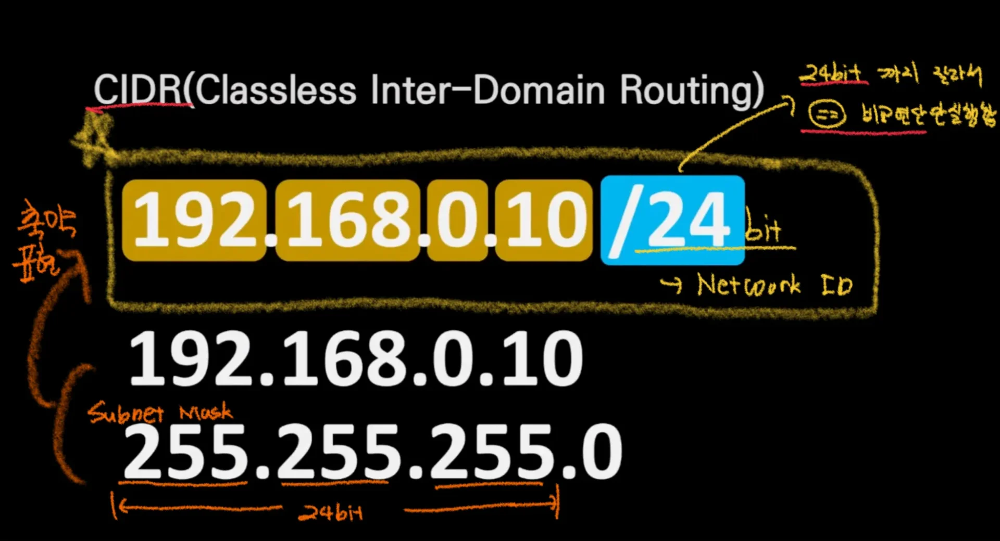

<details>
<summary>AWS CLI 로그인 ( IAM 계정 사용 )</summary>

<a id="1c3eda9b0fe1819bac0beacee2359c40"></a>

```json
aws configure
```

- 아래 내용 차례대로 입력
    <a id="1c3eda9b0fe181b8b537ccb31dff5a2b"></a>

    ```json
    AWS Access Key ID [None]: AKIAxxxxxxxxxxxxxxx
    AWS Secret Access Key [None]: XXXXXXXXXXXXXXXXXXXXXXXXXXX
    Default region name [None]: ap-northeast-2   # (서울 리전 예시)
    Default output format [None]: json
    ```

</details>

<details>
<summary>로그인 된 계정 정보 조회 </summary>

<a id="1c3eda9b0fe1817484dce4dff721181e"></a>

```json
aws sts get-caller-identity
```

<details>
<summary>결과</summary>

<a id="1c3eda9b0fe181e1bd08c43ba7f17391"></a>

```json
{
    "UserId": "AIDA4U7EZBW4APT7FSYZC",
    "Account": "869673799096",
    "Arn": "arn:aws:iam::869673799096:user/my-computer"
}
```

</details>

</details>

<details>
<summary>EC2 보안 그룹</summary>

- <strong>기본 조회</strong>
    <a id="1c3eda9b0fe18119a187fbfb7f4af6d1"></a>

    ```plaintext
    aws ec2 describe-security-groups
    ```

    <details>
    <summary>결과</summary>

    <a id="1c3eda9b0fe1818289e1d7a240fa5301"></a>

    ```json
    {
        "SecurityGroups": [
            {
                "GroupId": "sg-0ab5f78cc5765fa93",
                "IpPermissionsEgress": [
                    {
                        "IpProtocol": "-1",
                        "UserIdGroupPairs": [],
                        "IpRanges": [
                            {
                                "CidrIp": "0.0.0.0/0"
                            }
                        ],
                        "Ipv6Ranges": [],
                        "PrefixListIds": []
                    }
                ],
                "VpcId": "vpc-059546b2b45e09807",
                "SecurityGroupArn": "arn:aws:ec2:ap-northeast-2:869673799096:security-group/sg-0ab5f78cc5765fa93",
                "OwnerId": "869673799096",
                "GroupName": "default",
                "Description": "default VPC security group",
                "IpPermissions": []
            },
            {
                "GroupId": "sg-0608ececdcb65aede",
                "IpPermissionsEgress": [
                    {
                        "IpProtocol": "-1",
                        "UserIdGroupPairs": [],
                        "IpRanges": [
                            {
    ```

    </details>

- <strong>필터링 ID, NAME</strong>
    <a id="1c3eda9b0fe181deb87dcfdddf5b3982"></a>

    ```json
    aws ec2 describe-security-groups --query "SecurityGroups[*].{ID:GroupId, Name:GroupName}"
    ```

    <details>
    <summary>결과 </summary>

    <a id="1c3eda9b0fe1819e9680dac2ebda15ce"></a>

    ```json
    [
        {
            "ID": "sg-0ab5f78cc5765fa93",
            "Name": "default"
        },
        {
            "ID": "sg-0608ececdcb65aede",
            "Name": "default"
        }
    ]
    ```

    </details>

- 사용 중인지 확인
    <a id="1c3eda9b0fe1811cbaa5ce366df6a080"></a>

    ```json
    aws ec2 describe-network-interfaces --filters Name=group-id,Values=sg-0123456789abcdef0
    ```

    

    - 사용 중인 보안 그룹 없음

- 보안 그룹 삭제
    <a id="1c3eda9b0fe1818b984afc7da130ce5a"></a>

    ```json
    aws ec2 delete-security-group --group-id sg-0123456789abcdef0
    ```

</details>

<details>
<summary>VPC로 보안 그룹 확인하고 삭제하기 </summary>

<details>
<summary>1&#46; 전체 vpc의 id 조회</summary>

<a id="1c3eda9b0fe181018d44efea1066b4fb"></a>

```json
aws ec2 describe-vpcs --query "Vpcs[*].VpcId"
```



</details>

<details>
<summary>2&#46; 해당 vpc를 사용하는 보안그룹 조회</summary>

<a id="1c3eda9b0fe181c6b0fcfab38e575f4b"></a>

```json
aws ec2 describe-security-groups --filters "Name=vpc-id,Values={vpc id}"

// ex)
// aws ec2 describe-security-groups --filters "Name=vpc-id,Values=vpc-059546b2b45e09807"
```

- vpc로 조회한 보안그룹 정보
    

-  <code>보안그룹 ID</code> 확인
    

</details>

<details>
<summary>3&#46; 보안 그룹 인스턴스 연결 확인</summary>

<a id="1c3eda9b0fe1815e9316e69327283f1c"></a>

```json
aws ec2 describe-instances --filters "Name=instance.group-id,Values={security-group-id}"

// ex.
// aws ec2 describe-instances --filters "Name=instance.group-id,Values=sg-0ab5f78cc5765fa93"
```

- 연결되어 있지 않은 경우
    

    - 위와 같이 빈 배열(<code>&#91;&#93;</code>)로 나온다&#46;

</details>

<details>
<summary>3&#46;2&#46; 보안 그룹이 인스턴스에 연결되어 있는 경우, 해제하기 </summary>

<a id="1c3eda9b0fe1818c9011e3cc34bbcd00"></a>

```json
aws ec2 modify-instance-attribute --instance-id {instance-id} --groups {new-security-group-id}
```

- 인스턴스에 연결된 보안 그룹을 해제하려면, 먼저 해당 인스턴스를 <strong>새로운 보안 그룹</strong>에 연결 및 <strong>기존 보안 그룹을 제거</strong>해야 한다&#46;
    - <code>{instance&#45;id}</code>&#58; EC2 인스턴스 ID
        - EC2 인스턴스 ID 조회 필요

    - <code>{new&#45;security&#45;group&#45;id}</code>&#58; 새로 연결하는 보안그룹 ID
        - 새로운 보안그룹 생성 

</details>

<details>
<summary>4&#46; 보안그룹 삭제</summary>

<a id="1c3eda9b0fe1816ea532e3d459ddd96a"></a>

```bash
aws ec2 delete-security-group --group-id {security-group-id}
```

</details>

<details>
<summary>5&#46; vpc 삭제</summary>

<a id="1c3eda9b0fe1813ba920db740810354c"></a>

```bash
aws ec2 delete-vpc --vpc-id {vpc-xxxxxxxx}

vpc-059546b2b45e09807
```

</details>

</details>

<details>
<summary>보안그룹&#46;<code>인바운드</code> / <code>아웃반운드</code>  규칙 변경(추가, 삭제)</summary>

<details>
<summary>🧐 <code>CIDR</code> (<code>Classless Inter&#45;Domain Routing</code>)</summary>



<a id="1c3eda9b0fe181ef9872e9c8195cd536"></a>

### CIDR = IP(v4) &#43; Subnet 마스크 

<a id="1c3eda9b0fe1817ea649fea67ea1f44a"></a>

### CIDR <strong>(Classless Inter&#45;Domain Routing)</strong>

<a id="1c3eda9b0fe181bea26bf8df8a7f374b"></a>

CIDR은 IP주소를 할당하고 라우팅하는 방식을 더 유연하고 효율적으로 만들기 위해 사용하는 방법이다&#46; 

<a id="1c3eda9b0fe18180b0e1e10146fbedb5"></a>

<code>CIDR</code>은 <strong><u>IP주소</u></strong>와 <strong><u>서브넷 마스크</u></strong>를 결합하여, 네트워크를 효율적으로 관리할 수 있게 한다&#46; 

- CIDR 표기법
    <a id="1c3eda9b0fe1812d9861c887a79c1fa7"></a>

    CIDR은 IP

> ✏️ 

</details>

- 인바운드 규칙 추가 
    <a id="1c3eda9b0fe18136b32dc7659ee54d6a"></a>

    ```bash
    aws ec2 revoke-security-group-ingress --group-id {보안그룹 ID} --protocol {프로토콜} --port {포트번호} --cidr {CIDR 주소}
    ```

    <details>
    <summary>ex) </summary>

    - SSH(22번 포트) 
        <a id="1c3eda9b0fe1811c8367c8ac542ac0ed"></a>

        ```bash
        aws ec2 authorize-security-group-ingress --group-id sg-xxxxxxxx --protocol tcp --port 22 --cidr 0.0.0.0/0
        ```

    - <strong>HTTP</strong>(80번 포트)
        <a id="1c3eda9b0fe181a8ae11de60711be958"></a>

        ```bash
        aws ec2 authorize-security-group-ingress --group-id sg-xxxxxxxx --protocol tcp --port 80 --cidr 0.0.0.0/
        ```

    </details>

- 아웃바운드 규칙 추가 
    <a id="1c3eda9b0fe1817e8b21e3f233e59e5c"></a>

    ```bash
    aws ec2 revoke-security-group-egress --group-id {보안그룹 ID} --protocol {프로토콜} --port {포트번호} --cidr {CIDR 주소}
    ```

    <details>
    <summary>ex) </summary>

    - <strong>HTTP(80번 포트)</strong>
        <a id="1c3eda9b0fe1818a9bf4f835b4ab28de"></a>

        ```bash
        aws ec2 authorize-security-group-egress --group-id sg-xxxxxxxx --protocol tcp --port 80 --cidr 0.0.0.0/0
        ```

    </details>

</details>

<details>
<summary>새로 생성된 보안그룹이 default인 경우, 삭제 오류가 발생된다&#46; </summary>


</details>

[로컬 환경에서 aws-cli로 ec2 콘솔 접속](#/post/1c3eda9b-0fe1-8195-8e9f-e839cf58ebe0)
