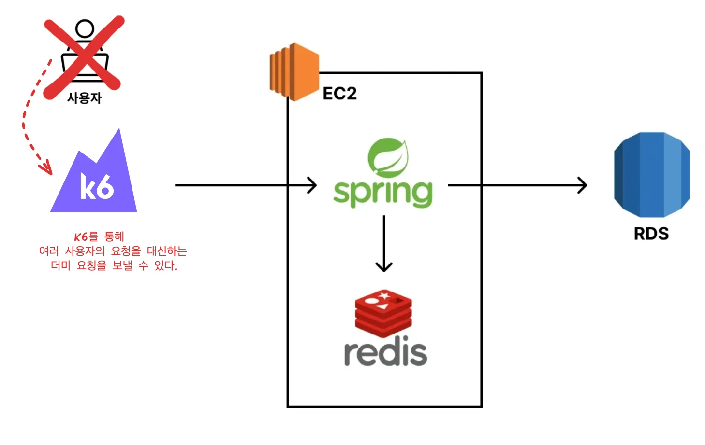
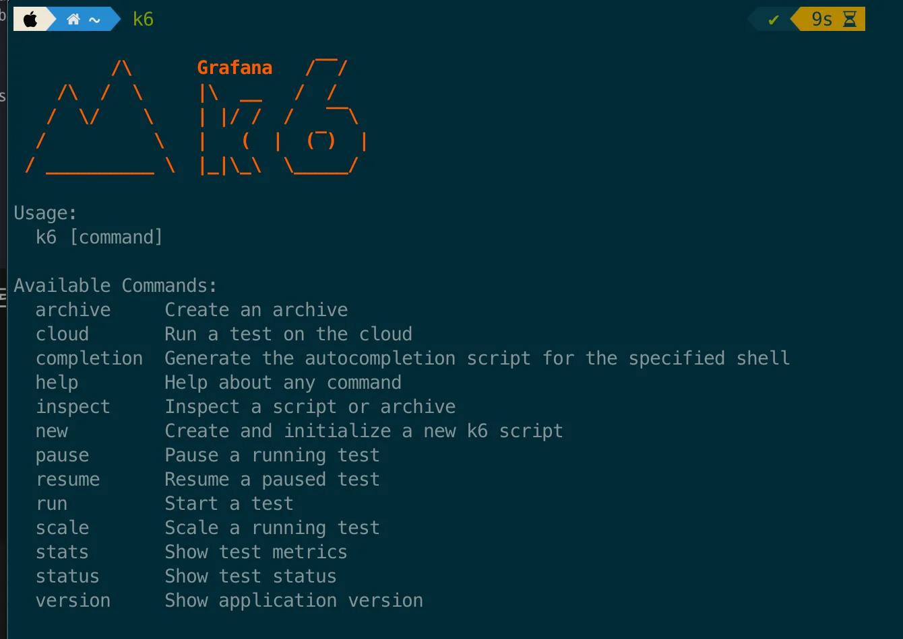
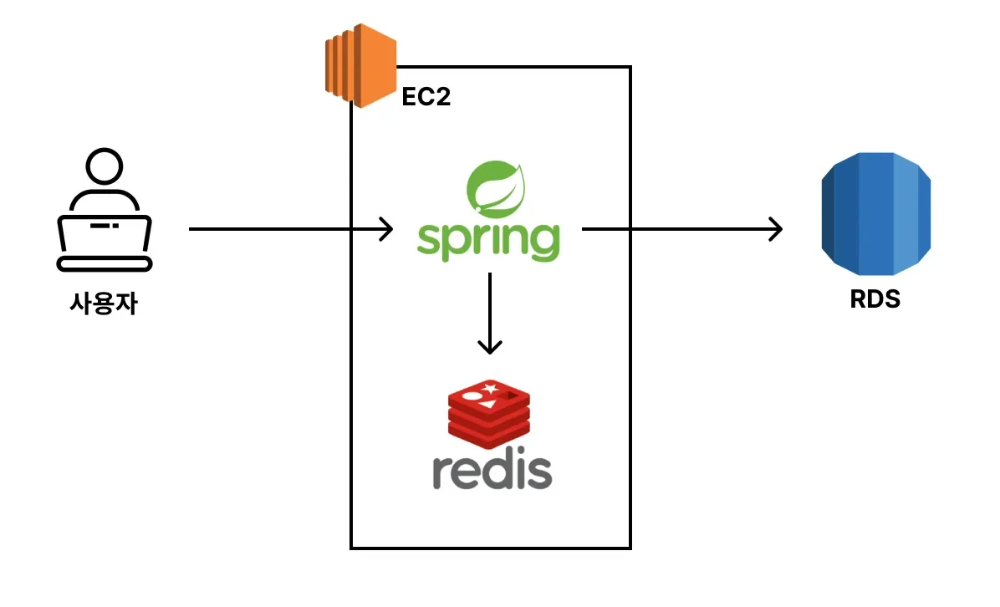
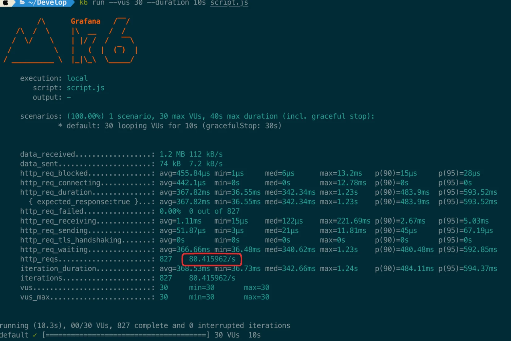
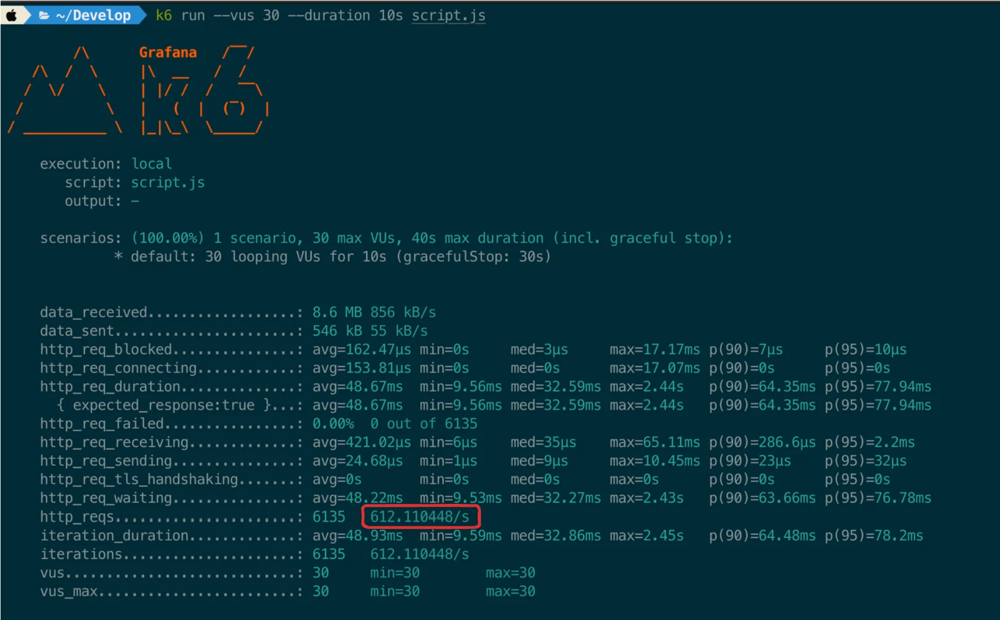

<a id="1c3eda9b0fe181169dddc2eee446b1d5"></a>

### 부하 테스트의 기본 개념

---

<details>
<summary>왜 부하테스트를 해야 하는가?</summary>

<a id="1c3eda9b0fe181859d64fee7cf118865"></a>

백엔드 서버 구현 후 베포를 한다&#46; 

<a id="1c3eda9b0fe181e3a74bf6af7f91f761"></a>

 이때 베포 이후, <strong><u>베포된 서버</u></strong>가 <strong><u>어느 정도의 트래픽을 감당할 수 있</u></strong>는지 <u>운영적인 관점</u>에서 파악 필요하다

<a id="1c3eda9b0fe1818482d1f79de16a5e9d"></a>

왜냐하면 서버의 부하를 넘는 트래픽 요청이 들어오면, 서버가 다운되고 서비스의 가용성 문제가 발생되기 때문이다&#46;  ( 서비스 정상 운영 불가 )

<a id="1c3eda9b0fe18139a99dcd477cc03c64"></a>

따라서 <strong><u>베포된 서버가 어느 정도의 트래픽을 감당할 수 있는지</u></strong>, <strong><u>해당 트래픽을 넘어서면 어떻게 해결할 것인지</u></strong> ( <strong><code>Scale up</code></strong>  or <strong><code>Scale out</code></strong> )  서버의 <strong><u>부하테스트</u></strong>를 진행하여 파악해야한다&#46;

</details>

<details>
<summary>자주 사용되는 용어&#58; <code>TPS</code>, <code>Throughput</code></summary>

<a id="1c3eda9b0fe181a9aa3ed7c5a9669baf"></a>

부하테스트에서 자주 사용하는 용어들은 아래와 같다&#46;  

> ✏️ 
> 
> <a id="1c3eda9b0fe18180ae61c422189dcca3"></a>
> 
> <strong><u>1초</u></strong>에 <strong><u>최대 100개의 API 요청</u></strong>을 처리 가능한 서버<br>     ⇒  해당 서비스의 Throughput&#58;  <strong><code>100TPS</code></strong>

- <strong><code>TPS</code></strong>( Transaction Per Seconds )
    - <strong><u>1초당 처리한 트랜잭션 수</u></strong>를 나타낸다&#46;

- <strong><code>Throughput</code></strong>
    - <strong><u>서비스가 1초당 처리할 수 있는 작업량</u></strong>을 나타낸다&#46;

    - 단위는 <strong><code>TPS</code></strong> 많이 활용한다&#46; 

</details>

<a id="1c3eda9b0fe1814ba0f1f76d25053e45"></a>

### 부하 테스트 툴 세팅&#58; <code>k6</code><strong> </strong>

---

> 📖 
> 
> <a id="1c3eda9b0fe181439a8ad1679cfeedbc"></a>
> 
> <code>K6</code> 는 부하 테스트 툴 중 하나로써 <strong><u>간단하고 빠르게 테스트가 가능</u></strong>하다는 장점을 가지고 있다&#46;
> 
> - <strong>부하테스트 툴</strong>&#58; <strong><code>ngrinder</code></strong>, <strong><code>jmeter</code></strong>, <strong><code>ab</code></strong>, <strong><code>locust</code></strong> 등 다양한 툴이 있다&#46;

<details>
<summary><code>k6</code> 는 ‘<strong><u>사용자인척 요청을 보내는 툴’ </u></strong>이다&#46;</summary>



- k6를 통해 <strong><u>여러 사용자의 요청을 대신</u></strong>하는 <strong><u>더미 요청들을 보낼</u></strong><strong> </strong>수 있다&#46; 

- 이를 통해 <strong><u>서버 부하를 테스트</u></strong>하고, 그에 따른 <strong><u>성능 지표를 제공</u></strong>한다&#46; 

</details>

<details>
<summary>설치 방법</summary>

<details>
<summary>window</summary>

<a id="1c3eda9b0fe18144b4aad1b5fbc7cb61"></a>

‣

<a id="1c3eda9b0fe181c3b295ec4379ff615e"></a>

‣

</details>

- MacOS
    <a id="1c3eda9b0fe181e483e3c780e1b80eb2"></a>

    ```bash
    # homebrew로 k6 설치
    brew install k6

    # 설치 확인 
    k6
    ```

    

</details>

<details>
<summary><code>k6</code> 스크립트 작성</summary>

> <strong><code>k6 공식문서</code></strong><strong>&#58;</strong> ‣

- <strong>script&#46;js</strong>
    <a id="1c3eda9b0fe181ac9b21d348268d12cb"></a>

    ```javascript
    import http from 'k6/http';
    import { sleep } from 'k6';

    export default function () {
      http.get('http://{EC2 IP 주소}:8080/boards');
    }
    ```

    - 로컬 환경에서 k6를 통해 API에 부하를 주기 위해 위와 같이 script를 작성한다&#46;

</details>

> ☝🏻 
> 
> <a id="1c3eda9b0fe181358188d6ad5dfa4cef"></a>
> 
> 간단하고 빠르게 테스트 할 수 있다고 해서 <strong><u>테스트 결과가 부정확한 것은 아니</u></strong>다&#46;  <code>k6</code>는 <strong><u>높은 정확도</u></strong>와 <strong><u>고부하를 발생</u></strong>시킬 수 있기 때문에 <u>실제 현업에서도 많이 사용</u>한다&#46;

<a id="1c3eda9b0fe1814bac81fa4eeb328a98"></a>

### EC2에 올린 스프링 서버, 부하테스트 

---

<details>
<summary>아키텍처</summary>



<details>
<summary>EC2 &#45; t3a&#46;small</summary>

- Spring Boot

- Redis

</details>

- RDS &#45; t3&#46;micro

</details>

<details>
<summary>캐시 적용 전, 성능(부하) 테스트 </summary>

<details>
<summary><strong>&#91; 코드 &#93; boardSevice&#58;</strong> 캐싱 로직 주석 처리</summary>

<a id="1c3eda9b0fe181d683a9ef540f631c08"></a>

```java
@Service
@RequiredArgsConstructor
public class BoardService {

    private final BoardRepository boardRepository;

    // Cache Aside 전략
    // @Cacheable(cacheNames = "getBoards", key="'boards:page:' + #page + ':size:' + #size", cacheManager = "boardCacheManager")
    public List<Board> getBoards(int page, int size) {
        Pageable pageable = PageRequest.of(page - 1, size);
        Page<Board> pageOfBoards = boardRepository.findAllByOrderByCreatedAtDesc(pageable);
        return pageOfBoards.getContent();
    }
}
```

- 캐싱 적용 전, 서버의 성능테스트를 하기 위해, <strong><u>캐싱 로직 주석 처리</u></strong>

</details>

<details>
<summary>EC2 콘솔에서 서버 백그라운드로 실행</summary>

> ☝🏻 
> 
> <a id="1c3eda9b0fe181a68a02e7b092ec5484"></a>
> 
> <strong><u>포그라운드</u></strong>로 서버를 실행하면 <strong><u>API 호출에 대한 로그 출력</u></strong>에서 성능을 잡아먹을 수 있다&#46;
> 
> <a id="1c3eda9b0fe18181a5bed3c258f0b39f"></a>
> 
> 따라서 정확한 성능 테스트를 위해 서버를 <strong><u>백그라운드에서 실행</u></strong>시키는 것을 권장한다

<a id="1c3eda9b0fe181229edafd91633b3c5f"></a>

```bash
# jar 파일 빌드
./gradlew clean build -x test

# jar 파일 확인
cd build/libs
ls

# 백그라운드로 서버 실행
nohup java -jar -Dspring.profiles.active=prod {빌드된 jar 파일명} &
```

</details>

<details>
<summary><strong>로컬 환경에서 K6로 성능 테스트 </strong></summary>

> ☝🏻 
> 
> <a id="1c3eda9b0fe18177bd2edb3d5c693ee6"></a>
> 
> 더 정확한 성능 측정 방법이 있지만 성능 테스트에 초점을 맞춘 강의가 아니기 때문에 간편한 방법으로 측정 진행한다&#46;

<a id="1c3eda9b0fe18161b583f365d8534aad"></a>

```bash
# K6의 스크립트 파일이 위치한 경로에서 실행
k6 run --vus 30 --duration 10s script.js
```

- <code>&#45;&#45;vus 30</code> 
    - 가상 유저(Virtual Users)를 30명으로 셋팅 

    - API 요청을 보내는 사용자가 30명인 것처럼 부하 생성

- <code>&#45;&#45;duration 30s</code>
    - 30초 동안 테스트를 유지



<a id="1c3eda9b0fe1818b8918f57f12363508"></a>

‘평균적으로 1초에 80&#46;4 요청을 처리했다’ 는 뜻이다&#46; 

<a id="1c3eda9b0fe1814587c4d94e9c6712b1"></a>

     ⇒ 현재 구축한 서비스의 <u>게시글 조회 API의 Throughput</u>&#58; <strong><code>80&#46;4 TPS</code></strong>

</details>

</details>

<details>
<summary><strong>캐시 적용 후, 성능(부하) 테스트</strong> </summary>

<details>
<summary><strong>&#91; 코드 &#93; boardSevice&#58;</strong> 캐싱 적용</summary>

<a id="1c3eda9b0fe18105861fc3ab07ad0cfe"></a>

```java
@Service
@RequiredArgsConstructor
public class BoardService {

    private final BoardRepository boardRepository;

    // Cache Aside 전략
    @Cacheable(cacheNames = "getBoards", key="'boards:page:' + #page + ':size:' + #size", cacheManager = "boardCacheManager")
    public List<Board> getBoards(int page, int size) {
        Pageable pageable = PageRequest.of(page - 1, size);
        Page<Board> pageOfBoards = boardRepository.findAllByOrderByCreatedAtDesc(pageable);
        return pageOfBoards.getContent();
    }
}
```

</details>

<details>
<summary>백그라운드에서 실행 중인 서버 종료 후, 재실행</summary>

> ☝🏻 
> 
> <a id="1c3eda9b0fe181258ca4c48d52f6db1b"></a>
> 
> <strong><u>포그라운드</u></strong>로 서버를 실행하면 <strong><u>API 호출에 대한 로그 출력</u></strong>에서 성능을 잡아먹을 수 있다&#46;
> 
> <a id="1c3eda9b0fe181a6a2e8e5d9fb672543"></a>
> 
> 따라서 정확한 성능 테스트를 위해 서버를 <strong><u>백그라운드에서 실행</u></strong>시키는 것을 권장한다

<a id="1c3eda9b0fe18193a52fc5280dedf66e"></a>

```bash
# jar 파일 빌드
./gradlew clean build -x test

# 8080 포트 킬
sudo fuser -v 8080/tcp
sudo kill -9 {PID}

# jar 파일 확인
ls build/libs

# 백그라운드로 서버 실행
nohup java -jar -Dspring.profiles.active=prod build/libs/redis-prac-0.0.1-SNAPSHOT.jar &
```

</details>

<details>
<summary><strong>로컬 환경에서 K6로 성능 테스트 &#45; </strong><strong><u>성능 개선</u></strong><strong> </strong><strong><code>약 7&#46;6배</code></strong><strong> </strong></summary>

> ☝🏻 
> 
> <a id="1c3eda9b0fe18185bd62da8c42464fe7"></a>
> 
> 더 정확한 성능 측정 방법이 있지만 성능 테스트에 초점을 맞춘 강의가 아니기 때문에 간편한 방법으로 측정 진행한다&#46;

<a id="1c3eda9b0fe181739289d9962a69821f"></a>

```bash
# K6의 스크립트 파일이 위치한 경로에서 실행
k6 run --vus 30 --duration 10s script.js
```

- <code>&#45;&#45;vus 30</code> 
    - 가상 유저(Virtual Users)를 30명으로 셋팅 

    - API 요청을 보내는 사용자가 30명인 것처럼 부하 생성

- <code>&#45;&#45;duration 30s</code>
    - 30초 동안 테스트를 유지



- 평균적으로 <strong><u>1초에 612&#46;1 요청을 처리</u></strong>했다

<a id="1c3eda9b0fe1818494d7c42a24a82bf4"></a>

     ⇒ <strong><u>캐싱 적용</u></strong>한 서비스의 <u>게시글 조회 API의 Throughput</u>&#58; <strong><code>612&#46;4 TPS</code></strong>

</details>

> ✏️ 
> 
> <a id="1c3eda9b0fe18168a754fc04efdb7cac"></a>
> 
> <strong><u>Redis 캐싱</u></strong>을 통해 <strong>성능</strong>을 <strong><u>약 7&#46;6 배</u></strong> (= 612&#46;4 / 80&#46;1 ) <strong>향상</strong> 시킬 수 있었다&#46;

</details>
