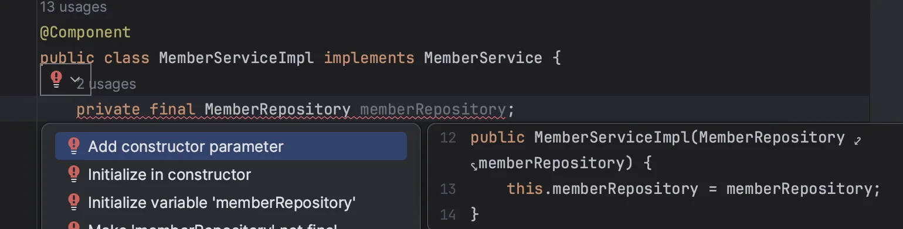
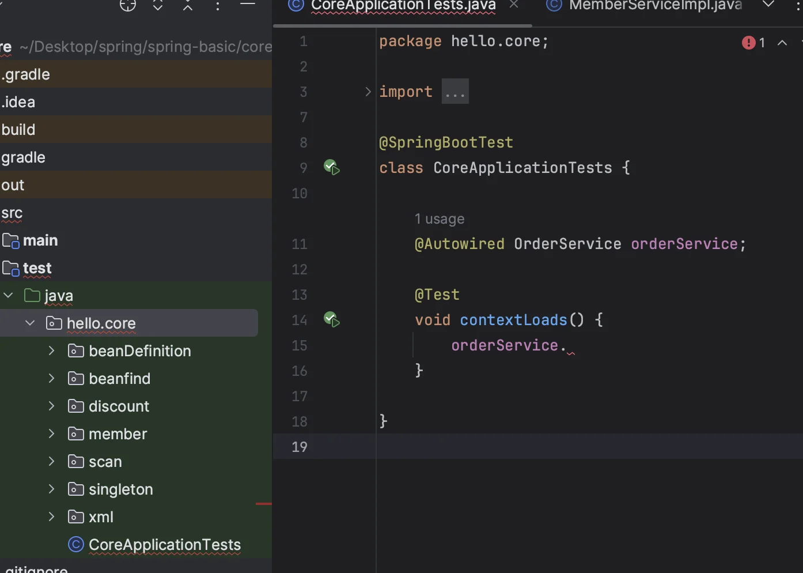
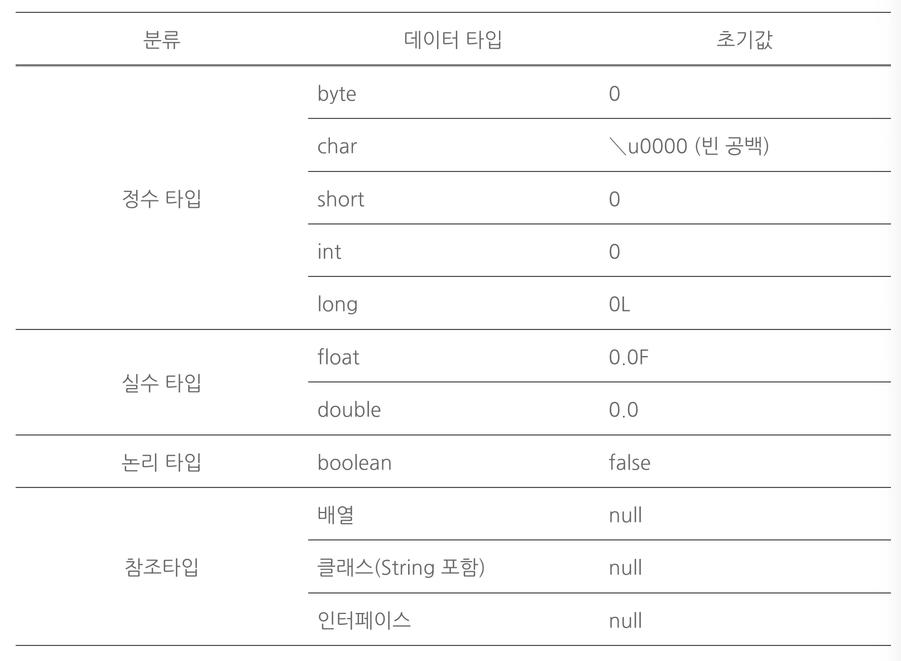

> 의존관계 주입은 크게 4가지 방법이 있다&#46;
> 
> - <strong>생성자 주입</strong>
> 
> - <strong>수정자(setter) 주입</strong>
> 
> - <strong>필드 주입</strong>
> 
> - <strong>일반 메서드 주입</strong>

<a id="1c3eda9b0fe181928176fed001e777fd"></a>

##  생성자 주입

---

<a id="1c3eda9b0fe1811ebc74cdeb955809ad"></a>

이름 그대로 <strong>생성자를 통해서 의존관계를 주입</strong> 받는 방법이다&#46; (이전까지 사용한 방법)

<a id="1c3eda9b0fe1815b8f66ccbf982a12c7"></a>

<strong>생성자 호출 시점에 딱 1번만 호출</strong>되는 것이 보장돼, <strong><u>불편</u></strong><strong><u>, </u></strong><strong><u>필수</u></strong><u> </u><strong><u>의존관계</u></strong>에 사용된다&#46;

> 좋은 아키텍쳐, 개발 습관은 한계점이랑 제약있어야함<br>→ 다 열어두면 어디서 뭐가 수정되었는지 알 수 없음<br>⇒ 생성자를 통한 의존관계 주입 및 외부에서 수정 불가 (한계, 제약)<br>⇒ 불변성 매우 중요&#33;&#33;<br>→ 생성자에 값(private) 을 넣고 setter를 안만들면 불변성이 유지된다&#46;

> 🧐 불변 의존관계란?<br>인스턴스 안에 데이터를 <code>private</code>로 설정 및 수정메서드(setter) X<br>→ private으로 선언 후 생성자를 통해 초기화, 수정자 X ⇒ 불변성 만족

> 🧐 필수 의존관계란?<br>생성자가 없을 시, 초기화 오류 발생 ⇒ 필수적으로 생성자를 통해 초기화 해야 함&#46;
> 
> > Error&#58; <strong>java&#58; variable memberRepository </strong><strong><u>not initialized in the default constructor</u></strong>
> > 
> > 

> 📌 <strong>중요<br></strong><strong><u>생성자가 딱 1개</u></strong><strong>만 있으면, </strong><strong><u>&#64;Autowired 생략해도 자동 주입</u></strong><strong>된다&#46;<br>(</strong><strong><u>스프링 빈 </u></strong><strong>에만 해당함)</strong>

<a id="1c3eda9b0fe18116aa62dcc57e584c15"></a>

```java
@Component
 public class OrderServiceImpl implements OrderService {
     private final MemberRepository memberRepository;
     private final DiscountPolicy discountPolicy;

		 // @Autowired 생략 <- 생정자 1개
     public OrderServiceImpl(MemberRepository memberRepository, DiscountPolicydiscountPolicy) {
         this.memberRepository = memberRepository;
         this.discountPolicy = discountPolicy;
     }
}
```

<a id="1c3eda9b0fe181bfa070f6750418a9ce"></a>

## 수정자 주입(setter 주입)

---

<a id="1c3eda9b0fe18122ae99d01b11e48fe4"></a>

<strong>수정자 메서드(setter)를 통해 의존관계를 주입</strong>하는 방법

<a id="1c3eda9b0fe1817d99fbdc5d8833678a"></a>

<strong><u>선택, 변경 </u></strong><u>가능성이 있는 의존관계</u>에 사용하며,<br>자바빈 프로퍼티 규약의 수정자 메서드 방식을 사용하는 방법이다&#46; 

<details>
<summary>🧐 ’<em>자바빈 프로퍼티 규약 ’ </em>이란?</summary>

> •<strong><u> 멤버 변수</u></strong>는 <strong><u>Property</u></strong>라고 부르며, <strong><u>접근자는 private으로 선언</u></strong>되어야 한다&#46;<br>• <strong><u>getter</u></strong>와 <strong><u>setter</u></strong>가 있어야 하며 이는 <strong><u>public으로 선언</u></strong>되어야 한다&#46;

<details>
<summary>ex)</summary>

<a id="1c3eda9b0fe181fab0bcffe7aa2d4c99"></a>

```java
class Data {
	 // Property(맴버 변수)의 접근자: private 선언
   private int age;

	 // getter, setter를 통해 Property(맴버 변수) 접근 및 변경, public 선언
   public void setAge(int age) {
     this.age = age;
   }
   public int getAge() {
     return age;
	 } 
}
```

</details>

---

<a id="1c3eda9b0fe181f0882bde387cfcdb3d"></a>

Reference)

<a id="1c3eda9b0fe1813f9e35e5398eb30afc"></a>

<a href="https://dololak.tistory.com/133">https&#58;//dololak&#46;tistory&#46;com/133</a>

<a id="1c3eda9b0fe181329cd8f75b7fb6a188"></a>

<a href="https://ttuk-ttak.tistory.com/39">https&#58;//ttuk&#45;ttak&#46;tistory&#46;com/39</a>

</details>

<a id="1c3eda9b0fe181889964f7bb2fdd274a"></a>

```java
@Component
public class OrderServiceImpl implements OrderService {
    private MemberRepository memberRepository;
    private DiscountPolicy discountPolicy;
    
    @Autowired
    public void setMemberRepository(MemberRepository memberRepository) {
        this.memberRepository = memberRepository;
    }
    
    @Autowired
    public void setDiscountPolicy(DiscountPolicy discountPolicy) {
        this.discountPolicy = discountPolicy;
    }
}
```

> ⚠️ <strong>참고<br></strong><strong><code>&#64;Autowired</code></strong><strong> 의 기본 동작은 주입할 대상이 없으면 오류가 발생한다&#46;<br>(</strong><strong><code>&#64;Autowired(required = false)</code></strong><strong> 지정 시 주입 대상 없이 동작 가능)</strong>

<a id="1c3eda9b0fe18174bd72c272518ed24d"></a>

## 필드 주입

---

<a id="1c3eda9b0fe181e7809ded68fa0ba7cb"></a>

필드에 바로 주입하는 방법

> 코드가 간결하지만, <strong>외부에서 변경이 불가능</strong>해 <strong><u>테스트하기 어렵다</u></strong> 치명적인 단점이 존재함&#46;<br>⇒ 테스트 시, 어차피 setter를 따로 만들어주어야 함&#46; <br>→ 수정자 주입이랑 동일 <br>→ 그냥 쓰지말자<br><br>DI 프레임워크 없이, 아무것도 할 수없음<br>⇒ 결론, 특별한 경우를 제외하고, <strong><u>사용하지 말자</u></strong><br>   ( ‘<u>애플리케이션의 실제 코드와 관계없는 테스트 코드</u>’ 나 <br>      ‘<u>스프링 설정을 목적으로 하는 &#64;Configuration 같은 곳’</u> 에서만 특별한 용도로 사용 )
> 
> 

<details>
<summary><strong>🧐 ‘</strong><em><strong>필드(Field) </strong></em><strong>’ 란?</strong></summary>


<a id="1c3eda9b0fe18173a300fe8d81c0bf82"></a>

<strong>객체의 고유 데이터(부품 객체, 상태 정보 …)</strong>를 저장하는 곳

<a id="1c3eda9b0fe18116bed7f91d98af2878"></a>

선언된 형태는 변수와 비슷하지만,<strong> 필드를 변수라 부르지는 않</strong>는다&#46;

<a id="1c3eda9b0fe18116b51bddcf796befed"></a>

변수는 생성자와 메서드 내에서만 사용되고, 생성자와 메서드가 실행 종료되면 자동 소멸된다&#46;<br>그러나 <strong>필드는 생성자와 메서드 전체에서 사용되며, 객체가 소멸되지 않는 한 객체와 함께 존재한다&#46;</strong>

- <strong>필드 선언</strong><br>필드 선언은 중괄호 블록 어디서든 존재할 수 있다&#46; <br>생성자 선언, 메소드 선언 앞, 뒤 어디서든 가능하나, 생성자와 메서드 중괄호 블록 내부에는 선언될 수 없다&#46; ( <strong>생성자와 메서드 중괄호 내부에 선언</strong>된 것은 모두 <strong>로컬 변수</strong>로 필드가 아니다&#46; )
    <a id="1c3eda9b0fe1819c88acd30c0a3526af"></a>

     필드 선언은 변수의 선언 형태와 비슷하여, <strong>클래스 맴버 변수</strong>로 부르기도 한다&#46;

    > 타입 필드 (= 초기값) ; 

    <a id="1c3eda9b0fe1810e9289fd5204da5709"></a>

    <strong><u>초기 값이 지정되지 않는 필드</u></strong>들은 객체 생성 시 <u>자동으로 </u><strong><u>기본값</u></strong><u>으로 설정</u>된다&#46; 

    

</details>

<a id="1c3eda9b0fe181078cdbc4437dffcf36"></a>

```java
	@Component
public class OrderServiceImpl implements OrderService {
    @Autowired private MemberRepository memberRepository;
    @Autowired private DiscountPolicy discountPolicy;
}
```

> ⚠️ <strong>참고<br></strong><strong><code>&#64;Autowired</code></strong><strong>는 스프링에서 제공하는 기술로 순수한 자바 테스트 코드에는 당연히 동작하지 않음<br>(</strong><strong><code>&#64;SpringBootTest</code></strong><strong> 처럼 스프링 컨테이너를 테스트에 통합한 경우에만 가능)</strong>

> ⚠️ <strong>참고</strong><br>다음 코드와 같이 <code>&#64;Bean</code> 에서 파라미터에 의존관계는 자동 주입된다&#46; 수동 등록시 자동 등록된 빈의 의존 관계가 필요할 때 문제를 해결할 수 있다&#46;
> 
> <a id="1c3eda9b0fe18110af2cf1f6cd042025"></a>
> 
> ```java
> @Bean
>  OrderService orderService(MemberRepository memberRepoisitory, DiscountPolicy discountPolicy) {
>      return new OrderServiceImpl(memberRepository, discountPolicy);
>  }
> ```

<a id="1c3eda9b0fe181da8e79c5b53c19b61c"></a>

### 결론

---

<a id="1c3eda9b0fe181c4897eea3a6685c6c6"></a>

특수한 목적(테스트 코드, configuration)에만 사용 가급적 애플리케이션 코드 내에서는 사용 X

<a id="1c3eda9b0fe181d99135cf3116971daf"></a>

## 일반 메서드 주입

---

<a id="1c3eda9b0fe1815fa0ebed27f6fc3f7e"></a>

일반 메서드를 통한 의존관계 주입 <br>한번에 여러 필드를 주입 받을 수 있으나, 일반적으로 잘 사용하지 않는다&#46; 

<a id="1c3eda9b0fe181bb83c1f65deaeb7ecd"></a>

```java
@Component
public class OrderServiceImpl implements OrderService {
    private MemberRepository memberRepository;
    private DiscountPolicy discountPolicy;

    @Autowired
    public void init(MemberRepository memberRepository, DiscountPolicy discountPolicy) {
         this.memberRepository = memberRepository;
         this.discountPolicy = discountPolicy;
		} 
}
```

> ⚠️ <strong>참고<br></strong><strong>의존관계 자동 주입은 스프링 컨테이너가 관리하는 스프링 빈이어야 동작</strong>한다&#46; 스프링 빈이 아닌 <code>Member</code> 같은 클래스에서 <code>&#64;Autowired</code> 코드를 적용해도 아무 기능도 동작하지 않는다
