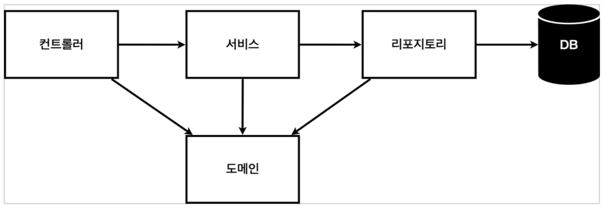
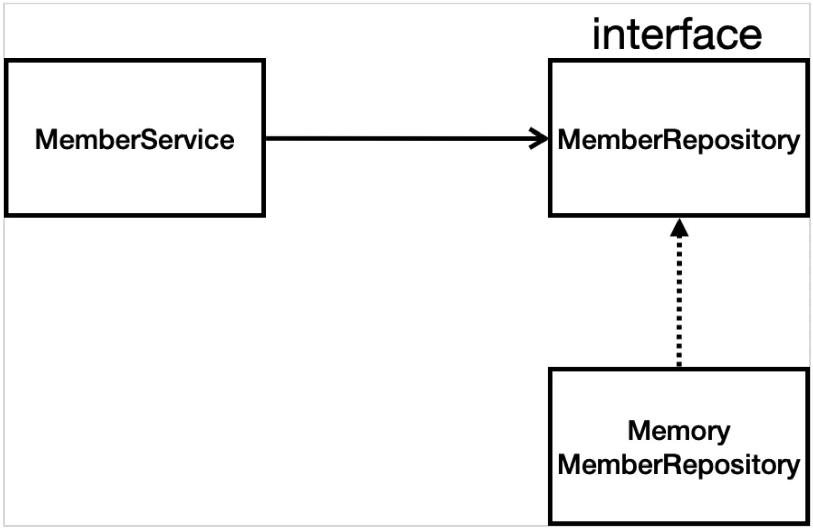
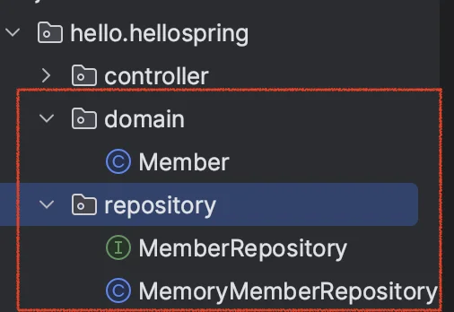
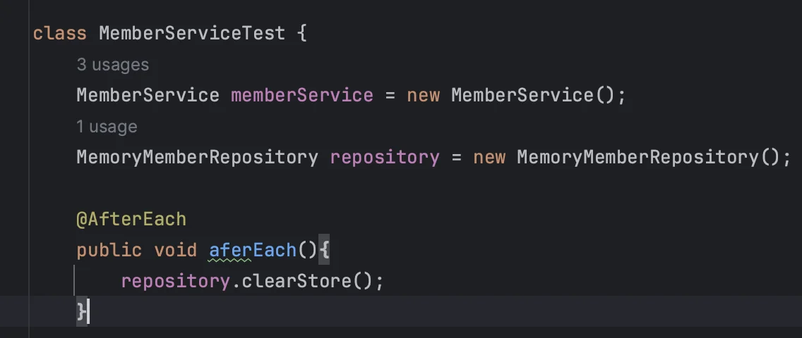
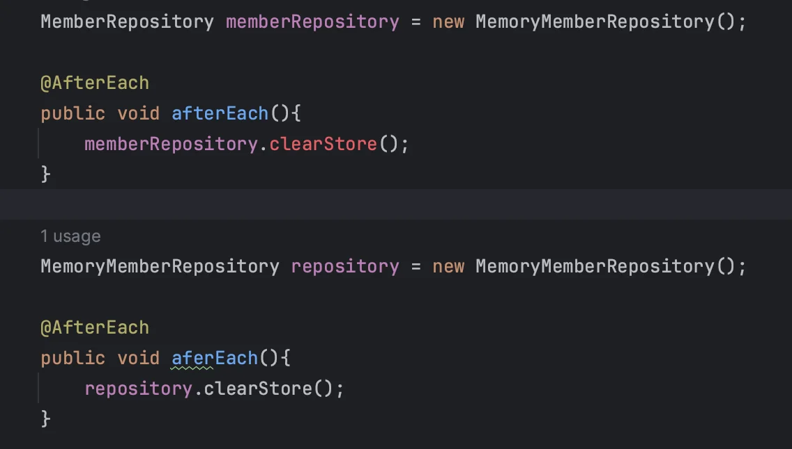

> 📌 <strong>해당 챕터</strong> <strong>목적<br></strong> 가장 단순한 예제를 가지고 스프링 생태계 전반적으로 어떤 식으로 개발이 일어나고 동작하는 지를 알아보기

<a id="1c3eda9b0fe181a99053eafafc36d1af"></a>

#  비지니스 요구사항 정리

> • 데이터&#58; 회원ID, 이름<br>• 기능&#58; 회원 등록, 조회<br>• 아직 데이터 저장소가 선정되지 않음 (가상의 시나리오)

<a id="1c3eda9b0fe181a186dbdff71a2f54ac"></a>

### 일반적인 웹 어플리케이션 계층 구조



- Controller&#58; 웹 MVC의 controller 역활

-  서비스&#58; 비지니스 도메인 객체를 가지고 핵심 비지니스 로직이 동작하도록  구현 ( ex&#46; 회원가입 중복 X …)

-  레포지토리&#58; 데이터베이스에 접근, 도메인 객체를 DB에 저장 및 관리

-  도메인&#58; 비지니스 도메인 객체 ( ex&#46; 회원, 주문, 쿠폰 등 주로 데이터베이스에 저장 및 관리됨&#46;)

<a id="1c3eda9b0fe1819b866ac82d86d9fbc2"></a>

### 클래스 의존관계



- <strong><u>아직 데이터 저장소가 선정되지 않</u></strong>아, 우선 <strong>인터페이스</strong>로 구현 클래스를 변경할 수 있도록 설계

- 데이터 저장소는 RDB, NoSQL 등등 다양한 저장소를 고민중인 상황으로 가정

- 개발은 진행하기 위해서 <strong><u>초기 개발 단계에서는 구현체로 가벼운 메모리 기반의 데이터 저장소 사용</u></strong>

> ⚠️ <strong>로직 → </strong><strong>인터페이스(메모리 기반)</strong><strong>로 설계 </strong><br><strong><u>Why ?</u></strong><strong> )</strong> 아직 데이터저장소가 선택되지 않았음, 후에 <code>rdb</code> or <code>jpa </code>등 구체적 기술 선정 후 바꿔 끼울 것이기 때문에 <strong>인터페이스로 설계</strong>

<a id="1c3eda9b0fe181a98521f37a8891312b"></a>

# 회원 도메인과 레포지토리 만들기



- <code>optional</code>&#58; 자바8 이상부터 나온 문법, null 반환 시 optional로 감싸서 반환 처리

<a id="1c3eda9b0fe1819794fbc2c59722abee"></a>

### 회원 &#95;&#95; 객체

<a id="1c3eda9b0fe18163923ec213f3222cdd"></a>

```java
// domain/Member
package hello.hellospring.domain;

public class Member {
    private Long id;
    private String name;

    public Long getId() {
        return id;
    }

    public void setId(Long id){
        this.id = id;
    }

    public String getName(){
        return name;
    }

}
```

<a id="1c3eda9b0fe1810c96abfd384da1b5ba"></a>

### 회원 repository &#95;&#95; interface

<a id="1c3eda9b0fe181199036d0446653d2d8"></a>

```java
// repository/MemberRepository
package hello.hellospring.repository;

import hello.hellospring.domain.Member;

import java.util.*;

public interface MemberRepository {
    Member save(Member member);
    Optional<Member> findById(Long id);
    Optional<Member> findByName(String name);
    List<Member> findAll();
}
```

<a id="1c3eda9b0fe1819ebdb3f1e7db667d32"></a>

### 회원 repository &#95;&#95; 메모리 구현체

<a id="1c3eda9b0fe1819195fbcf35204a56a3"></a>

```java
// repository/MemoryMemberRepository
package hello.hellospring.repository;

import hello.hellospring.domain.Member;

import java.util.*;

// 동시성 문제가 고려되어 있지 않음, 실무에서는 ConcurrentHashMap, AtomicLong 사용 고려
public class MemoryMemberRepository implements MemberRepository {

    private static Map<Long, Member> store = new HashMap<>();
    private static long sequence = 0L;

    @Override
    public Member save(Member member) {
        member.setId(++sequence);
        store.put(member.getId(), member);
        return member;
    }

    @Override
    public Optional<Member> findById(Long id) {
        return Optional.ofNullable(store.get(id));
    }

    @Override
    public Optional<Member> findByName(String name) {
        return store.values().stream()
                .filter(member -> member.getName().equals(name))
                .findAny();
    }

    @Override
    public List<Member> findAll() {
        return new ArrayList<>(store.values());
    }

    public void clearStore(){
        store.clear();
    }
}
```

<a id="1c3eda9b0fe1819d9225c6c0a1c03946"></a>

# 회원 리포지토리 테스트 케이스 작성

> 자바의 main 메서드나 웹어플리케이션의 컨트롤러를 통해 기능을 테스트하기에는 한번 실행에 발생되는 비용이 매우 크다&#46; 따라서 반복적인 실행을 거의 불가능하다&#46; <br>이를 위해 자바에서 <code>JUnit</code> 이라는 테스트 프레임워크를 제공한다&#46; 

> <em>작성</em>
> 
> 1. &#91; test 폴더 &#93;에 &#91; <strong>같은 명 패키지 &#93;</strong> 생성, &#91; <strong>같은 클래스 명 &#43; Test &#93;</strong> 로 <u>클래스 작성</u>
> 
> 1. 테스트 하고자 하는 클래스 생성 (<code>new</code>)
> 
> 1. 각 단위 테스트&#58;   <code>&#64;Test</code> 어노테이션  &#43;  테스트하고자 하는 메서드 명, 실제 데이터를 생성하여  비교 (Assertions)

> <strong>테스트는 각각 독립적으로 실행되어야 하며, 테스트 순서에 의존관계가 있는 것은 좋은 테스트가 아니다&#46; </strong>

<a id="1c3eda9b0fe181e79914f185fae5089b"></a>

```java
// test/java/hello.hellospring/repository/MemoryMemberRepositoryTest

package hello.hellospring.repository;

import hello.hellospring.domain.Member;
import org.junit.jupiter.api.AfterEach;
import org.junit.jupiter.api.Test;

import java.util.List;

import static org.assertj.core.api.Assertions.assertThat;

public class MemoryMemberRepositoryTest {
    MemoryMemberRepository reppository = new MemoryMemberRepository();

    @AfterEach  // 각 테스트 종료 후 실행.
    public void afterEach() {
        reppository.clearStore();  // 하나의 단위 테스트 종료 후 데이터 초기화
    }
    
    @Test
    public void save(){
        // given
        Member member = new Member();
        member.setName("spring");

        // when
        reppository.save(member);

        // then
        Member result = reppository.findById(member.getId()).get();
        assertThat(result).isEqualTo(member);
    }

    @Test
    public void findByName(){
        // given
        Member member1 = new Member();
        member1.setName("spring1");
        reppository.save(member1);

        Member member2 = new Member();
        member2.setName("spring2");
        reppository.save(member2);

        // when
        Member result = reppository.findByName("spring1").get();

        // then
        assertThat(result).isEqualTo(member1);
    }

    @Test
    public  void findAll(){
        // given
        Member member1 = new Member();
        member1.setName("spring1");
        reppository.save(member1);

        Member member2 = new Member();
        member2.setName("spring2");
        reppository.save(member2);

        // when
        List<Member> result = reppository.findAll();

        // then
        assertThat(result.size()).isEqualTo(2);
    }
}
```

<a id="1c3eda9b0fe181b19c6fc61a442ade35"></a>

# 회원 서비스 개발

<a id="1c3eda9b0fe181ed8457cebebc437a21"></a>

서비스 클래스는 비지니스 관련 용어를 사용해야 함&#46; 그래야 개발자든 기획자든 소통이 빠름 

<a id="1c3eda9b0fe181d7b92af677764f3c0c"></a>

ex) joint

<a id="1c3eda9b0fe181e292aaf68dba6310fb"></a>

(repository는 기계적인, 개발스러운 용어 사용)

<a id="1c3eda9b0fe1811b919dde5f84e0db0d"></a>

```java
package hello.hellospring.service;

import hello.hellospring.domain.Member;
import hello.hellospring.repository.MemberRepository;
import hello.hellospring.repository.MemoryMemberRepository;

import java.util.List;
import java.util.Optional;

public class MemberService {
    private final MemberRepository memberRepository = new MemoryMemberRepository();

    /**
     * 회원 가입
     */
    public Long join(Member member) {
        validateDuplicateMember(member); // 중복 회원 검증
        memberRepository.save(member);
        return member.getId();
    }

    private void validateDuplicateMember(Member member) {
        // ifPresent : 결과 값이 null이 아닐 시 동작
        memberRepository.findByName(member.getName())
            .ifPresent(m -> {
                throw new IllegalStateException("이미 존재하는 회원입니다.");
            });
    }
		
		/**
		 * 전체 회원 조회
		 */
    public List<Member> findMembers() {
        return memberRepository.findAll();
    }

    public Optional<Member> findOne(Long memberId) {
        return memberRepository.findById(memberId);
    }
}
```

<a id="1c3eda9b0fe1811fb160cdfda9350e71"></a>

# 회원 서비스 테스트

> <strong>테스트 코드 &#45; 메소드 명</strong>은 영어권 사람들과 일하는 것이 아니라면, 실제 <strong><code>한글명</code></strong>으로도 많이 적는다&#46; <br>→ <strong>build 시</strong>, 테스트 코드는 포함되지 않음&#46;

> 테스트 코드 작성&#58; <strong>given(데이터) , when(실행), then(결과)</strong>  패턴

> 테스트는<strong> 정상 플로우 </strong>도 중요하지만 <strong>예외 플로우 </strong>가 훨씬 더 중요하다&#46;

<a id="1c3eda9b0fe181f48a57f1e8dd3d2c02"></a>

## 회원가입(join)

- 정상적으로 저장되는지 테스트 (정상 플로우)
    <details>
    <summary>test code </summary>

    <a id="1c3eda9b0fe181699f88f04d16299b8d"></a>

    ```java
    @Test
    void 회원가입() {
        // given
        Member member = new Member();
        member.setName("hello");

        // when
        Long saveId = memberService.join(member);
        
        // then
        Member findMember = memberService.findOne(saveId).get();
        assertThat(member.getName()).isEqualTo(findMember.getName());
    }
    ```

    </details>

- 중복된 값을 인지하여 예외처리를 하는지 (예외 플로우)
    <details>
    <summary>방법1) try &#45; catch&#58;  애매… why?? </summary>

    <a id="1c3eda9b0fe18108b15df5eebea5524c"></a>

    ```java
    @Test
    public void 중복_회원_예외(){
        // given
        Member member1 = new Member();
        member1.setName("spring");

        Member member2 = new Member();
        member2.setName("spring");

        // when
        memberService.join(member1);// try-catch: string 값 자체를 비교한다. 애매함...
    		try {
    		    memberService.join(member2);
    		    fail();
    		} catch (IllegalStateException e) {
    		    assertThat(e.getMessage()).isEqualTo("이미 존재하는 회원입니다.");
    		}

    }
    ```

    </details>

    <details>
    <summary>방법2) assertThrows</summary>

    <a id="1c3eda9b0fe181a68ffbe4eb7639d7ee"></a>

    ```java
    @Test
    public void 중복_회원_예외(){
        // given
        Member member1 = new Member();
        member1.setName("spring");

        Member member2 = new Member();
        member2.setName("spring");

        // when
        memberService.join(member1);
        IllegalStateException e = assertThrows(IllegalStateException.class, () -> memberService.join(member2));

        // then
        assertThat(e.getMessage()).isEqualTo("이미 존재하는 회원입니다.");
    }
    ```

    </details>

<a id="1c3eda9b0fe18116b48ad51be857a41b"></a>

## 값 누적에 따른 Error 

<a id="1c3eda9b0fe181c6b2a9eae36ce48ca6"></a>

→ 이전에 실행한 테스트의 데이터가 남아 다음 테스트에서 오류를 일으킨다&#46; 따라서 <code>memberRepository&#46;clearStore()</code> , <code>&#64;afterEach</code>를 통해  메모리(store)에 저장된 데이터를 각 테스트가 끝날때 마다 지운다&#46;



<a id="1c3eda9b0fe18176bd00c4fc4564369c"></a>

### <a href="https://ko.wikipedia.org/wiki/%EC%BD%94%EB%93%9C_%EC%8A%A4%EB%A9%9C">code smell</a>) 테스트 인스턴스 외, 외부 인스턴스 생성 및 의존관계 형성

>  테스트 하려는 객체 인스턴스(memberService)와 다른 외부 인스턴스(memberRepository) 2개를 생성해 테스트 한다&#46; 

<a id="1c3eda9b0fe1811a875fcf9fb635dde3"></a>

MemoryMemberRepository 모듈에서 데이터를 저장하는 <strong>store(Map) 자료가 static 변수</strong>라서 다른 모듈(memberService)에서 호출해도 문제가 없지만, <strong><u>일반 변수로 선언 시에는 Error를 발생</u></strong>시킨다&#46;

<a id="1c3eda9b0fe181dabbe3cf46750ffc59"></a>

⇒ 하나의 테스트에서 테스트하고자 하는 인스턴스가 아닌 다른 인스턴스를 접근하여 사용 시, <strong><u>의존성, 복잡도 증가, 예기치 않는 오류의 발생 확률</u></strong><u>이 증가</u>한다&#46; 따라서 좋지 않은 방법이며, 해당 방법은 아래의 <strong><code>DI(의존관계 주입)</code></strong>을 통해 리펙토링하여 해결한다&#46; 

<a id="1c3eda9b0fe1815f97badde8121edbf2"></a>

## 개선) <strong>의존관계 주입(Dependency Injection) </strong>

<a id="1c3eda9b0fe181889080dae647b8bfdb"></a>

→ <strong>생성자 주입을</strong> 통한 <strong><u>외부에서 인스턴스(memberService)를 주입</u></strong>한다&#46;

> 주의) DI 사용 시에는 &#64;SpringBootTest 를 적용해야 스프링컨테이너에서 해당하는 빈을 가져와 주입할 수 있다&#46; 

<a id="1c3eda9b0fe181ce8589c23fd418fe44"></a>

### <strong>테스트 하려는 객체에서의 생성자 주입 ( MemberService )</strong>

> 2개의 객체를 불러와 테스트 해야한 객체에 생성자 주입을 통해 외부 인스턴스를 주입시킴

<a id="1c3eda9b0fe181d6a317d9f343f8a9a1"></a>

```java
public class MemberService {
    private final MemberRepository memberRepository;

    public MemberService(MemberRepository memberRepository) {
        this.memberRepository = memberRepository;
    }

     .   .   .
```

<a id="1c3eda9b0fe181f7918fd35476e17169"></a>

### <strong>테스트코드에서의 생성자 주입 사용 ( MemberServiceTest  )</strong>

> <code>&#64;BeforeEach</code> &#58; 각 테스트 실행 전에 호출

<a id="1c3eda9b0fe181ada150c285bc914451"></a>

```java
class MemberServiceTest {
    MemberService memberService;
    MemberRepository memberRepository;

    @BeforeEach
    public void beforeEach() {
        memberRepository = new MemoryMemberRepository();
        memberService = new MemberService(memberRepository);
    }

     .   .   .
```

<details>
<summary>Error) 변수명 오류</summary>

> MemberRepository 객체 생성 시, memberRepository로 변수명 생성 시, clearStore 메서드 동작  X → 왜그런거지? 이건 이유를 모르겠음…

<a id="1c3eda9b0fe181fba0e0c5ebc2e08552"></a>

⇒ 아&#46;&#46; MemberRepository 인터페이스에 claerStore 함수 추가 안함…

<a id="1c3eda9b0fe181baa34fe2c403fd0209"></a>

오류 메세지부 읽고 확인하자…



</details>
