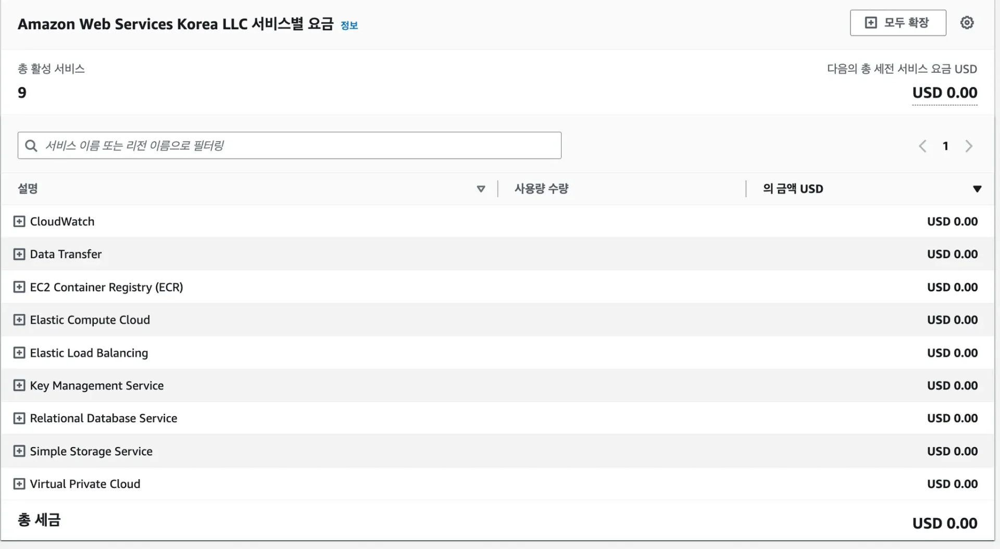

### ✅ EC2

- EC2 인스턴스 (t3a&#46;small) &#58; 시간당 0&#46;026 USD (24시간당 약 800원)
    

    (비용이 걱정되시는 분들은 학습이 끝나자마자 인스턴스를 종료하시길 권장드립니다&#46;)

- 데이터 전송 비용 &#58; 1 GB당 0&#46;1368 USD (1GB당 약 200원)
    

    (실습 과정 동안 1GB 이하의 데이터만 전송합니다&#46;)

- Public IPv4 비용 &#58; 시간당 0&#46;005 USD (24시간당 약 200원)

### ✅ RDS

- RDS 인스턴스 (t4g&#46;micro) &#58; 시간당 0&#46;026 USD (24시간당 약 800원)
    

    (프리티어일 경우 월 750시간까지 무료)

- 스토리지 비용 &#58; GB&#45;월당 0&#46;131 USD (20GB&#45;24시간당 약 200원)
    

    (프리티어일 경우 20GB까지 무료)

- Public IPv4 비용 &#58; 시간당 0&#46;005 USD (24시간당 약 200원)

### ✅ ElasitCache

- 캐시 (cache&#46;t3micro) &#58; 시간당 0&#46;025 USD (24시간당 약 800원)
    

    (프리티어일 경우 월 750시간까지 무료)

### ✅ 혹시나 비용이 많이 나가고 있는 건 아닌 지 체크하는 방법

