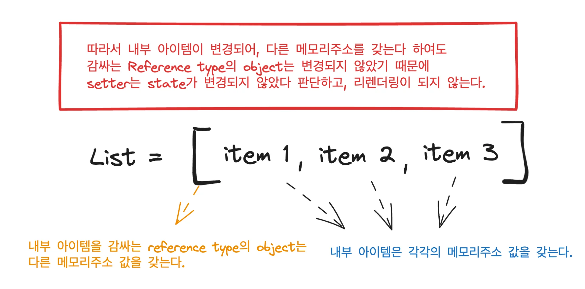
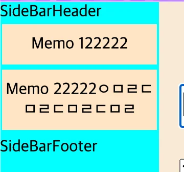

<a id="1c3eda9b0fe1815b8c27c8cd07d973b0"></a>

## 코드

[project 1&#58; memo &#45; Read, Update · gyungsubLee/inflearn&#95;react&#95;prac&#64;33bdb1c]()

<a id="1c3eda9b0fe1814e8a23d818357c0574"></a>

## 학습 내용

---

> ☝🏻 
> 
> <a id="1c3eda9b0fe18132ba51fad1e8fc080d"></a>
> 
> <code>List&#46;map</code>을 통해 DOM 생성 시, <code>소괄호</code>를 사용해야 한다&#46; 
> 
> - &#91; <strong>X</strong> &#93; <code>(item) ⇒ { DOM 생성 }</code>
> 
> - &#91; <strong>O </strong><strong>&#93;</strong><strong> </strong><code>(item) ⇒ </code><strong><code>(</code></strong><code> DOM 생성 </code><strong><code>)</code></strong>

<details>
<summary>각 컴포넌트의 시작 div 태그에 컴포넌트 명으로  된, class 명을 명시하면 css를 다루기 편하다</summary>

- 나중에 styled commponet 사용하면 큰 의미가 없긴 함

<details>
<summary>ex) </summary>

<a id="1c3eda9b0fe181ef95c0fa7b014342ba"></a>

```javascript
const MemoList = ({ memos }) => {
  return (
    <div className="MemoList">
      {memos.map((memo) => (
        <dlv className="Memo" key={memo.title}>
          {memo.title}
        </dlv>
      ))}
    </div>
  );
};
```

</details>

</details>

<details>
<summary>자바스크립트 &#45;  <strong><u>reference type 객체(list, map …)</u></strong><strong>,</strong> <strong><u>setter</u></strong> 함수의 동작 원리 </summary>

> setter 함수는 이전 값과 똑같은 state로 변경되는 경우, 리렌더링을 발생시키지 않는다&#46; 

<details>
<summary>🤬 오류 &#45; 하위 컴포넌트에서 setter를 통해 값을 변경해도, <strong><u>리렌더링</u></strong><u>이 발생되지 않</u>음</summary>

<details>
<summary>&#91; 코드 &#93; MemoContainer&#46;jsx</summary>

<a id="1c3eda9b0fe181d793bae3b565399281"></a>

```javascript
const MemoContainer = ({ memo, setMemo }) => {
  return (
    <div className="MainContainer">
      <div>
        <input
          type="text"
          className="MainContainer__title"
          value={memo.title}
          onChange={(e) => {
            setMemo({
              ...memo,
              title: e.target.value,
              updatedAt: new Date().getTime(),
            });
          }}
        />
      </div>
      <div>
        <textarea
          className="MainContainer__content"
          value={memo.content}
          onChange={(e) => {
            setMemo({
              ...memo,
              content: e.target.value,
              updatedAt: new Date().getTime(),
            });
          }}
        />
      </div>
    </div>
  );
};

export default MemoContainer;

```

</details>

<details>
<summary>&#91; 코드 &#93; App&#46;jsx</summary>

<a id="1c3eda9b0fe18130acefeea8efa9b2c0"></a>

```javascript
import "./App.css";
import MemoContainer from "./components/MemoContainer/MemoContainer";
import SideBar from "./components/SideBar/SideBar";
import { useState } from "react";

const time = new Date().getTime();

const defaultMemosData = [
  {
    title: "Memo 1",
    content: "This is memo 1",
    createdAt: time, // 생성 시간
    updatedAt: time, // 수정 시간
  },
  {
    title: "Memo 2",
    content: "This is memo 2",
    createdAt: time, // 생성 시간
    updatedAt: time, // 수정 시간
  },
];

function App() {
  const [memos, setMemos] = useState(defaultMemosData);

  const [memoContainerIndex, setMemoContainerIndex] = useState(0);

  const setMemo = (newMemo) => {
    memos[memoContainerIndex] = newMemo;
    setMemos(memos);
  };

  return (
    <div className="App">
      <SideBar memos={memos} />
      <MemoContainer memo={memos[memoContainerIndex]} setMemo={setMemo} />
    </div>
  );
}

export default App;
```

<a id="1c3eda9b0fe1817a8f0fededf1ad23a1"></a>

<br>

</details>

---

<a id="1c3eda9b0fe181b380ffe9cecfe199c3"></a>

App&#46;jsx에서 setMemo 함수를 통해, 하위 컴포넌트에서 새로 변경되는 메모를 받아서 <code>memos</code> state를 수정한다&#46;

- 여기서 <code>memos</code> State는  <code>List</code>인 <strong><u>Reference Type 객체</u></strong><strong><u>이다&#46;</u></strong>

</details>

<details>
<summary><strong>⚠️ 원인</strong><strong> </strong>&#45; reference 객체 내부 요소가 변경되어도, reference 전체를 state로 설정하고 변경하면, reference 객체만을 비교하기 때문에, state가 변경되지 않는다&#46; </summary>



<a id="1c3eda9b0fe181f09a10ea73ccc557ee"></a>

reference 내부의 요소가 변경되고, setter를 통해 reference 객체를 통으로 바꾸면,<code> setter</code>는 내부 요소가 아닌,<strong><u> reference 객체만을 비교</u></strong>하기 때문에 <strong><u>동일한 값이라 판단</u></strong>하여 <strong><u>state를 변경하지 않</u></strong>는다&#46; 

</details>

<details>
<summary>👍🏻 해결 &#45; 변경할 배열값을 <strong><u>복사</u></strong>한 <u>새로운 reference 객체</u>를 생성해 state를 변경한다&#46; </summary>

<a id="1c3eda9b0fe18182bc88e24cd06a2790"></a>

```javascript
 const setMemo = (newMemo) => {
    memos[memoContainerIndex] = newMemo;

    console.log("memos", memos);

    setMemos([...memos]);
  };
```

- setter에 수정된 배열을 스프레드(<code>…</code>)로 복사하여 새로운 reference type을 생성하여 변경한다&#46; 

- setter는 새로운 state라 판단하여 state를 수정하기 때문에, state가 변경되고 리렌더링이 정상적으로 발생된다&#46;  

</details>

</details>

<details>
<summary><code>불변성</code> ( 매우 중요 )</summary>

- <strong><u>리렌더링이 발생되기 전</u></strong>까지, <strong><u>state의 값은 회손되어서는 안</u></strong>된다&#46; 
    - 동시성제어와 비슷한 얘기이다&#46; 데이터에 대한 정합성을 보장하기 위함

<details>
<summary>🤬 오류  &#45; 데이터 정합성 오류</summary>

<a id="1c3eda9b0fe181f8963fdb1167c2a5db"></a>

```javascript
function App() {
  const [memos, setMemos] = useState(defaultMemosData);

  const [memoContainerIndex, setMemoContainerIndex] = useState(0);

  const setMemo = (newMemo) => {
    memos[memoContainerIndex] = newMemo;
    setMemos([...memos]);
  };

```

<details>
<summary>위 코드의 경우 state인 memos 내부 아이템을 직접 접근하여 변경된다&#46; </summary>

<a id="1c3eda9b0fe1816e84d5fc6ee7c7c983"></a>

```javascript
 memos[memoContainerIndex] = newMemo;
```

</details>

- 즉, state가 <code>useState</code>의 <code>setter</code> 통해 변경되는 것이 아닌, 직접 해당 reference Type에 접근하여 수정된다&#46;  따라서 <strong><u>데이터의 불변성이 회손</u></strong>된다&#46;

- 이로인해 <strong><u>리렌더링이 발생되기 전  memos 데이터에 접근</u></strong>하는 경우,<strong> 화면과 실제 memos의 데이터가 동일하지 않</strong>게되며, <u>데이터의 정합성에 문제가 발생</u>되고, <u>서비스에서 오류를 발생</u> 시킨다&#46;

</details>

<details>
<summary>👍🏻 해결 &#45;  변경 전, 미리 state의 데이터를 복사하는 새로운 객체를 생성 후, 해당 객체를 변경하여 업데이트한다&#46; </summary>

<a id="1c3eda9b0fe181cea027e103538da54a"></a>

```javascript
const setMemo = (newMemo) => {
	// 미리 state의 값을 복사한 새로운 객체 생성
  const newMemos = [...memos];
  
  // 새로 생성한 객체에서 수정
  newMemos[memoContainerIndex] = newMemo;
	
	// 수정된 새로 생성한 객체를 통해 업데이트
  setMemos(newMemos);
};
```

</details>

</details>

<details>
<summary>드릴링(props를 하위 컴포넌트로 넘겨주는 행위) 줄이기</summary>

<details>
<summary>🤬 리펙토링 전 &#45; index, setter 넘김</summary>

<details>
<summary>&#91; 코드 &#93; MemoList&#46;jsx</summary>

<a id="1c3eda9b0fe1818ea351d4d54b47fe5c"></a>

```javascript
import MemoItem from "./MemoItem";

const MemoList = ({ memos, setMemoContainerIndex }) => {
  return (
    <div className="MemoList">
      {memos.map((memo, index) => (
        <MemoItem
          key={index}
          index={index}
          setMemoContainerIndex={setMemoContainerIndex}}
        >
          {memo.title}
        </MemoItem>
      ))}
    </div>
  );
};

export default MemoList;

```

</details>

<details>
<summary>&#91; 코드 &#93; MemoItem&#46;jsx</summary>

<a id="1c3eda9b0fe1819dbeb4e0b2225b13cb"></a>

```javascript
const MemoItem = ({ children, index, setMemoContainerIndex }) => {
  return (
    <dlv
      className="Memo"
      onClick={() => {
        setMemoContainerIndex(index);
      }}
    >
      {children}
    </dlv>
  );
};

export default MemoItem;
```

</details>

</details>

<details>
<summary>😁 리펙토링 후 &#45; onClick 함수 넘김</summary>

- onClick 함수를 넘겨 map 함수에서 요소에 대한 click 이벤트를 처리하고, 그에 따른 의존성을 줄인다&#46; 

---

<details>
<summary>&#91; 코드 &#93; MemoList&#46;jsx</summary>

<a id="1c3eda9b0fe1811b98d3f38cb8afc17e"></a>

```javascript
import MemoItem from "./MemoItem";

// 리렌더링 시, 재생성을 막기 위해 컴포넌트 외부에 선언함
const onClick = (idx, setMemoIdex) => {
  setMemoIdex(idx);
  console.log("clicked!", idx);
};

const MemoList = ({ memos, setMemoContainerIndex }) => {
  return (
    <div className="MemoList">
      {memos.map((memo, index) => (
        <MemoItem
          key={index}
          onClick={() => onClick(index, setMemoContainerIndex)}
        >
          {memo.title}
        </MemoItem>
      ))}
    </div>
  );
};

export default MemoList;

```

</details>

<details>
<summary>&#91; 코드 &#93; MemoItem&#46;jsx</summary>

<a id="1c3eda9b0fe18128acfcf0dd37088429"></a>

```javascript
const MemoItem = ({ children, onClick }) => {
  return (
    <dlv className="Memo" onClick={onClick}>
      {children}
    </dlv>
  );
};

export default MemoItem;
```

</details>

</details>

</details>

<details>
<summary>title이 길어지는 경우, 문자열 개행(줄바꿈)이 일어난다&#46; ( CSS )</summary>

- 🤬 오류 &#45; title, 문자열 개행(줄변경) 발생
    

- 해결 
    <a id="1c3eda9b0fe181ec9d87f928bb362bf1"></a>

    ```css

    .MemoItem {
      width: 100%;
      white-space: nowrap;
      text-overflow: ellipsis;
      overflow: hidden;
    }
    ```

</details>

<details>
<summary>선택된 요소 구분하기 &#45; <code>classname</code>에 <code>삼항연산자</code> 사용</summary>

<details>
<summary>1&#46; Memo의 index를 저장하는 State (<code>memoContainerIndex</code>) 불러오기</summary>

<a id="1c3eda9b0fe181bc8b3adce5d3165683"></a>

```javascript
// App.jsx
function App() {
  const [memos, setMemos] = useState(defaultMemosData);

  const [memoContainerIndex, setMemoContainerIndex] = useState(0);

  const setMemo = (newMemo) => {
    const newMemos = [...memos];
    newMemos[memoContainerIndex] = newMemo;

    setMemos(newMemos);
  };

  return (
    <div className="App">
      <SideBar
        memos={memos}
        setMemoContainerIndex={setMemoContainerIndex}
        memoContainerIndex={memoContainerIndex}
      />
      <MemoContainer memo={memos[memoContainerIndex]} setMemo={setMemo} />
    </div>
  );
  
  
// SideBar.jsx
const SideBar = ({ memos, setMemoContainerIndex, memoContainerIndex }) => {
  return (
    <div className="SideBar">
      <SideBarHeader />
      <MemoList
        memos={memos}
        setMemoContainerIndex={setMemoContainerIndex}
        memoContainerIndex={memoContainerIndex}
      />
      <SideBarFooter />
    </div>
  );
};

// MemoList.jsx
const MemoList = ({ memos, setMemoContainerIndex, memoContainerIndex }) => {
  return (
    <div className="MemoList">
      {memos.map((memo, index) => (
        <MemoItem
          key={index}
          onClick={() => onClick(index, setMemoContainerIndex)}
          isSelected={index === memoContainerIndex}
        >
          {memo.title}
        </MemoItem>
      ))}
    </div>
  );
};
```

</details>

<details>
<summary>2&#46; <strong><u>요소의 index, 선택된 요소의 index 비교</u></strong> 및 <strong><u>특정 class 활성화</u></strong> 시키기</summary>

- <strong><u>요소의 index, 선택된 요소의 index 비교</u></strong>
    - <code>===</code> 연산을 통화 비교 후, <code>boolean</code> 값을 넘김

    <a id="1c3eda9b0fe181dab14bc0893c0850b1"></a>

    ```javascript
    const MemoList = ({ memos, setMemoContainerIndex, memoContainerIndex }) => {
      return (
        <div className="MemoList">
          {memos.map((memo, index) => (
            <MemoItem
              key={index}
              onClick={() => onClick(index, setMemoContainerIndex)}
              isSelected={index === memoContainerIndex}
            >
              {memo.title}
            </MemoItem>
          ))}
        </div>
      );
    };
    ```

- 넘김 boolean 값을 삼항연산자를 사용하여, 특정 <code>class(css)</code> 활성화 시킴
    <a id="1c3eda9b0fe1813dbaddd41ba07ba71f"></a>

    ```
    const MemoItem = ({ children, onClick, isSelected }) => {
      return (
        <dlv
          className={"MemoIte" + (isSelected ? " selected" : "")}
          onClick={onClick}
        >
          {children}
        </dlv>
      );
    };

    export default MemoItem;
    ```

</details>

</details>
