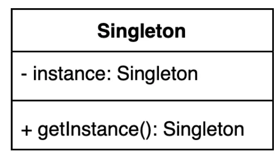
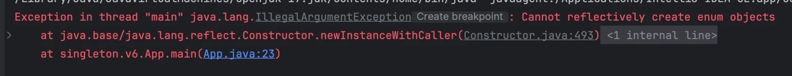
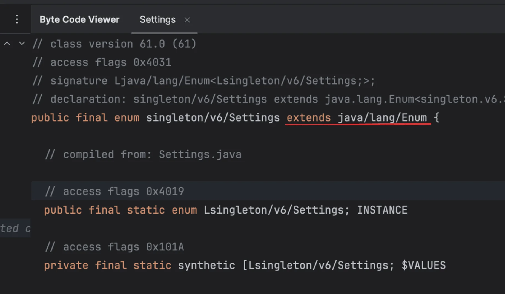
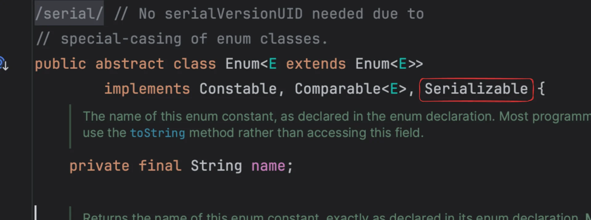
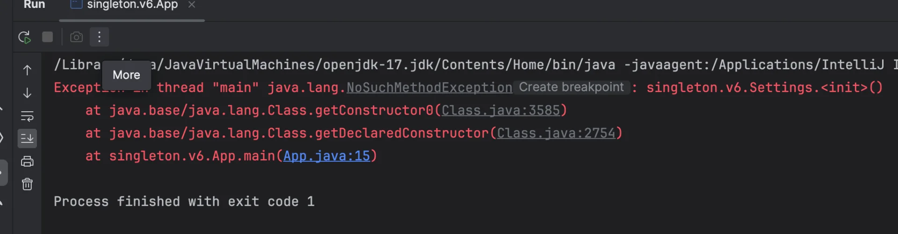
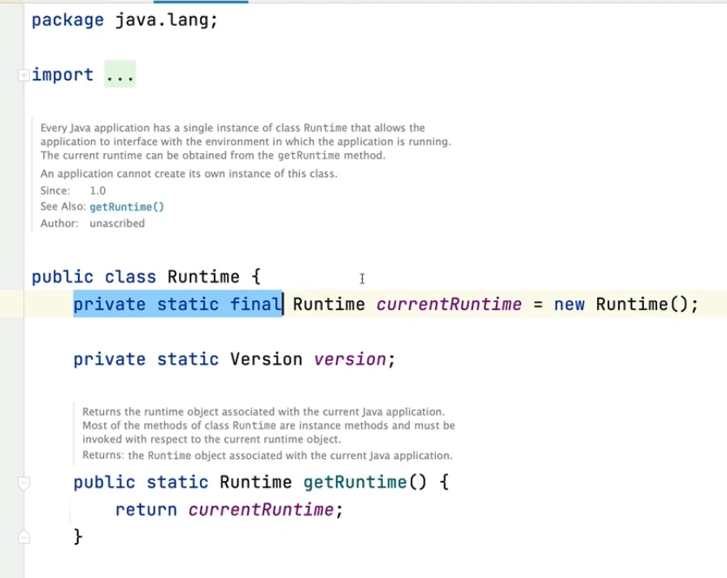

<a id="1c3eda9b0fe18178a81ae5d9a526c135"></a>

## 싱글톤 ( Singleton ) 패턴

---

<a id="1c3eda9b0fe18106a39ff3bd7dde6da7"></a>

### 1&#46; 가장 단순한 구현

---

> ✏️ 
> 
> <a id="1c3eda9b0fe181a58701caf61d3df232"></a>
> 
> 싱글톤 패턴은 <strong><u>인스턴스를 오직 한개만 제공</u></strong>하는 클래스를 말한다&#46; 
> 
> <a id="1c3eda9b0fe181ceb0a1dca9b5839985"></a>
> 
> 따라서 생성된 하나의 인스턴스를 <strong><u>글로벌하게 접근</u></strong>할 수 있도록 해야한다&#46; ( <code>static</code> )
> 
> <details>
> <summary>사용 예시</summary>
> 
> <a id="1c3eda9b0fe1818eb5add6a1db5a9a17"></a>
> 
> settings 화면 같은 경우 오직 하나만 있어야 한다&#46;
> 
> <a id="1c3eda9b0fe18127bd8fc8d558a6df6f"></a>
> 
> 동일 인스턴스가 아닐 시, 화면마다 적용한 설정들에 대해 동기화가 되지 않을 수 있다&#46; 
> 
> - A 화면에서 한 설정들이 B 화면에서 적용되지 않음
> 
> </details>

<a id="1c3eda9b0fe181439800f296e25ee133"></a>

### 구현



<details>
<summary>&#91; 코드 &#93; Settings  &#45; <code>싱글톤 패턴</code></summary>

<a id="1c3eda9b0fe18113b3c1db401dab63c0"></a>

```java
public class Settings {
		
		private static Settings instance;	
		
		private Settings() {}   // 기본 생성자 private 선언, 외부 new 호출을 막는다.
		
		public static Settings getInstance() {
				if (instance == null ) {
						instance = new Settings();
				}

				return instance;
		}
}
```

</details>

<details>
<summary>&#91; 코드 &#93; App</summary>

<details>
<summary><code>new</code> 키워드 </summary>

<a id="1c3eda9b0fe181a2bf6ef780168d7b77"></a>

```java
public class App {
		public static void main(String[] args) {
				Settings settings1 = new Settings();
				Settings settings2 = new Settings();
				
				System.out.println(settings1 != settings2);  // true
		}
}
```

<a id="1c3eda9b0fe181bb8642fd94b232d3df"></a>

<code>new</code> 키워드를 사용하여 인스턴스 객체를 생성하면, 매번 다른 인스턴스가 생성된다&#46; 

<a id="1c3eda9b0fe181d9b8d7ff1adbcee429"></a>

싱글톤 패턴의 경우, 하나의 인스턴스만을 생성하고 공유하는 것이기 때문에 

<a id="1c3eda9b0fe1814c986df4d4d7d84adc"></a>

이를 기본 생성자를 <code>private</code> 으로 선언하여 외부에서 <code>new</code> 키워드를 통한 인스턴스 생성을 막는다&#46;

</details>

<a id="1c3eda9b0fe18138b907fb8caf99266e"></a>

```java
public class App {
		public static void main(String[] args) {
				Settings settings1 = Settings.getInstance();
				Settings settings2 = Settings.getInstance();
				
				// 두 인스턴스 동일 -> 싱글톤
				System.out.println(settings1 == settings2);  // true
		}
}
```

</details>

<a id="1c3eda9b0fe18128a6d5ddfff55788b2"></a>

### 질문 

<a id="1c3eda9b0fe181ae8b04c778a1075cf6"></a>

‣

<details>
<summary>🧐 <code>static</code></summary>

<a id="1c3eda9b0fe18140b207d18b346a94ff"></a>

<code>static</code> 키워드는 클래스에 소속되는 멤버(변수, 메서드)를 만든다&#46; 

<a id="1c3eda9b0fe1817b8de2cea235149ba1"></a>

즉, 객체(인스턴스) 생성 없이 사용할 수 있도록 한다&#46; 

<a id="1c3eda9b0fe18133b834cd95eeb0cf50"></a>

```java
public class Util {
    public static void sayHello() {
        System.out.println("Hello!");
    }
}

// 이렇게 객체 없이 사용 가능:
Util.sayHello();
```

</details>

<details>
<summary>🧐 클래스(static) 멤버, 인스턴스 멤버</summary>

<a id="1c3eda9b0fe18138ae6ad1785fb25dc5"></a>

<strong>JVM 메모리 구조</strong>

| 메모리 영역 | 설명 |
| --- | --- |
| <strong><code>Method Area</code></strong> | 클래스 로딩 시 클래스 정보, static 변수 저장됨 |
| <strong><code>Heap</code></strong> | 객체(인스턴스)들이 저장되는 영역 |
| <strong>Stack</strong> | 메서드 호출 시 사용되는 지역 변수, 호출 순서 저장 |
| <strong>PC Register</strong> | 현재 실행 중인 명령의 주소 저장 |
| <strong>Native Method Stack</strong> | JVM 외부 네이티브 메서드용 |

1. <strong>클래스 로딩 시점 ( static )</strong>

<a id="1c3eda9b0fe18140b58bd194bff441e3"></a>

클래스가 처음 사용되면 JVM이 클래스 로더를 통해 <code>&#46;class</code> 파일을 로딩함

<a id="1c3eda9b0fe1815bb9c7c22aa9fbee3d"></a>

이떄, <code>Method Area</code>에 <strong><u>클래스 정보</u></strong>와 <strong><u><code>static</code></u></strong><strong><u> 멤버 ( 변수, 메서드 )</u></strong>가 올라감

<a id="1c3eda9b0fe18143ba8cc773e6067481"></a>

따라서 <strong><u><code>static</code></u></strong><strong> </strong><strong><u>멤버</u></strong><strong>는</strong> <u>클래스 단위</u>로 <strong><u>한 번만 로딩되고, 공유</u></strong>됨

<details>
<summary>ex)</summary>

<a id="1c3eda9b0fe181bb8451dd6d0b5404e7"></a>

```java
public class Counter {
    static int count = 0;
}
```

- Counter&#46;class가 JVM에 로딩되는 순간 Method Area에 count 변수가 생김

</details>

1. 객체 생성 시점 ( 인스턴스 )

<a id="1c3eda9b0fe18194b618eb6beb95aedb"></a>

<strong><u><code>new</code></u></strong><strong><u> 키워드로 객체를 생성</u></strong>하면, JVM은 <code>Heap 영역</code>에서<strong><u> 인스턴스를 생성</u></strong>함

<a id="1c3eda9b0fe181199f18d31eaef86269"></a>

<strong>각각 인스턴스</strong>는 <strong><u>자신만의 인스턴스 변수를 가짐</u></strong>

<a id="1c3eda9b0fe181038854fd51a73ed465"></a>

하지만 <code>static</code> 변수는 공유되므로 객체를 여러 개 만들어도 하나만  존재함

<a id="1c3eda9b0fe18108a403df025d0db276"></a>

<strong>그림으로 정리</strong>

<a id="1c3eda9b0fe1814d87a4ec4aa203442f"></a>

```java
[ Method Area ]
  ┌──────────────────────┐
  │ Counter.class         │
  │ static int count = 0; │◀─────────────── 모든 객체가 공유
  └──────────────────────┘

[ Heap ]  
  ┌─────────────┐     ┌─────────────┐
  │ c1          │     │ c2          │
  │ 인스턴스 변수 │     │ 인스턴스 변수 │
  └─────────────┘     └─────────────┘
       ↑                     ↑
       └─────────────────────┘
                 │
              각 인스턴스마다 독립된 Heap 영역을 가짐  
```

</details>

<details>
<summary>🧐 <code>private static</code></summary>

<a id="1c3eda9b0fe181ac8f99d2553c93cb8d"></a>

<code>private</code> 키워드는 클래스 내부에서만 접근 가능하도록 만드는 접근 제어자이다&#46;

<a id="1c3eda9b0fe181329d9cc22f087871a3"></a>

따라서 <code>private</code> 로 선언 시, 외부 클래스에서 해당 변수나 메서드에 접근할 수 없다&#46; 

<a id="1c3eda9b0fe181caa173db648afce0f9"></a>

<code>static</code> 멤버(변수, 메서드)는  Method 영역에서 관리한다&#46; 따라서 모든 인스턴스 Heap 영역에서 공유된다 &#46;

| <strong>개념</strong> | <strong>설명</strong> |
| --- | --- |
| <strong>static</strong> | 클래스 단위로 메모리(Method Area)에 로딩됨&#46; 모든 인스턴스가 공유함&#46; 객체 없이 접근 가능&#46; |
| <strong>private</strong> | 해당 클래스 <strong>내부에서만 접근 가능</strong>&#46; 외부 클래스에서는 접근 불가&#46; |

<a id="1c3eda9b0fe1818eb842e54ed709f7b1"></a>

허지만 private으로 선언된 static의 경우 ( <code>private static</code> ) 메모리는 공유되지만, 접근 제한하여 외부에서 사용할 수 없다&#46; 

<a id="1c3eda9b0fe18178b847fd5eb5136253"></a>

공유는 되지만, 접근은 제한한다&#46;  굉장히 이상한 개념이다&#46; 

- 해당 개념을 학습하면서 굉장히 비효율적이라고 생각들었다&#46; 

> 🧐 그렇다면 <strong><code>private static</code></strong><strong>은 사용 이유는 무엇인가? </strong>

<a id="1c3eda9b0fe18173889ae49b7973d04c"></a>

우선 static 메서드는 인스턴스 없이 동작하므로, 같은 static 멤버(static 변수 / 메서드 )만 직접 접근할 수 있다&#46; 

- <strong>static 메서드 내에서 사용되는 멤버들도 static으로 선언되어 있어야, 동일한 메서드 영역(Method Area)에 존재하게 되고 접근이 가능하다&#46;</strong>

<a id="1c3eda9b0fe1810c90d5e6765b42bf4d"></a>

따라서 static 메서드 내에서 호출되는 멤버는 동일하게 static 키워드를 사용하여 선언해야 한다&#46; 

<a id="1c3eda9b0fe181e2b064dec0ab1603ed"></a>

여기서 헤당 멤버들이 외부에서 사용되지 않고 클래스 내부에서만 사용된다면 <code>private</code>으로 선언하여 접근을 제한하는 것이다&#46;

> <strong>🧐 그러면 여기서 얻는 이점은 무엇인가? </strong>

<a id="1c3eda9b0fe1814da36ee6d45eab7a98"></a>

접근 제어자의 사용 유무는 객체지향의 특성인 <code>캡슐화</code>를 위해서이다&#46; 

<a id="1c3eda9b0fe1816b9f6ef999f5ba38c5"></a>

즉, 외부에서 접근 하지 못하게 막아 <strong>필요한 범위 내에서만 메서드/변수를 쓰도록 설계하는 것이다&#46; </strong>

<a id="1c3eda9b0fe1817eb4f3df13d8da1aa6"></a>

이로써 코드를 안전하게 보호하고, 품질과 안정성을 높인다&#46;

<details>
<summary>ex) </summary>

<a id="1c3eda9b0fe18154b8fbf90c7ac06569"></a>

```java
public class PasswordUtils {
    
    // 외부에서 쓸 필요 없는 내부 로직
    private static boolean isEmpty(String str) {
        return str == null || str.isEmpty();
    }

    // 외부에서 호출하는 공개 API
    public static boolean isValid(String password) {
        if (isEmpty(password)) return false;
        return password.length() >= 8;
    }
}
```

- <code>isEmpty()</code>를 <code>public static</code>으로 만들면 외부에서도 사용할 수 있게 되지만,<br><strong>실제로 외부에서 사용할 필요가 없다면, 쓸 수 없도록 막는 것이 더 좋음</strong> 
    - → 유지보수, 보안 측면에서 유리

</details>

<a id="1c3eda9b0fe18128a206c77e82591b8d"></a>

<strong>정리</strong>

| 질문 | 답변 |
| --- | --- |
| 메서드 영역에 있는데 private이면 낭비 아닌가? | 클래스 내부에서 재사용되므로 중복 제거, 코드 정리 효과 |
| 메모리는 공유되는데 막아두는 건 비효율 아닌가? | 공유는 하되 <strong>필요한 곳에서만 쓰게 제한</strong>하는 게 모범 사례 |
| 외부에서 못 쓰면 의미가 없다? | 내부 로직 간의 중복 제거나 정리용으로 충분히 가치 있음 |

</details>

<details>
<summary>🧐 <strong><u>생성자</u></strong>를 <code>private</code>으로 선언한 이유는?</summary>

- 외부에서<strong><u> </u></strong><strong><u><code>new</code></u></strong><strong><u> 키워드를 통해 인스턴스 생성</u></strong> 시, <strong><u>매번 다른 인스턴스가 생성</u></strong>된다&#46; 

- 이는 하나의 인스턴스만을 생성하여 공유하는 싱글톤 패턴에 위반되므로, 이를 <code>private</code>을 통해 막는다&#46; 

</details>

<details>
<summary>🧐 <code>getInstance()</code>를 <code>static</code>으로 선언하는 이유는?</summary>

- <code>static</code> 멤버는 인스턴스 멤버와 다르게<strong><u> 메서드 영역(Method Area)에서 관리</u></strong>하여 <strong><u>모든 인스턴스 힙 영역에서 공유</u></strong>한다&#46; 

- 즉, 인스턴스 생성 없이 가져와 사용할 수 있다&#46;  ex) <code>Settings&#46;getInstance()</code>

- 따라서 생성된 <strong><u>하나의 인스턴스를 글로벌하게 공유하여 사용</u></strong>할 수 있다&#46;

</details>

<details>
<summary>🧐 <code>getInstance()</code>가 <strong><u>멀티쓰레드 환경</u></strong>에서<br>안전하지 않은 이유?</summary>

<a id="1c3eda9b0fe18148a331c7817b4907ae"></a>

```java
public class Settings {
		
		private static Settings instance;	
		
		private Settings() {}
		
		public static Settings getInstance() {
		
				if (instance == null ) {   <- 동시에 여러 쓰레드가 접근 
						instance = new Settings();
				}

				return instance;
		}
}
```

-  <strong>동시에 여러 스레드가 </strong><strong><code>instance == null</code></strong><strong> 인 것을 보고 </strong><strong><u>서로 다른 Settings 인스턴스를 만</u></strong><strong>들 수 있다&#46;</strong>
    <details>
    <summary><u>동시성 문제</u>가 발생됨</summary>

    <a id="1c3eda9b0fe181cfbcb8c45f6665d84c"></a>

    ```java
    if (instance == null) {
        instance = new Settings();
    }
    ```

    1. <strong>Thread A와 Thread B가 동시에 getInstance()를 호출</strong>

    1. 두 스레드 모두 instance == null 조건을 <strong>통과</strong>

    1. 둘 다 new Settings() 실행

    1. 결국 <strong>Settings 인스턴스가 두 개 생성됨</strong> 

    </details>

- 결과적으로 싱글톤 패턴의 핵심인 하나의 인스턴스만을 생성해야 한다는 규칙이 꺠진다&#46; <br>따라서 해당 코드는 <u>스레드&#45;세이프하지 않다</u> ( <code>Thread&#45;unsafe</code> ) 

</details>

<a id="1c3eda9b0fe1816696b6d6893ea147c6"></a>

### 2&#46;  멀티쓰레드 환경

---

<details>
<summary>방법 1) <code>synchronized</code>  &#91; ❌ &#93;</summary>

<a id="1c3eda9b0fe1810482f0d339bee9c6ac"></a>

```java
public class Settings {
		private static Settings instance;
		
		private Settings() { }
		
		public static synchronized Settings getInstance() {
				if (instance == null) {
						instance = new Settings();
				}				
				return instance;
		}
}
```

- 매번 동기화 처리하는 과정 발생되어 성능에 약간 불이득이 있다&#46; 
    - 락을 통한 제어가 필요, 비용 발생

</details>

<details>
<summary>방법 2) eager initialization ( 이른 초기화 ) &#91; ❌ &#93;</summary>

<a id="1c3eda9b0fe1813181a6cc4d5390a641"></a>

```java
public class Settings {
		private static final Settings INSTANCE = new Settings(); // staic final, 상수와 동일 -> 대문자 사용
		
		private Settings() {}
		
		public static Settings getInstance() {
				return INSTANCE;
		}
} 
```

- 만약 해당 객체를 만드는 비용이 비싸지 않아 미리 생성 가능하다면<br>위와 같이 미리 만들고 <code>Thread safe</code> 하게 작성할 수 있다&#46; 
    - 클래스가 로딩되는 시점에 static 필드들이 초기화 된다&#46;<br>따라서 여러 스레드에서 동시에 접근하여도 미리 초기화된 인스턴스만 반환하면 되기 때문에<br>스레드 안전하게 동작될 수 있다&#46;

---

- 장점
    - <code>synchronized</code> 와 달리 <strong>락에 대한 제어가 없</strong>기 때문에, 더 성능적인 이점이 있다&#46; 

- 단점
    - 만약 해당 인스턴스를 만드는 과정이 오래 걸리고 메모리를 많이 사용한다면 로딩 시 많은 리소스가 소비된다&#46;

    - 만약 미리 만들고 사용되지 않는다면 오히려 리소만 낭비한 경우가 된다&#46; 

</details>

<details>
<summary>방법 3) double checked locking  &#91; <strong>O</strong> &#93;</summary>

<a id="1c3eda9b0fe18133bea8cf9d0472c8b5"></a>

```java
public class Settings {
		private static volatile Settings instance;
		
		private Settings() { }
		
		public static  Settings getInstance() {
				if (instance == null) {
						synchronized (Settings.class) {
								if (instance == null) {
										instance = new Settings();
								}		
						}
				}				
				return instance;
		}
}
```

<a id="1c3eda9b0fe181b5bbe5c3fd23c4ecf6"></a>

<code>getInstance()</code>를 호출할 때마다, 매번 <code>synchronized</code> 연산을 하지 않는다&#46; 

- <code>if ( instance == null)</code> 을 통해 instance가 없는 경우만, <code>synchronized</code> 를 통해 락 제어를 한다&#46; 

<a id="1c3eda9b0fe1810db155c715f29daabd"></a>

따라서  <code>방법1</code> 의  경우보다 훨씬 더 성능에 유리하며, 인스턴스가 필요한 시점에 생성할 수 있기 때문에 <code>방법2</code>의 문제 또한 해결할 수 있다&#46;

- <code>방법1</code>&#58; 매번 <code>synchronized</code> 의 락 제어 비용이 발생됨

- <code>방법2</code>&#58; 미리 인스턴스를 생성하기 때문에 낭비가 발생될 수 있음

<a id="1c3eda9b0fe181bea42bd44e45f24315"></a>

그러나 해당 기법은 굉장히 복잡한 방법이다&#46; 

<a id="1c3eda9b0fe1817bad3ceb0a6d84e1e7"></a>

왜 <code>volatile</code>을 사용하지는 이해하려면, 자바 1&#46;4 이하 버전의 멀티스레딩 환경에서의 메모리를 다루는 방법을 이해해야 한다&#46; 

- 해당 부분을 이해하기에는 너무 복잡하다&#46; 

<a id="1c3eda9b0fe181daadecc969c5cb9e98"></a>

또한 자바 1&#46;5 이상부터 동작한다&#46; 즉, 1&#46;4 이하에는 적용되지 않는다&#46; 

- 이 내용은 해당 사항 없음, 강의에서 다루길래 같이 정리함

</details>

<details>
<summary>방법 4) static inner 클래스 &#91; <strong>O</strong> &#93;</summary>

> ✏️ 
> 
> <a id="1c3eda9b0fe18190a7a7d174b9a8e522"></a>
> 
> <strong><u>정적 내부 클래스(static inner class)</u></strong>를 이용한 <strong><u>지연 초기화(Lazy Initialization)</u></strong> 및 <strong><u>스레드 안전(Thread&#45;safe)</u></strong> 싱글톤 구현

<a id="1c3eda9b0fe181c8b3aeda99ee12a13b"></a>

```java
public class Settings {

		private Settings() {}
		
		private static class SettingsHolder {
				private static final Settings INSTANCE = new Settings();
		}
		
		public static Settings getInstance() {
				return SettingsHolder.INSTANCE;
		}
}
```

- <strong><u>inner static class를 만</u></strong>들고 getter(<code>getInstance()</code>)에서 해당 inner static 클래스 호출한다&#46;

- 이러면, <code>getInstance()</code>  호출 시, 해당 클래스가 로딩이 되면서 인스턴스가 초기화 된다&#46; <br>따라서 <strong><u>인스턴스 조회 시점에, 인스턴스를 생성</u></strong>할 수 있다&#46; 
    <details>
    <summary><strong><code>레이지 로딩</code></strong></summary>

    - SettingsHolder 클래스는 <strong><code>getInstance()</code></strong><strong>가 호출될 때까지는 로딩되지 않는다&#46;</strong>

    - <code>SettingsHolder&#46;INSTANCE</code>에 접근하는 순간, JVM이 SettingsHolder를 <strong>처음 로딩하고 초기화한다&#46;</strong>

    </details>

<details>
<summary><strong>클래스 초기화는 JVM이 한 번만, 그리고 동기화된 방식으로 수행한다&#46;</strong></summary>

- JVM은 <strong>클래스를 처음 로드하고 초기화하는 작업을 하나의 스레드만이 수행하도록 보장한다&#46;</strong>

- 따라서  <code>INSTANCE = new Settings()</code>도 딱 한 번만 실행한다&#46;

- 다른 스레드는 이 초기화가 끝난 뒤에 접근한다&#46;
    - JVM 스펙에서 <strong><code>Class Initialization Phase</code></strong><strong> 부른다&#46; </strong>

</details>

- 즉, JVM 내부에서 클래스 초기화를 스레드 하나만 동작되도록 강제하기 때문에 스레드 안전이 보장된다&#46; 
    <details>
    <summary>ex) </summary>

    <a id="1c3eda9b0fe1816b9eabd3f1a7682c07"></a>

    ```java
    SettingsHolder.INSTANCE = new Settings()
    ```

    <a id="1c3eda9b0fe18199b16eeaac987434d2"></a>

    여기서 <code>INSTANCE</code>는 <strong>힙 영역</strong>에 생성된다&#46; 

    <a id="1c3eda9b0fe18108be1bfe96c1344bfe"></a>

    그러나 <code>SettingsHolder&#46;class</code>의 static 변수는 <strong><u>메서드 영역</u></strong><u>에 메타정보로 저장</u>된다&#46; 

    <a id="1c3eda9b0fe1818da043e1eff6d4b82f"></a>

    따라서 INSTANCE 참조 자체는 <strong><u>클래스 로딩 시</u></strong><u> 단 한 번만 초기화</u>된다&#46;

    </details>

> 👉🏻 
> 
> <a id="1c3eda9b0fe181749362f5913881d084"></a>
> 
> SettingsHolder&#46;INSTANCE는 <strong>처음 getInstance() 호출 시점에 생성</strong>
> 
> <a id="1c3eda9b0fe1818caaddc5142210f4da"></a>
> 
> 클래스 초기화는 JVM이 <strong>자동으로 스레드 안전하게 처리</strong>
> 
> <a id="1c3eda9b0fe181f387fbd9030a878a2f"></a>
> 
> 따라서 synchronized 없이도 <strong>스레드 세이프 &#43; Lazy Initialization</strong>이 가능
> 
> <a id="1c3eda9b0fe18157b087dca8d4668518"></a>
> 
> <br><strong>장점</strong>
> 
> - <strong>효율적</strong>&#58; synchronized 오버헤드 없음
> 
> - <strong>지연 초기화</strong>&#58; 메모리 절약 가능
> 
> - <strong>JVM 보장으로 안전</strong>&#58; 복잡한 동기화 코드 필요 없음
> 
> <a id="1c3eda9b0fe18186be13ffd2806ff3a5"></a>
> 
> 이전 double checked locking 처럼 복잡한 이론적 배경 없이도 쉽게 사용 가능하며, <br>코드 양도 더 적다&#46;

</details>

<a id="1c3eda9b0fe181c89ef8d6f0c0951cae"></a>

### 3&#46;  싱글톤이 깨지는 경우

> 🧐 
> 
> <a id="1c3eda9b0fe181a8ac85e3bbcc5a0b2c"></a>
> 
> 사용하는 쪽에서 <u>이상하게 사용</u>하는 경우, 싱글톤이 꺠질 수 있다&#46; 

<details>
<summary>1&#46; <code>리플랙션</code>을 사용한 인스턴스 동적 생성</summary>

<a id="1c3eda9b0fe18107aaabdfbb35930109"></a>

```java
public class App {
		public static void main(String[] args) throws NoSuchMethodException {
				Settings settings1 = Settings.getInstance();
				
				// 리플랙션을 사용한 인스턴스 생성 ( new 를 사용한 인스턴스 생성과 유사 )
				Constructor<Settings> constructor =Settings.class.getDeclaredConstructor();
				constructor.setAccessible(true);
				Settings settings2 = constructor.newInstance();
				
				System.out.println(settings1 == settings2);  // false
		}
}
```

<details>
<summary>자바에서는 Constructor에 접근해서 <strong><code>private 생성자</code></strong>도 <strong><u>강제로 호출</u></strong>할 수 있다&#46;  &#91; 리플랙션 &#93;</summary>

<a id="1c3eda9b0fe181a8896af7c704c994ee"></a>

```java
Constructor<Settings> constructor = Settings.class.getDeclaredConstructor();
constructor.setAccessible(true);
Settings newInstance = constructor.newInstance();

System.out.println(Settings.getInstance() == newInstance); // false 😱
```

</details>

<a id="1c3eda9b0fe18117a955ca3a74dce4a1"></a>

해당 방법은 막을 수가 없다&#46;  

</details>

<details>
<summary>2&#46; <code>직렬화</code> &#38; <code>역직렬화</code> 사용</summary>

> ✏️ 
> 
> <a id="1c3eda9b0fe18160b761f4f36bfb6e00"></a>
> 
> 자바에서 오브젝트를 파일 형태로 디스크에 저장했다가 ( 직렬화 )
> 
> <a id="1c3eda9b0fe18157b29de2799f9943ee"></a>
> 
> 디스크에서 가져와 다시 오브젝트로 읽을 수 있다&#46; ( 역직렬화 )

<a id="1c3eda9b0fe18118a7bac055f55ecc1e"></a>

```java
public class Settings implements Serializable {
		// Serializable ID 생략..

		private Settings() {}
		
		private static class SettingsHolder {
				private static final Settings INSTANCE = new Settings();
		}
		
		public static Settings getInstance() {
				return SettingsHolder.INSTANCE;
		}
}
```

Settings&#46;class

<a id="1c3eda9b0fe18167a360f4a4e8612869"></a>

```java
public class App
		public static void main(String[] args) throws IOException {
				Settings settings1 = Settings.getInstance();
		
				// 오브젝트를 직렬화하여 파일로 저장
				try (ObjectOutput out = new ObjectOutputStream(new FileOutputStream("settings.obj"))) {
						settings1 = out.writeObject(settings);
				} 
				
				// 파일을 역직렬화하여 오브젝트로 읽어옴, 이때 생성자를 사용해 새로운 인스턴스를 생성함
				try (ObjectOutput in = new ObjectInputStream(new FileInputStream("settings.obj"))) {
						settings2 = (Settings) in.readObject();
				} 
				
				System.out.println(settings1 == settings2);  // false
		}		
}
```

App&#46;class

- 역직렬화 시, 반드시 생성자를 사용하여 다시 인스턴스를 만든다&#46; 

<a id="1c3eda9b0fe181f2be5dc573bff0e50a"></a>

여러가지 방법들을 사용해 보안하여 코딩을 했지만, 사용자가 이상하게 사용하면 패턴이 깨질수 있다&#46; 

<details>
<summary>&#91; 해결 &#93; 역직렬화 시, 새로운 인스턴스 생성을 막음</summary>

<a id="1c3eda9b0fe18179944ff1119de09efd"></a>

```java
public class Settings implements Serializable {

		...
		
		protected Object readResolve() {
				return getInstance();
		}
}
```

<a id="1c3eda9b0fe181eeb049e7e24bc00da0"></a>

<code>readResolve()</code> 메서드가 명시적으로 오버라이딩할 수는 없지만, 실제 역직렬화 시 사용된다&#46;<br>따라서 위와 같이 <code>readResolve()</code>를 인스턴스 조회 코드로 명시를 하면, 생성자를 통한 생성 대신 위 <strong><u>getter(</u></strong><strong><u><code>getInstance()</code></u></strong><strong><u>)를 통해 인스턴스를 읽</u></strong>어온다&#46; 

<a id="1c3eda9b0fe18116b03bc77746fd17c4"></a>

따라서 <strong><u>역직렬화된 인스턴스를 비교</u></strong>하면 <strong><u>동일한 값</u></strong>이 나온다&#46;

<a id="1c3eda9b0fe1819690fdf424ed82489a"></a>

```java
public class App
		public static void main(String[] args) throws IOException {
				Settings settings1 = Settings.getInstance();
		
				// 오브젝트를 직렬화하여 파일로 저장
				try (ObjectOutput out = new ObjectOutputStream(new FileOutputStream("settings.obj"))) {
						settings1 = out.writeObject(settings);
				} 
				
				// 파일을 역직렬화하여 오브젝트로 읽어옴, 이때 생성자를 사용해 새로운 인스턴스를 생성함
				try (ObjectOutput in = new ObjectInputStream(new FileInputStream("settings.obj"))) {
						settings2 = (Settings) in.readObject();
				} 
				
				System.out.println(settings1 == settings2);  // true
		}		
}
```

</details>

</details>

<a id="1c3eda9b0fe181689566c998447711cc"></a>

### 4&#46; Thread Safe 한 구현  &#45; <code>enum</code>

> 📖 
> 
> <a id="1c3eda9b0fe181d3b155fdbc0e32d638"></a>
> 
> <code>enum</code>은 자바에서 <u>싱글톤(Singleton) 구현</u><strong> 시, 가장 안전하게 구현할 수있는 권장 방법이다&#46;</strong>
> 
> - <strong>enum은 자체적으로 단 하나의 인스턴스만 생성되도록 보장</strong>
> 
> - JVM이 클래스 로딩 시점에 딱 한 번만 생성해주고, 그 이후에는 재생성되지 않는다&#46;
> 
> - <strong><u>리플렉션(Reflection)</u></strong>이나 <strong><u>직렬화(Serialization)</u></strong>을 사용해도 <strong>싱글톤이 깨지지 않</strong><strong>음</strong>

<details>
<summary><strong>&#91; 🤬 오류 &#93;</strong> 자바에서는 <strong><u>Constructor에 접근</u></strong>해서 <strong><code>private 생성자</code></strong>도 <strong><u>강제로 호출</u></strong>할 수 있다&#46;  &#91; 리플랙션 &#93;</summary>

<a id="1c3eda9b0fe1817da09cdaf23f53b0e3"></a>

```java
Constructor<Settings> constructor = Settings.class.getDeclaredConstructor();
constructor.setAccessible(true);
Settings newInstance = constructor.newInstance();

System.out.println(Settings.getInstance() == newInstance); // false 😱
```

<a id="1c3eda9b0fe1816f8c0af8ac1decf37d"></a>

따라서 생성자를 private 하게 선언 하여도 외부에서 Constructor에 접근하여  인스턴스를 강제 생성한다&#46; 이를 통해서 싱글톤 패턴이 꺠진다&#46; 

</details>

<details>
<summary><strong>&#91; 😎 해결 &#93;</strong><strong>  </strong><strong><code>enum</code></strong></summary>

<details>
<summary>1&#46; <code>enum</code> 을 사용하면 리플렉션에 안전한 코드를 만들 수 있다&#46;</summary>

<a id="1c3eda9b0fe181499cb3fba1d4a3290c"></a>

```java
public enum Settings {
		INSTANCE;`
}
```

<a id="1c3eda9b0fe181b4b3d1f874e45f7a2a"></a>

<code>enum</code>은 자바 컴퍼일러가 특별하게 처리하는 구조이다&#46; 

<a id="1c3eda9b0fe18118b837f61225af144d"></a>

JVM 내부적으로 enum 클래스는 <strong><code>java&#46;lang&#46;Enum</code></strong>을 자동 상속하고,<strong><u> 특수한 생성자 규칙</u></strong>을 적용한다&#46; 

<a id="1c3eda9b0fe1815ab50fd0a32bd51434"></a>

따라서 <strong> </strong><strong><code>enum</code></strong><strong> 은</strong><strong><u> </u></strong><strong><u>리플렉션으로 인스턴스를 생성</u></strong><strong>하려고 하면</strong><strong><u> </u></strong><strong><u>예외가 발생</u></strong>된다&#46;



<details>
<summary>exception</summary>

<a id="1c3eda9b0fe181189076f089c0ec3ae2"></a>

```java
java.lang.IllegalArgumentException: Cannot reflectively create enum objects
```

<a id="1c3eda9b0fe181ae818ddc17c0f9bd5d"></a>

enum 클래스의 리플렌션으로 생성은 JVM이 막는다&#46; 

<a id="1c3eda9b0fe18178837ae52f8b66f431"></a>

생성하려고 하면 위와 같은 exception이 발생된다&#46;

</details>

</details>

<details>
<summary>2&#46; <strong><code>enum</code></strong><strong>은 직렬화 시에도 안전하다&#46;</strong></summary>

<a id="1c3eda9b0fe181f5871df7a78b14f424"></a>

```java
ObjectOutputStream oos = new ObjectOutputStream(new FileOutputStream("obj.ser"));
oos.writeObject(Settings.INSTANCE);

ObjectInputStream ois = new ObjectInputStream(new FileInputStream("obj.ser"));
Settings deserialized = (Settings) ois.readObject();

System.out.println(Settings.INSTANCE == deserialized); // true 🎉
```

<a id="1c3eda9b0fe181b48b86d4eb1cae2a97"></a>

<code>enum</code>은 직렬화할 때 <strong><u>이름(name)만 저장</u></strong>되고,<u> </u><u>역직렬화</u> 시 <strong><code>Enum&#46;valueOf()</code></strong>를 <u>사용</u>한다&#46; 

<a id="1c3eda9b0fe1812283aeea0e7bc9be0c"></a>

 따라서 <strong>JVM이 기존 인스턴스를 자동으로 반환한다&#46; </strong>

</details>

</details>

<details>
<summary><strong>&#91; 🧐 비교 &#93;</strong><strong><code>일반 싱글톤 (SettingsHolder)</code></strong><strong> </strong><strong>vs</strong><strong> </strong><strong><code>enum 싱글톤</code></strong><strong><code> </code></strong><strong><code>(Settings&#46;INSTANCE)</code></strong></summary>

| <strong>비교 항목</strong> | <strong>일반 싱글톤 (</strong>SettingsHolder<strong>)</strong> | <strong>enum 싱글톤 (</strong>Settings&#46;INSTANCE<strong>)</strong> |
| --- | --- | --- |
| 생성 개수 제어 | 직접 제어해야 함 | JVM이 자동 제어 |
| 리플렉션 공격 | 깨짐 (강제 생성 가능) | 예외 발생, 생성 자체 불가 |
| 역직렬화 공격 | 깨짐 (readResolve() 필요) | 자동으로 동일 인스턴스 보장 |
| 코드 간결성 | 비교적 복잡 | 매우 간단 |
| 유지보수, 안정성 | 개발자 실수 여지 있음 | JVM이 보장함 |

- 실무에서는 <strong>가장 안전한 싱글톤 방식으로 </strong><strong><code>enum</code></strong><strong>을 권장한다&#46; </strong>

</details>

<details>
<summary>enum은 클래스이다&#46;</summary>

<a id="1c3eda9b0fe181afba7bec2e13eb2cb1"></a>

클래스와 동일하게 멤버 선언, getter, setter 다 사용가능하다&#46;

<a id="1c3eda9b0fe181d3a223c874f8c2a03b"></a>

```java
public enum Settings {

		INSTANCE;
		
		private Settings();
		
		private Integer number;
		
		public Integer getNumber() {
				return number;
		}
		
		public Integer setNumber(Integer number) {
				this.number = number;
		}
}
```

</details>

<details>
<summary>enum은 내부적으로 Serializable 구현한다&#46; </summary>

<details>
<summary>bytecode</summary>

<a id="1c3eda9b0fe1817dac5cd62cdcee8c29"></a>

```java
// class version 61.0 (61)
// access flags 0x4031
// signature Ljava/lang/Enum<Lsingleton/v6/Settings;>;
// declaration: singleton/v6/Settings extends java.lang.Enum<singleton.v6.Settings>
public final enum singleton/v6/Settings extends java/lang/Enum {

  // compiled from: Settings.java

  // access flags 0x4019
  public final static enum Lsingleton/v6/Settings; INSTANCE

  // access flags 0x101A
  private final static synthetic [Lsingleton/v6/Settings; $VALUES

  // access flags 0x9
  public static values()[Lsingleton/v6/Settings;
   L0
    LINENUMBER 8 L0
    GETSTATIC singleton/v6/Settings.$VALUES : [Lsingleton/v6/Settings;
    INVOKEVIRTUAL [Lsingleton/v6/Settings;.clone ()Ljava/lang/Object;
    CHECKCAST [Lsingleton/v6/Settings;
    ARETURN
    MAXSTACK = 1
    MAXLOCALS = 0

  // access flags 0x9
  public static valueOf(Ljava/lang/String;)Lsingleton/v6/Settings;
   L0
    LINENUMBER 8 L0
    LDC Lsingleton/v6/Settings;.class
    ALOAD 0
    INVOKESTATIC java/lang/Enum.valueOf (Ljava/lang/Class;Ljava/lang/String;)Ljava/lang/Enum;
    CHECKCAST singleton/v6/Settings
    ARETURN
   L1
    LOCALVARIABLE name Ljava/lang/String; L0 L1 0
    MAXSTACK = 2
    MAXLOCALS = 1

  // access flags 0x2
  // signature ()V
  // declaration: void <init>()
  private <init>(Ljava/lang/String;I)V
   L0
    LINENUMBER 8 L0
    ALOAD 0
    ALOAD 1
    ILOAD 2
    INVOKESPECIAL java/lang/Enum.<init> (Ljava/lang/String;I)V
    RETURN
   L1
    LOCALVARIABLE this Lsingleton/v6/Settings; L0 L1 0
    MAXSTACK = 3
    MAXLOCALS = 3

  // access flags 0x100A
  private static synthetic $values()[Lsingleton/v6/Settings;
   L0
    LINENUMBER 8 L0
    ICONST_1
    ANEWARRAY singleton/v6/Settings
    DUP
    ICONST_0
    GETSTATIC singleton/v6/Settings.INSTANCE : Lsingleton/v6/Settings;
    AASTORE
    ARETURN
    MAXSTACK = 4
    MAXLOCALS = 0

  // access flags 0x8
  static <clinit>()V
   L0
    LINENUMBER 9 L0
    NEW singleton/v6/Settings
    DUP
    LDC "INSTANCE"
    ICONST_0
    INVOKESPECIAL singleton/v6/Settings.<init> (Ljava/lang/String;I)V
    PUTSTATIC singleton/v6/Settings.INSTANCE : Lsingleton/v6/Settings;
   L1
    LINENUMBER 8 L1
    INVOKESTATIC singleton/v6/Settings.$values ()[Lsingleton/v6/Settings;
    PUTSTATIC singleton/v6/Settings.$VALUES : [Lsingleton/v6/Settings;
    RETURN
    MAXSTACK = 4
    MAXLOCALS = 0
}

```

</details>

- enum 클래스의 바이트 코드 확인 시, <code>java/lang/Enum</code> 을 상속하는 것을 확인 할 수 있다&#46; 
    

- enum 클래스 확인 시, Serializable의 구현체인 것을 확인할 수 있다&#46; 



</details>

<details>
<summary>enum을 리플랙션 통해 인스턴스를 생성하려고 한다면 예외가 발생된다&#46; </summary>

<a id="1c3eda9b0fe18198a5d2f6ab5ea32b00"></a>

```java
package singleton.v6;

import java.lang.reflect.Constructor;
import java.lang.reflect.InvocationTargetException;

public class App {
    public static void main(String[] args) throws NoSuchMethodException, InvocationTargetException, InstantiationException, IllegalAccessException {
        Settings settings = Settings.INSTANCE;

        /**
           * Error: java.lang.NoSuchMethodException: singleton.v6.Settings.<init>()
             자바 리플렉션으로 Settings 클래스의 생성자를 찾으려고 했지만, 기본 생성자가 없거나 private 이라서 호출할 수 없음을 의미한다.
             즉, Enum으로 클래스 생성 시, 리플랙션을 통한 인스턴스 생성이 막힌다.
        */
        
        Constructor<Settings> constructor = Settings.class.getDeclaredConstructor();
        constructor.setAccessible(true);
        Settings settings1 = constructor.newInstance();
       
        System.out.println(settings == settings1); // true
    }
}
```



</details>

- enum은 <strong>직렬화 시에도 안전하다&#46;</strong>

> ☝🏻 
> 
> <a id="1c3eda9b0fe181a5997cfeb36bb13218"></a>
> 
> <code>단점</code>
> 
> - <code>enum</code>은 <u>미리 인스턴스가 생성</u>된다&#46; 
>     - earger initializer 단점과 동일
> 
> - <code>enum</code> <u>클래스만 상속</u>할 수 있다&#46; 
> 
> <a id="1c3eda9b0fe181ad96fee5b2d4f1bcf2"></a>
> 
> 따라서 static inner 클래스(SettingsHolder)를 사용하는 것으로 위 단점을 모두 해결 가능하니, 적절하게 상황에 맞게 사용해야 한다&#46; 

<a id="1c3eda9b0fe18129ac47ec8be6d6d1c8"></a>

### 5&#46; 실무에서 사용

<details>
<summary>자바 java&#46;lang&#46;runtime</summary>

<a id="1c3eda9b0fe181d19008d9eb059cbacc"></a>

```java
public class RuntimeExample {
		
		public static void main(String[] args) {
				Runtime runtime = Runtime,getRuntime();   // static final 로 미리 생성되어 thread safe 하다.				
				System.out.println(runtime.maxMemory());
				System.out.println(runtime.freeMemory());
		}
}
```

<details>
<summary>Runtime 인스턴스는 static final 로 미리 생성되기 때문에, thread safe 하다&#46;</summary>

- 2&#46; eager initialization  방식 
    

</details>

</details>

<details>
<summary>스프링 &#45; 싱글톤 스코프</summary>

<a id="1c3eda9b0fe1818b81ddc267e8563073"></a>

```java
// Config
@Configuration
public class SpringConfig {
		
		@Bean
		public String hello() {
				return "hello";
		}
}

// App
public class SpringExample {
		public static void main(String[] args) {
				ApplicationContext applicationContext = new AnnotationConfigApplicationContext(SpringConfig.class);
				String hello1 = applicationContext.getBean("hello", Spring.class);
				String hello2 = applicationContext.getBean("hello", Spring.class);
				System.out.println(hello1 == hello2);		// true		
}
```

- 유일 객체가 필요한 경우, 스프링에서는 싱글톤 스코프 빈을 등록하여 사용하는 경우가 많다&#46; 
    - 엄밀히 따지면 싱글톤 패턴이 아니다&#46; 얼마든지 여러개의 다른 인스턴스를 생성할 수 있다&#46;

</details>

- 다른 디자인 패턴( 빌더, 퍼사드, 추상 팩토리 등) 구현체의 일부로 쓰임
    - 다른 챕터에서 정리
