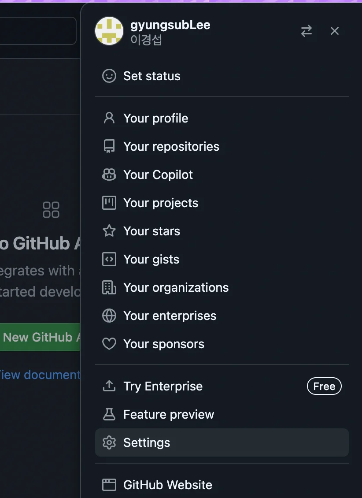
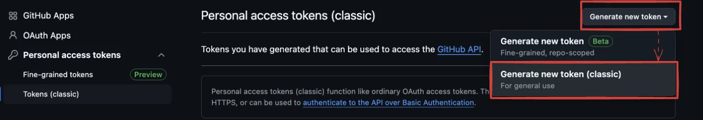
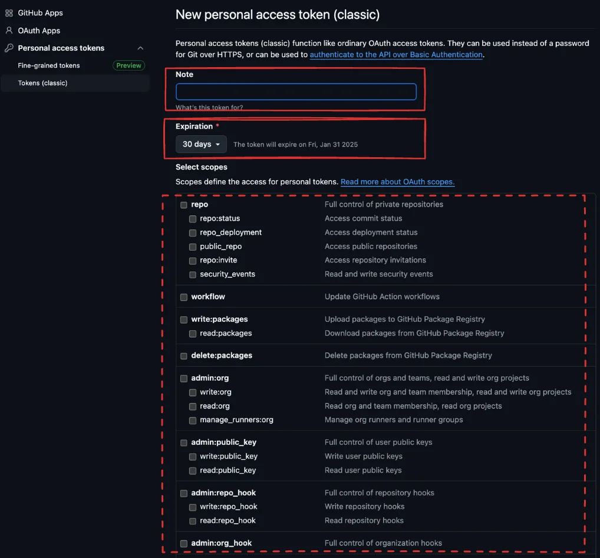
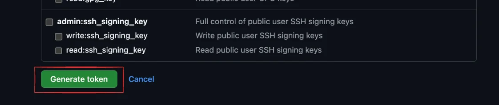
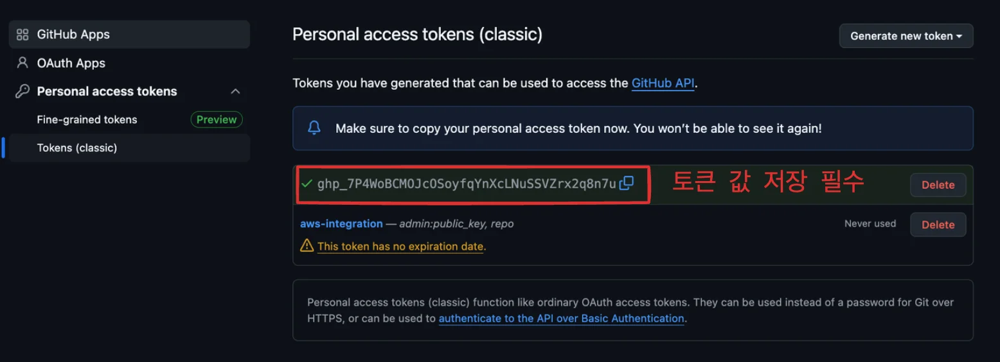

- 프로필  &#45; Settings
    

    

- Developer settings
    

- Personal access tokens
    

- Token ( classic ) 
    

- Generate new token → Generate new token ( classic ) 
    

- 이름, 만료기간, 권한 설정
    

- 완료 후 토큰 생성
    

- 아래와 같이 생성된 토큰의 값을 알려준다&#46;  처음 한번만 보여주기 때문에 잘 보관해서 사용해야 한다&#46;
    
