

## TCP, UDP

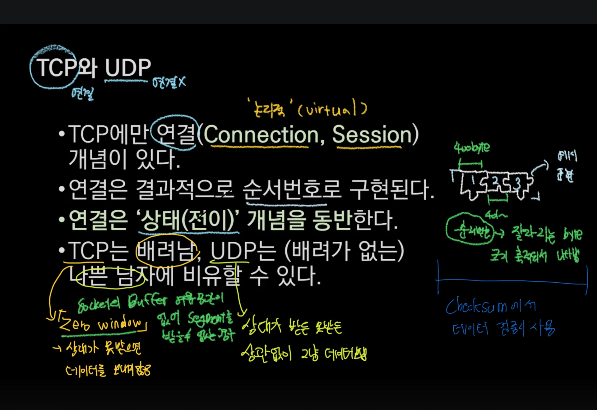

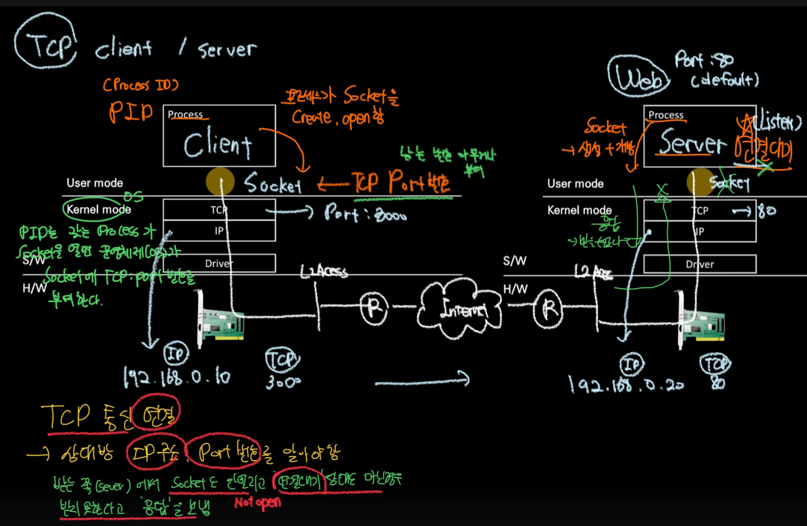

## TCP 연결 과정 ( 3&#45;way handshaking )

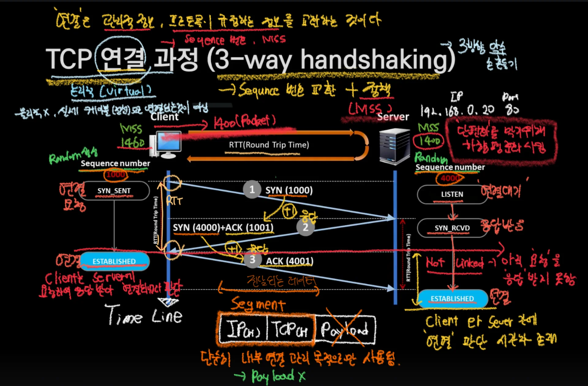

## TCP 연결 종료 과정 ( 4&#45;way handshaking )

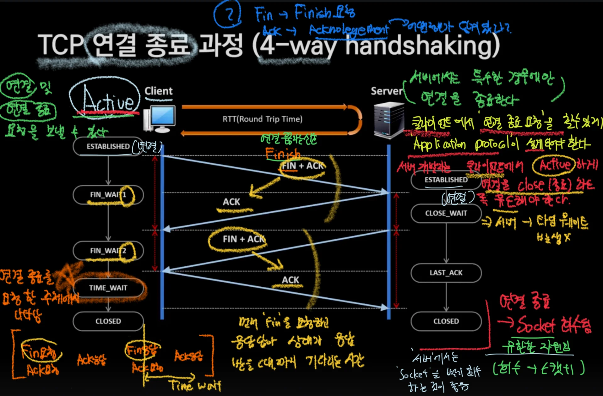

## TCP 연결 상태 변화 

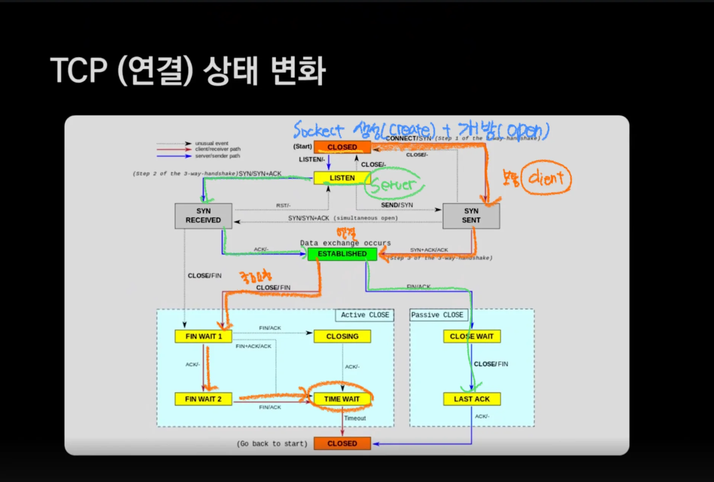

## TCP Header 형식

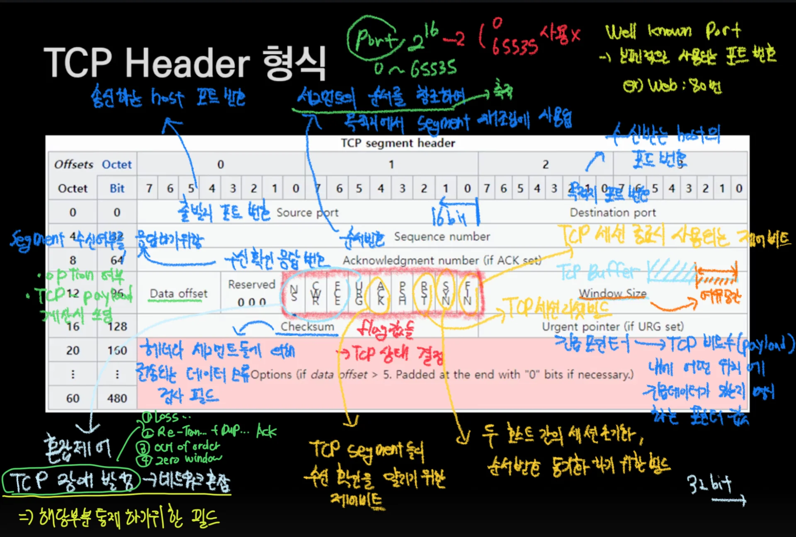

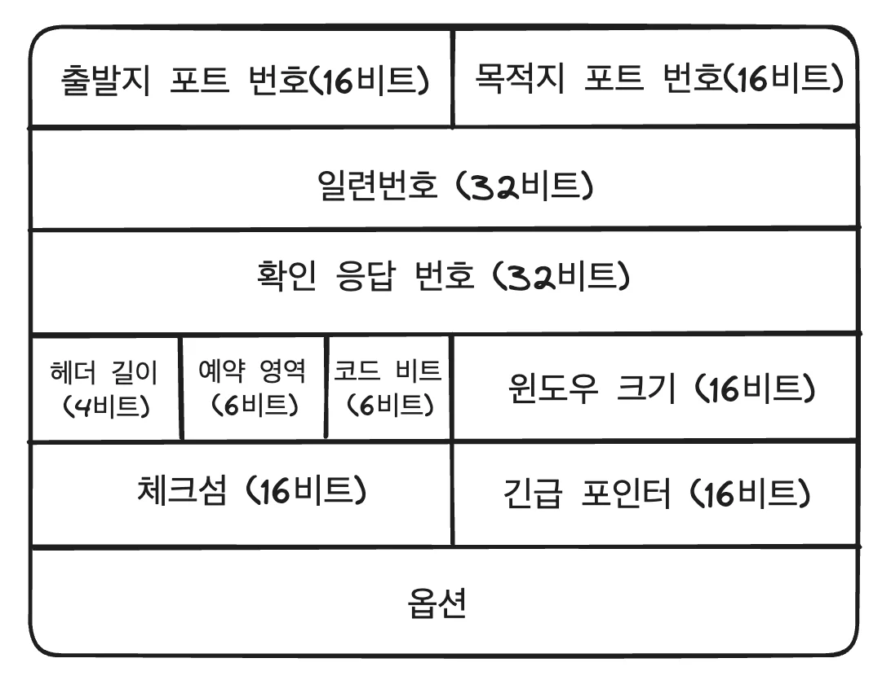

## UDP Header 형식

> TCP에 비해 매우 간단, 필요한 부분 구현 해서 사용 (커스텀) 

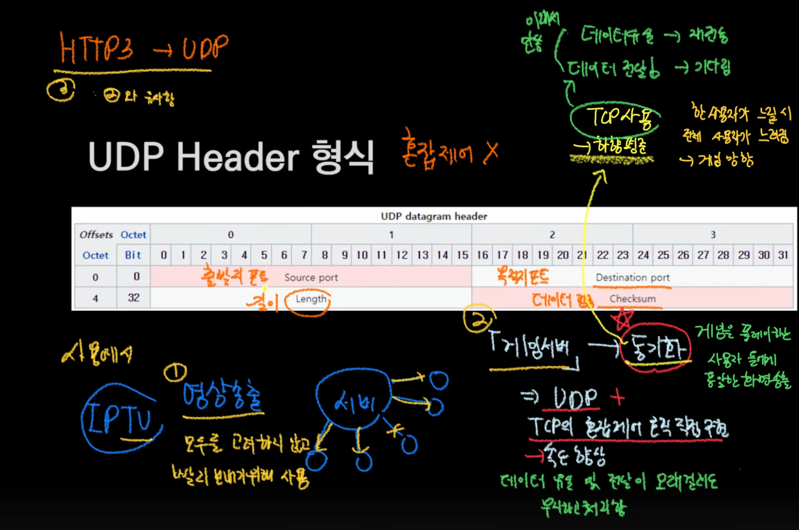

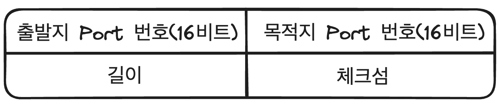

## TCP 연결  → ‘착각’

> TCP 연결은 &#91; 요청 ↔ 응답 &#93; 을 통한 ‘End&#45;Point’ 의 논리적인 판단이다&#46;  → 보안성 X, 오류 가능성 ↑  → 신뢰 X

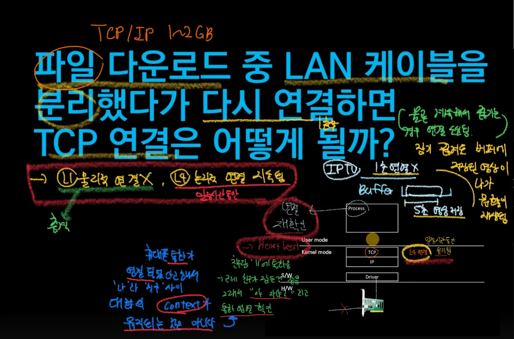

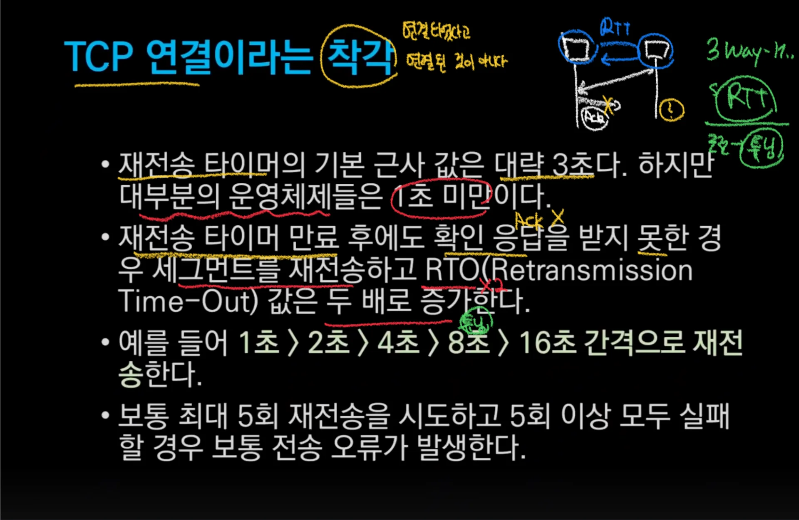

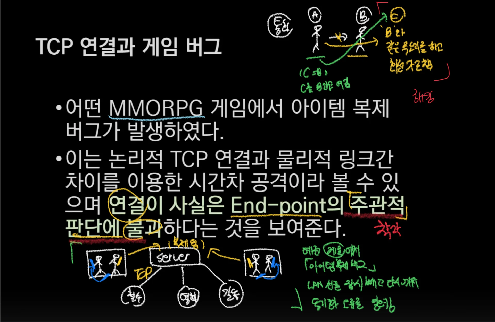

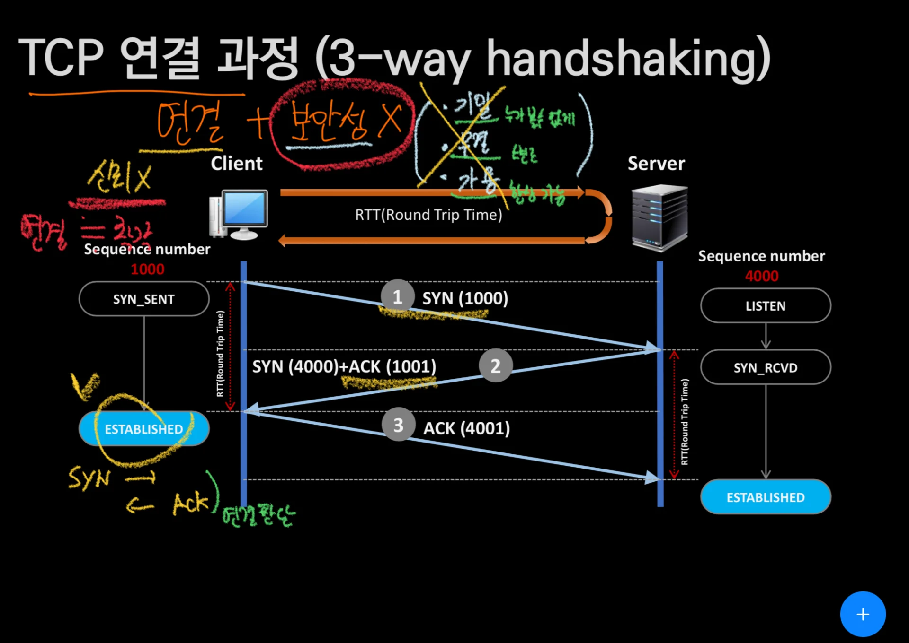
