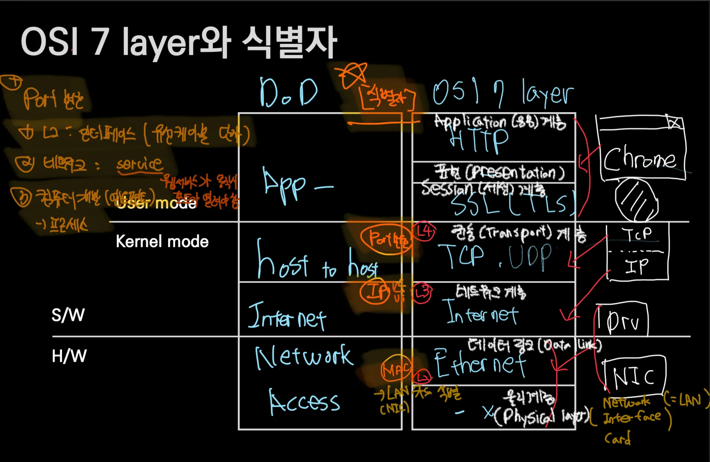
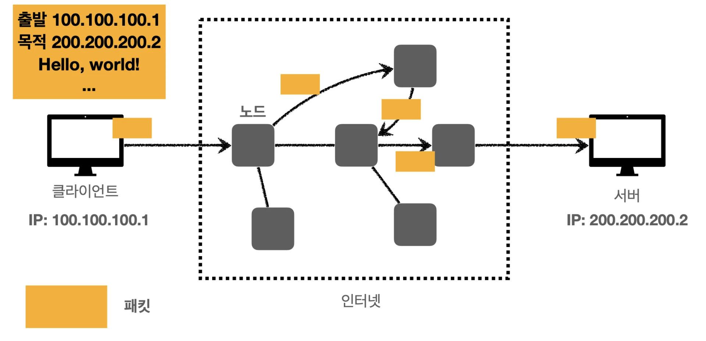
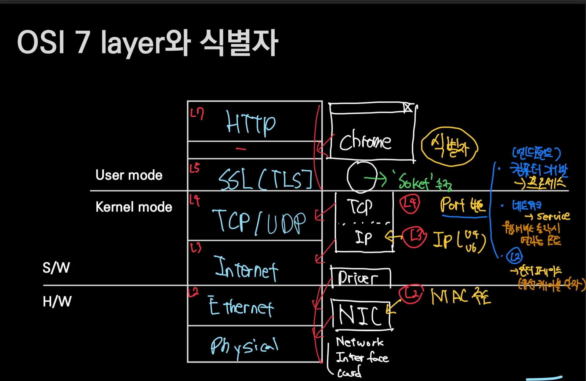
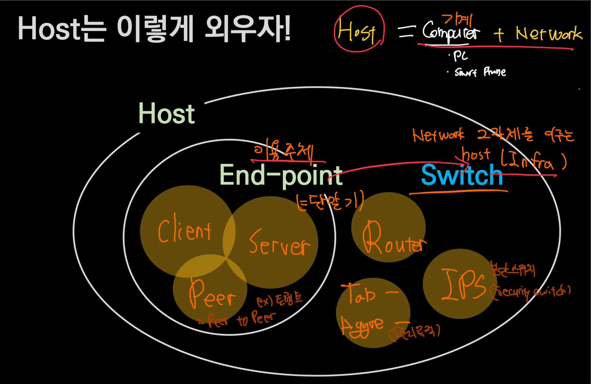
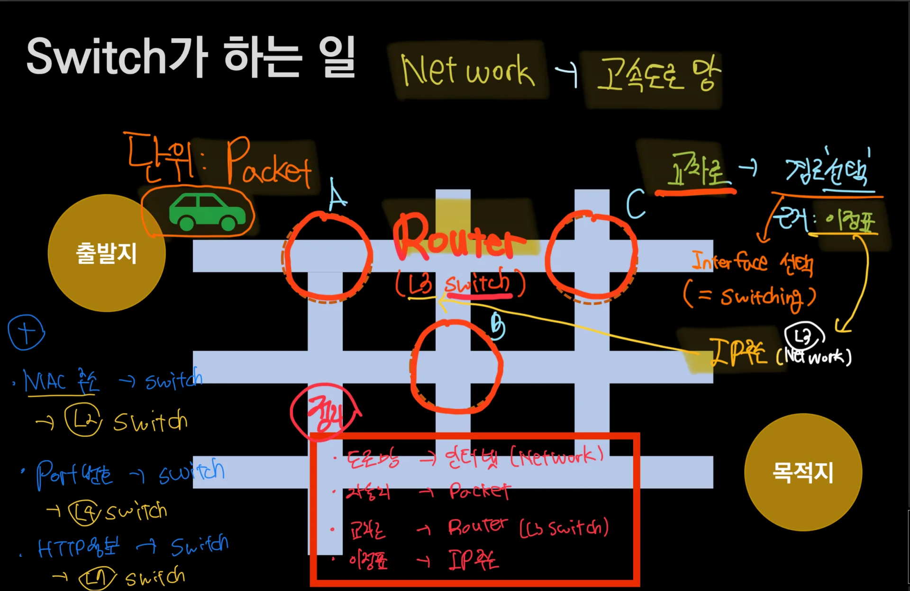
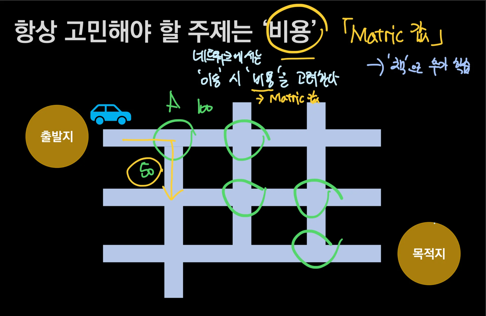

## 1 &#45; OSI 7 Layer

### • 1 Layer&#58; Physical Layer ( 물리적 계층 )

>  해당 내용은 다루지 않음

비트 단위 데이터를 전기적, 광학적 신호로 변환하여 전송하는 역할 수행 ex) 케이블, 허브, 리피터 등 하드웨어 구성 요소  

### • 2 Layer&#58; Data Link Layer ( 데이터 링크 계층)

네트워크 기기 간 데이터 전송, 오류 검출 및 제어, 흐름 제어 등을 담당

대표적으로 Ethernet이 있으며, <code>MAC주소</code>를 통해 식별함

전송되는 데이터 단위는 <code>Frame</code> 임

### • 3 Layer&#58; Network Layer ( 네트워크 계층 )

>  Internet = Routes &#43; DNS 집합인 논리적인 네트워크 

중계 노드를 통해 데이터(Packet)를 전송 시, 중계 방법을 규정

대표적으로 <code>Internet</code>이 있으며, <code>IP주소</code>를 통해 식별함

전송되는 데이터 단위는 <code>Packet</code> 임

### • 4 Layer&#58; Transport Layer ( 전송 계층 )

대표적으로 <code>TCP, UDP</code>가 있으며, <code>Port 번호</code>를 통해 식별함

전송 데이터 단위는 <code>Segment</code>임

### •5  Layer&#58; Session Layer ( 세션 계층 )

대표적으로<code> SSL(Secure Sockets Layer) / TSL(Transport Layer Security)</code> 가 있다&#46;

해당 계층 이후로는 <code>Stream</code> 이라는 데이터 단위를 사용한다&#46;

### • 6 Layer&#58; Presentation Layer ( 표현 계층 )

### • 7 Layer&#58; Application Layer ( 응용 계층 ) 

사용자와 가장 밀접한 계층으로 인터페이스 역활을 함 응용 프로세스  간의 정보 교환을 담당

댸표적으로 <code>HTTP</code> 가 있음 

### 1&#46;2 &#45; 식별자

- L2&#58; MAC 주소

- L3&#58; IP 주소 ( v4/v6 )

-  Port 번호 
    - L2&#58; 인터페이스 ( 유선 케이블 단자를 가르킴 )

    - 네트워크 &#58; Service ( 웹서비스 동작 시 열리는 포트 )

    - 엔드포인트&#58; 프로세스 

## 2 &#45; Host

> ✏️ 
> 
> 
> 
>  <code>Host</code>&#58;  <code>Computer(Pc, Phone …)</code> &#43; <code>Network</code>

### Switch

> <strong>Network  그 자체를 이루는 Host</strong>

- <code>Router</code>

- IPS

- aggregation switch, Tap …

### End &#45; point

> 네트워크 인프라를 이용하는 <strong><u>이용 주체 </u></strong>

- <code>Client</code>

- <code>Server</code>

- <a href="https://post.naver.com/viewer/postView.nhn?volumeNo=14678102&#38;memberNo=19185109">P2P( Peer to Peer)</a>
    

    → 양방향 파일 전송 시스템,   ex) 토렌트

## 3 &#45; Switch

> Network = 도로망 자동차 = Packet 교차로  = Switch  이정표 = IP주소

네트워크를 예시를 들 때, 많이 비교하는 것이  ‘도로망’ 이다&#46;

보통 운전을 하면서  출발지에서 목적지를 향할 때, 각 표지판, 지도 등 이정표를 통해 경로를 선택한다&#46; 

네트워크(Internet, L3)에서 IP주소(이정표)를 통해 각 Router(교차로)들을 지나서

목적지(수산받는 HOST)로 데이터(Packet)을 전달한다&#46; 

### 3&#46; 2 &#45; 비용( Routing Matric )

> <strong>• 라우팅 메트릭(Metric)</strong> 라우터가 목적지에 이르는 여러 경로(루트) 중 최적의 경로를 결정하는데,우선순위를 가지게 숫자로 환산하는 변수( 최적 경로 선택 기준 값)

자세한 내용은 해당 <a href="https://skstp35.tistory.com/418">링크</a> 참조
