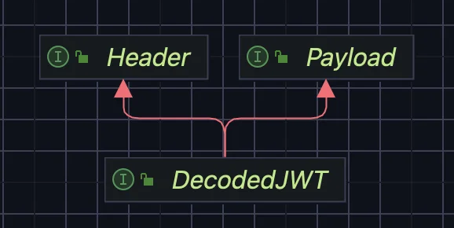
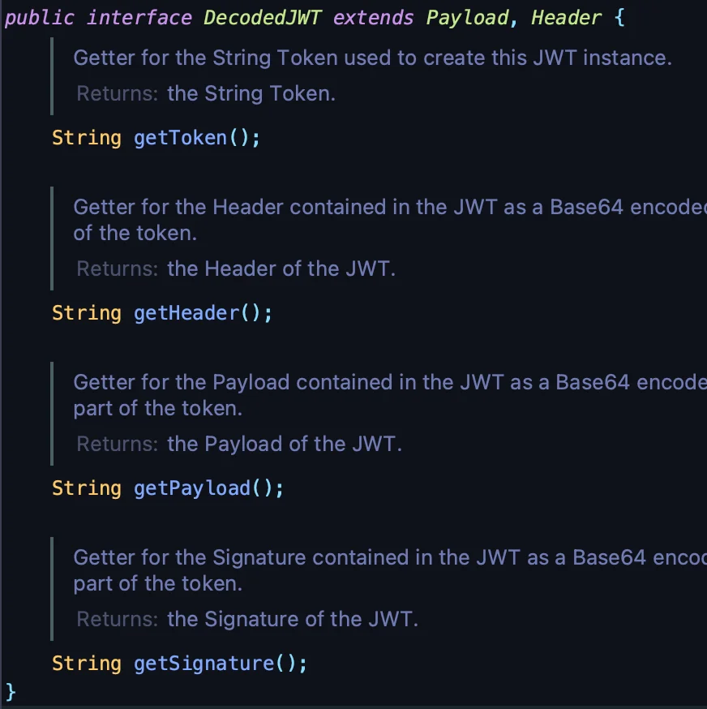
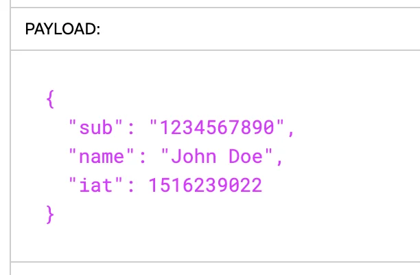

<a id="1c3eda9b0fe18189a7c8fee51a3d9aa2"></a>

## JWT 디코딩 &#45; DecodedJWT

---

> 📖 
> 
> <a id="1c3eda9b0fe181bd8491fb948b3e42a7"></a>
> 
> JWT를 디코딩하여 Header와 Payload의 값을 조회할 수 있다&#46;

<details>
<summary> JWT 디코딩 &#45; <code>JWT&#46;decodeJwt(token)</code></summary>


</details>

<details>
<summary><code>DecodedJWT</code></summary>

- 상속 관계
    

- 내부 메서드 
    

    - <code>getToken()</code>&#58; 토큰 조회

    - <code>getHeader()</code>&#58; 헤더 조회

    - <code>getPayload()</code>&#58; 페이로드 조회

    - <code>getSignature()</code>&#58; 시그니처 조회 

</details>

<details>
<summary><code>Header</code></summary>

- Decoded Header
    

    - <code>alg</code>&#58; 알고리즘 

    - <code>typ</code>&#58; 타입

    - <code>cty</code>&#58; 컨텐츠 타입

    - <code>kid</code>&#58; Key ID

- 내부 메서드 
    

    - <code>getAlgorithm()</code>&#58;  알고리즘(<code>Header&#46;alg</code>) 조회

    - <code>getType()</code>&#58; 타입(<code>Header&#46;typ</code>) 조회

    - <code>getContentType()</code>&#58; 컨텐츠 타입(<code>Header&#46;cty</code>)  조회

    - <code>getKeyId()</code>&#58; Key ID(<code>Header&#46;kid</code>)  조회

    - <code>getHeaderClaim(String name)</code>

</details>

<details>
<summary><code>Payload</code></summary>

- Decoded Payload
    

    <details>
    <summary><code>iss</code> <strong>(Issuer)</strong></summary>

    -  JWT를 발행한 주체(발행자) 

    - JWT가 신뢰할 수 있는 발행자에서 생성되었는지 확인

    </details>

    <details>
    <summary><code>sub</code> <strong>(Subject)</strong></summary>

    - JWT의 주체

    - 사용자의 고유 ID를 포함하여, 이 토큰이 <strong><u>누구에게 발급되었는지를 명시</u></strong>

    - JWT가 특정 사용자와 연관되어 있음을 나타냄

    </details>

    <details>
    <summary><code>aud</code> <strong>(Audience)</strong></summary>

    - JWT가 대상(audience)으로 하는 애플리케이션이나 서비스 목록

    - JWT가 지정된 애플리케이션에서만 사용되도록 제한

    - ex) &#91;&#34;app1&#34;, &#34;app2&#34;&#93;
        - app1과 app2라는 두 개의 애플리케이션을 대상으로 나타냄

    </details>

    <details>
    <summary><code>exp</code> <strong>(Expiration Time)</strong></summary>

    - JWT의 만료 시간

    - JWT의 유효기간을 제한하여 보안을 강화
        - 만료 후 JWT가 더 이상 유효하지 않음

    - ex) 1672531199 (유닉스 타임스탬프)
        - 1672531199는 2023년 12월 31일 23&#58;59&#58;59 (UTC) 의미

    </details>

    <details>
    <summary><code>nbf</code> <strong>(Not Before)</strong></summary>

    - JWT가 유효하기 시작하는 시간

    - JWT가 특정 시점 이전에 사용되지 않도록 제한

    </details>

    <details>
    <summary><code>iat</code> <strong>(Issued At)</strong></summary>

    - JWT 발행된 시점

    - JWT가 언제 생성되었는지 확인
        -  토큰의 신선도(freshness) 판단 가능

    </details>

    <details>
    <summary><code>jti</code><strong> (JWT ID)</strong></summary>

    - JWT의 고유 식별자(ID)

    - JWT의 재사용을 방지하거나 추적 목적으로 사용
        - JWT가 중복 사용되지 않도록 방지하기 위해 식별자로 활용&#46;

    </details>

    <details>
    <summary>예제 토큰</summary>

    <a id="1c3eda9b0fe181428bc7e49ab242d520"></a>

    ```json
    // Payload
    {
      "iss": "auth0",
      "sub": "user123",
      "aud": ["app1", "app2"],
      "exp": 1672531199,
      "nbf": 1672444799,
      "iat": 1672444799,
      "jti": "unique-jwt-id"
    }
    ```

    </details>

<details>
<summary>내부 메서드 </summary>


<details>
<summary>예제 토큰</summary>

<a id="1c3eda9b0fe181e0a1a7cf94f94b25bb"></a>

```json
// Payload
{
  "iss": "auth0",
  "sub": "user123",
  "aud": ["app1", "app2"],
  "exp": 1672531199,
  "nbf": 1672444799,
  "iat": 1672444799,
  "jti": "unique-jwt-id"
}
```

</details>

<details>
<summary>1&#46; String <code>getIssuer()</code></summary>

- <strong>설명</strong>&#58;
    - <code>iss</code> 클레임(발행자, Issuer)&#46;

    - JWT를 발행한 엔터티의 식별 정보를 나타냅니다&#46;

- <strong>예제 반환값</strong>&#58;
    - <code>&#34;auth0&#34;</code>

</details>

<details>
<summary>2&#46; String <code>getSubject()</code></summary>

- <strong>설명</strong>&#58;
    - <code>sub</code> 클레임(주제, Subject)&#46;

    - JWT가 발행된 사용자 또는 주체를 나타냅니다&#46;

- <strong>예제 반환값</strong>&#58;
    - <code>&#34;user123&#34;</code>

</details>

<details>
<summary>3&#46; List&#60;String&#62; <code>getAudience()</code></summary>

- <strong>설명</strong>&#58;
    - <code>aud</code> 클레임(청중, Audience)&#46;

    - JWT가 대상으로 하는 시스템, 애플리케이션, 또는 서비스의 리스트입니다&#46;

    - 단일 값이거나 배열로 나타날 수 있습니다&#46;

- <strong>예제 반환값</strong>&#58;
    - <code>&#91;&#34;app1&#34;, &#34;app2&#34;&#93;</code>

</details>

<details>
<summary>4&#46; Date <code>getExpiresAt()</code></summary>

- <strong>설명</strong>&#58;
    - <code>exp</code> 클레임(만료 시간, Expiration Time)&#46;

    - JWT의 유효 기간이 끝나는 시점을 나타냅니다&#46; 이 시간 이후의 JWT는 무효로 간주됩니다&#46;

- <strong>예제 반환값</strong>&#58;
    - <code>2023&#45;12&#45;31T23&#58;59&#58;59Z</code>

</details>

<details>
<summary>5&#46; Date <code>getNotBefore()</code></summary>

- <strong>설명</strong>&#58;
    - <code>nbf</code> 클레임(Not Before)&#46;

    - 이 값 이전에는 JWT가 유효하지 않음을 나타냅니다&#46;

- <strong>예제 반환값</strong>&#58;
    - <code>2023&#45;12&#45;31T00&#58;00&#58;00Z</code>

</details>

<details>
<summary>6&#46; Date <code>getIssuedAt()</code></summary>

- <strong>설명</strong>&#58;
    - <code>iat</code> 클레임(Issued At)&#46;

    - JWT가 생성된 시점을 나타냅니다&#46;

- <strong>예제 반환값</strong>&#58;
    - <code>2023&#45;12&#45;31T00&#58;00&#58;00Z</code>

</details>

<details>
<summary>7&#46; String <code>getId()</code></summary>

- <strong>설명</strong>&#58;
    - <code>jti</code> 클레임(JWT ID)&#46;

    - JWT를 고유하게 식별하는 식별자(ID)입니다&#46;

    - 이 값은 주로 JWT의 재사용을 방지하거나 추적 목적으로 사용됩니다&#46;

- <strong>예제 반환값</strong>&#58;
    - <code>&#34;unique&#45;jwt&#45;id&#34;</code>

</details>

</details>

<details>
<summary>ex) Payload 데이터 추출 </summary>

<a id="1c3eda9b0fe181df8cffee1dab7e38c6"></a>

```java
// JWT 디코딩
DecodedJWT decodedJWT = JWT.decode(token);
Payload payload = decodedJWT.getPayload();

// Payload 데이터 추출
String issuer = payload.getIssuer();
String subject = payload.getSubject();
List<String> audience = payload.getAudience();
Date expiration = payload.getExpiresAt();
Date notBefore = payload.getNotBefore();
Date issuedAt = payload.getIssuedAt();
String jwtId = payload.getId();
```

</details>

</details>
