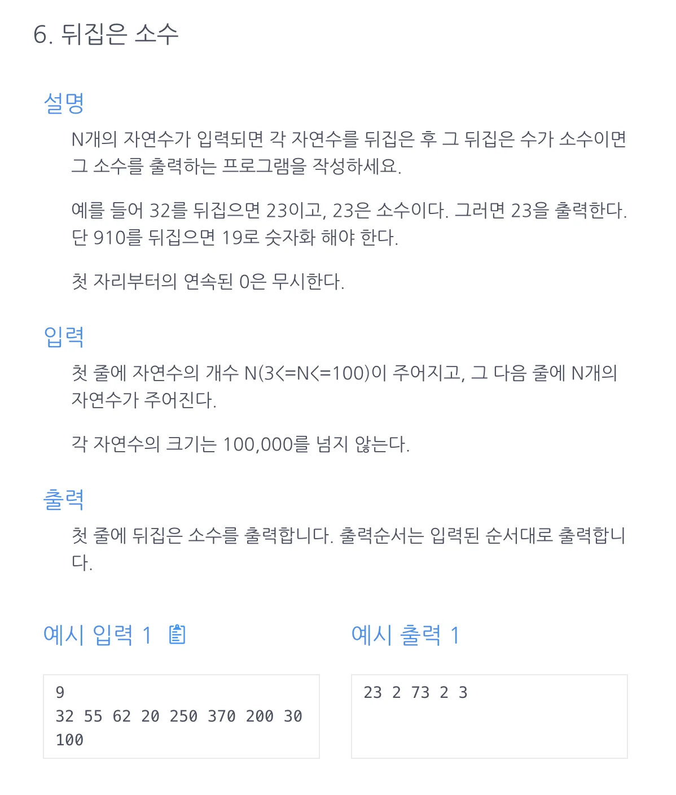

<a id="1c3eda9b0fe181778df1deb4edb1908c"></a>

## 문제)



<a id="1c3eda9b0fe181aaa078eb1961469090"></a>

## 풀이)

<a id="1c3eda9b0fe181dd8aa3c9bdf1cadfb7"></a>

### 내 풀이) StringBuilder&#46;reverse()&#46;toString();

<a id="1c3eda9b0fe181599f2def91a2b013a5"></a>

<code>int</code> → <code>String</code> → <code>int</code>, 잦은 형변환 좋은 코드는 아닌 듯…

<a id="1c3eda9b0fe181f0aa75ef6bd52e6769"></a>

```java
import java.util.ArrayList;
import java.util.Scanner;

public class Main {
    public boolean isPrime(int n){
				if(n==1) return false;
        for(int i=2; i<=Math.sqrt(n); i++){
            if(n%i==0) return false;
        }
        return true;
    }
    public ArrayList<Integer> solution(int n, int[] arr) {
        ArrayList<Integer> answer = new ArrayList<>();
        for(int x : arr){
            String s = Integer.toString(x);
            String tmp = new StringBuilder(s).reverse().toString();
            int num = Integer.parseInt(tmp);
						// isPrime 함수 자체에 num==1일때, false 리턴이 더 명시적임.
						// 소수에 1이 포함되지 않기 때문에, 소수 판별 함수 자체에 해당 로직이 있어야 함.
            if (num > 1 &&isPrime(num)) answer.add(num);
        }
        return answer;
    }
    public static void main (String[]args){
        Main m = new Main();
        Scanner sc = new Scanner(System.in);
        int n = sc.nextInt();
        int[] arr = new int[n];
        for(int i=0; i<n; i++){
            arr[i] = sc.nextInt();
        }
//        System.out.println(m.solution(n));
        for (int x : m.solution(n, arr)) System.out.print(x+" ");
    }

}
```

<a id="1c3eda9b0fe18156bc6dccf81b127960"></a>

### 강의 풀이) 

<a id="1c3eda9b0fe1810d8b7bd9514930659f"></a>

알고리즘&#58; 숫자 뒤집기 ← 요거 유용

<a id="1c3eda9b0fe1814fbb58d02865c9dc76"></a>

형변환이 일어나지 않는다&#46; 더 깔끔한 풀이

<a id="1c3eda9b0fe181999594ddf77ef9b94e"></a>

```java
import java.util.ArrayList;
import java.util.Scanner;

public class Main {
    public boolean isPrime(int n){
        if(n==1) return false;
        for(int i=2; i<=n; i++){
            if(n%i==0) return false;
        }
        return true;
    }
    public ArrayList<Integer> solution(int n, int[] arr) {
        ArrayList<Integer> answer = new ArrayList<>();
        for(int i=0; i<n; i++){
            int tmp=arr[i];
            int res=0;
            while(tmp>0) {
                int t = tmp % 10;
                res = res * 10 + t;
                tmp = tmp / 10;
            }
            if(isPrime(res)) answer.add(res);
        }
        return answer;
    }
    public static void main (String[]args){
        Main m = new Main();
        Scanner sc = new Scanner(System.in);
        int n = sc.nextInt();
        int[] arr = new int[n];
        for(int i=0; i<n; i++){
            arr[i] = sc.nextInt();
        }
//        System.out.println(m.solution(n));
        for (int x : m.solution(n, arr)) System.out.print(x+" ");
    }

}
```
