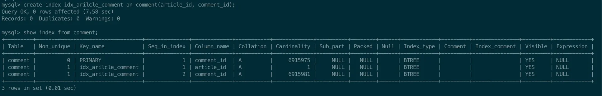
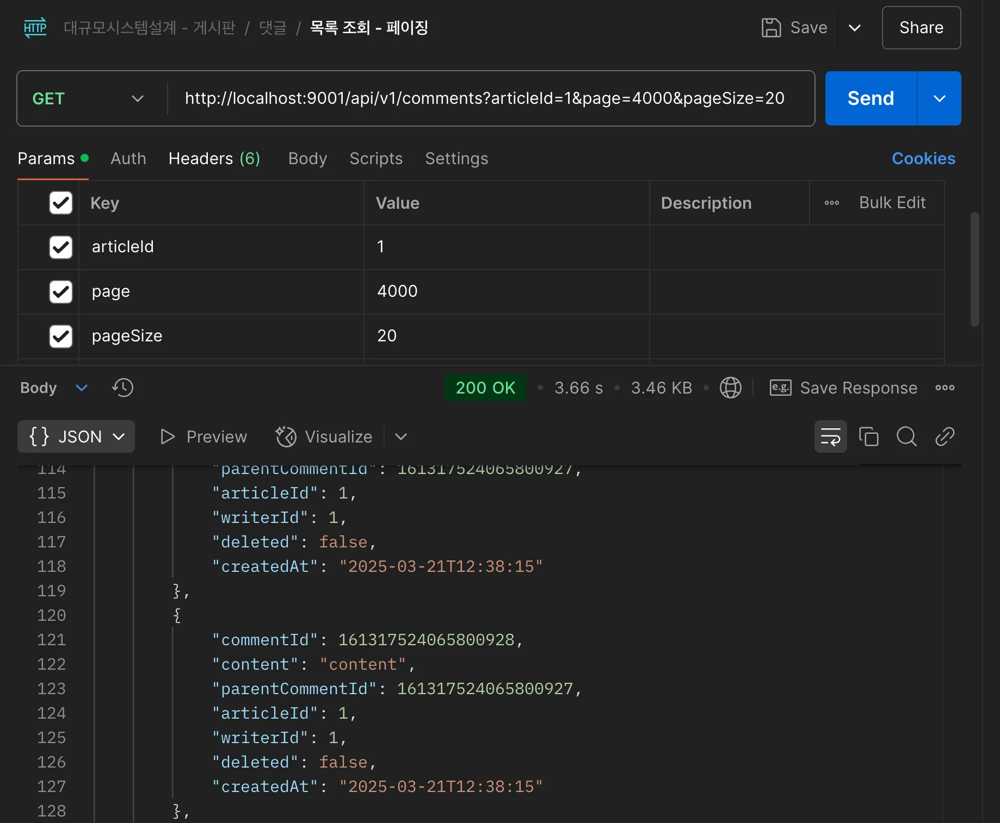
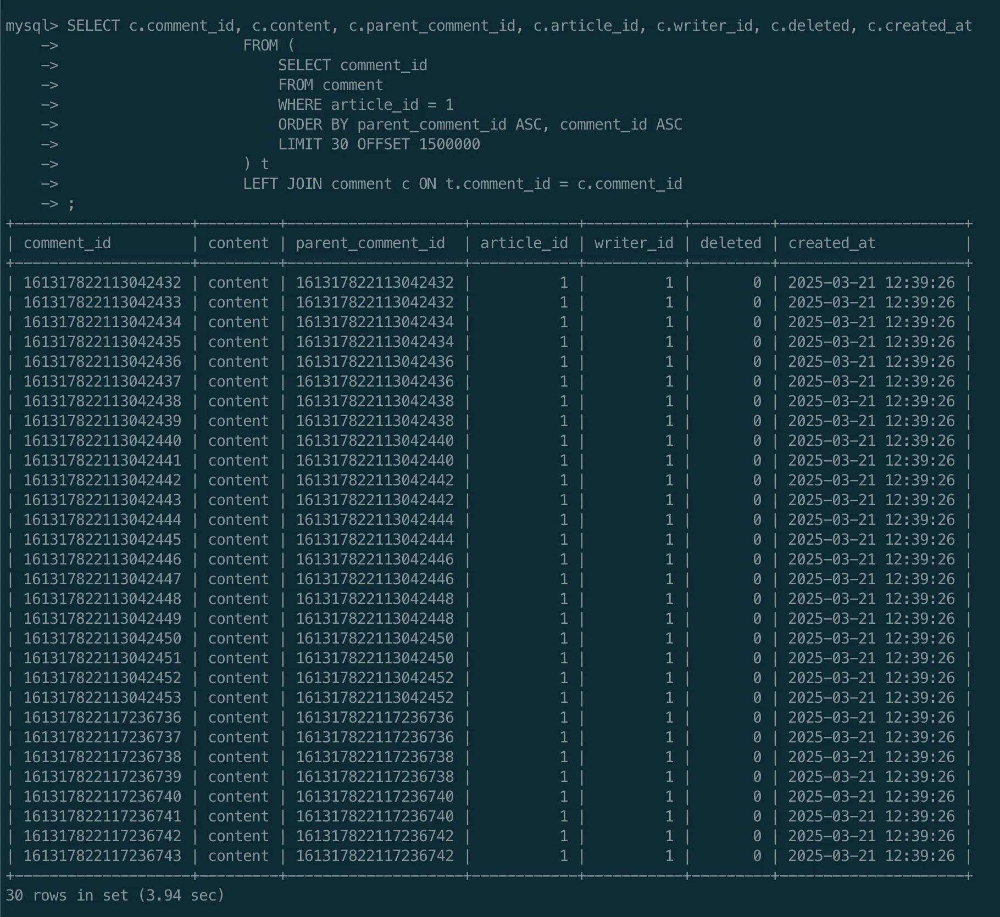
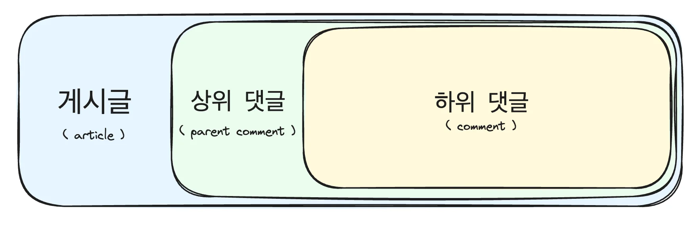
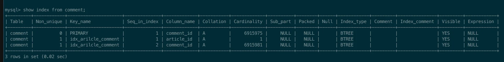
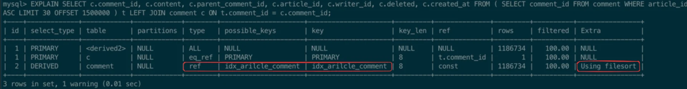
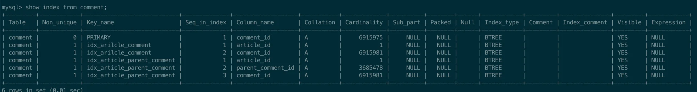
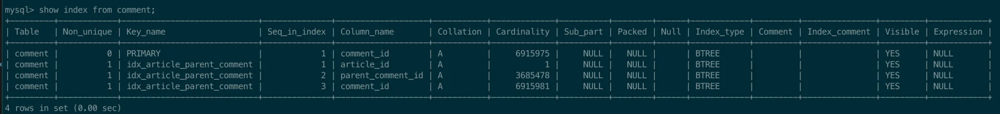
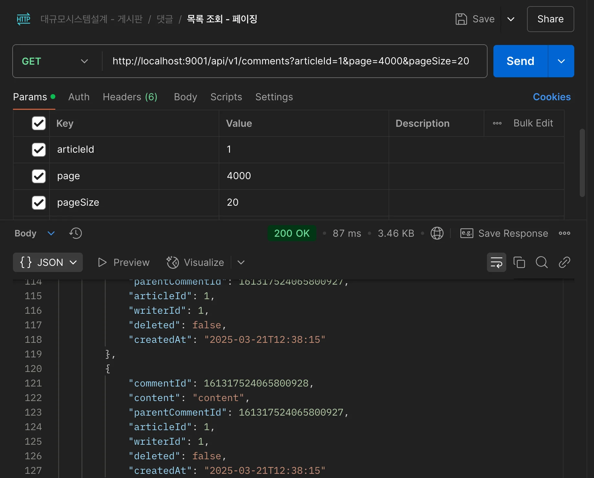

<a id="1c3eda9b0fe181c7ac9dd3af26c04537"></a>

### &#91; 배경 &#93;인덱싱을 적용했지만,  최적화가 되지 않음

---

<a id="1c3eda9b0fe18134b0c6ed74adeed115"></a>

&#91; 댓글 목록 조회 &#45; 페이징 &#93; 쿼리 최적화를 위해 comment 테이블에 <strong><u>복합 인덱스</u></strong>를 적용했다&#46; 

<a id="1c3eda9b0fe181c4953fed94157919f5"></a>

```sql
CREATE INDEX idx_article_comment ON comment(article_id, comment_id);
```

- 복합 인덱스&#58; <code>게시글 ID</code>, <code>댓글 ID</code>



<a id="1c3eda9b0fe181eb86c4ce3349f9cf3e"></a>

```sql
SELECT c.comment_id, c.content, c.parent_comment_id, c.article_id, c.writer_id, c.deleted, c.created_at
FROM (
	SELECT comment_id
	FROM comment
	WHERE article_id = 1
	ORDER BY parent_comment_id ASC, comment_id ASC
	LIMIT 30 OFFSET 1500000
) t
LEFT JOIN comment c ON t.comment_id = c.comment_id;
```

댓글 페이지 조회 쿼리





<a id="1c3eda9b0fe181768313dac6b88a10f3"></a>

그 뒤, 다시 쿼리를 실행 했더니,  <code>평균 4 &#126; 3&#46;5 초</code> 사이의 응답 속도가 나왔다&#46;

<a id="1c3eda9b0fe181bb8251ce9db53d0a4f"></a>

 해당 응답 속도가 실제 운영 상황에서 발생된다면 이는 굉장히 큰 문제이다&#46;

<details>
<summary><strong>🧐 UX 따른 응답 시간 </strong></summary>

<details>
<summary>reference</summary>

<a id="1c3eda9b0fe1817dbf04da7113125160"></a>

‣

<a id="1c3eda9b0fe181cd929bfc00bdf4239c"></a>

‣

</details>

- <strong><code>0&#46;1초 이내</code></strong><strong>&#58; 사용자에게 빠릿빠릿하다고 느껴지는 반응속도</strong>

- <strong><code>0&#46;4초</code></strong><strong>&#58; 그나마 사용자의 집중도가 분산되는 것을 막으려면 시스템 피드백을 0&#46;4초 이내에 제공되어야 한다&#46;</strong>

- <strong><code>1초 이상</code></strong><strong>&#58; 1초가 넘어가면 사용자가 기다리기 시작하게 되며 생산성과 만족도가 떨어지게 된다&#46; 이후, 유저 이탈률이 증가함</strong>

</details>

<a id="1c3eda9b0fe181b98336f62964895bb2"></a>

또한 인덱싱은 적용한 후 인데도, 오히려 쿼리 최적화가 되지 않았다&#46;

<a id="1c3eda9b0fe181db8221e458cc888407"></a>

따라서 해당 문제의 원인을 찾고 다시 인덱스를 설정하여 쿼리 최적화를 진행하였다&#46; 

<a id="1c3eda9b0fe1818698bcc85aa5f64dd1"></a>

### &#91; 원인 &#93; 인덱싱 정렬이 적용되지 않아 filesort로 정렬이 진행됨

<a id="1c3eda9b0fe1818ba5c2efa58be7fde7"></a>

도메인 게층



<a id="1c3eda9b0fe18170b974cc6b8980ea22"></a>

게시글과 댓글들에 따른 계층 구분은 위와 같다&#46; 

- 한 게시글 안에 댓글이 작성될 수 있다&#46; 

- 한 댓글에 하위 댓글이 작성될 수 있다&#46; 

> ✏️ 
> 
> <a id="1c3eda9b0fe181b09c10ffb8cd715f67"></a>
> 
> 더 상위 경계 요소가 우선순위를 갖는다&#46; 
> 
> <a id="1c3eda9b0fe181b9ba07ee52d307399b"></a>
> 
> 따라서 인덱스 설정 시, 더 상위 우선순위를 갖도록 설정해야 한다&#46; 
> 
> <details>
> <summary>ex) </summary>
> 
> > 게시글 &#62; 상위 댓글 &#62; 하위 댓글
> 
> <a id="1c3eda9b0fe181aebb0eedb0778700ce"></a>
> 
> ```sql
> create index [인덱스명] on comment(article_id, parent_comment_id, comment_id);
> ```
> 
> - 위와 같이 인덱스 생성 시, 먼저 인자로 넣어줌으로써 우선순위를 결정할 수 있다&#46;
> 
> > B&#43; Tree 탐색 순서
> 
> <a id="1c3eda9b0fe18130a5ebd62076def97e"></a>
> 
> <code>article&#95;id</code> → <code>parent&#95;id</code> → <code>comment&#95;id</code>
> 
> </details>

<a id="1c3eda9b0fe18169a936d144fd80f115"></a>

그리고 실제 &#91; 댓글 목록 조회 &#45; 페이징 &#93; 쿼리에서 사용하는 필터링 및 정렬 조건은 아래와 같다&#46;

<a id="1c3eda9b0fe181f590e3e197a7803825"></a>

```sql
SELECT c.comment_id, c.content, c.parent_comment_id, c.article_id, c.writer_id, c.deleted, c.created_at
FROM (    
		SELECT comment_id    
		FROM comment    
		WHERE article_id = :articleId    # 게시글 id
		ORDER BY parent_comment_id ASC, comment_id ASC  # 상위 댓글 id, 하위 댓글 id
		LIMIT :limit OFFSET :offset
) t
LEFT JOIN comment c ON t.comment_id = c.comment_id
```

<a id="1c3eda9b0fe18187b133e858f60a296a"></a>

위 페이징 조회 쿼리를 보면 <code>게시글 ID</code>, <code>부모 게시글 ID</code>, <code>자식 게시글 ID</code>를 필터링  및 정렬 조건으로 사용하는 것을 확인할 수 있다&#46;

<a id="1c3eda9b0fe181ebb10cf3eb9a6af5ff"></a>

그러나 <code>게시글 ID</code>, <code>자식 게시글 ID</code> 만 인덱스는 설정을 하였다&#46;

<details>
<summary>적용 index</summary>



</details>

<a id="1c3eda9b0fe1816d8131fd94140fc887"></a>

```sql
ORDER BY parent_comment_id ASC
 ...
```

<a id="1c3eda9b0fe1815498e6f2c089a942a6"></a>

따라서 <code>부모 게시글 ID</code>에 따른 결과 값 정렬에서 <u><code>parent&#95;comment&#95;id</code></u><u>의 인덱스가 정의되지 않</u>아 <strong><u>filesort 알고리즘이 정렬에 사용</u></strong>되었다&#46; 

<details>
<summary>쿼리 실행 계획</summary>



<details>
<summary><code>Using filesort</code></summary>

<details>
<summary>MySQL이 <u>결과 집합을 정렬하기 위해 </u><strong><u>인덱스를 사용하지 않</u></strong>고 별도의 <strong><u>정렬 알고리즘(즉, filesort 알고리즘)</u></strong>을 사용함을 의미한다&#46;</summary>

- <strong>정렬 방식</strong>
    - <strong>ORDER BY</strong> 절이나 GROUP BY 등을 처리할 때, 정렬에 적합한 인덱스가 없다면 <strong><u>결과 집합을 메모리(또는 데이터 크기가 커지면 디스크)에서 직접 정렬</u></strong>한다&#46;

- <strong>filesort 알고리즘</strong>
    - 작은 데이터셋의 경우 메모리 내에서 정렬이 수행되지만, 정렬할 데이터가 많아 메모리 내에서 처리할 수 없을 경우 임시 디스크 파일을 생성하여 정렬

- 성능
    -  데이터 양이 많을 경우, 인덱스를 사용한 정렬에 비해 상대적으로 느릴 수 있다&#46; 이는 <strong><u>CPU 및 I/O 부하를 증가</u></strong>시킬 수 있으므로, <strong><u>성능 최적화가 필요한 경우 </u></strong><u>인덱스를 추가</u>하는 등의 개선이 필요하다&#46;

</details>

</details>

</details>

<a id="1c3eda9b0fe181b0949ff4520cabeb7d"></a>

<strong><code>filesort 알고리즘</code></strong><strong>의 경우, </strong><strong><u>데이터 셋이 큰</u></strong><strong> 경우 </strong><strong><u>디스크에서 연산을 수행</u></strong><strong>하기 때문에 병목이 발생되어 </strong><strong>쿼리 속도 저하</strong><strong>가 발생된다&#46;</strong>

<a id="1c3eda9b0fe1817f93c7dd7bca794a0a"></a>

따라서 이를 인덱스를 재정의하여 해결했다&#46;

<a id="1c3eda9b0fe1819ea529d063b89ad29b"></a>

### &#91; 해결 &#93; 쿼리 최적화 &#45; 인덱스 추가&#58; <code>parent&#95;comment&#95;id</code>

<a id="1c3eda9b0fe1817ab975d3d218ff3144"></a>

따라서 이를 parent&#95;comment&#95;id에 대한 인덱스를 추가하여 최적화를 할 수 있다&#46;  

<a id="1c3eda9b0fe1810c8e9ff3c14c43516f"></a>

<strong>인덱스 생성</strong>

<a id="1c3eda9b0fe181a3846dc5da8e0dc156"></a>

```sql
CREATE INDEX idx_article_parent_comment ON comment(article_id, parent_comment_id, comment_id);
```

- 결과 값 정렬(order by) 조건으로 사용하는 <code>parent&#95;comment&#95;id</code>를 인덱스에 추가

<a id="1c3eda9b0fe1817aae9af889995377d7"></a>

<strong>인덱스 조회</strong>


<details>
<summary>기존 인덱스 삭제</summary>



<a id="1c3eda9b0fe18148af0adfa727c99020"></a>

```sql
drop index idx_article_comment on comment;
```



</details>

<a id="1c3eda9b0fe18160808cdf89798684f9"></a>

포스트맨 호출



- 약 <strong><code>55&#46;4배</code></strong><strong> 속도 개선 </strong>
    - 최적화 전&#58; 평균 <code>3&#46;6초</code> ( 3600 ms )

    - 최적화 후 평균 <code>0&#46;065초</code> ( 65ms )
