> ✏️ 
> 
> <a id="1c3eda9b0fe181599bfdd77ff4f0765d"></a>
> 
> DockerContainer에 폴더를 복사하려면 폴더명 뒤어 <code>/</code>를 붙여야 한다&#46; 
> 
> - ex) <code>COPY my&#95;app /my&#95;app/</code>

<a id="1c3eda9b0fe181068299f03aaaaa0736"></a>

## Dockerfile

---

> 📖 
> 
> <a id="1c3eda9b0fe18164b875e7ef1ff47d2d"></a>
> 
> <code>Dockerfile</code>이란 <strong><u>Docker 이미지를 만</u></strong>들게 해주는 파일이다&#46; 
> 
> 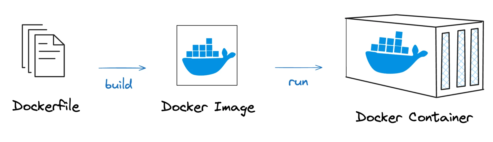
> 
> - Dockerfile을 통해 나만의 이미지를 만들 수 있다&#46; 
>     <a id="1c3eda9b0fe1817c8ea6cb5f86493882"></a>
> 
>     → 내 프로젝트를 dockerfile을 통해 이미지로 만들고 실행시킬 수 있다&#46; 

<details>
<summary>🧐 <strong>다른 이름의 Dockerfile 사용 방법</strong></summary>

> <strong>기본 Dockerfile을 사용 규칙</strong>

<a id="1c3eda9b0fe18178a236f8aeddbd25cc"></a>

<code>docker build &#46;</code> 를 실행하면 <strong><u>현재 디렉터리에서 Dockerfile이라는 파일을 기본적으로 찾</u></strong><strong>는다&#46;</strong>

<a id="1c3eda9b0fe181a3aab6fe44941a98fb"></a>

만약 Dockerfile이 없다면, <code>“failed to read dockerfile&#58; no such file or directory&#34;</code>오류 가 발생된다&#46; 

> 옵션&#58; <code>&#45;f</code>  ( 도커 파일명 강제로 지정 )

- <code>&#45;f</code> 옵션을 사용하면 Dockerfile의 파일명을 직접 지정할 수 있다&#46; 
    <a id="1c3eda9b0fe181a7ba24c87ef67eb782"></a>

    ```bash
    docker build -t my-custom-container -f MyDockerfile .
    ```

> <strong>여러 개의 Dockerfile을 구분하는 방법</strong>

<a id="1c3eda9b0fe1816e944bcbcae23d9a28"></a>

프로젝트에서 여러 개의 Dockerfile이 필요할 때는 <strong>파일명을 다르게 지정</strong>하여 관리할 수 있다&#46;

- <strong><u>특정 환경 </u></strong><strong>별로 관리</strong>
    <a id="1c3eda9b0fe18108a95ed136be074363"></a>

    ```bash
    Dockerfile.dev # 개발 환경
    Dockerfile.prod # 운영 환경
    Dockerfile.test # 테스트 환경

    # 사용 예시 
    docker build -t my-app-dev -f Dockerfile.dev .
    docker build -t my-app-prod -f Dockerfile.prod .
    ```

- <u>특정 서비스</u> 별로 관리 
    <a id="1c3eda9b0fe181fcb16ce325a7be22ea"></a>

    ```bash
    Dockerfile.backend # 백엔드 서버
    Dockerfile.frontend # 프론트엔드 앱
    Dockerfile.database # DB 컨테이너

    # 사용 예시
    docker build -t backend-app -f Dockerfile.backend .
    docker build -t frontend-app -f Dockerfile.frontend .
    ```

</details>

<details>
<summary><code>FROM</code>&#58; 베이스 이미지 생성</summary>

> ✏️ 
> 
> <a id="1c3eda9b0fe1812b871bfaa8807e9e6b"></a>
> 
> <code>FROM</code>은 <strong><u>베이스 이미지를 생성</u></strong>하는 역할을 한다&#46;<br> Docker 컨테이너를 <strong><u>특정 초기 이미지</u></strong>를 기반으로 추가적인 세팅을 할 수 있다&#46; 

<a id="1c3eda9b0fe1815f9032ca8796505de6"></a>

컴퓨터를 새로 사서 실행시키면 기본 프로그램(인터넷, 그림판, 메모장 등)이 깔려있는 것처럼,

<a id="1c3eda9b0fe1815db03dd8c8c2dd2563"></a>

컨테이너를 새로 띄워 미니 컴퓨터 환경을 구축할 때, 기본 프로그램을 설정하는 것과 동일하게 <strong><u>특정 프로그램들</u></strong>을 <strong><u>컨테이너의 생성(build) 시, 베이스 이미지(기본 프로그램)으로 설정</u></strong>할 수있다&#46;

- 프로젝트의 성격에 맞게 JDK, Node 등을 베이스 이미지로 설정한다&#46; 

- ☝🏻 Dockerfile로 파일명을 명시해야 한다&#46; 
    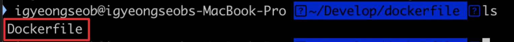

<a id="1c3eda9b0fe181629f9ff121ed0419d4"></a>

```docker
# 문법
FROM [이미지명]
FROM [이미지명]:[테그명]
```

- <code>태그명</code>을 적지 않으면 해당 이미지의 최신(latest) 버전 사용

- <strong><code>Dockerfile</code></strong><strong>로 이미지(Image) 생성</strong>
    <a id="1c3eda9b0fe181fbae87dcce4cbb5675"></a>

    ```docker
    # Dockerfile로 이미지 생성(build)
    docker build -t [이미지명]:[태그명] [Dockerfile이 존재하는 디렉터리 경로]

    # ex
    docker build -t sample .
    docker build -t sample:1.0 .
    ```

</details>

<details>
<summary>&#91; 실습 &#93; <code>FROM</code>&#58; 베이스 이미지 생성</summary>

<details>
<summary>JDK 17 베이스 이미지로 컨테이너 띄워보기</summary>

<details>
<summary>Dockerhub &#45; openjdk</summary>

[openjdk &#45; Official Image &#124; Docker Hub]()

</details>

<details>
<summary>1&#46; Dockerfile 생성</summary>

<a id="1c3eda9b0fe181289375f99da86aa413"></a>

```docker
# JDK 17
FROM openjdk:17-jdk
```

</details>

<details>
<summary>2&#46; <code>Dockerfile</code> 기반으로 이미지 생성 &#58; <code>build</code></summary>

<a id="1c3eda9b0fe1810a8020e4aafe687c80"></a>

```bash
docker build -t my-jdk17-server .
```

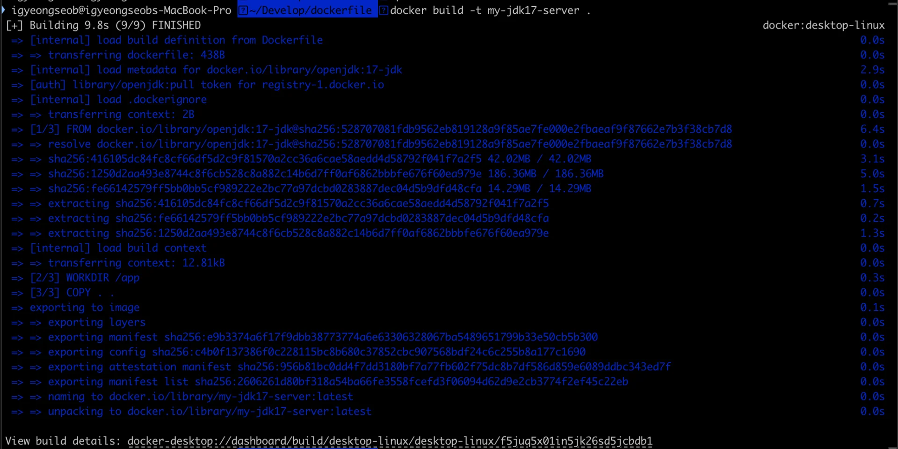

</details>

<details>
<summary>3&#46; 이미지 기반으로 컨테이너 띄우기&#58; <code>run</code></summary>

<a id="1c3eda9b0fe181ab938ec4237e0c7990"></a>

```bash
docker run -d my-jdk17-server
```

</details>

<details>
<summary>4&#46; 컨테이너 조회</summary>

<a id="1c3eda9b0fe18149a5c9de39e5abb998"></a>

```bash
docker ps # 실행되고 있는 컨테이너가 없다. 
docker ps -a # 확인 시, 컨테이너가 종료되어 있음
```

<a id="1c3eda9b0fe181e684d8e25adc9a9666"></a>

Docker의 컨테이너는 내부적으로 필요한 명령을 다 수행하면 컨테이너가 저절로 종료된다&#46; 

</details>

<details>
<summary>5&#46; 컨테이너 내부에서 jdk 설치 확인</summary>

- Dockerfile
    <a id="1c3eda9b0fe18166b3bcf0f68aad685f"></a>

    ```bash
    FROM openjdk:17-jdk

    ENTRYPOINT ["/bin/bash", "-c", "sleep 500"]
    ```

    > ☝🏻 
    > 
    > <a id="1c3eda9b0fe181b8b3d6d76b9e80217c"></a>
    > 
    > Dockerfile 수정 시, <strong><u>수정된 Dockerfile에 대한 이미지를 다시 생성</u></strong>하고 컨테이너를  실행해야 ㅎ나다&#46;

- 컨테이너 내부에서 JDK 설치 확인
    <a id="1c3eda9b0fe181e98db4f26109959f16"></a>

    ```bash
    docker build -t my-jdk17-server # 이미지 빌드
    docker run -d my-jdk17-server # 컨테이너 실행

    docker ps # 실행 중인 컨테이너 조회
    docker exec -it [컨테이너 ID] bash # 컨테이너 접속

    java -version # JDK 설치 확인
    ```

    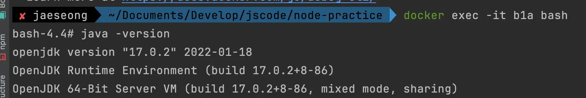

    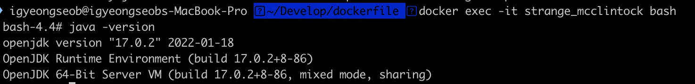

</details>

</details>

<details>
<summary> Node 베이스 이미지로 컨테이너 띄워보기</summary>

<details>
<summary>1&#46; Dockerfile 생성</summary>

<a id="1c3eda9b0fe1811d8c83c2220506c40d"></a>

```docker
FROM node

ENTRYPOINT ["/bin/bash", "-c", "sleep 500"]
```

</details>

<details>
<summary>2&#46; <strong>이미지 만들고 컨테이너 띄우기</strong></summary>

<a id="1c3eda9b0fe181f0b70acefebf7d0c6f"></a>

```bash
$ docker build -t my-node-server . # 이미지 생성
$ docker run -d my-node-server # 이미지를 기반으로 컨테이너 생성
$ docker ps # 실행 중인 컨테이너 조회
$ docker exec -it [컨테이너 ID] bash # 컨테이너 접속

$ node -v # Node 설치되어 있는 지 확인
```

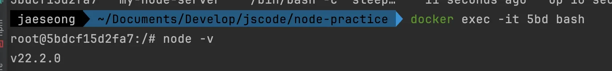

</details>

</details>

</details>

<details>
<summary><code>COPY</code>&#58; 파일 복사(이동)</summary>

> ✏️ 
> 
> <a id="1c3eda9b0fe181b0a83fc8a7c00aa026"></a>
> 
> <code>COPY</code>는 <strong><u>호스트 컴퓨터</u></strong>에  있는 파일을 복사하여 <strong><u>컨테이너</u></strong>에 전달한다&#46; 

<a id="1c3eda9b0fe181dfac05cc4d3245fc7e"></a>

```bash
# 문법
COPY [호스트 컴퓨터에 있는 복사할 파일의 경로] [컨테이너에서 파일이 위치할 경로]

# 예시
COPY app.txt /app.txt
```

---

<details>
<summary>&#91; 실습 &#93; 파일 복사</summary>

1. app&#46;txt 파일 생성

1. Dockerfile 생성 후, 이미지 생성 및 컨테이너 실행
    <a id="1c3eda9b0fe1813c9237c34ff6250034"></a>

    ```bash
    FROM ubuntu

    COPY app.txt /app.txt

    ENTRYPOINT ["/bin/bash", "-c", "sleep 500"] # 디버깅용 코드
    ```

    <a id="1c3eda9b0fe18111bc70fa968e56e8a3"></a>

    ```bash
    $ docker build -t my-server .
    $ docker run -d my-server
    $ docker exec -it [Container ID] bash

    $ ls
    ```

</details>

<details>
<summary>&#91; 실습 &#93; 폴더 안에 있는 모든 파일들 복사</summary>

1. <strong><code>my&#45;app</code></strong><strong> 디렉터리 만들기, </strong><strong><code>my&#45;app</code></strong><strong> 디렉터리 안에 파일 만들기</strong>

1. Dockerfile 생성 후, 이미지 생성 및 컨테이너 실행
    <a id="1c3eda9b0fe181a2a7e8fabb65bc8c4d"></a>

    ```bash
    FROM ubuntu

    COPY my-app /my-app/

    ENTRYPOINT ["/bin/bash", "-c", "sleep 500"] # 디버깅용 코드
    ```

    <a id="1c3eda9b0fe181ee8235c29c6a488cc8"></a>

    ```bash
    $ docker build -t my-server .
    $ docker run -d my-server
    $ docker exec -it [Container ID] bash

    $ ls
    ```

    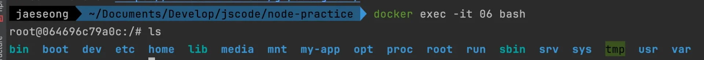

</details>

<details>
<summary>&#91; 실습 &#93; 와일드 카드 사용</summary>

1. <code>app&#46;txt</code>, <code>readme&#46;txt</code> 파일 2개 만들기

1. Dockerfile 생성 후, 이미지 생성 및 컨테이너 실행
    > ⚠️ 
    > 
    > <a id="1c3eda9b0fe181be8256c603396f6ab6"></a>
    > 
    > <strong>주의</strong>
    > 
    > -  <code>/text&#45;files</code>라고 적으면 안 되고 <code>/text&#45;files/</code>라고 적어야 <code>text&#45;files</code>라는 디렉토리 안에 파일들이 정상적으로 복사된다&#46; 

    <a id="1c3eda9b0fe1811281d2e02f4cf8e77e"></a>

    ```bash
    FROM ubuntu

    COPY *.txt /text-files/

    ENTRYPOINT ["/bin/bash", "-c", "sleep 500"] # 디버깅용 코드
    ```

    <a id="1c3eda9b0fe181f1b6dec6f26aa224a0"></a>

    ```bash
    $ docker build -t my-server .
    $ docker run -d my-server
    $ docker exec -it [Container ID] bash

    $ ls
    ```

</details>

</details>

<details>
<summary> <code>&#46;dockerignore</code>&#58;  <strong><u>복사를 제외(무시)</u></strong>할 파일 지정</summary>

> ✏️ 
> 
> <a id="1c3eda9b0fe181cda53df1028d7a3dad"></a>
> 
> 특정 파일 또는 폴더만 <code>COPY</code>를 하고 싶지 않을 수 있다&#46;<u><br></u>그럴 때 <code>&#46;dockerignore</code>를 활용한다&#46; 

1. <strong><code>&#46;dockerignore</code></strong><strong> 파일 생성</strong>
    - <code>&#46;dockerignore</code>
        <a id="1c3eda9b0fe181319107f913087423fd"></a>

        ```bash
        readme.txt
        ```

1. Dockerfile 생성 후, 이미지 생성 및 컨테이너 실행
    <a id="1c3eda9b0fe18102a851c398d3321ba4"></a>

    ```bash
    FROM ubuntu

    COPY ./ /

    ENTRYPOINT ["/bin/bash", "-c", "sleep 500"] # 디버깅용 코드
    ```

    <a id="1c3eda9b0fe1816aa90ad5f83b81978c"></a>

    ```bash
    $ docker build -t my-server .
    $ docker run -d my-server
    $ docker exec -it [Container ID] bash

    $ ls
    ```

</details>

<details>
<summary><code>ENTRYPOINT</code>&#58; 컨테이너가 시작할 때 실행되는 명령어</summary>

> ✏️ 
> 
> <a id="1c3eda9b0fe181b6906ff9546db11202"></a>
> 
> <code>ENTRYPOINT</code>는 컨테이너가 생성되고 최초로 실행할 때, 수행되는 명령어를 뜻한다&#46; <br>→ <code>ENTRYPOINT</code>&#58; 미니 컴퓨터의 전원을 키고나서 실행시키고 싶은 명령어를 적는 곳

<a id="1c3eda9b0fe181bfa7aed9d7d21865fa"></a>

```docker
# 문법
ENTRYPOINT [명령문 ...]

# 예시
ENTRYPOINT ["node", "dist/main.js"]
```

<details>
<summary>ex) </summary>

<a id="1c3eda9b0fe181c9afa7ef1163a601cb"></a>

<strong>Dockerfile</strong>

<a id="1c3eda9b0fe1816da932e1498db850c2"></a>

```docker
FROM ubuntu

ENTRYPOINT ["/bin/bash", "-c", "echo hello"]
```

<a id="1c3eda9b0fe1817b95f3e96f15fb6a61"></a>

<strong>실행 ( CLI )</strong>

<a id="1c3eda9b0fe181a7b668f02cfb62126b"></a>

```docker
docker build -t my-server

docker run -d mey-server

docker ps -a

docker logs [컨케이너 ID]
```

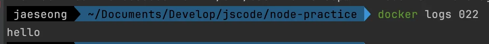

</details>

</details>

<details>
<summary>&#91; 실습 &#93; Spring Boot 프로젝트 Docker로 실행</summary>

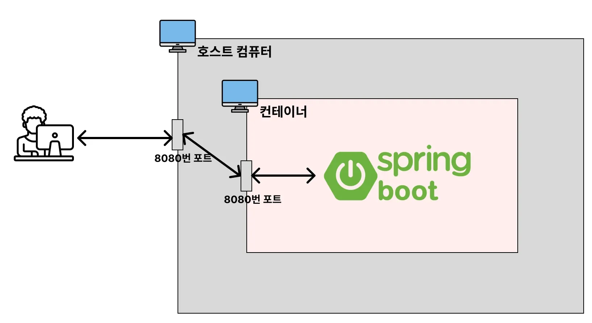

<details>
<summary>1&#46; 프로젝트 세팅</summary>

[start&#46;spring&#46;io]()

<a id="1c3eda9b0fe18163b766f1fc41b42afa"></a>

기본 컨트롤러 설정

<a id="1c3eda9b0fe1814cb3a2d3627d21c4b7"></a>

```java
package com.test.docker_test;

import org.springframework.web.bind.annotation.GetMapping;
import org.springframework.web.bind.annotation.PathVariable;
import org.springframework.web.bind.annotation.RequestMapping;
import org.springframework.web.bind.annotation.RestController;

@RequestMapping("hello")
@RestController
public class HelleController {

    @GetMapping("/{user}")
    public String hello(@PathVariable String user)  {
        return "Hello " + user;
    }
}
```

</details>

<details>
<summary>2&#46; Dockerfile 작성</summary>

<a id="1c3eda9b0fe1817b89e7f42c6125a125"></a>

Dockerfile 생성

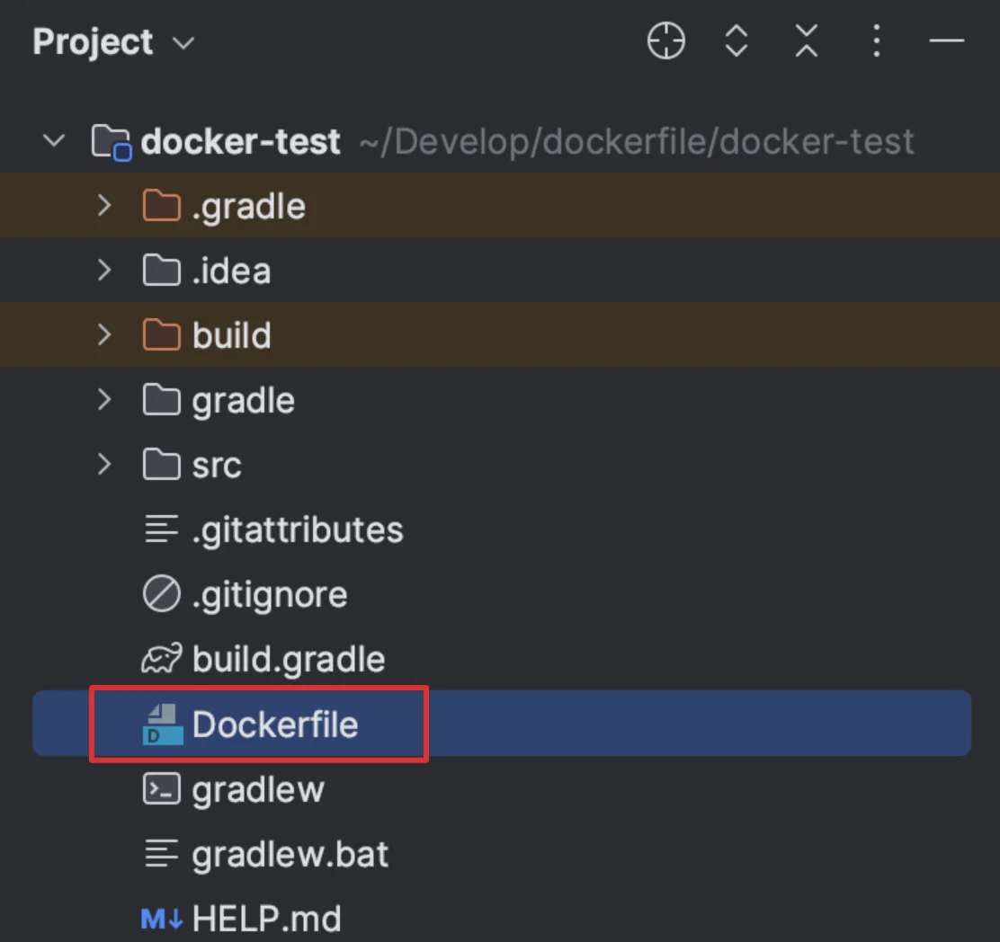

<a id="1c3eda9b0fe181c99c9fddbd1b614551"></a>

<strong>Dockerfile 작성</strong>

<a id="1c3eda9b0fe181788c20f517e0b125bf"></a>

```docker
FROM openjdk:17-jdk

COPY build/libs/*SNAPSHOT.jar app.jar

ENTRYPOINT ["java", "-jar", "/app.jar"]
```

- build된 jar 파일 복사 후, 컨테이너 내부에서 실행

</details>

<details>
<summary>3&#46; Spring Boot 프로젝트 빌드</summary>

<a id="1c3eda9b0fe18154ba3de9a6fb860672"></a>

```bash
./gradlew clean build
```

</details>

<details>
<summary>4&#46; Dockerfile 바탕으로 이미지 빌드 및 확인</summary>

<a id="1c3eda9b0fe181e8ab1bcfcd03b5492a"></a>

```bash
docker run -d -p 8080:8080 hello-server

docker image ls
```

</details>

<details>
<summary>5&#46; 컨테이너 실행 및 확인</summary>

<a id="1c3eda9b0fe18149bfb0da27a05bb92f"></a>

```bash
docker run -d -p 8080:8080 hello-server

docker ps
```

</details>

<details>
<summary><a href="http://localhost:8080">localhost&#58;8080</a>&#58; 접속</summary>

<a id="1c3eda9b0fe18122bad7d98f0c314558"></a>

```docker
 curl -X GET "http://localhost:8080/hello/user1"
```

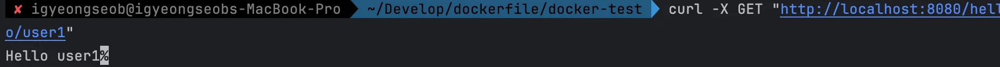

</details>

<details>
<summary>컨테이너, 이미지 삭제</summary>

<a id="1c3eda9b0fe181bb86aff28932dd1ac2"></a>

```bash
docker stop [컨테이너 ID]

docker rm [컨테이너 ID]

docker image rm [이미지 ID]
```

</details>

</details>

<details>
<summary>🧐 <code>RUN</code> vs <code>ENTRYPOINT</code></summary>

<a id="1c3eda9b0fe1810883a1d08f941abd1a"></a>

<code>RUN</code> 과 <code>ENTRYPOINT</code> 모두 명령어를 시킨다&#46; <br>그러나 둘의 차이점은 <strong><u>‘명령문 실행 시점이 다르다’</u></strong>는 것에 있다&#46; 

- <code>RUN</code>&#58;  ‘<strong><u>이미지 생성 과정’</u></strong>에서 필요한 명령어를 실행

- <code>ENTRYPOINT</code>&#58; 생성된 이미지를 기반으로 <strong><u>컨테이너를 생성한 직후</u></strong>에 명령어 실행

</details>

<details>
<summary><code>RUN</code>&#58; 이미지 생성 과정에서 사용할 명령문 실행</summary>

> ✏️ 
> 
> <a id="1c3eda9b0fe181f3b76ce3f2820f5e01"></a>
> 
> <code>RUN</code>은 이미지 생성 과정에서 명령어를 실행시켜야 할 때 사용한다&#46; 

<a id="1c3eda9b0fe1814fbb9fd94fd80777ce"></a>

```docker
# 문법 
RUN [명령문]

RUN npm install
```

<details>
<summary>ex) 이미지 생성 시, git도 같이 설치 </summary>

1. Dockerfile
    <a id="1c3eda9b0fe18181b9d4e08aed47996e"></a>

    ```docker
    FROM ubuntu

    RUN apt update && apt install -y git

    ENTRYPOINT ["/bin/bash", "-c", "sleep 500"]
    ```

1. 이미지 빌드 및 컨테이너 실행
    <a id="1c3eda9b0fe1815383d4d8012b780fdb"></a>

    ```bash
    docker build -t my-server .
    docker run -d my-server
    docker exec -it [Container ID] bash

    $ git -v # 컨테이너 내에 git이 잘 설치됐는 지 확인
    ```

</details>

</details>

<details>
<summary><code>WORKDIR</code>&#58; 작업 디렉토리 지정</summary>

> ✏️ 
> 
> <a id="1c3eda9b0fe181528d5af8534ca5f860"></a>
> 
> <code>WORKDIR</code>으로 작업 디렉토리를 설정할 수 있다&#46; 
> 
> - 이후 모든 작업(<code>RUN</code>, <code>CMD</code>, <code>ENTRYPOINT</code>, <code>COPY</code>, <code>ADD</code> …)들은 해당 디렉토리를 기준으로 실행된다&#46; 
>     - 최초 경로 변경
> 
> <a id="1c3eda9b0fe181658726eac303fb20b6"></a>
> 
> <br>이렇게 작업 디렉토리를 굳이 지정하는 이유는 <strong><u>컨테이너 내부의 폴더를 깔끔하게 관리</u></strong>하기 위해서이다&#46; 
> 
> <a id="1c3eda9b0fe18180ab79df514f2bc6e8"></a>
> 
> 컨테이너는 미니 컴퓨터와 같다&#46; 따라서 Dockerfile을 통해 생성되는 파일들을 특정 폴더에 정리해두는 것이 추후에 관리가 쉽다&#46; 
> 
> - <code>WORKDIR</code>을 쓰지 않으면 컨테이너 내부에 존재하는 기존 파일들과 뒤섞여버린다&#46; <br>따라서 관리가 어렵다&#46;

<a id="1c3eda9b0fe181a6ac4ffe62514445eb"></a>

```docker
# 문법
WORKDIR [작업 디텍토리로 사용할 절대 경로]

# 에시
WORKDIR /usr/src/app
```

<details>
<summary>ex) </summary>

1. <code>app&#46;txt</code>, <code>src</code>, <code>config&#46;json</code> 파일 만들기

1. <strong>Dockerfile 만들어서 이미지 생성 및 컨테이너 실행</strong>
    <details>
    <summary><code>WORKDIR</code>를 사용하지 않았을 때의 파일 구성 확인</summary>

    <a id="1c3eda9b0fe18151950ffca043a59e3a"></a>

    ```docker
    FROM ubuntu

    COPY ./ ./

    ENTRYPOINT ["/bin/bash", "-c", "sleep 500"] # 디버깅용 코드
    ```

    <a id="1c3eda9b0fe181e9ae4ad218c7125272"></a>

    ```bash
    docker build -t my-server .
    docker run -d my-server
    docker exec -it [Container ID] bash

    ls
    ```

    </details>

    <a id="1c3eda9b0fe181c78b12f21e97080069"></a>

    ```docker
    FROM ubuntu

    WORKDIR /my-dir

    COPY ./ ./

    ENTRYPOINT ["/bin/bash", "-c", "sleep 500"]

    ```

1. 이미지 빌드 및 컨테이너 실행 → 파일 구성 확인
    <a id="1c3eda9b0fe1812f965dc4ea1150e592"></a>

    ```bash
    docker build -t my-server .
    docker run -d my-server
    docker exec -it [Container ID] bash

    ls
    ```

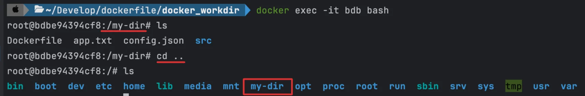

- WORKDIR 설정 시, 컨테이너 내부 bash 접속 시 root 설정이 workdir 로 설정한 폴더로 변경됨

</details>

</details>

<details>
<summary><code>EXPOSE</code>&#58; 컨테이너 내부에서 사용 중인 포트 문서화</summary>

> ✏️ 
> 
> <a id="1c3eda9b0fe18160adcafa14541565a4"></a>
> 
> <code>EXPOSE</code>는 컨테이너 <strong><u>내부에서 어떤 포트에 프로그램이 실행되는 지를 문서화</u></strong>하는 역활을 한다&#46; 
> 
> - 포트를 지정하는 <code>&#45;p</code> 와 같은 역할을 하지 않는다&#46; 
> 
> - 따라서  <code>EXPOSE</code> 명령어의 사용 여부는 작동 방식에 영향을 주지 않는다&#46;

<a id="1c3eda9b0fe1818dbae7f4d5a2bb533b"></a>

```docker
# 문법
EXPOSE [포트 번호]

# 예시
EXPOSE 3000
```

</details>
