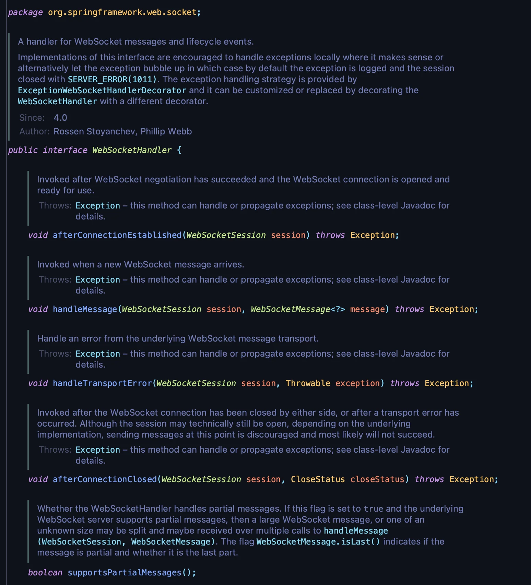

## WebSocketHandler

---

> 📖 
> 
> 
> 
>  Spring 프레임워크의 <code>WebSocketHandler</code> 인터페이스는 <strong><u>WebSocket 메시지 및 라이프사이클 이벤트를 처</u></strong>리하기 위해 사용된다&#46;
> 
> 
> 
> WebSocket을 사용하여 클라이언트와 서버 간의 실시간 양방향 통신을 구현할 때, 해당 인터페이스를 구현하여 <strong><u>WebSocket 연결, 메시지 송수신, 연결 종료 등의 이벤트를 처리</u></strong>할 수 있다&#46;

<strong>WebSocketHandler</strong>

<code>afterConnectionEstablished(WebSocketSession session)</code>

- <strong><u>WebSocket 연결이 성공적으로 수행된 후 </u></strong>호출됨

- 초기화 작업이나 클라이언트와의 연결 성공 시 특정 로직을 실행하는 데 사용

- ex) 클라이언트의 세션 ID를 저장하거나, 환영 메시지를 전송

<code>handleMessage(WebSocketSession session, WebSocketMessage&#60;?&#62; message)</code>

- 새로운 WebSocket <strong><u>메시지가 도착</u></strong>할 때 호출됨

- <strong><u>메시지를 처리하는 핵심 메서드</u></strong>로,<strong> </strong><strong><u>클라이언트로부터 받은 데이터를 처리</u></strong><strong>하거나 </strong><strong><u>응답을 전송</u></strong><strong>하는 데 사용</strong>

- ex) 채팅 메시지를 처리하거나 명령을 실행

<code>handleTransportError(WebSocketSession session, Throwable exception)</code>

- <strong>WebSocket </strong><strong><u>전송 중 오류가 발생</u></strong>했을 때 호출됨 

- <strong><u>발생한 예외를 처리</u></strong>하거나 <strong><u>로깅</u></strong>하며, 필요 시 <strong><u>연결 종료</u></strong>

- ex) 네트워크 오류 발생 시 사용자에게 알림

<code>afterConnectionClosed(WebSocketSession session, CloseStatus closeStatus)</code>

- <strong>WebSocket</strong> <strong><u>연결이 닫힌 후</u></strong> 호출됨

- <strong><u>연결 종료 후</u></strong> <strong>클린업(clean&#45;up) 작업</strong>을 수행

- ex) 사용자 세션 정리, 리소스 해제

<code>supportsPartialMessages()</code>

- WebSocketHandler가 부분 메시지(partial message)를 처리할 수 있는지를 반환

- 서버가 큰 메시지를 여러 부분으로 나누어 수신할 수 있는지 여부를 확인

- ex) 대용량 파일 전송 처리

## TextWebSocketHandler

---

> 📖 

## TextWebSocketHandler

---

> 📖
