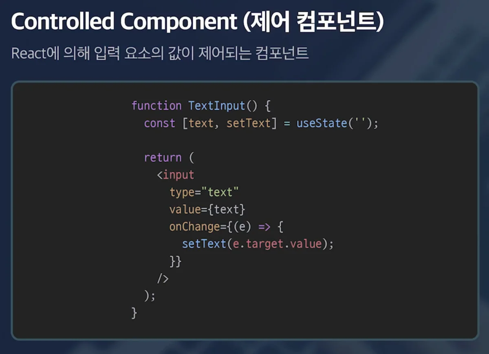
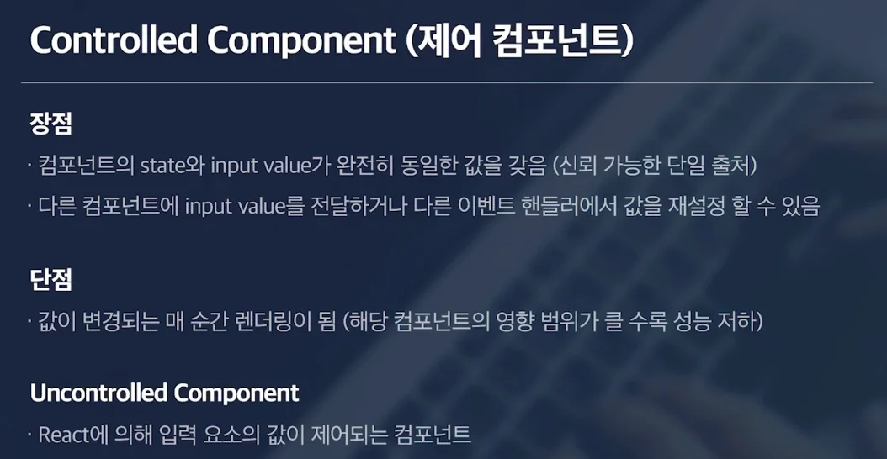

<a id="1c3eda9b0fe181ed8352c44a13fd6242"></a>

## Form 이벤트

---

> 📖 
> 
> <a id="1c3eda9b0fe181ccb495ec965dbbfe2b"></a>
> 
> 이벤트를 사용하는 가장 흔한 경우가 바로 form 요소들을 컨트롤할 때이다&#46; 
> 
> <a id="1c3eda9b0fe181c8a190c8e3a50eed9a"></a>
> 
> 따라서 이런 form 요소들을 컨트롤할 때 자주 쓰이는 <u>이벤트, 패턴</u><u>들</u>을 학습한다&#46; 

<details>
<summary>Controlled Component</summary>

> ✏️ 
> 
> <a id="1c3eda9b0fe181f7b63bfd3232e7814b"></a>
> 
> Form 요소의 Value와  해당 컴포넌트의 State 와 연결된 컴포넌트 



<a id="1c3eda9b0fe181fc908fde59948feb83"></a>

리액트에 의해 입력 요소 값이 제어되는 컴포넌트이다&#46; 

- 사용자가 값을 입력하는 순간 바로 state로 업데이트 된다 



</details>

<details>
<summary>Uncontrolled Component  &#45; <code>useRef()</code></summary>

<a id="1c3eda9b0fe18153b2d4e4de00f93e22"></a>

특정 DOM에 접근하여 직접 valuer 값을 가져온다&#46; 

- <code>useRef()</code>  사용

<a id="1c3eda9b0fe181528676ff1cdc4f2804"></a>

```javascript
import { useRef } from 'react';

function UncontrolledTextInput() {
  const inputRef = useRef();

  console.log('[UncontrolledTextInput] render');

  return (
    <>
      <input ref={inputRef} type="text" />
      <button
        onClick={() => {
          console.log(inputRef.current.value);
        }}
      >
        Get value
      </button>
    </>
  );
}

export default UncontrolledTextInput;

```

- useRef 사용 시, <code>current</code> 객체에 value 값이 담겨있다 
    - <code>…Ref&#46;current&#46;value</code> 를 사용하여 value 값을 가져온다&#46; 

> ✏️ 
> 
> <a id="1c3eda9b0fe181a09b26e4ca547af8be"></a>
> 
> Uncontrolled Component는 Form 요소와 state를 연결하는 것이 아니기 때문에, 변경되는 값이 state 담기지 않아, 리렌더링이 일어나지 않는다&#46; 
> 
> <a id="1c3eda9b0fe181c7a498f25dfe8c8564"></a>
> 
> 즉, 변경된 값이 화면에 반영되지 않는다&#46; 
> 
> <a id="1c3eda9b0fe18115aca7d8e62491f5ef"></a>
> 
> → <code>useState</code>를 사용하여 DOM에서 가져온 value 값을 저장할 필요가 있다&#46;

</details>

<details>
<summary>실습</summary>

<a id="1c3eda9b0fe181428609c20507671d64"></a>

‣

</details>
