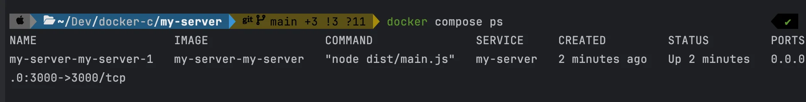
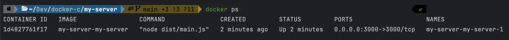
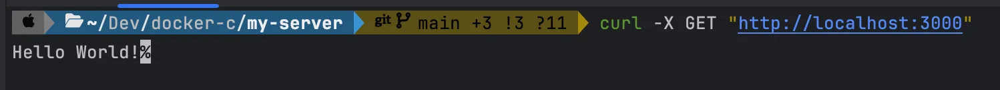
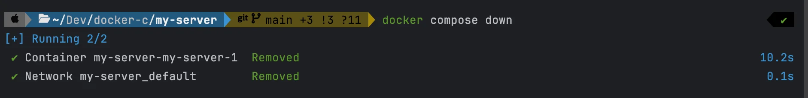

<a id="1c3eda9b0fe18149b7f9ce14e267b5b3"></a>

## Dokcer Compose로 백엔드(Next&#46;js) 실행

---

<details>
<summary>1&#46; Nest&#46;js 프로젝트 생성</summary>

<a id="1c3eda9b0fe181f88428cc76387ea335"></a>

```bash
# Nest CLI 설치
$ npm i -g @nestjs/cli

# nest new {프로젝트명}
$ nest new my-server
```

</details>

<details>
<summary>2&#46; <strong>Dockerfile, &#46;dockerignore, compose 파일 작성</strong></summary>

<a id="1c3eda9b0fe18132b8f3f0f0933b509d"></a>

<strong>Dockerfile</strong>

<a id="1c3eda9b0fe181f68e81fc7ecb92517c"></a>

```bash
FROM node

WORKDIR /app

COPY . .

RUN npm install

RUN npm run build

EXPOSE 3000

ENTRYPOINT [ "node", "dist/main.js" ]
```

<a id="1c3eda9b0fe1814897c9fecae1603a44"></a>

<strong>&#46;dockerignore</strong>

<a id="1c3eda9b0fe181a4ab26d02e72292a5f"></a>

```bash
node_modules
```

<a id="1c3eda9b0fe18114b7b2d8ae25f10f0b"></a>

<strong>compose 파일 작성</strong>

<details>
<summary>참고) Docker CLI</summary>

<a id="1c3eda9b0fe1819aa244e785b66cb38c"></a>

```bash
docker build -t my-server .
docker run -d -p 3000:3000 my-server
```

</details>

<a id="1c3eda9b0fe181f7a119eabd9197c2b7"></a>

```bash
services:
  my-server:
    build: . # 같은 경로에 있는 Dockerfile을 사용하여 image build
    ports:
      - 3000:3000
```

</details>

<details>
<summary>3&#46; compose 파일 실행</summary>

<a id="1c3eda9b0fe181f48491c48bbce5f4cd"></a>

```bash
docker compose up -d --build
```

</details>

<details>
<summary>4&#46; compose 실행 현황 보기</summary>

<a id="1c3eda9b0fe1819bb45ffa6ffd2a16db"></a>

```bash
docker compose ps
docker ps
```





</details>

<details>
<summary>5&#46; <a href="http://localhost:3000">localhost&#58;3000</a>  호출</summary>

<a id="1c3eda9b0fe1818cb60bf0e290b5bdd7"></a>

```bash
curl -X GET "http://localhost:3000"
```



</details>

<details>
<summary>6&#46; compose 실행 컨테이너 삭제</summary>

<a id="1c3eda9b0fe1819dba9de8ec462f4742"></a>

```bash
docker compose down
```



</details>
