> ✏️ 
> 
> <a id="1c3eda9b0fe1810f9297f9cc5058e162"></a>
> 
> 아무리 디자인을 잘한 애플리케이션이라도 시간이 지남에 따라 변화하고 성장해야 한다&#46;

<a id="1c3eda9b0fe18136af1ffcca3854c78c"></a>

## 오리 시뮬레이션 게임, SimUdcuk

---

<details>
<summary><strong>🧐 수퍼 클래스(Superclass), 서브 클래스(Subclass)</strong></summary>

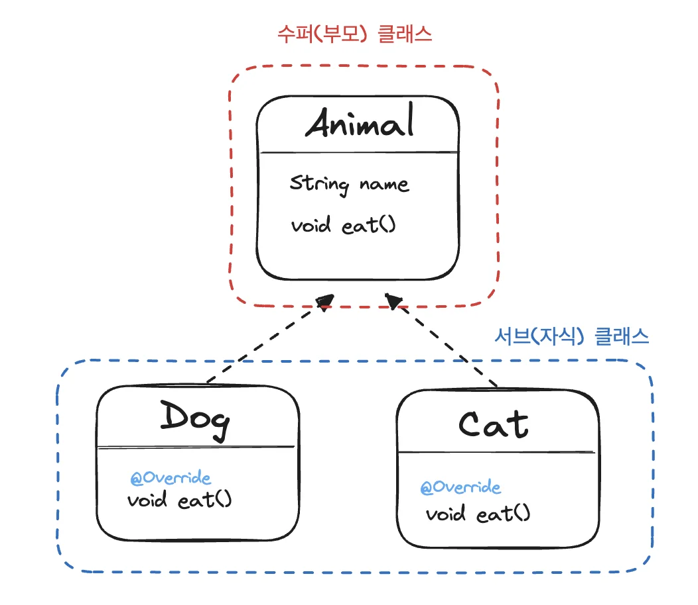

<details>
<summary>수퍼 클래스</summary>

- 상속 관계에서 상위(부모) 클래스를 말한다&#46;

- <code>자식(서브) 클래스</code>에게 <u>공통된 속성이나 메서드를 제공</u>한다&#46;<br>따라서 자식 클래스들은 수퍼 클래스의 멤버(필드, 메서드)를 상속받아 그대로 사용하거나,<br>필요에 따라 오버라이딩하여 수정할 수 있다&#46; 

</details>

<details>
<summary>서브 클래스</summary>

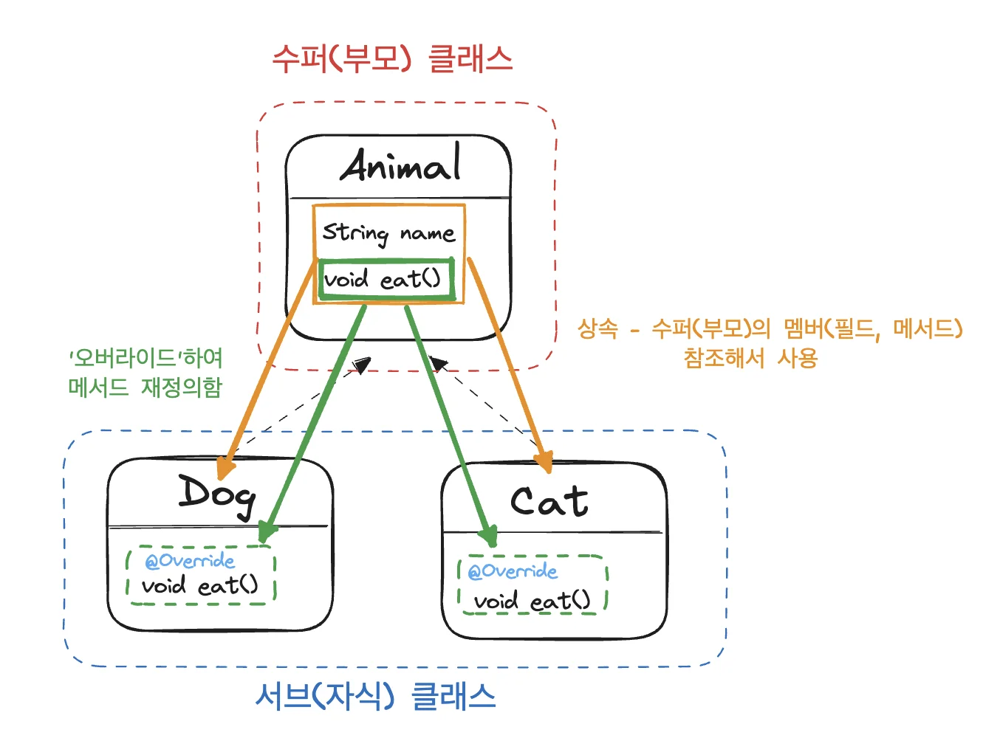

- 상속 관계에서 하위(자식) 클래스를 말한다&#46;

- 수퍼 클래스의 모든 필드와 메서드를 상속 받으며, 필요에 따라 특정 메서드를 오버라이딩하여<br>서브 클래스만의 특별한 동작을 구현할 수 있다&#46; 

</details>

</details>

<a id="1c3eda9b0fe1819fa257ed2a56ab7e1e"></a>

### 🤬 문제) <code>수퍼(부모) 클래스</code>에서 정의한 <u>메서드</u>가  <code>서브(자식) 클래스</code>에서 필요없는 경우가 생김

---

- 기존 앱 구조 
    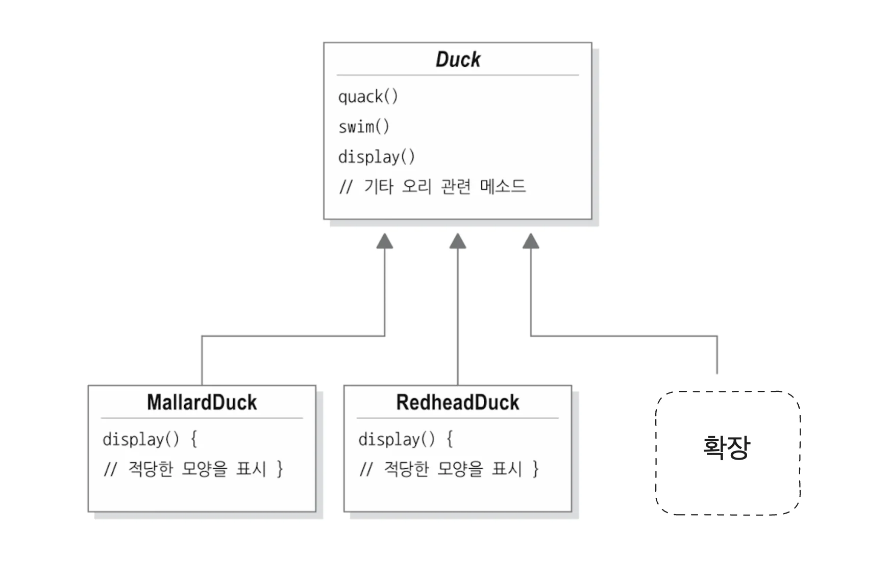

- 수퍼(부모) 클래스인 <code>Duck</code> 에 나는 동작 <code>fly()</code>를 추가
    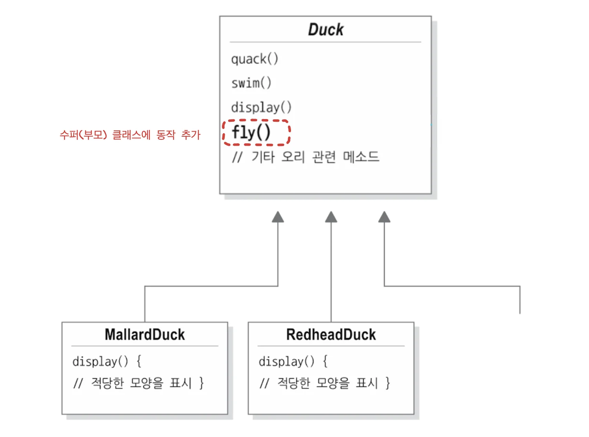

- 새로운 클래스 <strong><code>고무 오리(Rubber Duck)</code></strong>를 추가
    > <strong>🤬 문제점</strong><strong> </strong><strong>)</strong>고무 오리(Rubber Duck)는 날수 없다&#46; 

    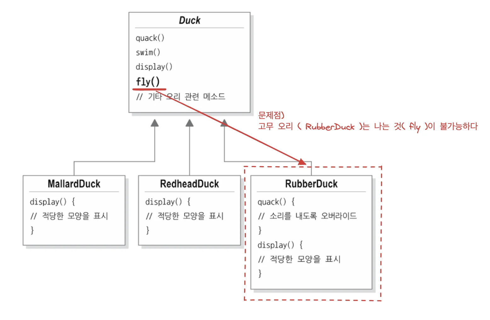

    > 🧐 <code>고무 오리(Rubber Duck)</code>의 <code>fly()</code>를  오버라이드 하면 되지 않나?

    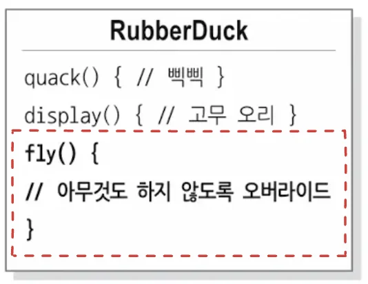

    <a id="1c3eda9b0fe1814891c9df9af9f6a6d1"></a>

    위와 같이 오버라이드를 통해 재정의를 한다면 아래와 같이 <strong><u>동일하게 날지 못하는 클래스가 추가</u></strong>되는 경우 <strong><u>매번 오버라이드를 통해 재정의</u></strong> 해야 한다&#46; 

    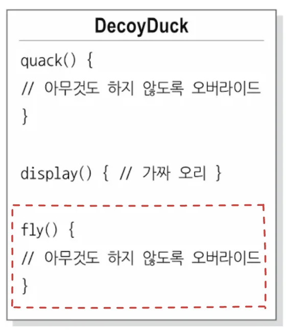

    - 오버라이드 시 단점
        - 서브 클래스의 <strong><u>코드  중복</u></strong>

        - 모든 오리의 <u>행동을 관리하기 어렵</u>다&#46; 

        - 실행 시에 특징을 바꿀 수 없다&#46;

        - 코드 변경 시,<strong><u> 다른 클래스들에게 원치 않는 영향을 줄 수 있</u></strong>다&#46; 

<a id="1c3eda9b0fe181ad8c7ec65870f49580"></a>

###  인터페이스로 분리  → Bad Case

---

> 클래스마다 <u>변화가 발생되는 두 메서드</u>를 <u>인터페이스로 분리</u> →  각 클래스마다 따로 구현

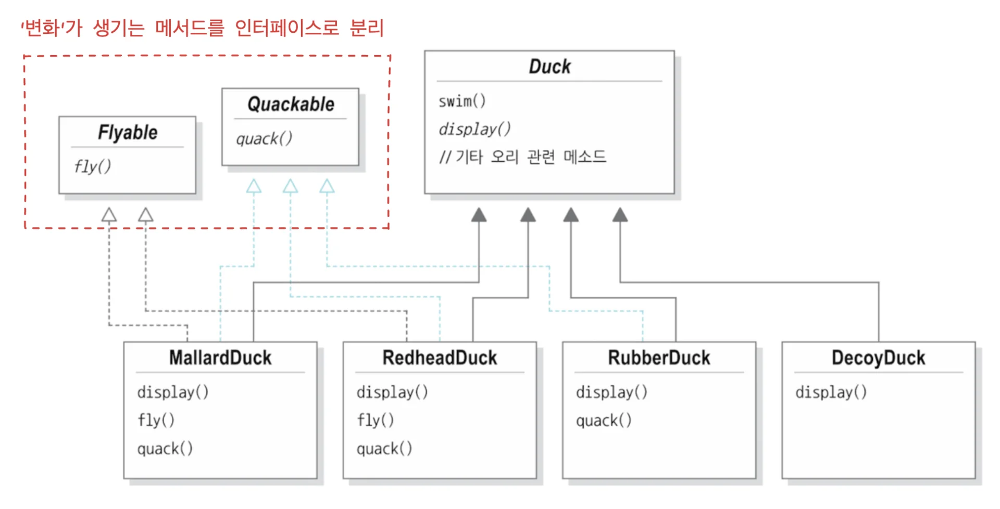

<a id="1c3eda9b0fe181459c84d8313dcb3f64"></a>

위와 같이 설게하는 경우, 정의한 인터페이스를 매번 각 클래스마다 구현한다&#46; 즉, <strong><u>코드의 중복</u></strong>이 생긴다&#46; 

<a id="1c3eda9b0fe18197bcf6c774a5bc5bfd"></a>

또한 <strong><u>인터페이스로 정의한 동작을  수정</u></strong>한다면, <u>구현되는 모든 서브 클래스들을 변경</u> 해야한다&#46;

<a id="1c3eda9b0fe181dd8007fd1827d31313"></a>

만약 그 구현된 서브 클래스가  100개 넘는다면 그걸 다 일일이 바꿔야 한다… 생각만 해도 끔찍하다&#46;

<a id="1c3eda9b0fe18121becaee35a969b51e"></a>

### 해결) <code>캡슐화</code>, <code>다형성</code>, <code>구성</code>

---

<a id="1c3eda9b0fe181338b55c38900d8be4b"></a>

 각 행동마다 인터페이스를 분리(<strong><code>Flyable</code></strong><strong>,</strong> <strong><code>Quackable</code></strong><strong>) </strong>하여 사용하는 방법은 <strong><u>변화되는 메서드들은 인터페이스로 분리하여 구현</u></strong>한다는 측면에서는 괜찮은 방법이었지만, <strong><u>구현 코드가 없</u></strong>어<strong><u> 재사용할 수 없</u></strong>으 며<strong> </strong><strong><u>확장 및 변경 시 내부 코드를 변경</u></strong>해야 한다는 단점이 있다&#46; ( OCP 위배 ) 

<a id="1c3eda9b0fe1811aa7a9eb9b7f976f3c"></a>

이를 객체지향의 특징인  <code>캡슐화</code> 와 <code>다형성</code> 그리고 상속을 대신 <code>구성</code> 활용해 해결한다&#46;

> ✏️ 
> 
> <a id="1c3eda9b0fe1819c84f1ffb25cc6cc5f"></a>
> 
> 디자인 원칙 &#45; <code>캡슐화</code>
> 
> <a id="1c3eda9b0fe181bb9ca8ce75e74cc4c7"></a>
> 
> 애플리케이션에서 <strong><u>달라지는 부분을 찾</u></strong>아내고, <u>달라지지 않는 부분</u>과 <strong>분리</strong>한다&#46; 
> 
> > <strong><u>달라지지는 부분</u></strong>을 찾아서 나머지 코드에 영향을 주지 않도록 <strong>‘캡슐화’ </strong>한다&#46;<br>그러면 나중에 <strong><u>바뀌지 않는 부분에 영향을 주지 않</u></strong>고 그 부분만 <strong><u>수정</u></strong><strong>하거나 </strong><strong><u>확장</u></strong><strong>할 수 있</strong>다&#46; <br>이로 인해 변경 과정에서 의도치 않게 발생되는 일을 줄이면서 시스템의 유연성을 향상시킬 수 있다&#46; 

<a id="1c3eda9b0fe181c0b069fd07e49f2bd3"></a>

아래와 같이 Dock 클래스에서 변경되는 ‘나는 행동(<strong><code>fly()</code></strong>)’ 과 ‘꽥꽥거리는 행동(<strong><code>quack()</code></strong>)’  외부로 분리한다&#46;

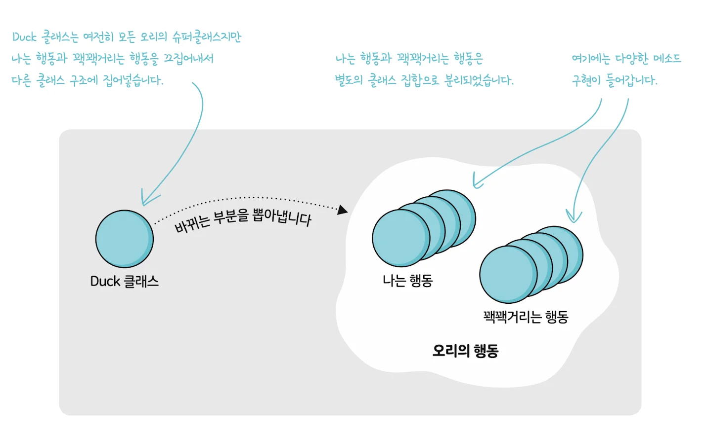

> ✏️ 
> 
> <a id="1c3eda9b0fe181d680e4c92022b9a7c8"></a>
> 
> 디자인 원칙 &#45; <code>다형성</code>
> 
> <a id="1c3eda9b0fe181809b21f010b84817d8"></a>
> 
> 구현보다는 인터페이스에 맞춰서 프로그래밍한다&#46; 
> 
> > ‘인터페이스에 맞춰 프로그래밍한다&#46;’는 말은 ‘상위 형식에 맞춰 프로그래밍한다&#46;’는 말이다&#46;<br>이는, ‘<strong><u>객체가 코드에 고정되지 않</u></strong>도록 <strong><u>상위 형식(Super Type)</u></strong><strong><u>에 맞춰 프로그래밍</u></strong>하여 <strong><u>다형성</u></strong><strong><u>을 활용</u></strong>해야 한다’는 것을 이야기한다&#46; <br><br>변수 선언 시 <code>추상클래스</code>나 <code>인터페이스</code> 같은 <u>상위 형식으로 선언</u>하여 객체를 <u>변수를 대입</u>할 때 <u>상위 형식으로 구현된 어떤 객체든 넣을 수 있</u>다&#46; 

<a id="1c3eda9b0fe181c1b756f05617a73df0"></a>

앱의 변경과 확장에 용이하기 위해, 나는 행동(<code>fly()</code>) 과 꽥꽥거리는 행동(<code>quack()</code>) 을 상위 형식(인터페이스)로 정의 후 아래와 같이 구현한다&#46; 

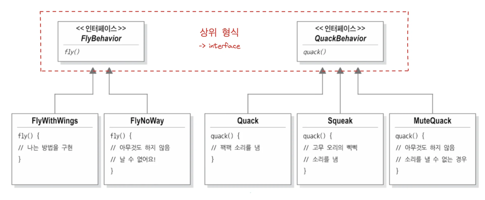

> ✏️ 
> 
> <a id="1c3eda9b0fe18197add7d9856e9014ac"></a>
> 
> <strong>디자인 원칙 &#45; </strong><strong><code>구성 (Composition)</code></strong>
> 
> <a id="1c3eda9b0fe181b6bef6c4cb31489973"></a>
> 
> 상속보다는 구성을 활용한다&#46;
> 
> > ‘나는 행동(<strong><code>fly()</code></strong>)’ 과 ‘꽥꽥거리는 행동(<strong><code>quack()</code></strong>)’을 <strong><u><code>Duck(수퍼) 클래스</code></u></strong> <strong>나 </strong><u>그 </u><strong><u><code>서브클래스</code></u></strong><u>에서 구현하지 않</u>고 <strong>다른 클래스에</strong><strong> </strong><strong><u>위임</u></strong>한다&#46;<br><br>각 오리에는 <strong><code>FlyBehavior</code></strong> 와 <strong><code>QuackBehavior</code></strong>가 있어, 각각 <strong><u>‘나는 행동’ 과 ‘꽥꽥 거리는 행동’을 위임 받</u></strong>는다&#46;<br><br>이런 식으로 <u>두 클래스를 합</u>치는 것은‘<strong><u>구성(Composition)’</u></strong>을 활용한 방법이다&#46;<br><br>이렇게 구성을 활용해 시스템을 만들면 유연성을 크게 향상 시킬수 있다&#46;<br>알고리즘군을 별도의 클래스 집합으로 캡슐화할 수 있으며,  구성 요소로 사용하는 객체에 올바른 행동 인터페이스를 구현하기만 하면 실행 시에 행동을 바꿀 수도 있다&#46; 

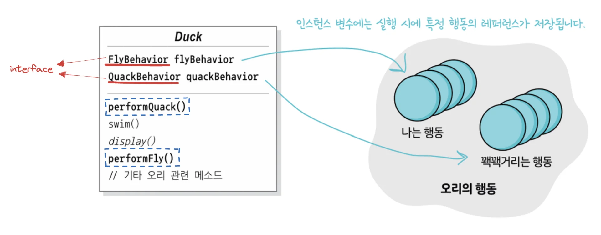

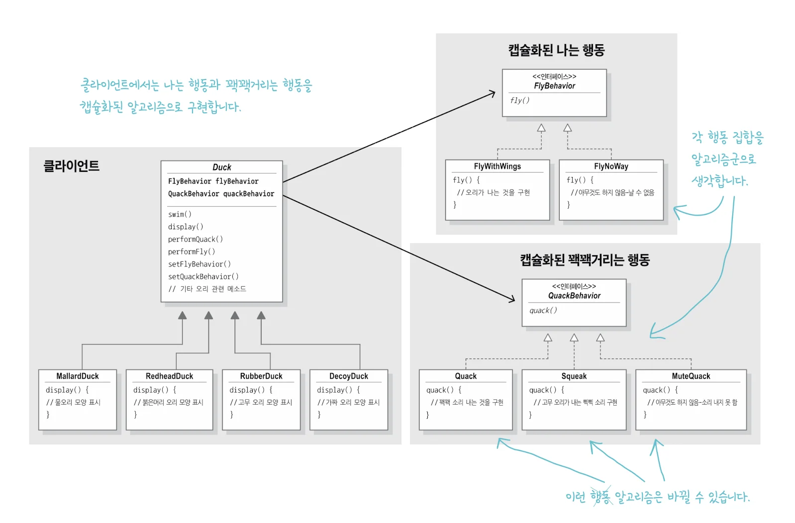

- &#91; 코드 &#93; 
    <details>
    <summary>나는 행동, fly </summary>

    <details>
    <summary>&#91;  코드 &#93; &#60; interface &#62; FlyBehavior</summary>

    <a id="1c3eda9b0fe181f8aab6c500ef94677c"></a>

    ```java
    package strategy.fly;

    public interface FlyBehavior {
        public void fly();
    }

    ```

    </details>

    <details>
    <summary>&#91;  코드 &#93;  FlyWithWings</summary>

    <a id="1c3eda9b0fe181e497caee33edf705bd"></a>

    ```java
    package strategy.fly;

    public class FlyWithWings implements FlyBehavior{
        @Override
        public void fly() {
            System.out.println("날 수 있음");
        }
    }

    ```

    </details>

    <details>
    <summary>&#91;  코드 &#93;  FlyNoWay</summary>

    <a id="1c3eda9b0fe18141b4c3d381ea9417f0"></a>

    ```java
    package strategy.fly;

    public class FlyNoWay implements FlyBehavior{
        @Override
        public void fly() {
            System.out.println("날지 못함");
        }
    }

    ```

    </details>

    </details>

    <details>
    <summary>꽥꽥 거리는 행동, quack</summary>

    <details>
    <summary>&#91;  코드 &#93; &#60; interface &#62; QuackBehavior</summary>

    <a id="1c3eda9b0fe18178a9b8e819f8fbe554"></a>

    ```java
    package strategy.quack;

    public interface QuackBehavior {
        public void quack();
    }

    ```

    </details>

    <details>
    <summary>&#91;  코드 &#93; Quack</summary>

    <a id="1c3eda9b0fe1815491b7e5037d04c757"></a>

    ```java
    package strategy.quack;

    public class Quack implements QuackBehavior{
        @Override
        public void quack() {
            System.out.println("꽥");
        }
    }

    ```

    </details>

    <details>
    <summary>&#91;  코드 &#93; MuteQuack</summary>

    <a id="1c3eda9b0fe181ba8b33e69dddd8798b"></a>

    ```java
    package strategy.quack;

    public class MuteQuack implements QuackBehavior {
        @Override
        public void quack() {
            System.out.println("소리가 나지 않음");
        }
    }

    ```

    </details>

    <details>
    <summary>&#91;  코드 &#93; Squeak</summary>

    <a id="1c3eda9b0fe181eb843ad4aa449ab5ab"></a>

    ```java
    package strategy.quack;

    public class Squeak implements QuackBehavior{
        @Override
        public void quack() {
            System.out.println("삑");
        }
    }

    ```

    </details>

    </details>

    <details>
    <summary>오리</summary>

    <details>
    <summary>&#91;  코드 &#93; &#60; abstract class &#62;  Duck </summary>

    <a id="1c3eda9b0fe181d08872cc5b7f97dcc6"></a>

    ```java
    package strategy;

    import strategy.fly.FlyBehavior;
    import strategy.quack.QuackBehavior;

    public abstract class Duck {

        FlyBehavior flyBehavior;
        QuackBehavior quackBehavior;

        public abstract void display();

        public void performFly() {
            flyBehavior.fly();
        }
        public void performQuack() {
            quackBehavior.quack();
        }

        public void swim() {
            System.out.println("오리는 물에 뜬다. 가짜 오리도...");
        }
    }

    ```

    </details>

    <details>
    <summary>&#91;  코드 &#93;  MallarDuck </summary>

    <a id="1c3eda9b0fe1814084a0f540cab8ef48"></a>

    ```java
    package strategy;

    import strategy.fly.FlyWithWings;
    import strategy.quack.Quack;

    public class MallarDuck extends Duck {

        public MallarDuck() {
            quackBehavior = new Quack();
            flyBehavior = new FlyWithWings();
        }

        @Override
        public void display() {
            System.out.println("오리");
        }
    }


    ```

    </details>

    </details>

    <details>
    <summary>테스트 </summary>

    <details>
    <summary>&#91;  코드 &#93; MiniDuckSimulator</summary>

    <a id="1c3eda9b0fe181c6b248c429cba1a0c5"></a>

    ```java
    package strategy;

    public class MiniDuckSimulator {
        public static void main(String[] args) {
            Duck mallard = new MallarDuck();
            mallard.performQuack();
            mallard.performFly();
        }
    }
    ```

    </details>

    </details>

<details>
<summary>🧐 동적으로 행동 지정 &#45; <code>Setter</code></summary>

> ☝🏻 
> 
> <a id="1c3eda9b0fe181a88d51cafa8f824d13"></a>
> 
> setter를 통한 변경은 객체의 불변성을 해치니 사용에 주의가 필요하다&#46; 

<details>
<summary>나는 행위 추가 &#45; 로켓</summary>

<details>
<summary>&#91; 코드 &#93; FlyRocketPowered</summary>

<a id="1c3eda9b0fe18158bc28d686fc9eaa5c"></a>

```java
package strategy.fly;

public class FlyRocketPowered implements FlyBehavior {

    @Override
    public void fly() {
        System.out.println("로켓 추진으로 날아갑니다!");
    }
}

```

</details>

</details>

<details>
<summary>추상 클래스 Duck &#45; Setter 추가</summary>

<details>
<summary>&#91; 코드 &#93; &#60; abstract class &#62; Duck</summary>

<a id="1c3eda9b0fe1815f8de9e5ee0dab3c48"></a>

```java
package strategy;

import strategy.fly.FlyBehavior;
import strategy.quack.QuackBehavior;

public abstract class Duck {

    FlyBehavior flyBehavior;
    QuackBehavior quackBehavior;
    
				.  .  .
    
    public void setFlyBehavior(FlyBehavior fb) {
        this.flyBehavior = fb;
    }

    public void setQuackBehavior(QuackBehavior qb) {
        this.quackBehavior = qb;
    }
}

```

</details>

</details>

<details>
<summary>새로운 오리 추가 &#45; ModelDuck</summary>

<details>
<summary>&#91; 코드 &#93; ModelDuck</summary>

<a id="1c3eda9b0fe181308d3bed7a38bc734f"></a>

```java
package strategy;

import strategy.fly.FlyNoWay;
import strategy.quack.Quack;

public class ModelDuck extends Duck{
    public ModelDuck() {
        flyBehavior = new FlyNoWay();
        quackBehavior = new Quack();
    }

    @Override
    public void display() {
        System.out.println("모형 오리");
    }
}
```

</details>

</details>

<details>
<summary>테스트 </summary>

<a id="1c3eda9b0fe181d5ac63d9700458dcfd"></a>

```java
package strategy;

import strategy.fly.FlyRocketPowered;

public class MiniDuckSimulator {
    public static void main(String[] args) {

        ModelDuck model = new ModelDuck();
        model.performFly();
        model.setFlyBehavior(new FlyRocketPowered());  // setter를 통해 동적으로 나는 행위 클래스 변경
        model.performFly();

    }
}

```

<a id="1c3eda9b0fe181f189dad13de8f972b1"></a>

```plaintext
날지 못함
로켓 추진으로 날아갑니다!
```

</details>

</details>

<a id="1c3eda9b0fe1812ea348d61e6a1fff23"></a>

### 전략 패턴

> 📌 
> 
> <a id="1c3eda9b0fe18161bfe3d89665c05475"></a>
> 
> <strong>전략 패턴 ( Strategy Pattern )</strong>
> 
> <a id="1c3eda9b0fe1810ab2f7f4ed21978488"></a>
> 
> <strong>알고리즘군을 정의하고 캡슐화하여 각각의 알고리즘군을 수정해 사용 가능하게 한다&#46; </strong>
> 
> <a id="1c3eda9b0fe181b195d9e77869509190"></a>
> 
> <strong>따라서 클라이언트로부터 알고리즘을 분리하여 독립적으로 변경할 수 있다&#46;  </strong>

<a id="1c3eda9b0fe181d6959fd29e54d844ee"></a>

앱에서 <strong><u>변화가 일어나는 부분을 그렇지 않은 부분과 분리</u></strong>하고 <strong><u>상위 형식을 정의해 각 구현체들을 만</u></strong>들어 <u>알고리즘군으로 캡슐화</u>하며, <u>다형성과 구성을 활용</u>하여 클라이언트로부터 알고리즘을 분리하여 독립적으로 만들어 변경 및 확장을 쉽게하고 유지보수를 용이하게 만든다&#46; 

<a id="1c3eda9b0fe18183ad15d464c9473197"></a>

이렇게 객체 지향의 <code>캡슐화</code>, <code>다형성</code> 그리고 상속 대신 <code>구성</code>을 활용한 디자인 방법을 ‘<strong>전략 패턴 ( Strategy Pattern )’</strong><strong> 이라 한다&#46;</strong>

---

<a id="1c3eda9b0fe18137a51decb985c58772"></a>

### 1차 작성 내용

<a id="1c3eda9b0fe181e58dd2e4a4b0bb17bc"></a>

## ex) 오리 시뮬레이션 게임

<a id="1c3eda9b0fe18196a46ce7aa1d3c73de"></a>

###  상속을 통한 애플리케이션 설계  → ❌ 

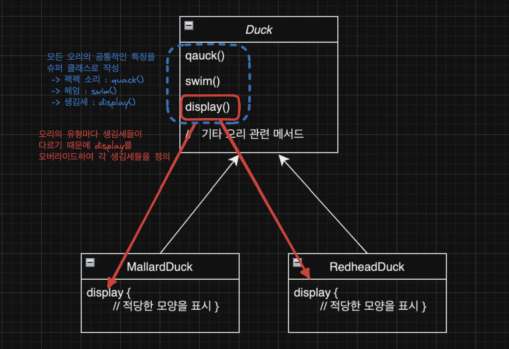

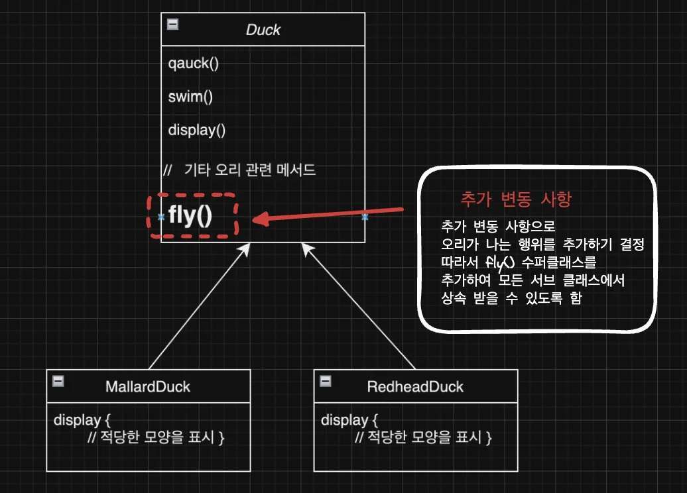

<a id="1c3eda9b0fe1810c92c5de89bc40906e"></a>

Duck 슈퍼클래스에  fly() 메서드를 추가하여 일부 서브클래스에 적합하지 않는 행동이 추가 되어 아래와 같은 오류가 발생되었다&#46;

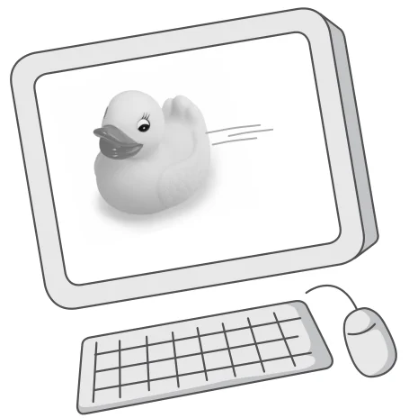

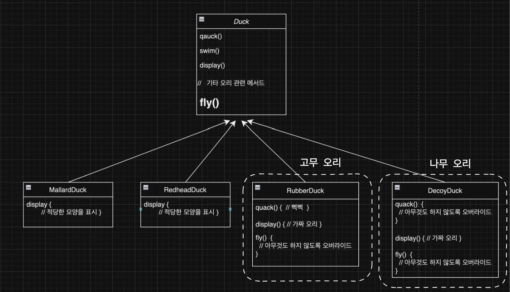

> 오버라이드를 통해 서브 클래스의 행동을 일일 변경

<a id="1c3eda9b0fe181f9a37ec567a9c8011f"></a>

위와 같이 슈퍼클래스의 각 메서드들을 각 유형에 맞춰 오버라이드하여 서브클래스에 적합하지 않는 행동들 재작성하여 오류를 해결했다&#46; 

<a id="1c3eda9b0fe181858fa8f2f510f5127f"></a>

그러나 위와같이 상속하여 오버라이드 하는 방법은 아래와 같이 제한사항이 생긴다&#46; 

- 서브클래스에 코드 중복

- 실행 시 특정 변경 어려움

- 모든 오리의 행동을 알 수 없음

- 코드를 변경했을 때 다른 오리들에게 원치 않는 영향을 끼칠 수 있다&#46; 

> 소프트웨어 개발에서 절대로 바뀌지 않는 진리는 <code>변화</code>이다&#46;<br>아무리 디자인을 잘한 애플리케이션이라도 시간이 지남에 따라 변화하고 성장해야한다&#46; 그렇지 않으면 해당 애플리케이션은 죽고만다&#46; <br>&#45; 헤드퍼스트 디자인패턴 44p 참조 &#45;

<a id="1c3eda9b0fe181ac890cc509a5bc08a9"></a>

<br>그러나 위 <strong>상속을 통한</strong><strong> </strong>앱 설계는 이러한 <u>애플리케이션의 </u><strong><u><code>변화</code></u></strong><u>에 대응하는데 있어 </u><strong><u>올바른 방법이 아니다</u></strong><strong>&#46; </strong>

> <em><strong>“ 시간이 지남에 따라 애플리케이션이 변화하고 수정됨에 따라 앱의 업데이트 및 유지보수 하는데 있어 </strong></em><em><strong><u>상속을 통한 앱 설계</u></strong></em><em><strong>는 올바른 방식이 아니다&#46;”</strong></em>

<a id="1c3eda9b0fe181c5b6bbe3caaffc67df"></a>

이런 <strong><code>변화</code></strong><strong> </strong>에 대응하기 위해 사용하는 설계 디자인인 중 하나가 바로  <strong><u>전략패턴</u></strong>이다&#46; 

<a id="1c3eda9b0fe1814d83c3fcca35136738"></a>

## 전략 패턴

> 📌 <strong>디자인 원칙1)</strong>
> 
> > 애플리케이션에서 <strong><u>달라지는 부분을 찾</u></strong>아내고, <strong><u>달라지지 않는 부분과 분리</u></strong>한다&#46;
> 
> <a id="1c3eda9b0fe18169861ccfaf63a640ad"></a>
> 
> 바뀌는 부분을 따로 뽑아<code>캡슐화</code> 한다&#46;  그러면 <strong>나중에 바뀌지 않는 부분에 영향을 미치지 않</strong>고<strong><u> 그 부분만 고치거나 확장할 수 있</u></strong>다&#46; 

> 📌 <strong>디자인 원칙2)</strong>
> 
> > 구현보다는 <strong>인터페이스</strong>에 맞춰 프로그래밍 한다&#46;<br>⇒ <strong>상위 형식(supertype)</strong>에 맞춰 프로그래밍한다&#46;                                                                                                                                                                                                                                                                                                                                                                                
> 
> <a id="1c3eda9b0fe181c18f63ec25dae9a2d1"></a>
> 
> ‘인터페이스에 맞춰 프로그래밍한다’ 라는 말은 ‘상위 형식에 맞춰 프로그래밍한다&#46;’ 라는 말과 같다&#46; 
> 
> <a id="1c3eda9b0fe181519577fea0031971e9"></a>
> 
> ‘인터페이스’ 단어가 중의적으로 자바의 구조를 지칭하기도 하지만, 인터페이스 개념을 지칭하는 용도로 쓰인다&#46; 
> 
> <a id="1c3eda9b0fe18127a165eb08269cb3e7"></a>
> 
> 인터페이스에 맞춰 프로그래밍 한다는 것이 반드시 자바의 인터페이스를 사용하라는 뜻은 아니다&#46; 
> 
> <a id="1c3eda9b0fe181eb9349c18efb51f369"></a>
> 
> 핵심은 실제 실행 시에 쓰이는 <strong><u>객체가 코드에 고정되지 않도록 </u></strong><strong><u>상위 형식(supertype)</u></strong><strong><u>에 맞춰 프로그래밍해서 다형성을 활용해야 한다</u></strong>는 점이다&#46; 

> 📌 <strong>디자인 원칙3) </strong>
> 
> > <strong>상속보다는 </strong><strong>구성</strong><strong>을 활용한다&#46;</strong>
> 
> <a id="1c3eda9b0fe181b3ab59db356b112743"></a>
> 
> <strong><u>각 행동들을 분리</u></strong>하여 <strong><u>행동 객체들로 구성</u></strong>하여 객체들에게 <strong>각 </strong><strong><u>행동들을 부여</u></strong>한다&#46; <br>⇒ 각 오리의 ‘나는 행위(<code>FlyBehavior</code>)’, ‘꽥꽥거리는 행위(<code>QuackBehavior</code>)’ 가 있으며, 해당 행동들을 위임  받는다&#46; 
> 
> <a id="1c3eda9b0fe181de8a74d3fbe095f968"></a>
> 
> <strong>구성</strong><strong>을 활용한 시스템 설계</strong>는 <strong><u>유연성을 크게 증가</u></strong>시키며 단순한 알고리즘군을 <u>별도의 클래스 집합</u>으로 <strong>캡슐화</strong> 가능하고 구성요소로 사용하는 객체에서<strong> 올바른 행동 인터페이스를 구현</strong>한다면 <strong><u>실행 시에도 행동을 변경</u></strong>할 수 있다&#46; 
> 
> <details>
> <summary><strong>🧐 구성이란 무엇인가? </strong></summary>
> 
> <a id="1c3eda9b0fe181b3a187e79617fc2b33"></a>
> 
> 구성(Compsition)이란 has a a
> 
> <a id="1c3eda9b0fe181d4b14ecf77a3b263d9"></a>
> 
> <a href="#/post/1c3eda9b-0fe1-818c-81c7-ef9e927f1359">페이지</a> 참조
> 
> </details>

<a id="1c3eda9b0fe181078b98df1d0d400d80"></a>

### ex) 전략 패턴 &#45; animal 

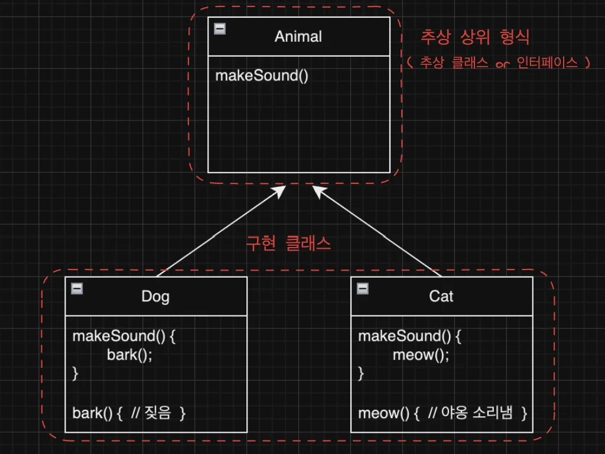

<a id="1c3eda9b0fe181cb98cfd1451077a205"></a>

인터페이스와 상위 형식에 맞춰 프로그래밍을 한다면 아래와 같이 다형성을 활용하여 상위 형식을 인스턴스의 래퍼런스로 활용할 수 있다&#46; 

<a id="1c3eda9b0fe1815198f7d725a819e2b8"></a>

```java
// 다형성 활용해 상위 형식인 Animal을 래퍼런스로 사용 
Animal animal = new Dog();
animal.makeSound();
```

<a id="1c3eda9b0fe1816e8b2ff71b2b207675"></a>

더 좋은 방법은 상위 형식의 인스턴스를 만드는 과정(<code>new Dog()</code>)을 직접 코드로 만드는 대신 구체적으로 구현된 객체를 실행 시에 대입하는 방법이다&#46; 

<a id="1c3eda9b0fe1819b97e1f39560999cee"></a>

```java
 a = getAnimal();
 a.makeSound();
```

<a id="1c3eda9b0fe1810b8f8cdd53c5d9a82d"></a>

### 오리 시뮬레이션  &#45; <code>전략패턴</code> 적용

<details>
<summary><strong> 인터페이스로 각 행위들 분리하기 </strong></summary>

> Dock 수퍼클래스의 <strong><u>행위들을 인터페이스로 분리</u></strong>하여 <strong>특징에 맞게 구현</strong>한다&#46;

- interface&#58; <code>FlyBehavior</code>, <code>QuackBehavior</code>

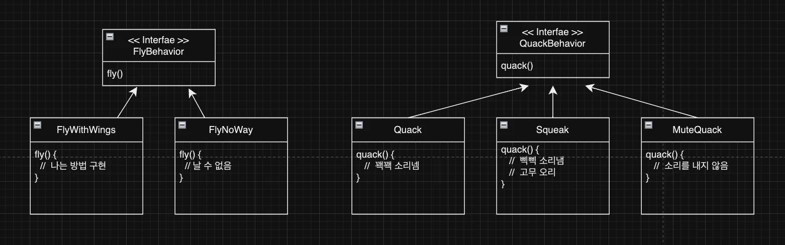

<a id="1c3eda9b0fe181e4be7ef70b20c182d4"></a>

이러한 디자인 방식은 다른 형식의 객체에서도 ‘나는 행동(<code>FlyBehavior</code>)’과 ‘꽥꽥거리는 행동(<code>QuackBehavior</code>)’을 재사용 할 수 있게 하며 기존의 행동 클래스를 수정하거나 그 행위를 하는 클래스를 건드리지 않고 새로운 행동을 추가할 수 있다&#46; (<code>OCP</code>)

- 재사용 → 앱 확장에 따른 메서드 중복 문제 해결

- <code>OCP</code>(Open&#45;Closed Principle) 준수

> <code>OCP(개방 폐쇠 원칙)</code>&#58; 확장에는 열려있고 변경에는 닫혀있어야 한다&#46;

- <a href="#/post/1c3eda9b-0fe1-819a-bde7-ff1e5e6ab2e6">페이지</a> 

<details>
<summary><strong>FlyBehavior</strong></summary>

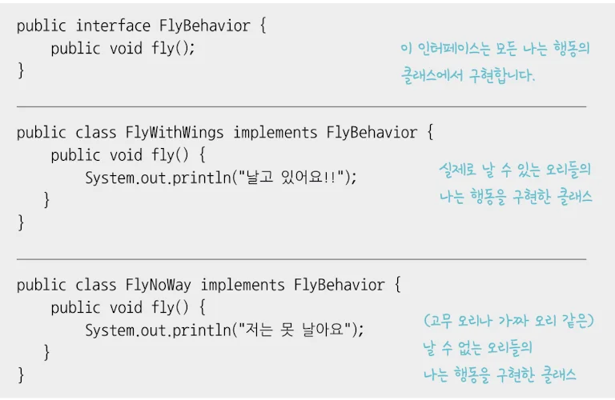

</details>

<details>
<summary><strong>QuackBehavior</strong></summary>

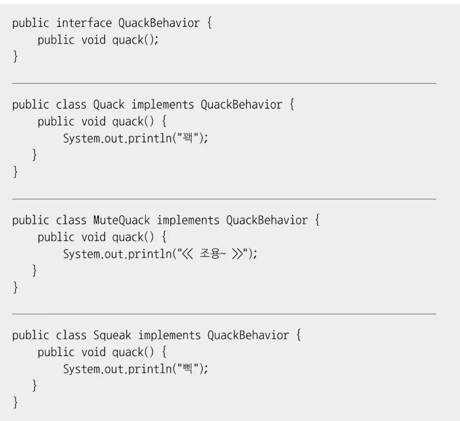

</details>

</details>

<details>
<summary><strong> 오리 행동 통합</strong></summary>

> 📌 행동(전략)들을 상위클래스 및 서브클래스애서 정의한 메서드를 써서 구현하지 않고 <strong><u>다른 클래스에 위임</u></strong>한다&#46; 

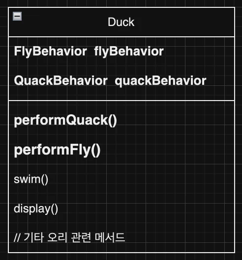

1. Duck 클래스에 <code>flyBehavior</code>, <code>quackBehavior</code>  인터페이스의 인스턴스 변수 추가 (특정 구상 클래스 형식으로 선언 X)
    <a id="1c3eda9b0fe1817e9471ea547b265fcf"></a>

    ```java
    FlyBehavior flyBehavior;
    QuackBehavior quackBehavior;
    ```

1. ISP, 인터페이스 분리 원칙 준수 
    <a id="1c3eda9b0fe18163a338e7922a5816e7"></a>

    ```java
    public void performFly() {
    	flyBehavior.fly();
    }

    public void performQuack() {
    	quackBehavior.quack();
    }
    ```

1. 동적으로 행동 지정&#58;  <code>setter</code>,  서브클래스에서 행동 변경 가능 → 유연성 ↑
    <a id="1c3eda9b0fe181eebccdef051d2fea57"></a>

    ```java
    public void setFlyBehavior(FlyBehavior fb) {
    		flyBehavior = fb;
    }

    public void setQuackBehavior(QuackBehavior qb) {
    	quackBehavior = qb;
    }

    ```

<details>
<summary><strong>Duck</strong></summary>

<a id="1c3eda9b0fe181dc8594c2fa6e1a7e5a"></a>

```java
public abstract class Duck {
	// 인터페이스 인스턴스 변수 선언
	FlyBehavior flyBehavior;
	QuackBehavior quackBehavior;

	// 기본 생성자
	public Duck(() {
	}
	
	// setter 
	public void setFlyBehavior(FlyBehavior fb) { fb.fly() };
	public void setQuackBehavior(QuackBehavior qb) { qb.quack() };
	
	abstract void display();


	//. 
	public void performFly() {
		flyBehavior.fly();
	}

	public void performQuack() {
		quackBehavior.quack();
	}

	public void swim() {
		System.out.println("All ducks float, even decoys!");
	}
}
```

</details>

<details>
<summary><strong>MallarDuck</strong></summary>

<a id="1c3eda9b0fe181c6b85cc0dacf5c6ba1"></a>

```java
public class MallardDuck extends Duck {

	public MallardDuck() {

		quackBehavior = new Quack();
		flyBehavior = new FlyWithWings();

	}

	public void display() {
		System.out.println("I'm a real Mallard duck");
	}
}
```

</details>

<details>
<summary><strong>테스트</strong></summary>

<a id="1c3eda9b0fe18183894cc0c2b86d3154"></a>

```java
public class MiniDuckSimulator1 {
	public static void main(String[] args) {
	
		Duck mallard = new MallardDuck();
		mallard.performQuack();
		mallard.performFly();	
	}
} 
```

</details>

</details>

<details>
<summary><strong>테스트</strong></summary>

<a id="1c3eda9b0fe181328a02f1f4e09e83ac"></a>

테스트를 위해 아래 2개의 구현 클래스 만들기 

<details>
<summary><strong>ModelDuck </strong></summary>

<a id="1c3eda9b0fe18153ac45c5002bac932f"></a>

```java
public class ModelDuck extends Duck {
		public ModelDuck() {
				flyBehavior = new FlyNoWay();
				quackBehavior = new Quack();
		}
		
		public void display() {
				System.out.print("저는 모형 오리입니다.")
		}
}
```

</details>

<details>
<summary><strong>FlyBehavior</strong></summary>

<a id="1c3eda9b0fe181859c86cf974ef1f5ab"></a>

```java
public class FlyRocketPowered implements FlyBehavior {
	public void fly() {
		System.out.println("로켓 추진으로 날아갑니다.");
	}
}
```

</details>

<details>
<summary><strong>MiniDuckSimulator ( 테스트 ) <br></strong></summary>

<a id="1c3eda9b0fe1819c965ed34ee81cae71"></a>

```java
public class MiniDuckSimulator1 {
	public static void main(String[] args) {
		Duck model = new ModelDuck();
		model.performFly();
		model.setFlyBehavior(new FlyRocketPowered());
		model.performFly();
	}
}
```

</details>

</details>

- 캡슐화 
    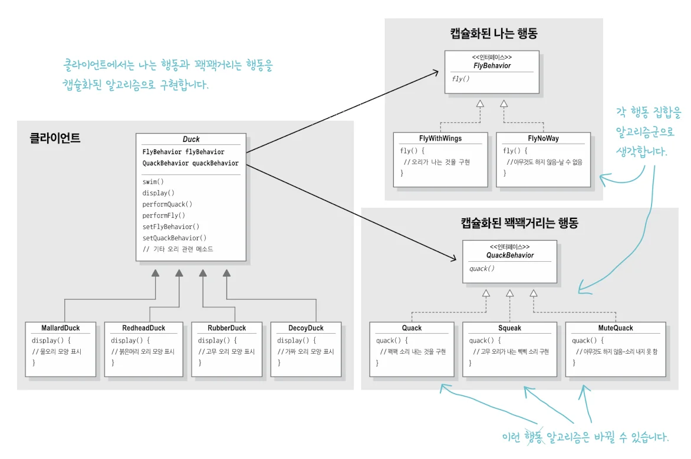
