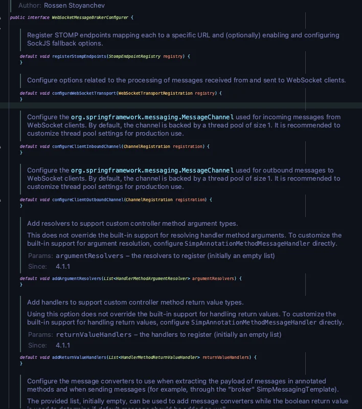
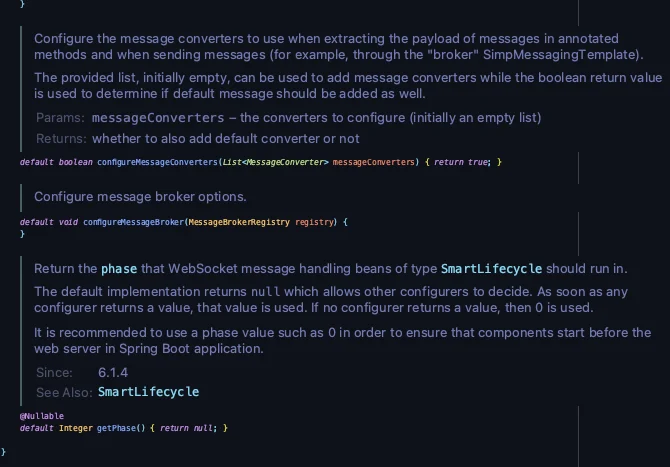

<a id="1c3eda9b0fe181e1ad35f65189edd296"></a>

## WebSocketMessageBrokerConfigurer

> 📖 
> 
> <a id="1c3eda9b0fe181b7bd65fdae8724c313"></a>
> 
> Spring 프레임워크에서<u> WebSocket 메세지 브로커 설정</u>을 <u>커스터마이징</u> 할 때 사용하는 인터페이스

<details>
<summary>WebSocketMessageBrokerConfigurer</summary>

<details>
<summary>주요 메서드</summary>

<details>
<summary>스크린샷</summary>





</details>

<details>
<summary><strong><code>registerStompEndpoints</code></strong></summary>

- STOMP 프로토콜을 지원하기 위한 <u>WebSocket 엔드포인트 등록</u>

- 클라이언트가 특정 URL을 통해 WebSocket 서버와 연결할 수 있도록 설정

- SockJS 폴백 옵션을 사용하여 WebSocket을 지원하지 않는 브라우저에서도 통신 가능하도록 설정 가능

<a id="1c3eda9b0fe1810386cef606429cd442"></a>

```java
 @Override
public void registerStompEndpoints(StompEndpointRegistry registry) {
    registry.addEndpoint("/ws")  // WebSocket 엔드포인트 설정
            .setAllowedOrigins("/*")  // Origin(출처)을 허용
            .withSockJS();  // 풀백 옵션 
}
```

</details>

<details>
<summary><strong><code>configureMessageBroker(MessageBrokerRegistry registry)</code></strong></summary>

- 메세지 브로커 옵션 설정
    - 메시지 라우팅 프리픽스 설정 (/topic, /queue 등)
        - 메세지 pub/sub 프리픽스 설정 

    - 외부 메시지 브로커 (예&#58; RabbitMQ)와 연동 설정

<a id="1c3eda9b0fe181aba3dbee5c4c49c5d0"></a>

```java
@Override
public void configureMessageBroker(MessageBrokerRegistry config) {
    config.enableSimpleBroker("/receive");  // 메세지 응답(구독, subscribe) prefix 설정
    config.setApplicationDestinationPrefixes("/send");  // 메세지 요청(발행, publish) prefix 설정
}
```

</details>

<details>
<summary><strong><code>configureWebSocketTransport</code></strong></summary>

- WebSocket 통신 시 사용되는 메세지 처리와 관련된 전송 설정 구성
    - 메세지 크기 제한 설정

    - 전송 속도 제한, 버퍼 설정

</details>

<details>
<summary><strong><code>configureClient</code></strong><strong><u><code>Inbound</code></u></strong><strong><code>Channel(ChannelRegistration registration)</code></strong></summary>

- &#91; 클라이언트 → 서버 &#93; 로 들어오는 메시지를 처리하는 채널 구성
    - 스레드 풀 크기를 조정하여 메세지 처리 성능 최적화

    - 특정 필터나 인터셉터 추가 

</details>

<details>
<summary><strong><code>configureClient</code></strong><strong><u><code>Outbound</code></u></strong><strong><code>Channel(ChannelRegistration registration)</code></strong></summary>

- &#91; 서버 → 클라이언트 &#93;로  전달되는 메세지를 처리하는 채널 구성
    - 스레드 풀 크기 조정

    - 메세지 전달 과정에 특정 로직 추가

</details>

<details>
<summary><strong><code>addArgumentResolvers(List&#60;HandlerMethodArgumentResolver&#62; argumentResolvers)</code></strong></summary>

- WebSocket 컨트롤러의 메서드에 사용할 사용자 정의 매개변수 리졸버 추가
    - ex) 새로운 타입의 매개변수를 처리하기 위한 커스텀 리졸버 구현 

</details>

<details>
<summary><strong><code>addReturnValueHandlers(List&#60;HandlerMethodReturnValueHandler&#62; returnValueHandlers)</code></strong></summary>

-  WebSocket 컨트롤러의 메서드가 반환하는 값을 처리하기 위한 사용자 정의 핸들러 추가
    - ex) 특정 타입의 반환값을 처리하기 위한 로직 구현

</details>

<details>
<summary><strong><code>configureMessageConverters(List&#60;MessageConverter&#62; messageConverters)</code></strong></summary>

- 메시지 페이로드를 변환하는 컨버터 설정

- <strong>매개변수</strong>
    - messageConverters&#58; 사용자 정의 컨버터 추가를 위한 리스트

    - 반환값 true인 경우 기본 컨버터도 추가됨

    - ex) JSON, XML 등 특정 데이터 형식을 처리하기 위한 커스텀 컨버터 추가

</details>

<details>
<summary><strong><code>getPhase()</code></strong></summary>

- WebSocket 메시지 처리 구성 요소의 시작 순서를 결정하는 phase 값 반환
    - <strong>기본값</strong>&#58; null (다른 구성요소가 값 설정 시 해당 값을 따름)

    - ex)  웹 서버보다 먼저 시작해야 하는 WebSocket 메시지 처리 설정 시 사용

</details>

</details>

</details>

<details>
<summary>ex)  <code>configureMessageBroker</code>, <code>registerStompEndpoints</code></summary>

- <code>registerStompEndpoints</code>&#58; 웹소캣 프로토콜 연결 엔드포인트 설정

- <code>configureMessageBroker</code>&#58; 발행, 구독 엔드포인트 설정

<a id="1c3eda9b0fe1812f8083c2c462c3abc1"></a>

```java
package com.example.websocket_tutorial;

import org.springframework.context.annotation.Configuration;
import org.springframework.messaging.simp.config.MessageBrokerRegistry;
import org.springframework.web.socket.config.annotation.EnableWebSocketMessageBroker;
import org.springframework.web.socket.config.annotation.StompEndpointRegistry;
import org.springframework.web.socket.config.annotation.WebSocketMessageBrokerConfigurer;

@Configuration
@EnableWebSocketMessageBroker
public class WebSocketConfig implements WebSocketMessageBrokerConfigurer {

    @Override
    public void configureMessageBroker(MessageBrokerRegistry config) {
        config.enableSimpleBroker("/receive");  // 메세지 응답(구독, subscribe) prefix 설정
        config.setApplicationDestinationPrefixes("/send");  // 메세지 요청(발행, publish) prefix 설정
    }

    @Override
    public void registerStompEndpoints(StompEndpointRegistry registry) {
        registry.addEndpoint("/ws");  // WebSocket 엔드포인트 설정
    } 
}
```

</details>

<details>
<summary>실습 코드</summary>

> <a href="#/post/1c3eda9b-0fe1-8138-8d24-fa5be66ba1d2">페이지</a> 

[websocket_tutorial](https://github.com/gyungsubLee/websocket_tutorial)

</details>
