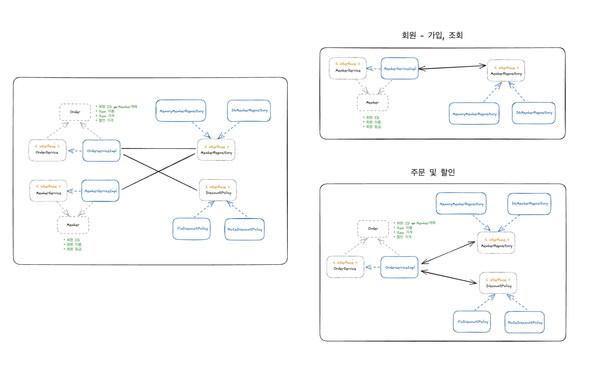
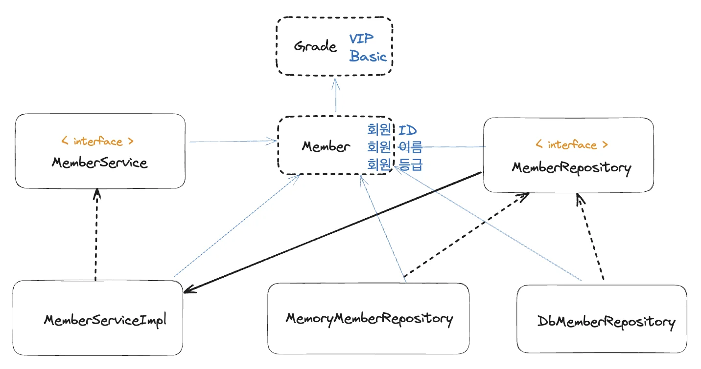
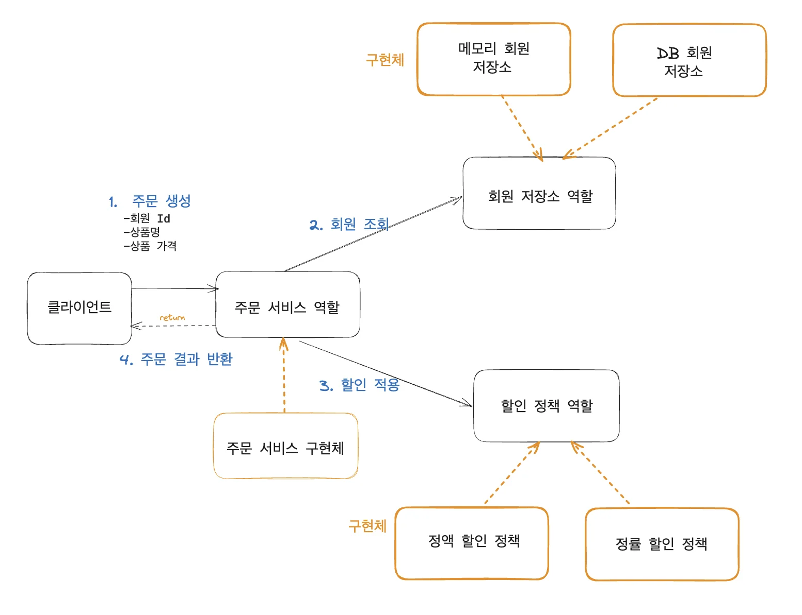
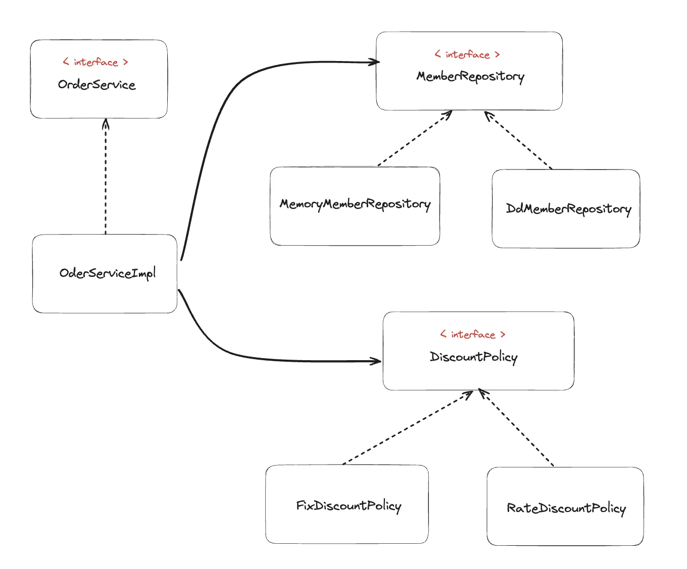
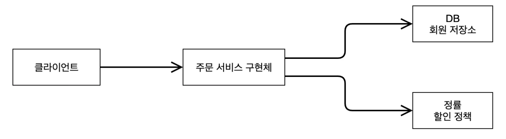
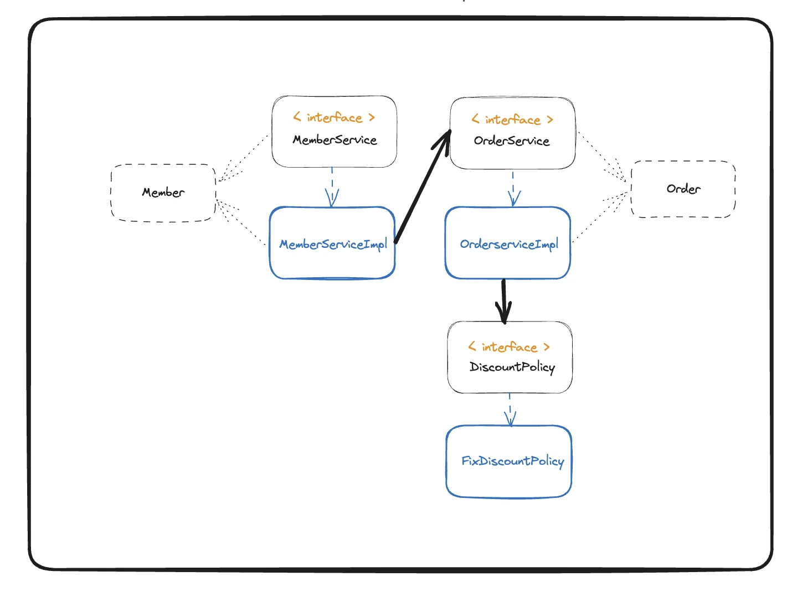
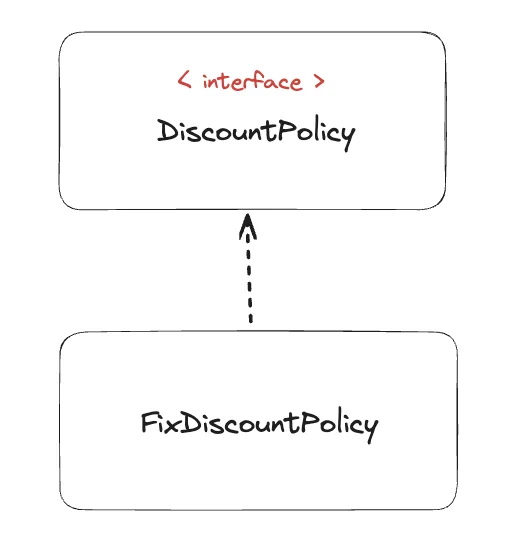

<a id="1c3eda9b0fe18157b964c3c1df477b5e"></a>

### sub&#45;items

[1. 객체 지향 설계, 스프링](#/post/1c3eda9b-0fe1-819c-8635-f03b9bfcf63a)

[1.1 - 스프링 탄생 역사](#/post/1c3eda9b-0fe1-819a-bae7-fb9a94223466)

[1.2  - 스프링이란?](#/post/1c3eda9b-0fe1-818a-835c-fec1a7e8bb97)

[1.3 - 좋은 객체지향 프로그램이란?](#/post/1c3eda9b-0fe1-8106-a21a-f1b7a1883901)

[1.4 - 객체 지향 설계 5 원칙(SOLID)](#/post/1c3eda9b-0fe1-8111-8e58-e6875a73e007)

[1.5 - 객체 지향 설계와 스프링](#/post/1c3eda9b-0fe1-8124-9e83-edaf39385cfb)

[2. 스프링 핵심 원리 이해1 - 예제 만들기](#/post/1c3eda9b-0fe1-8165-8232-d506473119c9)

[2.1 - 프로젝트 생성](#/post/1c3eda9b-0fe1-81f0-9ed2-f51b843ba81f)

[2.2 - 비지니스 요구사항 및  설계](#/post/1c3eda9b-0fe1-81c2-aaca-c6c9650c0d9c)

[2.3 - 회원 도메인 설계](#/post/1c3eda9b-0fe1-81f2-894c-f2651ac3e00c)

[2.4 - 회원 도메인 개발](#/post/1c3eda9b-0fe1-810a-93ba-ceed16e721d1)

[2.5 - 회원 도메인 실행 및  테스트](#/post/1c3eda9b-0fe1-817d-ab1c-f191e1ab7774)

[2.6 - 주문, 할인 도메인 설계](#/post/1c3eda9b-0fe1-81e3-bc11-c0c90b1998d1)

[2.7 - 주문, 할인 도메인 개발](#/post/1c3eda9b-0fe1-8192-b6a2-ec8f0f019481)

[2.8 - 주문, 할인 도메인 실행 및 테스트](#/post/1c3eda9b-0fe1-8169-9c13-c22d6b691594)

[3. 스프링 핵심 원리 이해2 - 객체 지향 원리 적용](#/post/1c3eda9b-0fe1-8178-bdb3-d5bce9411ee0)

[4. 스프링 컨테이너, 스프링 빈](#/post/1c3eda9b-0fe1-815d-9bd5-cc60b1067631)

[5. 싱글톤 컨테이너](#/post/1c3eda9b-0fe1-8123-a7d2-e204569f1845)

[6. 컴포넌트 스탠](#/post/1c3eda9b-0fe1-81a5-b7c3-e0f26b95978f)

[7. 의존관계 자동 주입](#/post/1c3eda9b-0fe1-8165-a640-df507fcd9529)

[8. 빈 생명주기 콜백](#/post/1c3eda9b-0fe1-81f3-83ed-ca61dd87fd15)

[9. 빈 스코프](#/post/1c3eda9b-0fe1-8101-9345-fa26878476f3)

[8.1 - 빈 생명주기 콜백](#/post/1c3eda9b-0fe1-819b-b068-cf95aab3513b)

[5.3 - 싱글톤 컨테이너](#/post/1c3eda9b-0fe1-81ca-bf28-f14bc7216667)

[6.4 - 중복 등록, 충돌](#/post/1c3eda9b-0fe1-815e-b61b-ec9f0431193e)

[7.8 - 조회한 빈이 모두 필요할 때, List, Map](#/post/1c3eda9b-0fe1-816a-9d73-c1fc84719e97)

[5.4  - 싱글톤 방식의 주의점](#/post/1c3eda9b-0fe1-819e-ab2c-f9edf06cb2e6)

[4.6 - BeanFactory와 ApplicationContext](#/post/1c3eda9b-0fe1-8128-94b6-c39471b3994e)

[6.1 - 컴포넌트 스캔과 의존관계 자동 주입](#/post/1c3eda9b-0fe1-8153-8975-dbd2e14d044e)

[5.1 - 웹 애플리케이션, 싱글톤](#/post/1c3eda9b-0fe1-8153-b20f-c9aad15c97f1)

[9.2 - 프로토타입 스코프](#/post/1c3eda9b-0fe1-8179-80d1-eef8d87f3b3e)

[4.4 - 스프링 빈 조회(동일한 타입이 둘 이상)](#/post/1c3eda9b-0fe1-81f5-be2e-c07fb8dc0b3f)

[7.2 - 옵션 처리](#/post/1c3eda9b-0fe1-8153-9a46-d17d70aa638d)

[3.9 - 스프링으로 전환하기](#/post/1c3eda9b-0fe1-8170-9126-ebbe815cb709)

[9.6 - request 스코프 예제 만들기](#/post/1c3eda9b-0fe1-8177-ba20-ea1ba2c222b6)

[5.6 - @Configuration, 바이트코드 조작](#/post/1c3eda9b-0fe1-819b-b57f-f4f2c35ff6b7)

[9.8 - 스코프와 프록시](#/post/1c3eda9b-0fe1-8115-88cf-caf9182dba03)

[9.5 - 웹 스코프](#/post/1c3eda9b-0fe1-8139-a47b-c343349393f6)

[6.2 - 탐색 위치와 기본 스캔 대상](#/post/1c3eda9b-0fe1-8154-b119-f47fcfadf593)

[3.5 - 새로운 구조와 할인 정책 적용](#/post/1c3eda9b-0fe1-8195-a0d8-f48980d81546)

[3.4 - AppConfig 리팩터링](#/post/1c3eda9b-0fe1-81bf-8074-d280983d9e9b)

[7.3 - 생성자 주입 선택해라!](#/post/1c3eda9b-0fe1-81d8-9f33-f3d9edbaeb91)

[4.7 - 다양한 설정 형식 지원(자바, XML)](#/post/1c3eda9b-0fe1-81be-a841-c526b88fa120)

[7.7 - 애노테이션 직접 만들기](#/post/1c3eda9b-0fe1-81e1-be67-fca94d0918d8)

[9.7 - 스코프와 Provider](#/post/1c3eda9b-0fe1-81e9-819d-f99961062639)

[4.8 - 스프링 빈 설정 메타 정보, BeanDefinition](#/post/1c3eda9b-0fe1-81f2-9846-de8315a321a0)

[7.9 - 자동, 수동의 올바른 실무 운영 기준](#/post/1c3eda9b-0fe1-81f3-9602-d4a33831b901)

[5.2 - 싱글톤 패턴](#/post/1c3eda9b-0fe1-8115-800e-d0d634dda9c9)

[3.1 - 새로운 할인 정책 개발](#/post/1c3eda9b-0fe1-816e-b662-d39b83cd0d81)

[3.7 좋은 객체 지향 설계의 5가지 원칙(SOLID)](#/post/1c3eda9b-0fe1-8172-a336-dd711857d017)

[4.1 - 스프링 컨테이너 생성](#/post/1c3eda9b-0fe1-81c0-9c0e-c6b23d10b649)

[3.8 - IoC, DI, 컨테이너](#/post/1c3eda9b-0fe1-8113-875c-da1894568c75)

[9.4 프로토타입 , 싱글톤  - Provider](#/post/1c3eda9b-0fe1-813d-ade3-f8678994b7b0)

[7.6 - @Autowired 필드 명, @Qualifier, @Primary](#/post/1c3eda9b-0fe1-815e-af6d-f3a8b26eb766)

[4.5 - 스프링 빈 조회(상속 관계)](#/post/1c3eda9b-0fe1-81a0-a4ed-ce069ee59fb3)

[4.2 - 컨테이너에 등록된 모든 빈 조회](#/post/1c3eda9b-0fe1-81c7-a9c7-fb6146f4b7dd)

[7.1 - 다양한 의존관계 주입 방법](#/post/1c3eda9b-0fe1-815a-b495-d41e57fe6a1d)

[5.5 - @Configuration, 싱글톤](#/post/1c3eda9b-0fe1-81c7-838f-e42958736b8b)

[7.5 - 조회 빈이 2개 이상 → Error](#/post/1c3eda9b-0fe1-81ca-83dc-c3327a378c9c)

[6.3 - 필터](#/post/1c3eda9b-0fe1-81cc-b115-d7206daf7226)

[3.2 - 새로운 할인 정책 적용과 문제점](#/post/1c3eda9b-0fe1-81d0-b3c0-dd1995d91fca)

[9.1 - 빈 스코프란?](#/post/1c3eda9b-0fe1-8149-b581-f57a5aa9eeac)

[8.3 - 빈 등록 초기화, 소멸 메서드 지정](#/post/1c3eda9b-0fe1-8167-8069-db2a9f35c681)

[3.3 - 관심사 분리](#/post/1c3eda9b-0fe1-818c-81c7-ef9e927f1359)

[4.3 - 스프링 빈 조회(기본)](#/post/1c3eda9b-0fe1-8193-911c-fec3eca48123)

[7.4 - 롬복과 최신 트랜드](#/post/1c3eda9b-0fe1-81a3-ab67-d3a675671d33)

[9.3 - 프로토타입 스코프, 싱글톤 빈 - 문제점](#/post/1c3eda9b-0fe1-81a8-92d2-fd8aa2528471)

[8.2 - 인터페이스 InitializingBean, DisposableBe](#/post/1c3eda9b-0fe1-81cd-b4c8-c667a00d07ef)

[8.4 - 애노테이션 @PostConstruct, @PreDestroy](#/post/1c3eda9b-0fe1-81b0-87cc-d5858cb2e8d7)

---

<a id="1c3eda9b0fe18195bc6af9f4cb6483ed"></a>

## &#91; 요구사항 &#93; 시나리오

<a id="1c3eda9b0fe18150af55cd91e368c392"></a>

### 회원 

> • 회원 가입, 조회<br>• 회원 등급(2)&#58; 일반, VIP<br>• 회원 데이터는 자체 DB를 구축할 수 있으며, 외부 시스템과 연동할 수 있다&#46;(미확정)

<a id="1c3eda9b0fe18170a372f2eaa1ae5ca4"></a>

### 주문 및 할인 정책

> • 회원 → 상품 주문 가<br>• 회원 등급에 따른 할인 정책 적용<br>• 할인 정책1 &#58; 모든 VIP는 1000원을 할인해주는 고정 금액 할인 적용됨(추후 변경 가능)<br>• 할인 정책은 변경 가능성 이 높다&#46; 회서의 기본 할인 정책을 아직 정하지 못했고, 오픈 직전까지 고민을 미루고 싶다&#46; 최악의 경우 할인을 적용하지 않을 수 있다&#46; (미확정)

<a id="1c3eda9b0fe181efa866f6adc2589eac"></a>

### 전체 클래스 다이어그램



<a id="1c3eda9b0fe181c7846dea51e4f15db2"></a>

# 회원 

<a id="1c3eda9b0fe181cab228e01dd945ebf7"></a>

## 회원 도메인 설계

<a id="1c3eda9b0fe181e7a900ca2029b1ff06"></a>

### 회원 도메인 요구사항

> • 회원을 가입하고 조회할 수 있다&#46;<br>• 회원은 &#91; 일반, VIP &#93;  두가지 등급이 있다&#46;<br>• 회원 데이터는 자체 DB를 구축할 수 있고, 외부 시스템과 연동할 수 있다&#46;(미확정)

<a id="1c3eda9b0fe181bb8b88f28a411bc48e"></a>

### 1&#46; 도메인 협력 관계도


<a id="1c3eda9b0fe181958736e7354b419fb8"></a>

기획자들도 볼수 있는 관계도, 이 그림을 바탕으로 클래스를 구체화함(클래스 다이어그램)

<a id="1c3eda9b0fe181eda498f45ab4fb121f"></a>

### 2&#46; 클래스 다이어그램


<a id="1c3eda9b0fe18170902bc3a468307ade"></a>

도메인 협력 관계를 바탕으로 개발자가 구체화해서 클래스 다이어그램을 만든다&#46; 

> 클래스 다이어그램은 실제 서버를 실행하지 않고 클래스들만 분석해서 볼 수 있는 그림이다&#46; 

<a id="1c3eda9b0fe181138844c9a3a99c8f16"></a>

### 3&#46; 객체 다이어그램

<a id="1c3eda9b0fe18185a515dec7f13ad2fd"></a>

데이터를 <code>memory</code>에 넣을 지 <code>DB</code>에 넣을 지는 서버가 실행되고 동적으로 결정된다&#46; 

> 서버가 실행되고, <code>MemoryMemberReporitory</code> ( or <code>DbMemberRepository</code> )가 new 키워드로 인스턴스가 생성되고 데이터가 들어와 <code>memory</code> (or <code>DB</code>)에 저장된다&#46;

<a id="1c3eda9b0fe181a383ebdad8aab9db8c"></a>

이때,  클라이언트가 실제로 사용하는 인스턴스(객체) 다이어그램이다&#46;

> 메모리 사용 시 →MemoryMemberRepository<br>DB 사용 시 → DbMemberRepository


<a id="1c3eda9b0fe1818ca25be484956fed98"></a>

## 회원 도메인 개발



<a id="1c3eda9b0fe181dbb590fdf5c8b078da"></a>

### 회원 엔티티


<details>
<summary><strong>회원 등급(Grade)</strong></summary>

<details>
<summary><strong>🧐 </strong><strong><a href="https://www.inflearn.com/questions/823977"><code>enum</code></a></strong><strong><a href="https://www.inflearn.com/questions/823977"> 이란? </a></strong></summary>

<a id="1c3eda9b0fe1816d9d7bd13e8eafb9f4"></a>

데이터 중 몇가지<strong><u> 한정된 값을 갖는 데이터 집합</u></strong>을 표시하는 자료형,  <code>Enum</code>(열거 타입)

> • 계절&#58; 봄, 여름, 가을, 겨울 <br>• 요일&#58; 월, 화, 수, 목, 금, 토, 일

<a id="1c3eda9b0fe18176acbbfa5e4e9cde23"></a>

<br><code>Enum</code>을 사용하면, 지정된 값만 들어올 수 있기 때문에, 오류 발생 확률이 줄고, 가독성이 좋은 코드를 작성할 수있다&#46; 

<a id="1c3eda9b0fe181fba837f2444debb8c5"></a>

```java
if (member.getGrade() == Grade.VIP) {...}
```

</details>

<a id="1c3eda9b0fe181bf9181e34f59c90745"></a>

```java
package hello.core.member;

public enum Grade {
    BASIC,
    VIP
}
```

</details>

<details>
<summary><strong>회원 엔티티(member)</strong></summary>

<a id="1c3eda9b0fe181ac9e15d1b3cf1c9727"></a>

```java
package hello.core.member;

public class Member {
    private Long id;
    private String name;
    private Grade grade;

    public Member (Long id, String name, Grade  grage) {
        this.id = id;
        this.name = name;
        this.grade = grage;
    }

    public Long getId() {
        return id;
    }

    public void setId(Long id) {
        this.id = id;
    }

    public String getName() {
        return name;
    }

    public void setName(String name) {
        this.name = name;
    }

    public Grade getGrade() {
        return grade;
    }

    public void setGrade(Grade grade) {
        this.grade = grade;
    }


}
```

</details>

<a id="1c3eda9b0fe181538fd9cc20526d117a"></a>

### 회원 서비스


<details>
<summary><strong>&#60;  interface &#62; </strong><strong>MemberService</strong></summary>

<a id="1c3eda9b0fe181d68918c1ad5bb0f33f"></a>

```java
package hello.core.service;

import hello.core.member.Member;

public interface MemberService {
    void join(Member member);
    Member findMember(Long memberId);
}
```

</details>

<details>
<summary><strong>MemberServiceImpl</strong></summary>

> 구현체가 하나인 경우, 관례상  구현체명을 &#91; <code>interface명</code>  &#43; <code>Impl</code> &#93; 으로 많이 씀

<a id="1c3eda9b0fe181fd84bbdaea68237582"></a>

```java
package hello.core.service;

import hello.core.member.Member;
import hello.core.repository.MemberRepository;
import hello.core.repository.MemoryMemberRepository;

public class MemberserviceImpl implements  MemberService{
    private final MemberRepository memberRepository = new MemoryMemberRepository();

    @Override
    public void join(Member member) {
        memberRepository.save(member);
    }

    @Override
    public Member findMember(Long memberId) {
        return memberRepository.findById(memberId);
    }
}
```

</details>

<a id="1c3eda9b0fe18109932ff29511ef1aff"></a>

### 회원 저장소


<details>
<summary><strong>&#60; interface &#62;</strong><strong> MemberRepository</strong></summary>

<a id="1c3eda9b0fe1816792adec5efce49813"></a>

```java
package hello.core.member;
 public interface MemberRepository {
     void save(Member member);
     Member findById(Long memberId);
}
```

</details>

<details>
<summary><strong>memoryMemberRepository</strong></summary>

<a id="1c3eda9b0fe181e3bd08e2f5ae78dd15"></a>

아직 데이터베이스가 확정되지 않은 경우, memory 형태로 간단하게 구현 하면서 개발 진행 (<code>테스트용</code> 으로만 사용)

> 동시성 이슈가 발생할 수 있어, 실무에서는 <code>ConcurrentHashMap</code>을 사용 해야함
> 
> <details>
> <summary><strong>🧐 </strong><strong><code>ConcurrentHashMap</code></strong><strong> 이란?</strong></summary>
> 
> <a id="1c3eda9b0fe1812dbbcaec6e0a9315cb"></a>
> 
> <a href="https://devlog-wjdrbs96.tistory.com/269">https&#58;//devlog&#45;wjdrbs96&#46;tistory&#46;com/269</a>
> 
> </details>

<a id="1c3eda9b0fe181b29cbdc31630294b90"></a>

```java
package hello.core.member;
 import java.util.HashMap;
 import java.util.Map;
 public class MemoryMemberRepository implements MemberRepository {
     private static Map<Long, Member> store = new HashMap<>();    // 예제 -> 간단하게 HashMap으로 구현
     @Override
     public void save(Member member) {
         store.put(member.getId(), member);
     }
     @Override
     public Member findById(Long memberId) {
         return store.get(memberId);
     }
}
```

</details>

<a id="1c3eda9b0fe1818585c0c4a87de7341e"></a>

### 회원 도메인 테스트

<a id="1c3eda9b0fe181a89fa1fb102941be11"></a>

```java
package hello.core.member;

import hello.core.service.MemberService;
import hello.core.service.MemberserviceImpl;
import org.junit.jupiter.api.Assertions.*;
import org.junit.jupiter.api.Test;

public class MemberServiceTest {
    MemberService memberService = new MemberserviceImpl();

    @Test
    void join() {
        //given
        Member member = new Member(1L, "memberA", Grade.VIP);

        //when
        memberService.join(member);
        Member findMember = memberService.findMember(1L);

        //then
        Assertions.assertThat(member).isEqualTo(findMember);
    }
}
```

<a id="1c3eda9b0fe181c7940fd5a198a83273"></a>

# 주문

<a id="1c3eda9b0fe181b99236f61dfc3848eb"></a>

## <u>주문 할인</u> 도메인 설계

<a id="1c3eda9b0fe1812baf64fdfe4edfb916"></a>

### <u>주문 할인</u> 정책

> <strong>• 회원은 상품을 주문할 수 있다&#46;<br>• 회원 등급에 따라 할인 정책을 적용할 수 있다&#46;<br>• 모든 VIP는 1000원을 할인해주는 고정 금액 할인을 적용한다&#46; (추후 수정될 수 있음)</strong>

<a id="1c3eda9b0fe181c38083e061e618a2d5"></a>

할인 정책은 변경 가능성이 높다&#46;<br>→ 기본 할인 정책이 아직 정해지지 못했고, 오픈 직전까지 고민을 미루고 싶다&#46; 최악의경우 할인을 적용하지 않을 수 있다&#46; (미확정)

<a id="1c3eda9b0fe1818e95aad8a23c9d7c4e"></a>

### <u>주문 할인</u> 도메인 관계도

<a id="1c3eda9b0fe1812da63eebedf6ec5966"></a>

● <strong>주문 도메인 역할</strong>


> /icons/report_gray.svg 실제로는 <strong>주문 데이터를 DB에 저장</strong>하지만, 예제가 너무 복잡해질 수 있어 <strong>생략</strong><br>→ <u>단순 주문 결과만 반환</u>

> <strong>1&#46;</strong> <strong>주문 생성&#58;</strong> 클라이언트 → 주문 서비스에서 주문 생성 요청<br><strong>2&#46; 회원 조회</strong>&#58; 할인을 위한 회원 등급 확인 필요함, 그래서 주문 서비스는 회원 저장소에서 회원을 조회<br><strong>3&#46; 할인 적용</strong>&#58; 주문 서비스는 회원 등급에 따른 할인 여부를 할인 정책에 위임함<br><strong>4&#46; 주문 결과 반환</strong>&#58; 주문 서비스는 할인 결과를 포함한 주문 결과 반환

<a id="1c3eda9b0fe1819f850ffbc52e850a51"></a>

<strong>● 주문 도메인 역할, 구현</strong>



> <strong>역할(인터페이스)과 구현 분리</strong> &#91;<code>다형성</code>&#93;

<a id="1c3eda9b0fe181378930de76732cb76f"></a>

역할과 구현을 분리했기 때문에 자유롭게 구현 객체를 조립할 수 있게 설계

<a id="1c3eda9b0fe1814ea5a9d2a040cec567"></a>

따라서, <strong><u>세부 정책 내용이 변경</u></strong><strong>되어도 </strong><strong><u>유연하게 변경  및 확장 </u></strong><strong>가능</strong>

<a id="1c3eda9b0fe181418dbacc55399cd9a9"></a>

### <u>주문 할인</u> 할인 도메인 클래스 다이어그램



> 실제 객체  레벨 구현도

<a id="1c3eda9b0fe18110a3f0fe77be3c3a27"></a>

### <u>주문 할인</u> 도메인 객체 다이어 그램

<a id="1c3eda9b0fe181008563d79b5af427b8"></a>

실제 application을 띄워서, 동적으로 객체들이 생성(new)될때, 형성되는 객체들의 연관관계도

> <strong>저장소</strong>&#91; <code>메모리</code> → <code>DB</code> &#93;, <strong>할인정책</strong><strong>(</strong><strong><code>일정금액</code></strong><strong> → </strong><strong><code>%</code></strong><strong>) </strong>이 변경되어도<u> </u><strong><u>협력 관계 그대로 재사용 가능</u></strong>

<details>
<summary><strong>1) 객체 다이어그램(메모리 구현체)</strong></summary>

> 초기 개발 시, 아직 DB가 정해지지 않음 → 메모리(hashMap) 으로 구현


</details>

<details>
<summary><strong>2) 객체 다이어그램(DB)</strong></summary>



</details>

<a id="1c3eda9b0fe181fe997ccf4e1ff61e25"></a>

## <u>주문 할인</u> 도메인 개발



<a id="1c3eda9b0fe1816eadf8c7fdc4d84d21"></a>

### 주문 도메인 개발


<details>
<summary><strong>Order</strong></summary>

<a id="1c3eda9b0fe1812b8e9ce15da52afef8"></a>

```java
package hello.core.order;

public class Order {
    private Long memberId;
    private String itemName;
    private int itemPrice;
    private int discountPrice;

    public Order(Long memberId, String itemName, int itemPrice, int discountPrice) {
        this.memberId = memberId;
        this.itemName = itemName;
        this.itemPrice = itemPrice;
        this.discountPrice = discountPrice;
    }

    public int calculatePrice(){
        return itemPrice - discountPrice;
    }

    public Long getMemberId() {
        return memberId;
    }

    public void setMemberId(Long memberId) {
        this.memberId = memberId;
    }

    public String getItemName() {
        return itemName;
    }

    public void setItemName(String itemName) {
        this.itemName = itemName;
    }

    public int getItemPrice() {
        return itemPrice;
    }

    public void setItemPrice(int itemPrice) {
        this.itemPrice = itemPrice;
    }

    public int getDiscountPrice() {
        return discountPrice;
    }

    public void setDiscountPrice(int discountPrice) {
        this.discountPrice = discountPrice;
    }

    @Override
    public String toString() {
        return "Order{" +
                "memberId=" + memberId +
                ", itemName='" + itemName + '\'' +
                ", itemPrice=" + itemPrice +
                ", discountPrice=" + discountPrice +
                '}';
    }
}
```

</details>

<details>
<summary><strong>&#60; interface &#62;</strong><strong> OrderService </strong></summary>

<a id="1c3eda9b0fe1816e9a5ffc14e56e4224"></a>

```java
package hello.core.order;

public interface OderService {
    Order createOrder(Long memberId, String itemName, int itemPrice);
}
```

</details>

<details>
<summary><strong>OrderServiceImpl</strong></summary>

<a id="1c3eda9b0fe181468278c33e898156b4"></a>

```java
package hello.core.order;

import hello.core.discount.DiscountPolicy;
import hello.core.discount.FixDiscountPolicy;
import hello.core.member.Member;
import hello.core.repository.MemberRepository;
import hello.core.repository.MemoryMemberRepository;

public class OderServiceImpl implements OderService {
    MemberRepository memberRepository = new MemoryMemberRepository();
    DiscountPolicy discountPolicy = new FixDiscountPolicy();

    @Override
    public Order createOrder(Long memberId, String itemName, int itemPrice) {
        Member member = memberRepository.findById(memberId);

				// 등급(memberGrade)만 넘길지, member 전체를 넘길지는 알아서 선택
        int discountPrice = discountPolicy.discount(member, itemPrice);  // 할인 정책이 적용된 값
        return new Order(memberId, itemName, itemPrice, discountPrice);
    }
}
```

</details>

<a id="1c3eda9b0fe181c482fadd5ae9110fe7"></a>

### 할인 도메인 개발



<details>
<summary><strong>&#60; interface &#62; </strong><strong>DiscountPolicy</strong></summary>

<a id="1c3eda9b0fe1815eb836f69c8e38f201"></a>

```java
package hello.core.discount;

import hello.core.member.Member;

public interface DiscountPolicy {

    /**
     * @return 할인 대상 금액
     */
    int discount(Member member, int price);
}
```

</details>

<details>
<summary><strong>FixDiscountPolicy</strong></summary>

<a id="1c3eda9b0fe1810fad89f634056f3993"></a>

```java
package hello.core.discount;

import hello.core.member.Grade;
import hello.core.member.Member;

public class FixDiscountPolicy implements DiscountPolicy{
    private int discountFixAmount = 1000; // 1000원 할인
    @Override
    public int discount(Member member, int price) {
        if (member.getGrade() == Grade.VIP) {
            return discountFixAmount;
        } else {
            return 0;
        }
    }
}
```

</details>

<a id="1c3eda9b0fe181efb02cfe47300fbea0"></a>

### <u>주문 할인 </u>도메인 테스트

<a id="1c3eda9b0fe181a3a9b6d8b6b8203a9b"></a>

```java
package hello.core.discount;

import hello.core.member.Grade;
import hello.core.member.Member;
import hello.core.member.service.MemberService;
import hello.core.member.service.MemberServiceImpl;
import hello.core.order.Order;
import hello.core.order.OrderService;
import hello.core.order.OrderServiceImpl;
import org.assertj.core.api.Assertions;
import org.junit.jupiter.api.DisplayName;
import org.junit.jupiter.api.Test;

import java.util.zip.Adler32;

class OrderServiceTest {
    MemberService memberService = new MemberServiceImpl();
    OrderService orderService = new OrderServiceImpl();

    @Test
    @DisplayName("VIP 회원은 1000원 할인 되어야 한다")
    void createOrder() {
        //given
        Long memberId = 1L;
        Member memberA = new Member(memberId, "memberA", Grade.VIP);
        memberService.join(memberA);

        //when
        Order order = orderService.createOrder(memberId, "itemA", 10000);
//        System.out.println("order = " + order);
        int isDiscountPrice = order.getItemPrice() - order.getDiscountPrice();

        //then
        Assertions.assertThat(isDiscountPrice).isEqualTo(order.calculatePrice());
    }

    @DisplayName("일반(BASIC) 회원은 정액 할인이 되지 않아야 한다")
    @Test
    void createOrder2() {
        // given
        Long memeberId = 2L;
        Member meberBASIC = new Member(memeberId, "meberBASIC", Grade.BASIC);
        memberService.join(meberBASIC);

        // when
        Order order = orderService.createOrder(memeberId, "itemB", 10000);
        int price = order.calculatePrice();

        // then
        Assertions.assertThat(price).isEqualTo(10000);
    }


}
```

<a id="1c3eda9b0fe18146a8eddda5a6491536"></a>

### Ch&#46;2 &#45; 설계 문제점


<a id="1c3eda9b0fe18104925aea838e0cf8ad"></a>

### ⇒ 의<strong>존관계가 인터페이스 뿐만 아니라 </strong><strong>구현까지 모두 의존</strong><strong>하는 문제점이 있음 (DIP, OCP 위반)</strong>

> Ch&#46;3 에서 해당 문제점 해결
