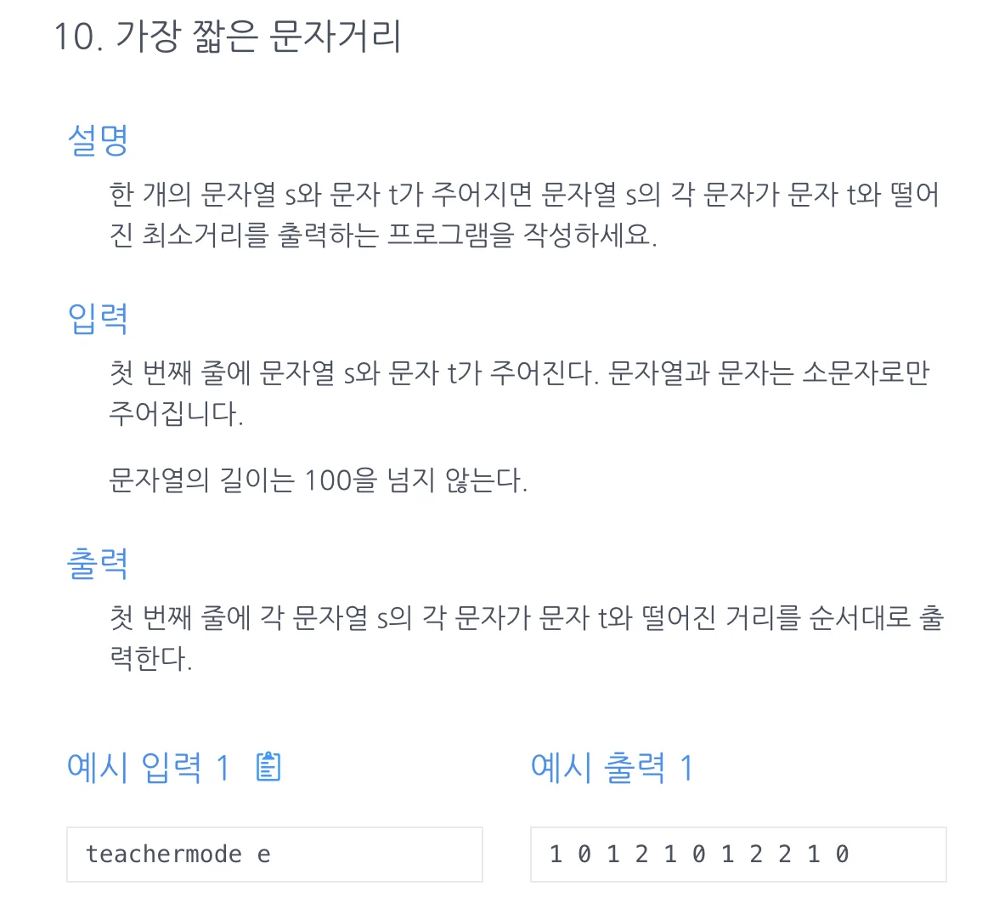

> &#43;) <a href="https://github.com/gyungsubLee/Python_Algorithm_interview/blob/main/Leetcode(%ED%8C%8C%EC%95%8C%EC%9D%B8)/02-%EB%B0%B0%EC%97%B4/42-trapping-rain-water/README.md">유사 문제 &#45; </a><strong><a href="https://github.com/gyungsubLee/Python_Algorithm_interview/blob/main/Leetcode(%ED%8C%8C%EC%95%8C%EC%9D%B8)/02-%EB%B0%B0%EC%97%B4/42-trapping-rain-water/README.md">Trapping Rain Water</a></strong>

<a id="1c3eda9b0fe18138b973e59396b759b1"></a>

## 문제)



<a id="1c3eda9b0fe181a9be33f4db9ae95411"></a>

예시 입력 1

<a id="1c3eda9b0fe181869086d295f1f4cabd"></a>

```plaintext
teachermode e
```

<a id="1c3eda9b0fe1817f935bd0148da7d639"></a>

예시 출력 1

<a id="1c3eda9b0fe1811dbd3ed8f14aca6a41"></a>

```plaintext
1 0 1 2 1 0 1 2 2 1 0
```

<a id="1c3eda9b0fe181718df9cea3308ddc53"></a>

## 풀이)

<a id="1c3eda9b0fe181629f47fea303f36074"></a>

### 1차 풀이) 강의 풀이

<a id="1c3eda9b0fe18177bb3ee034b836d053"></a>

```java
import java.util.Scanner;

public class Main {
    public int[] solution(char[] sList, char t){
        int p = 1000, len = sList.length;
        int[] answer = new int[len];
        for(int i=0; i<len; i++){
            if (sList[i]==t){
                p=0;
                answer[i]=p;
            }
            else {
                p++;
                answer[i]=p;
            }
        }
        p = 1000;
        for(int j=len-1; j>=0; j--){
            if(sList[j]==t) p=0;
            else{
                p++;
                answer[j]=Math.min(p, answer[j]);
            }
        }
        return answer;
    }
    public static void main(String[] args){
        Main m = new Main();
        Scanner sc=new Scanner(System.in);
        String str = sc.next();
        char t = sc.next().charAt(0);
        for ( int x : m.solution(str.toCharArray(), t)){
            System.out.println(x + " ");
        }
    }
}
```

<a id="1c3eda9b0fe181cb9641c1589254ade9"></a>

### 실패한 풀이) <del>삽질… </del>경우의 수를 잘못 생각함&#46;

<a id="1c3eda9b0fe1811f9a7eee3c95335713"></a>

```java
import java.util.ArrayList;
import java.util.Scanner;

public class Main {
    public int[] solution(String s, char t){
        int len = s.length(), r=len-1, lp=1000, rp=1000;
        int[] answer = new int[len];
        for(int l=0; l<len; l++){
            if ( l< r){
                if (s.charAt(l)==t) {
                    lp=0;
                    answer[l]=lp;
                    l++;
                }
                if (s.charAt(r)==t) {
                    rp=0;
                    answer[r]=rp;
                    r--;
                }
                // left Pointer
                lp++;
                answer[l]=lp;
                // right Pointer
                rp++;
                answer[r]=rp;
                r--;
            }
            else {
                if (answer[l] != 0){
                    lp++;
                    answer[l] = Math.min(answer[l], lp);
                    answer[r] = Math.min(answer[r], rp);
                } else {
                    lp = 0;
                }
            }
        }
        return answer;
    }
    public static void main(String[] args) {
        Main m = new Main();
        Scanner sc = new Scanner(System.in);
        String str = sc.next();
        char t = sc.next().charAt(0);
        System.out.println(m.solution(str, t));
    }
}
```

> <strong>input</strong>&#58; teachermode e<br><strong>output</strong>&#58; &#91;<u>1001, 0, 1, 2, 3</u>, 0, 1, 2, 2, 1, 0&#93;

---

<a id="1c3eda9b0fe181159935ff1f463566d8"></a>

오류) <code>l&#62;r</code> 부터<strong> left 포인트</strong>의 경우만 이전 <strong>right 포인트</strong>의 값과 비교하여 바꿔줘야 한다고 생각함&#46;

<a id="1c3eda9b0fe1817da8b7f25d8166d9fc"></a>

 ⇒ <code>l&#62;r</code> 부터 <strong>right포인트</strong>도 이전 <strong>left 포인트</strong>의 값과 비교해서 최솟값으로 바꿔줘야함&#46;  그렇다면 해당 굳이 &#91;<code>l&#60;r</code>, <code>l&#62;r</code>&#93; 구간을 나눠서 진행하는 것이 코드가 쓸데없이 복잡하고 더러움&#46;

<a id="1c3eda9b0fe181aead9fc0bbe23cfaa5"></a>

### 2차 풀이) 가장 깔끔한 듯?

<a id="1c3eda9b0fe1813dbceef5333994e737"></a>

```java
import java.util.Scanner;

public class Main {
    public int[] solution(char[] sList, char t){
        int p = 1000, len = sList.length;
        int[] answer = new int[len];
        for(int i=0; i<len; i++){
            if (sList[i]==t){
                p=0;
                answer[i]=p;
            }
            else {
                p++;
                answer[i]=p;
            }
        }
        p = 1000;
        for(int j=len-1; j>=0; j--){
            if(sList[j]==t) p=0;
            else{
                p++;
                answer[j]=Math.min(p, answer[j]);
            }
        }
        return answer;
    }
    public static void main(String[] args){
        Main m = new Main();
        Scanner sc=new Scanner(System.in);
        String str = sc.next();
        char t = sc.next().charAt(0);
        for ( int x : m.solution(str.toCharArray(), t)){
            System.out.println(x + " ");
        }
    }
}
```

<a id="1c3eda9b0fe181c5a0ade60665cc0b24"></a>

### 3차 풀이) 

<a id="1c3eda9b0fe181e7be45f979a7a14a7d"></a>

```java
import java.util.Scanner;

public class Main {
    public int[] solution(String s, char t) {
        int len = s.length();
        int[] answer = new int[len];
        int  p = 1000;
        for(int i=0; i<len; i++) {
            if(s.charAt(i)==t) p=0;
            else {
                p++;
                answer[i]=p;
            }
        }

        p = 1000;
        for(int i=len-1; i>=0; i--) {
            if(s.charAt(i)==t) p=0;
            else {
                p++;
                answer[i]=Math.min(answer[i], p);
            }
        }

        return answer;
    }
    public static void main(String[] args){
        Main m = new Main();
        Scanner sc = new Scanner(System.in);
        String s = sc.next();
        char t = sc.next().charAt(0);
        for (int x : m.solution(s, t)) System.out.print(x+" ");
    }
};
```
