<a id="1c3eda9b0fe181078a6df4d9624e869f"></a>

## <u>엔티티 상속</u>관계 매핑

<details>
<summary><strong>관계형 DB 설계 시</strong></summary>

>  <strong><u>논리 모델</u></strong>을 <strong>실제 </strong><strong><u>물리 모델</u></strong>로 <strong>구현</strong>한다&#46; 

- 논리모델
    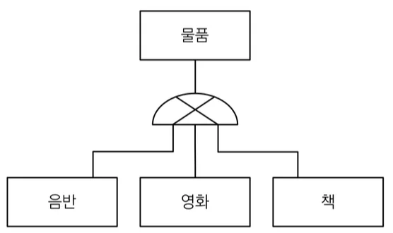

- 물리모델
    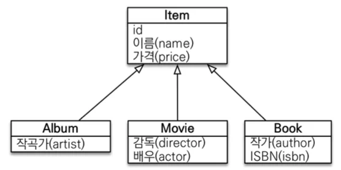

</details>

<details>
<summary>🧐상속 시, id 값 작성안해도 되나?</summary>

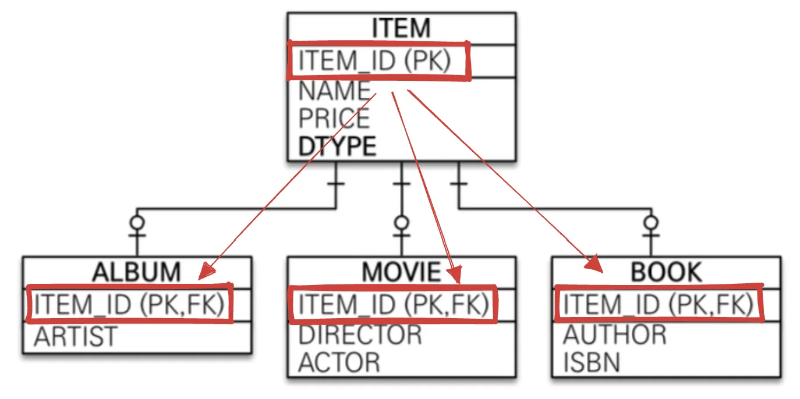

> 상속&#58; 부모의 값을 참조하여 적용<br> → 아래와 같이 작성하지 않아도 PK 지정됨

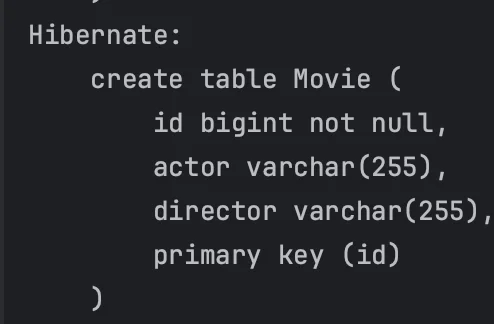

<details>
<summary>Item</summary>

<a id="1c3eda9b0fe181548e9bc0d68d1ceb09"></a>

```java
@Entity
@Inheritance(strategy = InheritanceType.JOINED)
public class Item {
    @Id
    @GeneratedValue
    private Long id;
    private String name;
    private int price;
}
```

</details>

<details>
<summary>Movie</summary>

<a id="1c3eda9b0fe18186b04ac5691963906f"></a>

```java
@Entity
public class Movie extends Item {
    private String director;
    private String actor;
}
```

</details>

</details>

<details>
<summary><strong><u>🧐 관계형 데이터베이스</u></strong><strong>에는 객체지향 언어의 </strong><strong>상속</strong><strong>이  </strong><strong><u>존재하지 않</u></strong><strong>는다&#46; 어떻게</strong><strong><u> 엔티티 객체 간의 상속 관계</u></strong><strong>를 </strong><strong><u>DB 매핑</u></strong><strong>하는가?</strong></summary>

<a id="1c3eda9b0fe181ee8252fa5371590ce3"></a>

데이터베이스에서의 상속과 유사한 &#91; <strong>슈퍼타입, 서브타입 &#93; </strong>모델링 기법이 있다&#46;

<a id="1c3eda9b0fe18184ad86e99fb322de80"></a>

따라서 <strong>ORM</strong>에서 이야기하는 <strong>상속 관계 매핑</strong>은 <strong><u>객체의 상속 구조</u></strong>와 <strong><u>DB의 슈퍼타입, 서브타입 관계</u></strong>를 <strong>매핑</strong>하는 것을 말한다&#46; 

<a id="1c3eda9b0fe1810096fcdfbfb56e4da5"></a>

슈퍼타입, 서브타입의 논리 모델을 <strong>실제 물리 모델로 구현</strong>하는 경우 아래와 같이 3가지의 전략 방법으로 구현한다&#46; 

| 전략 | 내용 |
| --- | --- |
| <code>조인 전략</code> | • 각각의 엔티티를  테이블로 변환<br>• 각각을 모두 테이블로 만들고 조회할 때 조인을 사용한다&#46;  |
| <code>단일 테이블 전략</code> | • 통합 테이블로 변환<br>• 단 하나 테이블을 사용해서 상속관계를 통합한다&#46;  |
| <code>서브 타입 테이블 전략</code> | • 서브타입 테이블로 변환<br>• 서브 타입마다 하나의 테이블로 만든다 ( Entity&#45;per&#45;table 전략 ) |

</details>

> 📌 <strong>주요 Anotation</strong>
> 
> <details>
> <summary><code>&#64;</code><strong><code>Inheritance(strategy=InheritanceType&#46;</code></strong><strong><code>XXX</code></strong><strong><code>)</code></strong></summary>
> 
> -  <strong>JOINED</strong>
> 
> - <strong>SINGLE&#95;TABLE ( 기본값)</strong>
> 
> - <strong>TABLE&#95;PER&#95;CLASS</strong>
> 
> <details>
> <summary>🧐 <code>default</code>&#58; <strong>SINGEL&#95;TABLE</strong></summary>
> 
> <a id="1c3eda9b0fe181f1ad07cbece523743b"></a>
> 
> ```java
> @Target({ElementType.TYPE})
> @Retention(RetentionPolicy.RUNTIME)
> public @interface Inheritance {
>     InheritanceType strategy() default InheritanceType.SINGLE_TABLE;
> }
> ```
> 
> </details>
> 
> <details>
> <summary><strong>🧐 InheritanceType</strong></summary>
> 
> <a id="1c3eda9b0fe1816dbd78d62cc182e1b0"></a>
> 
> ```java
> package jakarta.persistence;
> 
> public enum InheritanceType {
>     SINGLE_TABLE,         // 단일 테이블
>     TABLE_PER_CLASS,      // 서브타입 테이블
>     JOINED;               // 조인
> 
>     private InheritanceType() {
>     }
> }
> ```
> 
> </details>
> 
> </details>
> 
> <details>
> <summary><strong><code>&#64;DiscriminatorColumn(name=&#34;DTYPE&#34;)</code></strong></summary>
> 
> - <strong><u>단일 테블 전략</u></strong>에서 <strong><u>엔티티들을 구분</u></strong>하기 위해 붙이는 <strong>구분자 컬럼</strong>
>     - 관례로 ‘DTYPE’ 을 보통 많이 사용
> 
> </details>
> 
> <details>
> <summary><strong><code>&#64;DiscriminatorValue(”XXX”)</code></strong></summary>
> 
> - 하위 Entity들의 구분 값을 명시 <br>
> 
> </details>
> 
> <details>
> <summary><strong>ex) 단일테이블 전략</strong></summary>
> 
> > 📌 핵심 Anotaions
> > 
> > - <code>&#64;Inheritance(strategy = InheritanceType&#46;SINGLE&#95;TABLE)</code>&#58; 단일 테이블 상속 전략 사용
> > 
> > - <code>&#64;DiscriminatorColumn(name = &#34;VEHICLE&#95;TYPE&#34;)</code>&#58; <code>VEHICLE&#95;TYPE</code>이라는 이름의 구분자 컬럼을 정의
> > 
> > - <code>&#64;DiscriminatorValue(&#34;CAR&#34;)</code>&#58; Car 클래스의 구분자 값을 <code>CAR</code>로 지정
> > 
> > - <code>&#64;DiscriminatorValue(&#34;BIKE&#34;)</code>&#58; Bike 클래스의 구분자 값을 <code>BIKE</code> 지정
> 
> <details>
> <summary><code>Entity</code>&#58; Vehicle</summary>
> 
> <a id="1c3eda9b0fe1815b9ce6cd4e5ddd8f36"></a>
> 
> ```java
> import javax.persistence.*;
> 
> @Entity
> @Inheritance(strategy = InheritanceType.SINGLE_TABLE)
> @DiscriminatorColumn(name = "VEHICLE_TYPE")
> public abstract class Vehicle {
>     @Id
>     @GeneratedValue(strategy = GenerationType.IDENTITY)
>     private Long id;
> 
>     private String name;
> 
>     // Getters and setters
> }
> ```
> 
> </details>
> 
> <details>
> <summary><code>하위 Entity</code>&#58; Car</summary>
> 
> <a id="1c3eda9b0fe18199b617c93064d8b5cc"></a>
> 
> ```java
> import javax.persistence.DiscriminatorValue;
> import javax.persistence.Entity;
> 
> @Entity
> @DiscriminatorValue("CAR")
> public class Car extends Vehicle {
>     private int numberOfDoors;
> 
>     // Getters and setters
> }
> ```
> 
> </details>
> 
> <details>
> <summary><code>하위 Entity</code>&#58; Bike</summary>
> 
> <a id="1c3eda9b0fe1814c9d8cfc327f7aa905"></a>
> 
> ```java
> import javax.persistence.DiscriminatorValue;
> import javax.persistence.Entity;
> 
> @Entity
> @DiscriminatorValue("BIKE")
> public class Bike extends Vehicle {
>     private boolean hasCarrier;
> 
>     // Getters and setters
> }
> ```
> 
> </details>
> 
> <details>
> <summary>쿼리 </summary>
> 
> <a id="1c3eda9b0fe18158af5ff4fcb507fea1"></a>
> 
> ```java
> Hibernate: 
> 		create table vehicle (
> 		    has_carrier bit,
> 		    number_of_doors integer,
> 		    id bigint not null auto_increment,
> 		    vehicle_type varchar(31) not null,
> 		    name varchar(255),
> 		    primary key (id)
> 		) engine=InnoDB
> ```
> 
> </details>
> 
> <details>
> <summary>생성 테이블 예시 </summary>
> 
> | <strong>ID</strong> | <strong>NAME</strong> | <strong>VEHICLE&#95;TYPE</strong> | <strong>NUMBEROFDOORS</strong> | <strong>HASCARRIER</strong> |
> | --- | --- | --- | --- | --- |
> | 1 | Civic | CAR | 4 | NULL |
> | 2 | BMX | BIKE | NULL | true |
> 
> </details>
> 
> </details>

<a id="1c3eda9b0fe181ee8a2af2dfbe957d68"></a>

### 1) 조인 전략

> 각 엔티티를 모두 테이블로 만들고 데이터 삽입, 조회 시 조인(<code>join</code>)을 사용하여 가져온다&#46;<br>→ 데이터 INSERT 시, 각각 만들어진 테이블에 값이 들어간다&#46;<br>→ SELECT 시, PK, FK 값이 동일하기 때문에 join 해서 가져온다&#46;

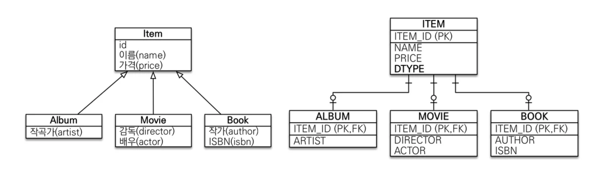

| <strong>장점</strong> | <strong>단점</strong> |
| --- | --- |
| •  테이블 정규화<br>•  외래 키 참조 무결성 제약조건 활용가능<br>•  저장공간 효율화 | •  조회 시 조인을 많이 사용, 성능 저하<br>•  조회 쿼리가 복잡함<br>•  데이터 저장 시 INSERT SQL 2번 호출 |

<details>
<summary><strong>값 INSERT 시, 아래와 같이 각 테이블에 값을 저장함</strong></summary>

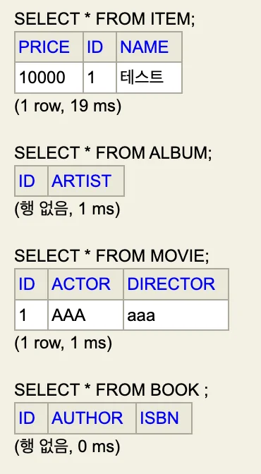

</details>

<details>
<summary><strong>조회 시, join해서 가져옴</strong></summary>

<a id="1c3eda9b0fe1816d8867dc80f4664ab6"></a>

```sql
Hibernate: 
    select
        m1_0.id,
        m1_1.name,
        m1_1.price,
        m1_0.actor,
        m1_0.director 
    from
        Movie m1_0 
    join
        Item m1_1 
            on m1_0.id=m1_1.id 
    where
        m1_0.id=?
movie1 = jpabook.jpashop.domain.Movie@2e590b
```

</details>

<details>
<summary><strong>구현 &#58; Item </strong><strong><code>&#64;Inheritance(strategy = InheritanceType</code></strong><code>&#46;</code><em><code>JOINED</code></em><code>)</code></summary>

<details>
<summary><strong>  </strong>jpashop</summary>

<details>
<summary>domain</summary>

<details>
<summary><strong>Item</strong></summary>

<a id="1c3eda9b0fe18127a069e946b2af87ad"></a>

```java
package jpabook.jpashop.domain;

import jakarta.persistence.*;

import java.util.ArrayList;
import java.util.List;

@Entity
@Inheritance(strategy = InheritanceType.JOINED)
public class Item {
    @Id
    @GeneratedValue
    private Long id;
    private String name;
    private int price;
    
    // getter
    // setter
}

```

</details>

<details>
<summary><strong>Album</strong></summary>

<a id="1c3eda9b0fe181f9a8d8fac3b005ea29"></a>

```java
package jpabook.jpashop.domain;

import jakarta.persistence.*;

@Entity
public class Album extends Item{
    private String artist;
		
		// getter
    // setter
}
```

</details>

<details>
<summary><strong>Moive</strong></summary>

<a id="1c3eda9b0fe181a1b05ce5c0b6af0e34"></a>

```java
package jpabook.jpashop.domain;

import jakarta.persistence.Entity;

@Entity
public class Movie extends Item {
    private String director;
    private String actor;
    
    // getter
    // setter
}
```

</details>

<details>
<summary><strong>Book</strong></summary>

<a id="1c3eda9b0fe18100b72ecc8dd420f27e"></a>

```java
package jpabook.jpashop.domain;

import jakarta.persistence.Column;
import jakarta.persistence.Entity;
import jakarta.persistence.GeneratedValue;
import jakarta.persistence.Id;

@Entity
public class Book extends Item{

    private String author;
    private String isbn;
    
    // getter
		// setter
}
```

</details>

</details>

<details>
<summary><strong>JpaMain</strong></summary>

<a id="1c3eda9b0fe181048a8dc05ac1c76f91"></a>

```java
Movie movie = new Movie();
movie.setDirector("aaa");
movie.setActor("AAA");
movie.setPrice(10000);
movie.setName("테스트");
em.persist(movie);

em.flush();
em.clear();

Movie movie1 = em.find(Movie.class, movie.getId());

System.out.println("movie1 = " + movie1);
```

</details>

</details>

</details>

<a id="1c3eda9b0fe181b39f3fca745ecbc618"></a>

### 2) 단일 테이블 전략

> 1개의 테이블로 모두 때려박는 방법<br>→ <strong>DTYPE</strong>으로 하위 엔티티들 구분

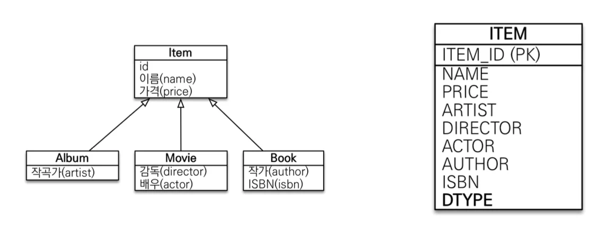

| 장점 | 단점 |
| --- | --- |
| •  조회 성능 빠름 ( 조인 x )<br>• 조회 쿼리 단순함 | • 자식 엔티티가 매핑한 컬럼은 모두 null 허용<br>• 단일 테이블에 모든것을 저장하므로 테이블 사이즈가 커질 수 있다&#46; 따라서 상황에 따라 오히려 성능이 느려질 수 있음 |

<details>
<summary>ex)하위 엔티티 구분</summary>

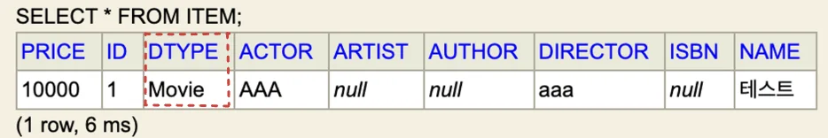

<details>
<summary><code>&#64;DiscriminatorColumn(name = &#34;DTYPE&#34;)</code></summary>

<a id="1c3eda9b0fe1816dbb7bf15476db5eba"></a>

```java
@DiscriminatorColumn(name = "DTYPE")
public abstract class Item {
```

</details>

<details>
<summary><code>&#64;DiscriminatorValue(&#34;Movie&#34;)</code></summary>

<a id="1c3eda9b0fe181ac8e16f081c93e42c6"></a>

```java
@DiscriminatorValue("Moive")
public class Movie extends Item {
```

</details>

</details>

<details>
<summary><strong>Item  &#45; </strong><code>&#64;</code><strong><code>Inheritance(strategy=InheritanceType&#46;</code></strong><em><code>SINGLE&#95;TABLE</code></em><strong><code>)</code></strong></summary>

<a id="1c3eda9b0fe1810fa42bde062ac396e6"></a>

```java
@Entity
@Inheritance   // 기본값: SINGLE_TABLE
public class Item {

     .   .   .
```

</details>

<details>
<summary><strong>쿼리</strong></summary>

<a id="1c3eda9b0fe181aab8c6c66cbbcb2e2a"></a>

```java
// 단일 테이블 생성
Hibernate: 
    create table Item (
        price integer not null,
        id bigint not null,
        DTYPE varchar(31) not null,
        actor varchar(255),
        artist varchar(255),
        author varchar(255),
        director varchar(255),
        isbn varchar(255),
        name varchar(255),
        primary key (id)
    )
    
    
    .  .  .
    
    
// 데이터 생성     
Hibernate: 
    select
        next value for Item_SEQ
Hibernate: 
    /* insert for
        jpabook.jpashop.domain.Movie */insert 
    into
        Item (name, price, actor, director, DTYPE, id) 
    values
        (?, ?, ?, ?, 'Movie', ?)
        
       
// 조회 ( Join X )        
Hibernate: 
    select
        m1_0.id,
        m1_0.name,
        m1_0.price,
        m1_0.actor,
        m1_0.director 
    from
        Item m1_0 
    where
        m1_0.DTYPE='Movie' 
        and m1_0.id=?

```

</details>

<a id="1c3eda9b0fe181e8a7c9fa0dc1b72d84"></a>

### 3) 서브타입 테이블 전략 ( 안씀 )

> 해당 전략은 데이터베이스 설계자, ORM 전문가 둘다 추천하지 않는 안 좋은 방법

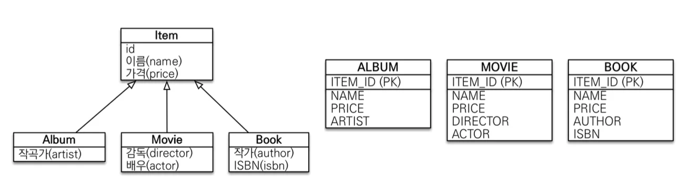

| 장점 | 단점 |
| --- | --- |
| • 서브 타입을 명확하게 구분해서 처리할 때 효과적<br>• not null 제약조건 사용 가능 | • 여러 자식 테이블을 함께 조회할 때 성능이 느림(UNION SQL 필요)<br>• 자식 테이블을 통합해서 쿼리하기 어려움 |

<details>
<summary><strong>Item  &#45; </strong><code>&#64;</code><strong><code>Inheritance(strategy=InheritanceType&#46;</code></strong><em><code>TABLE&#95;PER&#95;CLASS</code></em><strong><code>)</code></strong></summary>

<a id="1c3eda9b0fe1818282dfcc38ad7c6077"></a>

```java
@Entity
@Inheritance(strategy = InheritanceType.TABLE_PER_CLASS)
public class Item {

     .   .   .
```

</details>

<details>
<summary>테이블 생성</summary>

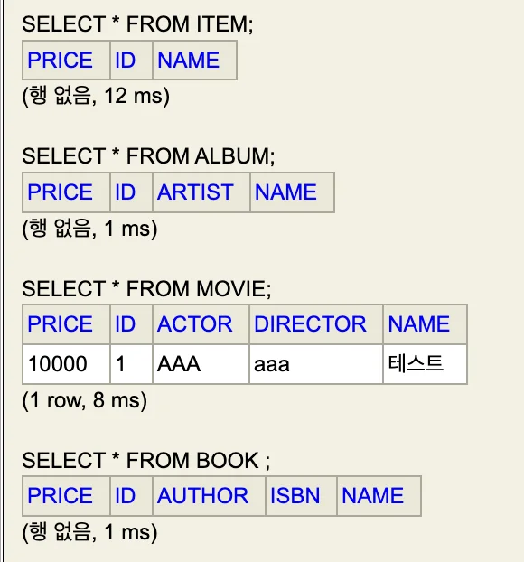

<a id="1c3eda9b0fe181c7a30aea39a82a8a11"></a>

```java
// 상속 관계를 갖는 각 테이블마다 모두 부모의 값을 가지고 생성됨
// DTYPE X
Hibernate: 
    create table Album (
        price integer not null,
        id bigint not null,
        artist varchar(255),
        name varchar(255),
        primary key (id)
    )
Hibernate: 
    create table Movie (
        price integer not null,
        id bigint not null,
        actor varchar(255),
        director varchar(255),
        name varchar(255),
        primary key (id)
    )
Hibernate: 
    create table Book (
        price integer not null,
        id bigint not null,
        author varchar(255),
        isbn varchar(255),
        name varchar(255),
        primary key (id)
    )

    
// 부모 클래스도 생성
Hibernate: 
create table Item (
    price integer not null,
    id bigint not null,
    name varchar(255),
    primary key (id)
)
```

</details>

<a id="1c3eda9b0fe1814c841dd60d2f3c8978"></a>

## <u>매핑 정보(속성) 상속</u>  &#45; <code>&#64;MappedSuperclass</code>

<details>
<summary>Case1) DB 완전히 다르나 객체의 공통 매핑 정보(<code>id</code>, <code>name</code>)만 상속 받아서 사용하고 싶은 경우</summary>

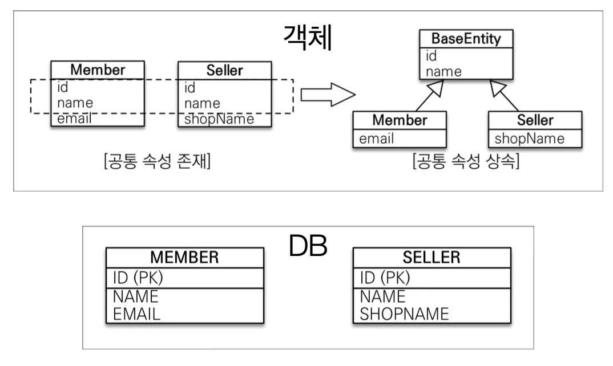

</details>

<details>
<summary>Case2) 공통된 필드(속성)들을 여러 곳에서 사용하려는 경우 → <strong>따로 추상클래스를 만들고 상속 처리 </strong></summary>

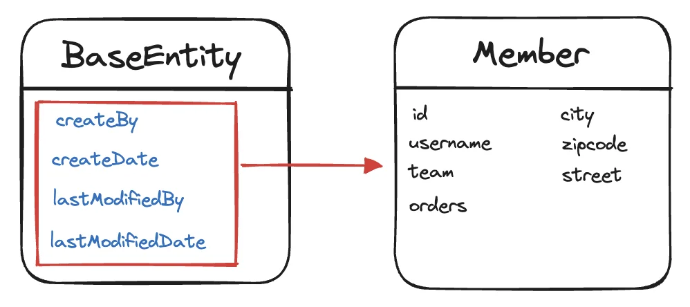

- 구현
    <details>
    <summary><strong>BaseEntity</strong></summary>

    <details>
    <summary>🧐 Getter, Setter 추가 시, 해당 내용도 상속 처리 되는가? </summary>


    </details>

    <a id="1c3eda9b0fe1814d8c15e8c64096c941"></a>

    ```java
    @MappedSuperclass
    public abstract class BaseEntity {   // 클래스, Entity X

        @Column(name ="INSERT_MEMBER")
        private String createdBy;
        private LocalDateTime createDate;

        @Column(name ="UPDATE_MEMBER")
        private String lastModifiedBy;
        private LocalDateTime lastModifiedDate;
       
       // getter, setter
       
    }

    ```

    </details>

    <details>
    <summary><strong>Member</strong></summary>

    <a id="1c3eda9b0fe181508c23d43d759bdde1"></a>

    ```java
    package jpabook.jpashop.domain;

    import jakarta.persistence.*;

    import java.util.ArrayList;
    import java.util.List;

    @Entity
    @Getter
    @Setter
    @NoArgConstrictor
    public class Member extends BaseEntity {

        @Id
        @GeneratedValue
        @Column(name = "MEMBER_ID")
        private Long id;

        @Column(name = "USERNAME")
        private String username;
        private String city;
        private String street;
        private String zipcode;

        @ManyToOne(fetch = FetchType.LAZY)
        @JoinColumn
        private Team team;

        @OneToMany(mappedBy = "member")
        private List<Order> orders = new ArrayList<>();

        // Constructor	
        public Member(String name, String city, String street, String zipcode) {
            this.name = name;
            this.city = city;
            this.street = street;
            this.zipcode = zipcode;
        }

        // 연관관계 편의 메서드
    //    public void addOder(Order order){
    //        order.setMember(this);
    //        this.getOrders().add(order);
    //    }
    }

    ```

    </details>

    <details>
    <summary><strong>JpaMain</strong></summary>

    > 🤔 해당 값들 나중에 다 <strong>자동화 가능</strong>
    > 
    > - 뒤에 배울 event 기능 활용
    > 
    > - Admin 에 현재 로그인 되어있는 세션 정보를 읽어와서 알아서 넣어줌

    <a id="1c3eda9b0fe18191a852f980ff9b5c8b"></a>

    ```java
    Member member = new Member();
    member.setName("user1");
    member.setCreatedBy("kim");
    member.setCreateDate(LocalDateTime.now());

    em.persist(member);

    tx.commit();
    ```

    </details>

    <details>
    <summary>SQL</summary>

    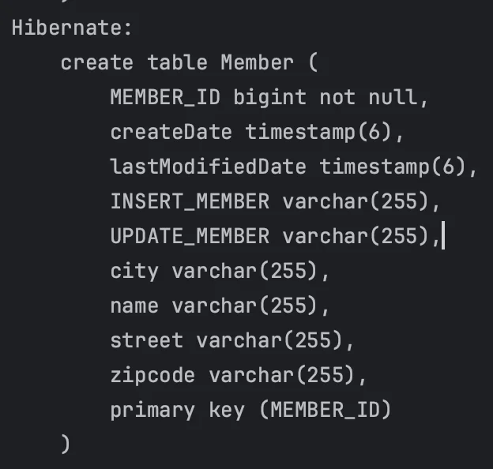

    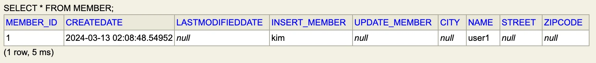

    </details>

</details>

> 📌 <strong>정리</strong>
> 
> - <u>엔티티 상속관계 매핑이 아니다&#46;</u> ( <strong><code>속성</code></strong><strong>만 상속 </strong>)
> 
> - entity가 아닌<strong><u> 클래스</u></strong>로 <strong><u>테이블과 매핑하지 않</u></strong>는다&#46; 
> 
> - 부모 클래스를 상속 받는 <strong><u>자식 클래스에 매핑 정보만 제공</u></strong>한다
> 
> - <strong><u>조회, 검색이 불가</u></strong>하다&#46;   ( <code>em&#46;find(BaseEntity)</code> ❌ )
> 
> - 직접 생성해서 사용할 일이 없다&#46; <strong><u>추상 클래스(abstract class)</u></strong>권장<br>⇒ <strong>나중에 다 자동화함</strong>

<details>
<summary>🧐 추상 클래스? interface, 일반 클래스와 차이점은?</summary>


</details>

<details>
<summary><strong>🧐 LocalDateTime&#46;메서드</strong></summary>


</details>

<a id="1c3eda9b0fe181f289fedd9a010d8b42"></a>

## 실전 예제 4 &#45; 상속관계 매핑

> 👉🏻 <strong>요구사항 추가</strong>
> 
> - 상품의 종류는 음반, 도서, 영화가 있고 이후 더 확장 가능하다&#46;
> 
> - 모든 데이터는 등록일과 수정일이 필수다&#46;

<a id="1c3eda9b0fe1813f9772fd71c2e218bd"></a>

### 도메인 모델

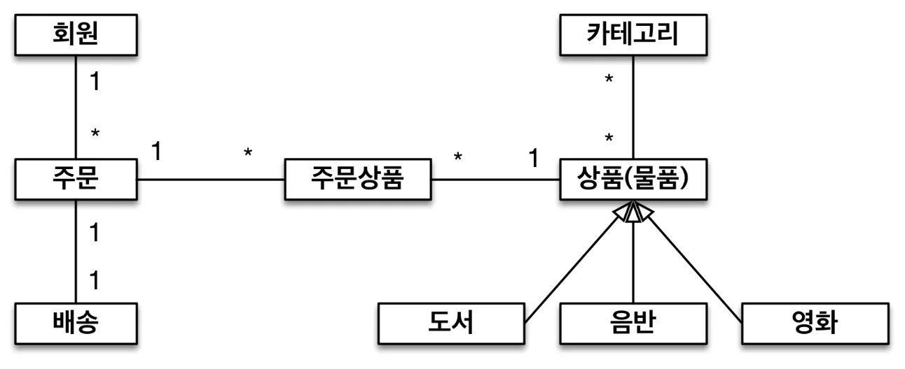

<a id="1c3eda9b0fe181eeb70deee061b93ae0"></a>

### 도메인 모델 상세

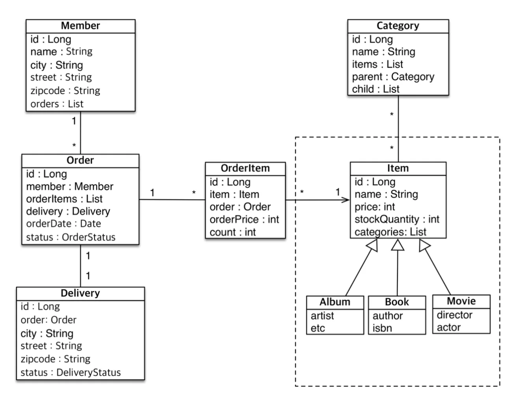

<a id="1c3eda9b0fe181d09d7dceae954d395e"></a>

### 테이블 설계

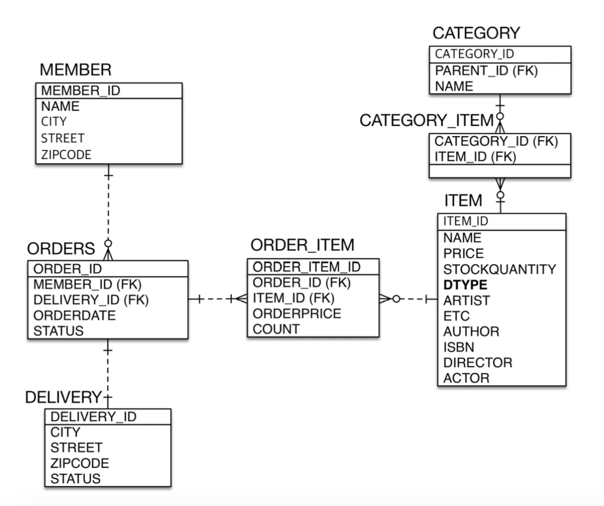

<a id="1c3eda9b0fe181ddab18e2351537f076"></a>

### 구현

<details>
<summary>jpabook&#46;jpashop</summary>

<details>
<summary>domain</summary>

<details>
<summary><strong>Item</strong></summary>

<a id="1c3eda9b0fe181e88f40cff942c0e30b"></a>

```java
@Entity
@Inheritance  // default: SINGLE_TABLE 
@DiscriminatorColumn
// Item 단독 테이블 생성 X -> abstract class ( 구현(테이블) X )
public abstract class Item extends BaseEntity {

		@Id
    @GeneratedValue
    private Long id;
    private String name;
    private int price;
    
   // getter, setter
} 
```

</details>

<details>
<summary><strong>Album</strong></summary>

<a id="1c3eda9b0fe18156a53ce18685badf5d"></a>

```java
@Entity
public class Album extends Item{
    private String artist;

    public String getArtist() {
        return artist;
    }

    public void setArtist(String artist) {
        this.artist = artist;
    }
}
```

</details>

<details>
<summary><strong>Book</strong></summary>

<a id="1c3eda9b0fe18119932cfc818da28df3"></a>

```java
@Entity
public class Book extends Item{

    private String author;
    private String isbn;

    public String getAuthor() {
        return author;
    }

    public void setAuthor(String author) {
        this.author = author;
    }

    public String getIsbn() {
        return isbn;
    }

    public void setIsbn(String isbn) {
        this.isbn = isbn;
    }
}
```

</details>

<details>
<summary><strong>Movie</strong></summary>

<a id="1c3eda9b0fe181a79a55ee4a2795d807"></a>

```java
@Entity
public class Movie extends Item {
    private String director;
    private String actor;

    public String getDirector() {
        return director;
    }

    public void setDirector(String director) {
        this.director = director;
    }

    public String getActor() {
        return actor;
    }

    public void setActor(String actor) {
        this.actor = actor;
    }
}

```

</details>

</details>

<details>
<summary><strong>JpaMain</strong></summary>

<a id="1c3eda9b0fe181158f54f689da3dd7e2"></a>

```java
Book book = new Book();
book.setName("창업가의 습관");
book.setAuthor("aaa");

em.persist(book);

tx.commit();
```

</details>

</details>

---

<details>
<summary><em><strong>SINGLE&#95;TABLE</strong></em>&#58; 단일 테이블(Item) 생성</summary>

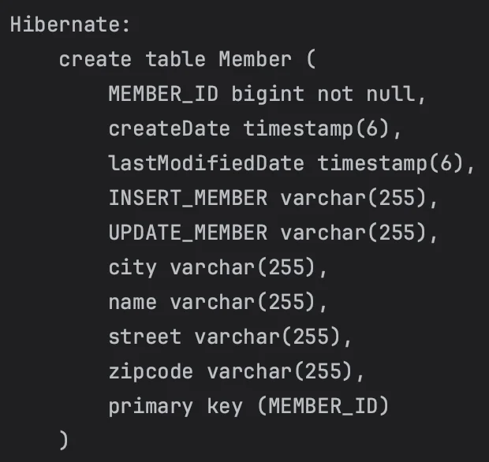

> h2 &#45; DB 조회 &#58; 잘 들어갔음

> 👉🏻 <strong>스프링, 스프링 데이터, JPA </strong>→ 자동으로 값 채워줌  ( 나중에 배움 )

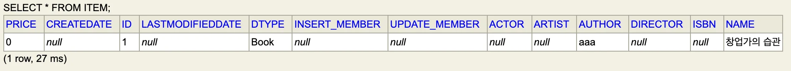

</details>

<details>
<summary><strong>JOINED&#58;  </strong>각 테이블 생성, 조회 시에만 <code>join</code></summary>

<details>
<summary><strong>Item</strong></summary>

<a id="1c3eda9b0fe18191be15d0bfccf1a758"></a>

```java
@Entity
@Inheritance(strategy = InheritanceType.JOINED)
@DiscriminatorColumn
public abstract class Item extends BaseEntity {

		@Id
    @GeneratedValue
    private Long id;
    private String name;
    private int price;

		// getter, setter
}
```

</details>

> 테이블 생성

<a id="1c3eda9b0fe181cca3b8d0be60a9c22c"></a>

```sql
Hibernate: 
    create table Item (
        price integer not null,
        createDate timestamp(6),
        id bigint not null,
        lastModifiedDate timestamp(6),
        DTYPE varchar(31) not null,
        INSERT_MEMBER varchar(255),
        UPDATE_MEMBER varchar(255),
        name varchar(255),
        primary key (id)
    )
    
Hibernate: 
    create table Album (
        id bigint not null,
        artist varchar(255),
        primary key (id)
    )
    
Hibernate: 
    create table Book (
        id bigint not null,
        author varchar(255),
        isbn varchar(255),
        primary key (id)
    )
    
Hibernate: 
    create table Movie (
        id bigint not null,
        actor varchar(255),
        director varchar(255),
        primary key (id)
    )
```

> DB 테이블 조회

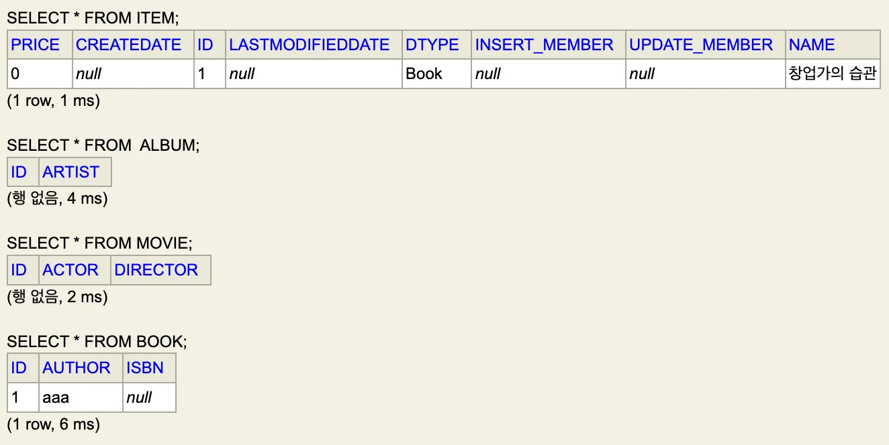

</details>

<details>
<summary>🧐 이중 상속 시, 값을 가져올 수 있나?  <strong>OK</strong></summary>

<a id="1c3eda9b0fe18191b531f54626baf03d"></a>

```java
// Item
@Entity
@Inheritance(strategy = InheritanceType.JOINED)
@DiscriminatorColumn
public abstract class Item extends BaseEntity {


// Book
@Entity
public class Book extends Item{
```

<a id="1c3eda9b0fe181c284e9d3807122eaff"></a>

```java
// JpaMain
Book book = new Book();
book.setName("창업가의 습관");
book.setAuthor("aaa");
book.setLastModifiedBy("테스트");

em.persist(book);

em.flush();
em.clear();

Book book1 = em.find(Book.class, book.getId());
System.out.println("book1.getLastModifiedBy() = " + book1.getLastModifiedBy());

tx.commit();
```

> <em><strong>JOINED&#58;</strong></em><em> </em>조회 시, join 해서 가져옴 즉, 부모 테이블에 있는 값을 가져옴<br>     <del>→ 큰 의미 없는 가정이었음…</del>

<a id="1c3eda9b0fe1819e9cdfcc7f8929413f"></a>

```java
// 쿼리 
Hibernate: 
    select
        b1_0.id,
        b1_1.createDate,
        b1_1.INSERT_MEMBER,
        b1_1.UPDATE_MEMBER,
        b1_1.lastModifiedDate,
        b1_1.name,
        b1_1.price,
        b1_0.author,
        b1_0.isbn 
    from
        Book b1_0 
    join
        Item b1_1 
            on b1_0.id=b1_1.id 
    where
        b1_0.id=?
book1.getLastModifiedBy() = 테스트
```

</details>

> 👉🏻 <strong>실무에서 상속관계 매핑 사용</strong><br>애플리케이션이 커지면서 데이터가 억단위로 넘어가고 파티셔닝 하고 이런 상황까지 가면<br>복잡도를 관리하기가 어렵다&#46;<br>하루에 100만 건씩 쌓이고 이러면 관리하기가 굉장히 어렵다&#46;<br>→<strong> 테이블 단순하게 유지해야 함<br>→ JSON으로 말아넣자?<br><br>우선 애플리케이션이 초장기인 경우, 객체지향적 설계를 하다가<br>장정, 단점이 트레이드 오프가 넘어가는 시점에 시스템 수정</strong>
