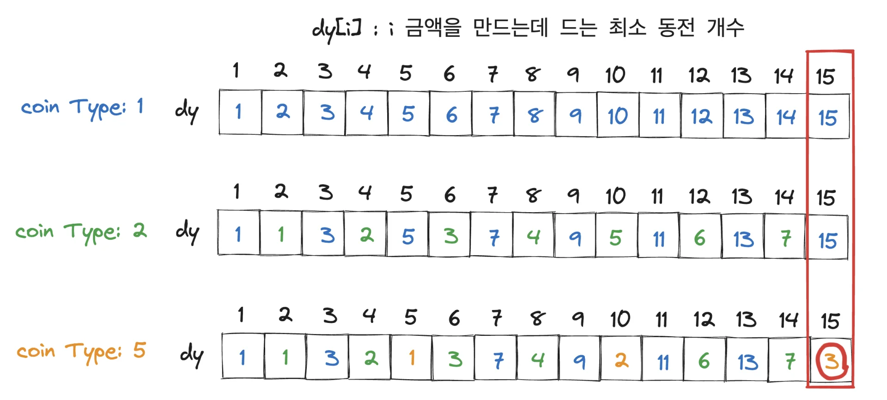

<a id="1c3eda9b0fe1814d8f1cc9f90456e5cd"></a>

# 문제

<a id="1c3eda9b0fe18105b043ea0dd2e6c354"></a>

## <strong>5&#46; 동전교환(냅색 알고리즘)</strong>

<a id="1c3eda9b0fe18148a8fbe8ca9929e95a"></a>

### 설명

<a id="1c3eda9b0fe181899620c925b07d82fb"></a>

다음과 같이 여러 단위의 동전들이 주어져 있을때 거스름돈을 가장 적은 수의 동전으로 교환해주려면 어떻게 주면 되는가?

<a id="1c3eda9b0fe1812d9033e3f78e18d0a6"></a>

각 단위의 동전은 무한정 쓸 수 있다&#46;

<a id="1c3eda9b0fe181f3b7bfd9d44c6563de"></a>

### 입력

<a id="1c3eda9b0fe181718548c31f14aa3403"></a>

첫 번째 줄에는 동전의 종류개수 N(1&#60;=N&#60;=50)이 주어진다&#46;

<a id="1c3eda9b0fe1812cab33ed4d3706d009"></a>

두 번째 줄에는 N개의 동전의 종류가 주어지고, 그 다음줄에 거슬러 줄 금액 M(1&#60;=M&#60;=500)이 주어진다&#46;

<a id="1c3eda9b0fe18165b959c0eca337486e"></a>

각 동전의 종류는 100원을 넘지 않는다&#46;

<a id="1c3eda9b0fe181aa82e0c529b5217da8"></a>

### 출력

<a id="1c3eda9b0fe1813d8206f0c48c159b35"></a>

첫 번째 줄에 거슬러 줄 동전의 최소개수를 출력한다&#46;

---

<a id="1c3eda9b0fe181378d64fde03787d81c"></a>

### 예시 입력 1

<a id="1c3eda9b0fe181bda61ff9d80044e3ba"></a>

```plaintext
3
1 2 5
15
```

<a id="1c3eda9b0fe181d3a9f1e20966457556"></a>

### 예시 출력 1

<a id="1c3eda9b0fe181d0a991c989eed7d1cf"></a>

```plaintext
3
```

---

<a id="1c3eda9b0fe181aaab63d24fb0f1e82c"></a>

### 힌트

> 출력설명 &#58; 5 5 5 동전 3개로 거슬러 줄 수 있다&#46;

<a id="1c3eda9b0fe181799133ddfbda85f05b"></a>

# 풀이

<a id="1c3eda9b0fe181c6923de0882ebb0bc9"></a>

## 풀이1) <code>BFS</code>

<a id="1c3eda9b0fe181148f76e093afff811f"></a>

```java
import java.util.*;

public class Main {
    public int  BFS(int[] coinType, int target, int v){
        Queue<Integer> Q=new LinkedList<>();
        Q.offer(v);
        int L = 0;
        while(!Q.isEmpty()){
            int len = Q.size();
            for(int i=0; i<len; i++){
                int tmp = Q.poll();
                for(int coin : coinType){
                    int sum = tmp + coin;
                    if(sum==target) return L+1;
                    Q.offer(sum);
                }
            }
            L++;
        }
        return L;
    }

    public static void main(String[] args) {
        Main T = new Main();
        Scanner sc = new Scanner(System.in);
        int n= sc.nextInt();
        int[] coinType = new int[n];
        for(int i=0; i<n; i++){
            coinType[i]=sc.nextInt();
        }
        int m = sc.nextInt();
        System.out.println(T.BFS(coinType, m, 0));
    }
}
```

<a id="1c3eda9b0fe18197bf18f663e23b3088"></a>

## 풀이2) <code>냅색 알고리즘</code>



<a id="1c3eda9b0fe181c4be08ec40700c25a2"></a>

```java
import java.util.*;

public class Main {
    static int n, m;
    static int[] dy;
    public int  solution(int[] coinType){
        Arrays.fill(dy, Integer.MAX_VALUE);
        dy[0]=0;
        for(int i=0; i<n; i++){
            for(int j=coinType[i]; j<=m; j++){
                dy[j]=Math.min(dy[j], dy[j-coinType[i]]+1);
            }
        }
        return dy[m];
    }

    public static void main(String[] args) {
        Main T = new Main();
        Scanner sc = new Scanner(System.in);
        n= sc.nextInt();
        int[] coinType = new int[n];
        for(int i=0; i<n; i++){
            coinType[i]=sc.nextInt();
        }
        m = sc.nextInt();
        dy=new int[m+1];
        System.out.println(T.solution(coinType));
    }
}
```
