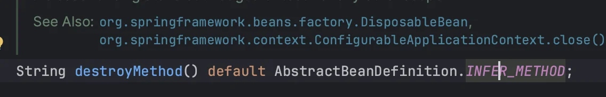
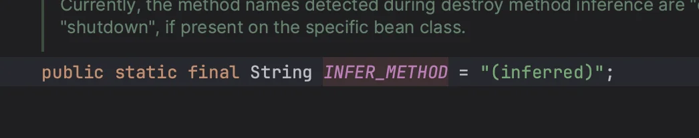
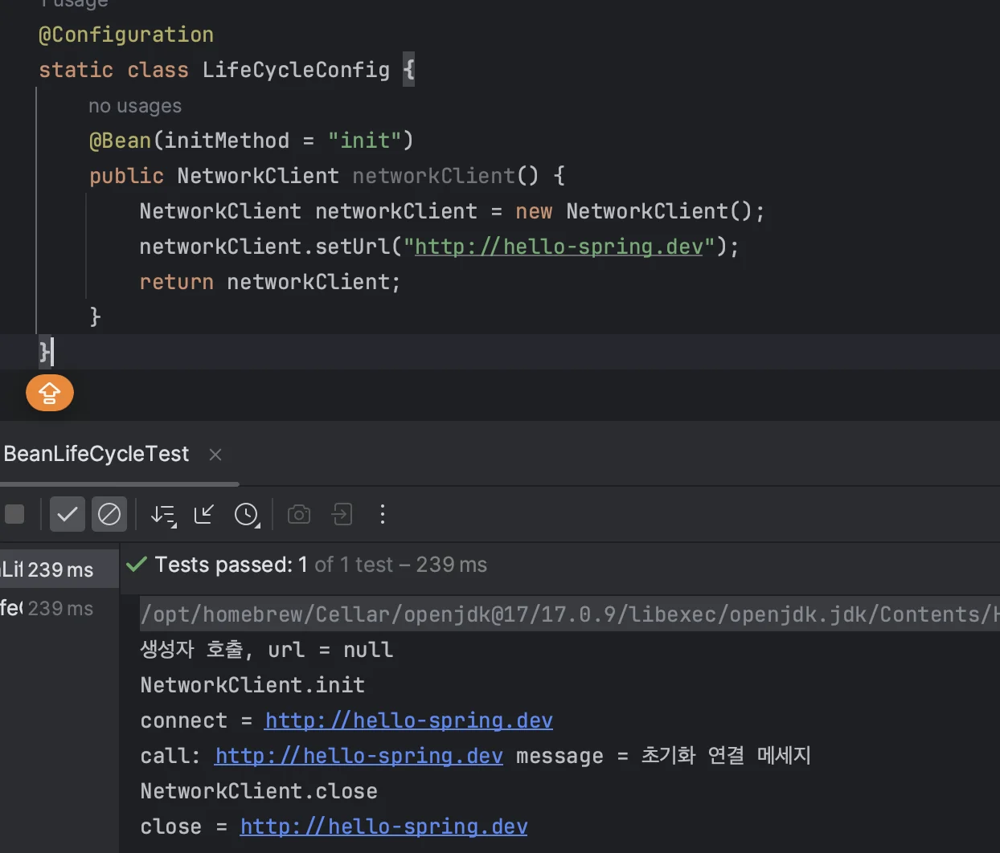

> AutoCloser 공부 및 정리 

<a id="1c3eda9b0fe181099becc6b963e67af0"></a>

## <strong>빈 등록 초기화</strong>, <strong>소멸 메서드 지정</strong>

---

> 설정 정보, <code>&#64;Bean(initMethod = &#34;init&#34;, destroyMethod = &#34;close&#34;)</code> 처럼 <br>→ 초기화, 소멸 메서드를 지정 가능

<a id="1c3eda9b0fe18147ab93ce2917062883"></a>

### 초기화 (init), 소멸(close) 메서드 생성

<a id="1c3eda9b0fe181c9870bfafeea9c6204"></a>

```java
package hello.core.lifecycle;

public class NetworkClient {
    private String url;

		public NetworkClient() {
				System.out.println("생성자 호출, url = " + url);
		}

    public void setUrl(String url) {
        this.url = url;
		}

		//서비스 시작시 호출
		public void connect() {
		    System.out.println("connect: " + url);
    }

    public void call(String message) {
		    System.out.println("call: " + url + " message = " + message);
		}

		//서비스 종료시 호출
		public void disConnect() {
         System.out.println("close + " + url);
		}

		public void init(){
        System.out.println("NetworkClient.init");
        connect();
        call("초기화 연결 메세지");
    }

    public void close(){
        System.out.println("NetworkClient.close");
        disconnect();
    }
}
```

<a id="1c3eda9b0fe18188a198e8e3823fbec4"></a>

### <strong>설정 정보에  빈( </strong>initMethod<strong> , </strong>destroyMethod )을 <strong>지정</strong>

>  <strong><code>&#64;Bean ( initMethod = &#34;init&#34;, destroyMethod = &#34;close&#34;)</code></strong>

<a id="1c3eda9b0fe1815e89f9e7d9ddf2ba62"></a>

```java
@Configuration
static class LifeCycleConfig {

	  @Bean(initMethod = "init", destroyMethod = "close")
	  public NetworkClient networkClient() {
	      NetworkClient networkClient = new NetworkClient();
	      networkClient.setUrl("http://hello-spring.dev");
	      return networkClient;
	  } 
}
```

<a id="1c3eda9b0fe181c28869d1b48d356839"></a>

<strong>출력</strong>

<a id="1c3eda9b0fe181f59879c35cde322980"></a>

```plaintext
생성자 호출, url = null
NetworkClient.init
connect: http://hello-spring.dev
call: http://hello-spring.dev message = 초기화 연결 메시지
13:33:10.029 [main] DEBUG
org.springframework.context.annotation.AnnotationConfigApplicationContext -
Closing NetworkClient.close
close + http://hello-spring.dev
```

> 👉🏻 <strong>설정 정보 사용 특징</strong>
> 
> ---
> 
> <a id="1c3eda9b0fe1812588f3e70d521d251b"></a>
> 
> • 메서드 이름을 자유롭게 생성할 수 있다&#46;<br>• 스프링 빈이 스프링 코드에 의존하지 않는다&#46;<br>• 설정 정보를 사용하기 때문에 코드를 고칠 수 없는 외부 라이브러리에도 초기화, 종료 메서드를 적용하 수 있다&#46; 

> 📌 <strong>종료 메서드 추론 ( </strong><code>&#64;Bean의 destroyMethod</code> )
> 
> ---
> 
> > 라이브러리는 대부분 <code>close</code> , <code>shutdown</code> 이라는 이름의 종료 메서드를 사용함
> 
> 
> 
> 
> 
> <a id="1c3eda9b0fe18103a98ed6c1c91919e6"></a>
> 
> &#64;Bean의 <code>destroyMethod</code> 는 기본값이 <code>(inferred)</code> (추론)으로 등록되어 있다&#46;<br>해당 추론 기능은 <code>close</code> , <code>shutdown</code> 라는 이름의 메서드를 자동으로 호출하여<br>이름 그대로 종료 메서드를 추론해서 호출해준다&#46;
> 
> <a id="1c3eda9b0fe1812d8c9edf1bcd69c43f"></a>
> 
> <br>따라서 직접 스프링 빈으로 등록하면<strong> 종료 메서드는 따로 적어주지 않</strong>아도<strong> 잘 동작</strong>한다&#46;
> 
> 
> 
> > 추론 기능 사용  X  → <code>destroyMethod=&#34;&#34;</code> 처럼 빈 공백을 지정)

<a id="1c3eda9b0fe18120845bf5e3fd16ba7d"></a>

###
