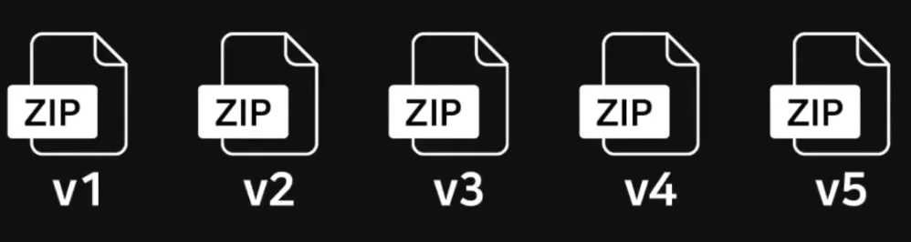
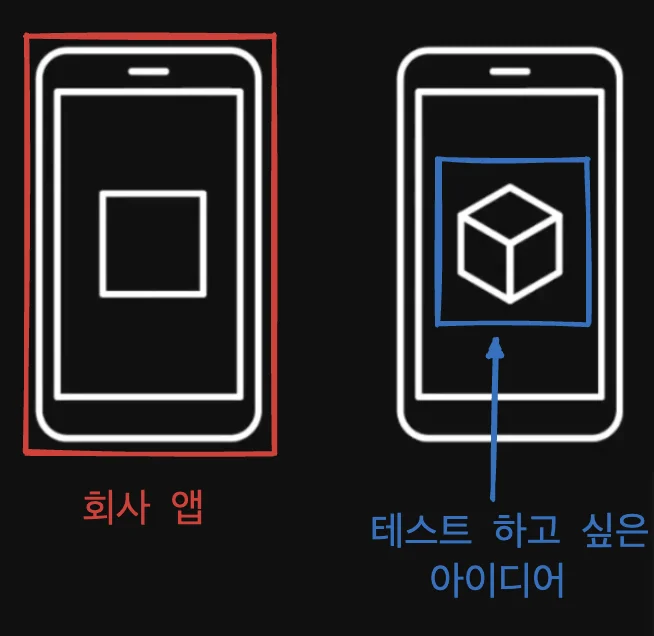
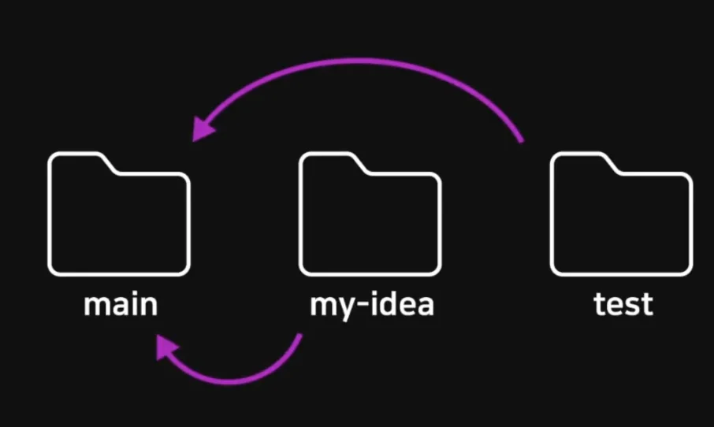
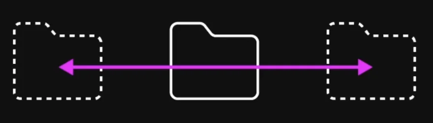
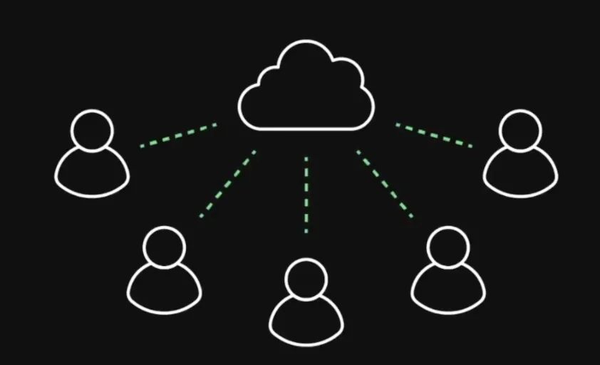
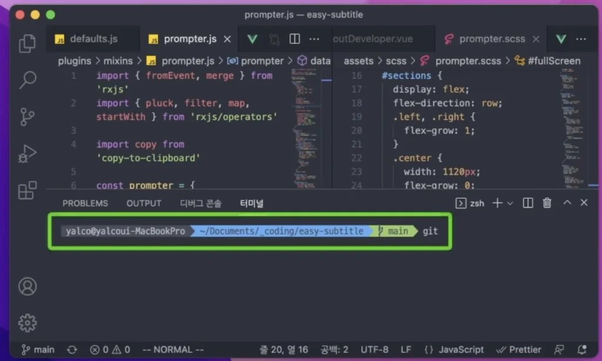
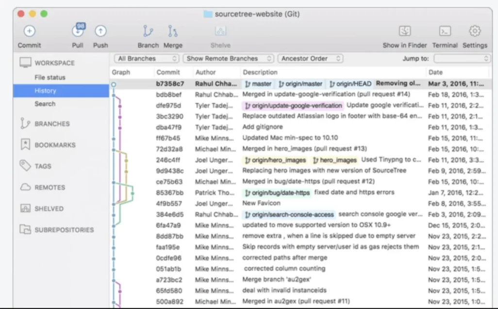

<a id="1c3eda9b0fe1817895e5f4e01a259d47"></a>

<a href="https://beautiful-college-c84.notion.site/708e601386dc422888132d3bd3321a32">페이지</a> 

<a id="1c3eda9b0fe181f2bf58c7407f8468b1"></a>

### Git 이란?

<a id="1c3eda9b0fe18142b079c93f53941746"></a>

git은 <strong>VCS</strong>란 종류의 프로그램들 중 하나이다&#46; 

> <strong>V</strong>ersion <strong>C</strong>ontrol <strong>S</strong>ystem

<a id="1c3eda9b0fe181c8897bd894954d52a1"></a>

### 시간

> 버전관리 


<a id="1c3eda9b0fe18130b66afabe20cb82a1"></a>

소프트웨어를 만드는 작업은 대부분 첫 결과물에서 끝이 아니라 

<a id="1c3eda9b0fe1815c8a4cdd7a3a907b3d"></a>

<strong>새 기능이 추가</strong>되거나 <strong>오류를 수정</strong>하고 <strong>성능을 개선</strong>하면서<strong> 계속해서 새 버전들이 업데이트 </strong>된다&#46;


<a id="1c3eda9b0fe181ba8ea7c07a60049bbb"></a>

그런데 이러한 작업들을 진행하다 보면 <strong>새로운 버전</strong>에<strong> 기능적 결함</strong>이 있어<strong> 이전 버전으로 되돌려야 할 경우</strong>가 생긴다&#46;



<a id="1c3eda9b0fe181a7804cd15c534fd708"></a>

위와 같이 <strong><u>버전마다 전부 압축해 백업</u></strong>을 해놓으면 언제든지 프로젝트를 이전 버전으로 변경할 수 있다&#46; 

<a id="1c3eda9b0fe1813c9f3cc5f1c6bce411"></a>

그런데 해당 방법은 프로젝트가 계속 진행될수록 차지하는 용량이 커지고 


<a id="1c3eda9b0fe181779ea3f1492329ea4d"></a>

특정 버전에만 문제가 있어 해당 버전만 취소해야하는 경우, 답이 없다&#46;&#46;&#46; 다시 작업…

<a id="1c3eda9b0fe181c18bc4ebe32e2cdf8b"></a>

그러나 GIt을 사용하는 경우, 위와 같은 문제들을 간단하게 해결할 수 있다&#46; 

<a id="1c3eda9b0fe18127967de10db423db35"></a>

### 차원

> <strong>Branch</strong>&#58; 다차원, 멀티버스



<a id="1c3eda9b0fe181b590c6f95420d645eb"></a>

예를 들어 회사에서 앱을 만드는데 , 기발한 아이디어가 떠올라 시도 해보고 싶은 경우, 실제 서비스하고 회사의 앱에서 논의되지 않는 코드를 내 멋대로 추가하고 테스트 할 수 없다&#46; 


<a id="1c3eda9b0fe1816d8202fe32de0ff69e"></a>

메인 프로젝트 폴더를 복사하여 사본에서 작업하고 테스트를 할 수 있다&#46;



<a id="1c3eda9b0fe18196b044d80da887d8a6"></a>

그러나 위와 같이 사본에서 작업을 하다가 실재품에 적용하기로 결정되어 변경사항 모두를 모두 메인프로젝트에 반영하려는 경우,

<a id="1c3eda9b0fe1811ba8eaf85f3bcd81da"></a>

해당 폴더의 변경내용들을 하나씩 비교하면서 반영해야한다&#46; 

<a id="1c3eda9b0fe181e795edef19c5af0269"></a>

특히나 서로 다른 수정파일이 존재하여 둘다 적용해야 하는 경우,굉장히 번거롭고 머리 아픈 작업이 된다&#46;&#46;

<a id="1c3eda9b0fe181859c1be9092ce9846a"></a>

하지만 Git을 사용하면 정말 쉽게 해결할 수 있다&#46; 

<a id="1c3eda9b0fe1817da66af503aca11949"></a>

프로젝트 폴더를 복사할 필요도, 압축해서 백업할 필요도 없다&#46; 




<a id="1c3eda9b0fe181e4b892f29dc9ffe799"></a>

Git은 마치 시간 여행을 하는 것 처럼 프로젝트의 버전들을 언제든 되돌릴 수 있고, 여러 차원을 넘나드는 것 처럼, 프로젝트의 내용을 마치 다른 폴더인 것처럼 여러 모드로 자유롭게 전환하고 변경사항들을 쉽게 이동할 수 있다&#46; 



<a id="1c3eda9b0fe1816fb8c5feefa51cafd4"></a>

또한 여러 개발자들이 함께 협력하여 소프트웨어를 만들어가는데 있어서도 정말 중요한 기능들을 제공한다&#46; 

<a id="1c3eda9b0fe1815faa82fc9113e1062f"></a>

### CLI &#38; GUI

> Git 명령어 입력 시 → <strong>CLI, Command 입력</strong>



> 프로젝트를 자세히 살펴봐야 하는 경우 → GUI(소스트리) 사용



<a id="1c3eda9b0fe181368348d3d8baced1cf"></a>

### <a href="#/post/1c3eda9b-0fe1-81a7-a498-c683f7d0c859">Git 최초 설정 </a>

> Git 전역으로 사용자 이름과 이메일 주소 설정하기<br> → github 계정과 별개임

- 설정

<a id="1c3eda9b0fe181d9b4c8d610463d4919"></a>

```bash
git config --global user.name "(본인 이름)"
```

<a id="1c3eda9b0fe18143b51bf9fcd93589d1"></a>

```bash
git config --global user.email "(본인 이메일)"
```

- 확인

<a id="1c3eda9b0fe1816f9228f6e46666c407"></a>

```bash
git config --global user.name
```

<a id="1c3eda9b0fe18102bd16f2d789cb74de"></a>

```bash
git config --global user.email
```

- 기본 브랜치명 변경

<a id="1c3eda9b0fe181cd8e29ffac7da036ba"></a>

```bash
git config --global init.defaultBranch main
```

- 프로젝트 생성 &#45; git initialize

<a id="1c3eda9b0fe18164a190f9e23957a5e0"></a>

```bash
git init
```

- 파일 상태

> 👉🏻 자세한 내용  <a href="#/post/1c3eda9b-0fe1-81db-b05a-c2afad5ca59f">페이지</a> 확인

<a id="1c3eda9b0fe1816b9452de43dadfc5f3"></a>

```bash
git status
```

<a id="1c3eda9b0fe181fbb6a4cc6cecdb069b"></a>

### Git 관리에서 특정 파일/폴더를 제외해야 하는 경우 ( <code>&#46;gitignore</code>)

<details>
<summary><strong>Reference</strong></summary>

<a id="1c3eda9b0fe18147b9bfe63d36ed9546"></a>

<a href="https://git-scm.com/docs/gitignore">https&#58;//git&#45;scm&#46;com/docs/gitignore</a>

<a id="1c3eda9b0fe181279cfdf7c0c6fe836e"></a>

<a href="https://www.yalco.kr/@git-github/1-6/">https&#58;//www&#46;yalco&#46;kr/&#64;git&#45;github/1&#45;6/</a>

</details>

> 📌 <strong>Case</strong>
> 
> - <strong>포함할 필요가 없는 경우</strong>&#58;  자동 생성, 다운로드 되는 파일들(빌드 결과물, 라이브러리)
> 
> - <strong>포함하지 말하야 하는 경우</strong>&#58; 보안상 민간한 정보들이 담긴 파일들

- <strong><code>&#46;gitignore</code></strong><strong> 형식</strong>
    <a id="1c3eda9b0fe1815ab1d8c0e9c9817b80"></a>

    ```bash
    # 이렇게 #를 사용해서 주석

    # 모든 file.c
    file.c

    # 최상위 폴더의 file.c
    /file.c

    # 모든 .c 확장자 파일
    *.c

    # .c 확장자지만 무시하지 않을 파일
    !not_ignore_this.c

    # logs란 이름의 파일 또는 폴더와 그 내용들
    logs

    # logs란 이름의 폴더와 그 내용들
    logs/

    # logs 폴더 바로 안의 debug.log와 .c 파일들
    logs/debug.log
    logs/*.c

    # logs 폴더 바로 안, 또는 그 안의 다른 폴더(들) 안의 debug.log
    logs/**/debug.log
    ```
