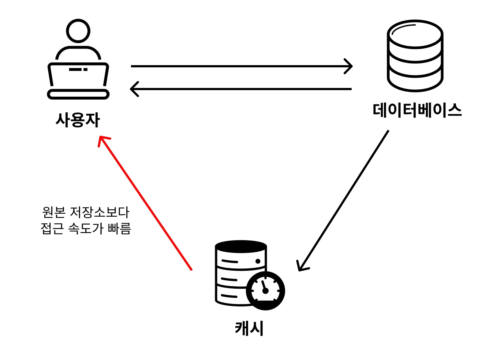
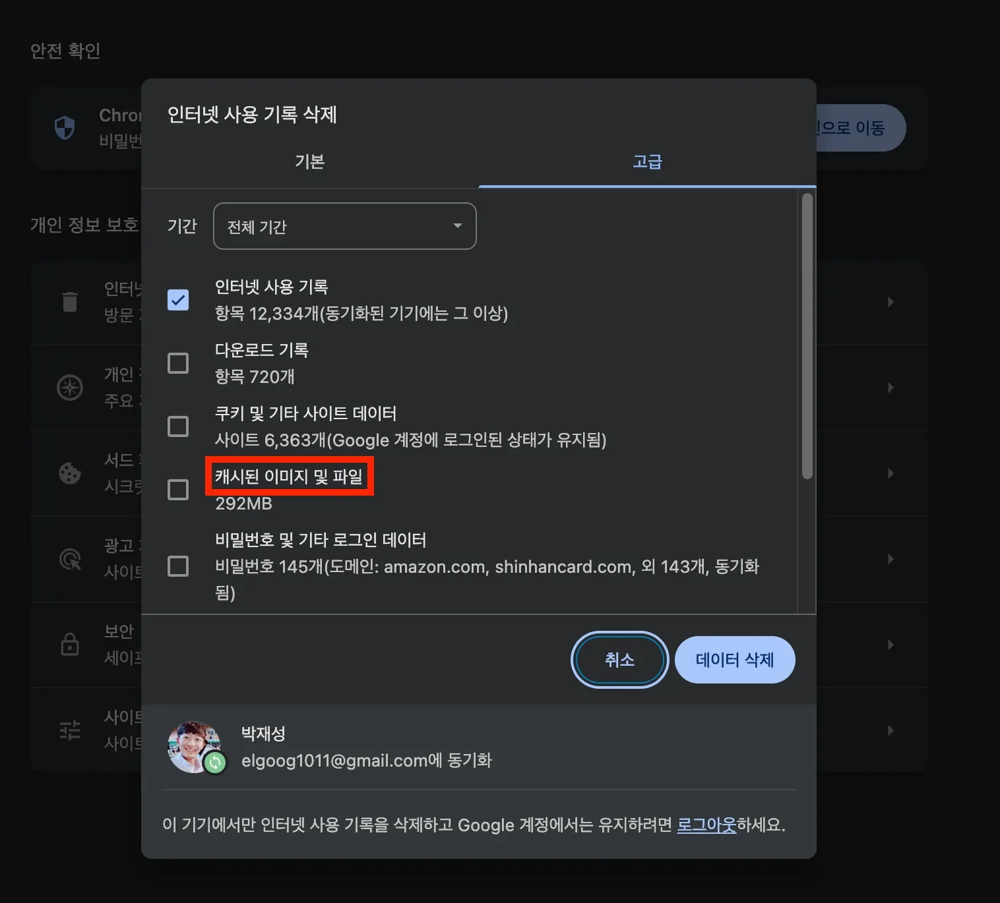

## 캐시 ( Cache )

---

> ✏️ 
> 
> 
> 
> <strong><code>캐시(Cache)</code></strong>란, <strong>원본 저장소보다 빠르게 가져올 수 있는 임시 데이터 저장소</strong>를 의미한다&#46; 
> 
> - 캐시(Cache)라는 단어는 전반적인 개발 분야에서 통용돼서 쓰인다&#46; 

ex)

## 캐싱 ( Caching )

---

> ✏️ 
> 
> 
> 
> <strong><code>캐싱(Caching)</code></strong>이란 <strong><u>캐시(Cache, 임시 데이터 저장소)에 접근</u></strong><strong>해서 </strong><strong><u>데이터를 빠르게 가져오는 방식</u></strong>을 의미한다&#46;

현업에서는 아래와 같이 얘기하는 편이다&#46; 

> “이 API는 응답 속도가 너무 느린데? 이 응답 데이터는 <strong><code>캐싱(Cahing)</code></strong><strong> </strong>해두고 쓰는 게 어때?’ 

이 말을 풀어서 설명하자면 

> ‘<strong><u>API 응답 결과</u></strong>를 원본 저장소보다 빠르게 가져올 수 있는 <strong><u>임시 데이터 저장소에 저장</u></strong>해두고, <strong><u>빠르게 조회할 수 있게 만</u></strong>드는 게 어때?<strong>’</strong>

라는 의미이다&#46;
