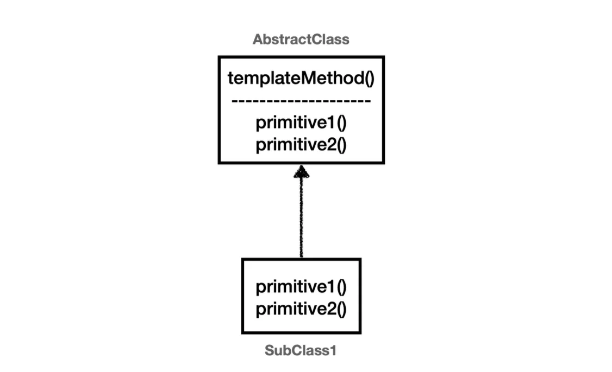
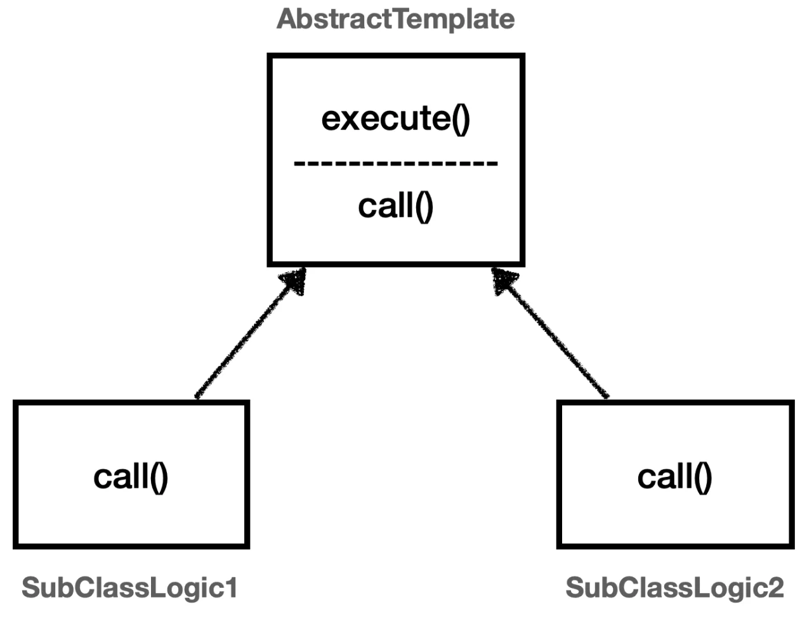
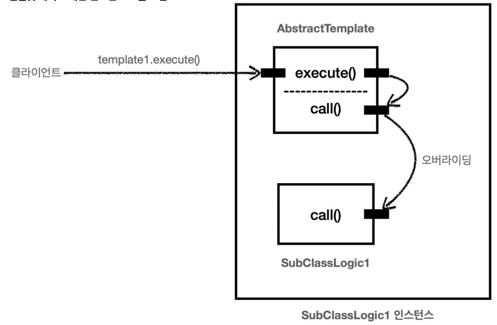
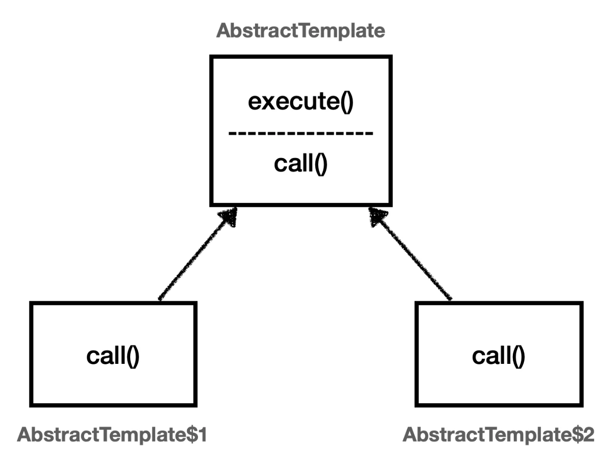
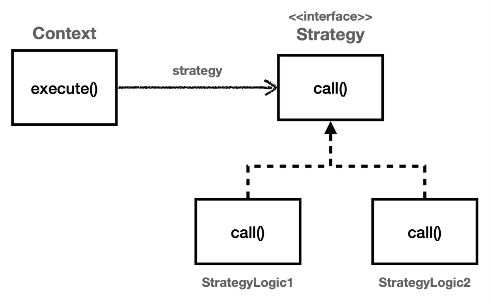
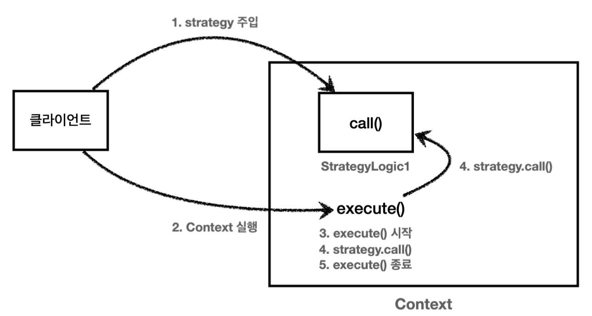
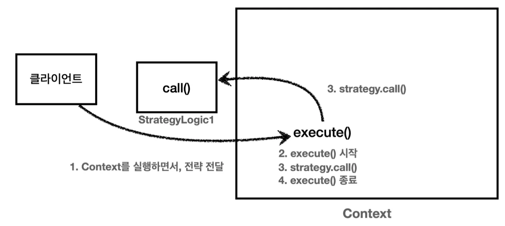
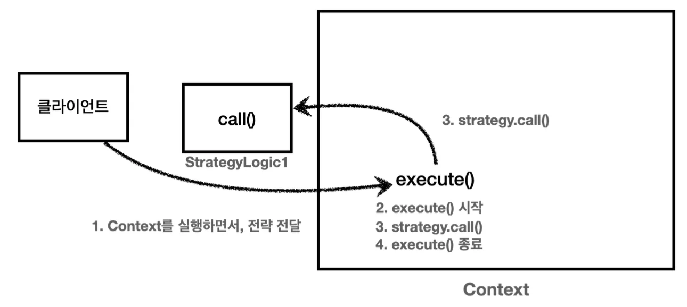
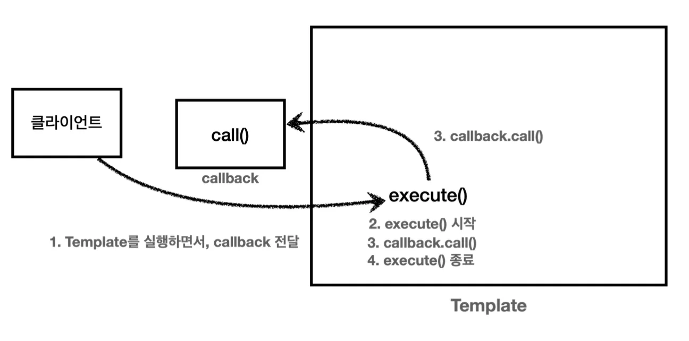

> 📌 
> 
> <a id="1f8eda9b0fe1800d8be3eccccf27208a"></a>
> 
> <strong>이전 정리 내용</strong>
> 
> - <a href="#/post/1c3eda9b-0fe1-81ef-b87b-daddd7fd3dfc">페이지</a>, 콜백 패턴
> 
> - <a href="#/post/1c3eda9b-0fe1-81ca-9f82-d83bfe68e477">페이지</a>

<a id="1f8eda9b0fe18058bf14e88861863937"></a>

## 스프링에서 사용하는 주요 디자인패턴  1 &#45; <br>&#91; <code>템플릿 메서드 패턴</code>, <code>템플릿 콜백 패턴</code>, <code>전략 패턴</code> &#93;

---

> ✅ 
> 
> <a id="1f8eda9b0fe180839a30c0a0945fd396"></a>
> 
> 좋은 애플리케이션의 설계에 있어 <strong><u>변하는 부분</u></strong>과 <u>변하지 않는 부분</u>을 <strong><u>잘 분리하는 것</u></strong>이 중요하다&#46;

<details>
<summary> 로그 추적기 도입 전, 후 코드 비교</summary>

<a id="1f8eda9b0fe18046b433cf25c03719a3"></a>

### 코드 

<details>
<summary>&#91; 코드 &#93; <code>V0</code>&#46; 로그 추적기 도입 전 </summary>

<a id="1f8eda9b0fe18090b240fdff5208c224"></a>

```java
// OrderControllerV0 코드 
@GetMapping("/v0/request")
public String request(String itemId) {
		orderService.orderItem(itemId);
		return "ok";
}

//OrderServiceV0 코드
public void orderItem(String itemId) {
		orderRepository.save(itemId);
}
```

</details>

<details>
<summary>&#91; 코드 &#93; <code>V3</code>&#46; 로그 추적기 도입 후</summary>

<a id="1f8eda9b0fe1807f9e2dd03e968a217c"></a>

```java
// OrderControllerV3 코드
@GetMapping("/v3/request")
public String request(String itemId) {
		
		TraceStatus status = null;
		try {
				status = trace.begin("OrderController.request()");
				orderService.orderItem(itemId);  // 핵심 기능
				trace.end(status);
		} catch (Exception e) {
				trace.exception(status, e);
				throw e;
		}
		
		return "ok";
}

// OrderServiceV3 코드
public void orderItem(String itemId) {
		TraceStatus status = null;
		try {
				status = trace.begin("OrderService.orderItem()");
				orderRepository.save(itemId);  // 핵심 기능
				trace.end(status);
		} catch (Exception e) {
				trace.exception(status, e);
				throw e;
		}
}
```

- 

</details>

<details>
<summary><strong>🧐 </strong><strong><code>핵심 기능</code></strong> vs <strong><code>부가 기능</code></strong></summary>

<details>
<summary><strong>핵심 기능</strong></summary>

> 핵심 기능은 해당 객체가 제공하는 고유의 기능이다&#46;

- ex1)  <code>orderSerivce</code>의 핵심 기능은 주문 로직이다&#46; 

- ex2) 메서드 단위로 보면 <code>orderService&#46;orderItem()</code>의 핵심 기능은 주문 데이터를 저장하기 위한 <code>orderRepository&#46;save(itemId)</code> 이다&#46; 

</details>

<details>
<summary><strong>부가 기능</strong></summary>

> 핵심 기능을 보조하기 위한 기능이다&#46; 

- 부가 기능은 단독으로 사용 되지 않고, 핵심 기능과 함께 사용한다&#46; 

- ex) <strong><code>로그 추적 로직</code></strong>, <strong><code>트랜잭션 기능</code></strong>
    - <strong><code>로그 추적 기능</code></strong>&#58; 어떤 핵심 기능이 호출 되었는지 로그를 남기기 위해 사용

</details>

</details>

> ❗ 
> 
> <a id="1f8eda9b0fe18032bcb3c6322b9aad84"></a>
> 
> 핵심 기능 로직 외, <strong>로그를 출력하는 </strong><strong><u>부가 기능 코드가 훨씬 더 많고 복잡</u></strong>하다&#46; 
> 
> - <code>V0</code>는 <strong><u>핵심 기능</u></strong>만 있지만, 로그 추적기를 추가한 <code>V3</code> 는 <strong><u>핵심 기능과 부가 기능이  함께</u></strong> 있다&#46;
> 
> - <code>V3</code> 코드를 보면 핵심 기능에 대한 코드보다 부가 기능을 처리하기 위한 코드가 훨씬 더 많다&#46;
> 
> <a id="1f8eda9b0fe180e18feeda5372385113"></a>
> 
> 클래스가 수백개이고 이를 로그 추적기에 대한 부가기능을 더한다고 한다면, 각 클래스마다 매번 해당 부가가기능 로직을 추가해야한다&#46; 
> 
> <a id="1f8eda9b0fe180b68486c19bb13b8b48"></a>
> 
> 그리고 이 부분이 수정되어야 한다면? 일일이 수백개의 동일한 로직을 고쳐야한다&#46; <br>매우 좋지 않은 코드이다&#46;
> 
> <a id="1f8eda9b0fe1800f8a37d2c26e87c043"></a>
> 
> 이를 <strong><u>디자인 패턴을 도입</u></strong>하여 <strong>변화되는 부분과, 변화되지 않는 부분을 분리</strong>하여 해결한다&#46; 

</details>

<details>
<summary>디자인 패턴 적용 이유</summary>

<a id="1f8eda9b0fe180dca004ccb4ebae3d75"></a>

V3 코드를 보면 아래와 같은 패턴이 반복된다&#46; 

<a id="1f8eda9b0fe18029931dd295d812541e"></a>

```java
TraceStatus status = null;
try {
		status = trace.begin("message"); 
		// 핵심 기능 호출
		trace.end(status);
} catch (Exception e) {
		trace.exception(status, e);
		throw e;
}
```

- 해당 로직이 로그 추적기에 대한 부가기능 코드이다&#46; <br><code>controller</code>, <code>service</code>, <code>repository</code>에서 반복적으로 사용되며 중간에 핵심 기능 로직만 변경될 뿐이다&#46; 

<a id="1f8eda9b0fe180a7be78dfef9592db8e"></a>

즉, 부가 기능과 관련된 코드가 중복이다&#46; 

<a id="1feeda9b0fe18003ac0ed8c21c4a3bb1"></a>

따라서 중복을 별도의 메서드로 뽑아내면 될 것 같지만, <code>try&#45;catch</code> 와 핵심 기능 로직이 중간에 있어 단순 메서드로 추출하는 것은 어렵다&#46; 

<a id="1f8eda9b0fe180d0ada2dc02e69a9f5c"></a>

그렇다면 어떻게 해결하는 것이 옳은가? 이는 변하는 부분과 변하지 않는 부분을 분리하고 모듈화하여 해결한다&#46; 그리고 이러한 패턴들을 공식과 같이 정의한 것이 디자인 패턴이다&#46; 

> ✏️ 
> 
> <a id="1f8eda9b0fe1809b889dc086e4156821"></a>
> 
> <strong><u>변하는 것</u></strong><strong>과 </strong><strong><u>변하지 않는 것</u></strong><strong>을 분리</strong>
> 
> ---
> 
> <a id="1f8eda9b0fe180109966e21d58640a93"></a>
> 
> 좋은 설계는 <u>변하는 것과 변하지 않는 것을 분리</u>하는 것이다&#46; 
> 
> <a id="1f8eda9b0fe1803fa34aeddff5bd28f2"></a>
> 
> 여기서 핵심 기능 부분은 변하고, 로그 추적기에 대한 부가 기능은 변하지 않는 부분이다&#46; 
> 
> <a id="1f8eda9b0fe180a7b70ccea375c04364"></a>
> 
> 이 둘을 분리해서 모듈화 함으로써 <code>SRP</code>, <code>OCP</code> 등을 만족하도록 설계할 수 있다&#46; 

<a id="1f8eda9b0fe1802e8f32f8eec2916f1f"></a>

<u>앱을 확장성 있고, 유지보수 측면이 높게 설계</u>하기 위해서는 디자인 패턴이 중요하다&#46; 

- 해당하는 장점을 가지는 앱들의 패턴들을 모아 정의한 것이 GOF 디자인 패턴이다&#46; 

<a id="1f8eda9b0fe180c69f7ff683f63fd1fb"></a>

이러한 디자인 패턴들 중 스프링에서 주요하게 사용하는 <strong><u>템플릿 메서드 패턴, 전략 패턴, 템플릿 콜백 패턴</u></strong> 등을 차례대로 예제 애플리케이션에 적용하면서 알아본다&#46; 

</details>

<a id="1f8eda9b0fe1800fa150de38dd3dca0c"></a>

### 템플릿 메서드 패턴

> 📖 
> 
> <a id="1f9eda9b0fe180ee96d6f9d39a0d96d9"></a>
> 
> <strong>템플릿 메서드 패턴</strong> (GOF 디자인 패턴)
> 
> ---
> 
> 
> 
> <a id="1f9eda9b0fe1801686fef84ba096b903"></a>
> 
> 템플릿 메서드 디자인 패턴의 목적은 다음과 같다&#46;
> 
> - 작업에서 <strong><u>알고리즘의 골격을 정의</u></strong>하고 <strong><u>일부 단계를 하위 클래스로 연기</u></strong>한다&#46;
> 
> -  템플릿 메서드를 사용하면 <strong><u>하위 클래스가 알고리즘의 구조를 변경하지 않</u></strong>고도 <strong><u>알고리즘의 특정 단계를 재정의</u></strong>할 수 있다&#46;

<a id="1f9eda9b0fe18042bc43cff26919bd64"></a>

### 실습

<details>
<summary>기본 예제 &#45; 패턴 적용 전</summary>

- &#91; 코드 &#93;  TemplateMethodTest
    <a id="1f8eda9b0fe180ad844fd46e7256234b"></a>

    ```java
    package com.inflearn.lecture_prac.trace.templacte;

    import lombok.extern.slf4j.Slf4j;
    import org.junit.jupiter.api.Test;

    @Slf4j
    public class TemplateMethodTest {

        @Test
        void tempateMethodV0() {
            logic1();
            logic2();
        }

        private void logic1() {
            long startTime = System.currentTimeMillis();
            // 비지니스 로직 실행
            log.info("비지니스 로직1 실행");
            // 비지니스 로직 종료
            long endTime = System.currentTimeMillis();
            long resultTime = endTime - startTime;
            log.info("resultTime={}", resultTime);
        }

        private void logic2() {
            long startTime = System.currentTimeMillis();
            // 비지니스 로직 실행
            log.info("비지니스 로직2 실행");
            // 비지니스 로직 종료
            long endTime = System.currentTimeMillis();
            long resultTime = endTime - startTime;
            log.info("resultTime={}", resultTime);
        }
    }
    ```

</details>

<details>
<summary>1&#46; 템플릿 메서드 패턴 적용1 &#45; 상속</summary>

> ✏️ 
> 
> <a id="1feeda9b0fe1801f9d25ff9c780d2e8b"></a>
> 
> <strong>템플릿 메서드 패턴</strong>
> 
> ---
> 
> 
> 
> 
> 
> <a id="1f8eda9b0fe180de80b0f16142882f12"></a>
> 
> 템플릿 메서드 패턴은 이름 그대로 템플릿을 사용하는 방식이다&#46; 
> 
> <a id="1f8eda9b0fe180eaaf2dd5311e2846eb"></a>
> 
> 템플릿은 기준이 되는 거대한 틀이다&#46; <strong><u>템플릿이라는 틀</u></strong>에 <strong><u>변하지 않는 부분을 몰아둔다&#46; </u></strong>
> 
> <a id="1f8eda9b0fe1807a951bfe289ba173ef"></a>
> 
> 그리고 <strong><u>일부 변하는 부분을 별도로 호출</u></strong>해서 해결한다&#46;
> 
> - <code>다형성</code>을 활용하여여 <strong><u>변하는 부분</u></strong>과 <strong><u>변하지 않는 부분</u></strong>을 분리한다&#46;

<a id="1f8eda9b0fe1805cbb55fae1f03b356c"></a>

### 코드

<details>
<summary>&#91; 코드 &#93; AbstractTemplate &#45; <code>상위 템플릿 클래스</code></summary>

> 📌 
> 
> <a id="1f8eda9b0fe1800d9a43d7d9dbe6f2e0"></a>
> 
> 변하지 않는 부분인 시간 측정 로직을 템플릿으로 분리하여 상위 클래스로 정의했다&#46; 
> 
> <a id="1f8eda9b0fe1808da13ef82c63cf8c66"></a>
> 
> 그리고 템플릿 안에 변하는 부분은 <code>call()</code> 메서드를 호출하여 처리한다&#46; 
> 
> - <strong><u>부모 클래스</u></strong>에 <strong>변하지 않는 템플릿 코드를 두</strong>고, <strong><u>자식 클래스</u></strong>에서 <strong><code>상속</code></strong><strong>과 </strong><strong><code>오버라이딩을</code></strong><strong> 사용</strong>하여 <strong>변하는 코드를 정의</strong>한다&#46; 

<a id="1f8eda9b0fe180f9af46c1570ae6c017"></a>

```java
package com.inflearn.lecture_prac.trace.template;

import lombok.extern.slf4j.Slf4j;

@Slf4j
public abstract class AbstractTemplate {

    public void execute() {
        long startTime = System.currentTimeMillis();
        // 비지니스 로직 실행
        call();
        // 비지니스 로직 종료
        long endTime = System.currentTimeMillis();
        long resultTime = endTime - startTime;
        log.info("resultTime={}", resultTime);
    }

    protected abstract void call();
}

```

</details>

<details>
<summary>&#91; 코드 &#93; SubClassLogic1 &#45; <code>하위 템플릿 구현체</code> </summary>

<a id="1f8eda9b0fe18013bf55dded429e72a6"></a>

```java
package com.inflearn.lecture_prac.trace.templacte;

import com.inflearn.lecture_prac.trace.template.AbstractTemplate;
import lombok.extern.slf4j.Slf4j;


@Slf4j
public class SubClassLogic1 extends AbstractTemplate {
    @Override
    protected void call() {
        log.info("비지니스 로직1 실행");
    }
}

```

</details>

<details>
<summary>&#91; 코드 &#93; SubClassLogic2 &#45; <code>하위 템플릿 구현체</code> </summary>

<a id="1f8eda9b0fe18016bbb9ee3161df14ef"></a>

```java
package com.inflearn.lecture_prac.trace.templacte;

import com.inflearn.lecture_prac.trace.template.AbstractTemplate;
import lombok.extern.slf4j.Slf4j;


@Slf4j
public class SubClassLogic2 extends AbstractTemplate {
    @Override
    protected void call() {
        log.info("비지니스 로직2 실행");
    }
}

```

</details>

<details>
<summary>&#91; 테스트 &#93; TemplateMethodTest<code>&#46;templateMethodV1()</code></summary>

<a id="1f8eda9b0fe18072b587e2f9b78ed919"></a>

```java
/**
 * 템플릿 메서드 패턴 적용
 */
@Test
void templateMethodV1() {
    AbstractTemplate template1 = new SubClassLogic1();
    template1.execute();

    AbstractTemplate template2 = new SubClassLogic1();
    template2.execute();
}
```

<a id="1f8eda9b0fe1800f8fe6d6ea5eb2f032"></a>

<strong>실행 결과</strong>

<a id="1f8eda9b0fe180eead86e76415120955"></a>

```java
비즈니스 로직1 실행 
resultTime=0
비즈니스 로직2 실행 
resultTime=0
```

</details>

</details>

<details>
<summary>2&#46; 템플릿 메서드 패턴 적용2 &#45;  익명 내부 클래스</summary>

> ☝🏻 
> 
> <a id="1f8eda9b0fe180cc9879e828333e0fdd"></a>
> 
> 위 예제는 <code>SubClassLogicX&#46;&#46;&#46;</code> 처럼  클래스를 계속 만들어야 하는 단점이 있다&#46; 
> 
> <a id="1f8eda9b0fe18046a18ded2545c466fc"></a>
> 
> 이러한 단점은 <strong><u>익명 내부 클래스</u></strong>를 통해 보안할 수 있다&#46;
> 
> - 익명 내부 클래스를 사용하면 <u>객체 인스턴스 생성과 동시에 해당 클래스를 상속 받는 자식 클래스까지 정의할 수 있</u>다&#46; 
> 
> - 직접 지정하는 이름없이 클래스 내부에 선언되는 클래스여서 <strong><u>익명 내부 클래스</u></strong>라 한다&#46;

<details>
<summary>&#91; 테스트 &#93; TemplateMethodTest<code>&#46;templateMethodV2()</code></summary>

<a id="1f8eda9b0fe180b1aed2e907baa3f48e"></a>

```java
/**
 * 템플릿 메서드 패턴, 익명 내부 클래스 사용
 */
@Test
void templateMethodV2() {
    AbstractTemplate template1 = new AbstractTemplate() {
        @Override
        protected void call() {
            log.info("비지니스 로직1 실행");
        }
    };
    log.info("클래스 이름1 {}", template1.getClass());
    template1.execute();

    AbstractTemplate template2 = new AbstractTemplate() {
        @Override
        protected void call() {
            log.info("비지니스 로직2 실행");
        }
    };
    log.info("클래스 이름2 {}", template2.getClass());
    template2.execute();
}
```

<a id="1f8eda9b0fe1808fbd75c839aeb8dbac"></a>

<strong>실행 결과</strong>

<a id="1f8eda9b0fe180588bebfa7d24b30e09"></a>

```java
클래스 이름1 class hello.advanced.trace.template.TemplateMethodTest$1
비즈니스 로직1 실행
resultTime=3

클래스 이름2 class hello.advanced.trace.template.TemplateMethodTest$2 
비즈니스 로직2 실행
resultTime=0
```

- 실행 결과를 통해 자바 임의로 만드는 익명 내부 클래스의 이름은  <code>TemplateMethodTest&#36;1</code> , <code>TemplateMethodTest&#36;2</code> 인 것을 확인할 수 있다&#46;
    

</details>

</details>

<details>
<summary>3&#46; 템플릿 메서드 패턴 적용3 &#45; 애플리케이션에 패턴 적용</summary>

> ☝🏻 
> 
> <a id="1f8eda9b0fe18013b753eb468cb212b3"></a>
> 
> <strong><code>AbstractTemplate</code></strong><code>&#60;Void&#62;</code>
> 
> ---
> 
> <a id="1f8eda9b0fe180c99d47ceba3a5a1e87"></a>
> 
> 제네릭에서 반환할 내용이 없는 경우, <code>Void</code> 타입을 명시하고 <code>null</code> 을 반환하면 된다&#46;  
> 
> - 참고로 제네릭은 기본 타입인 <code>void</code> , <code>int</code> 등을 선언할 수 없다&#46;

<a id="1f8eda9b0fe180eebdacea907e1661d2"></a>

### 코드

<details>
<summary>&#91; 코드 &#93; <strong>AbstractTemplate</strong></summary>

<a id="1f8eda9b0fe1806c98c2f2a160f24d0c"></a>

```java
package com.inflearn.lecture_prac.trace.template;

import com.inflearn.lecture_prac.trace.basic.TraceStatus;
import com.inflearn.lecture_prac.trace.logtrace.LogTrace;
import lombok.RequiredArgsConstructor;


@RequiredArgsConstructor
public abstract class AbstractTemplate<T> {

    private final LogTrace trace;

    public T execute(String message) {
        TraceStatus status = null;
        try {
            status = trace.begin(message);

            // 로직 호출
            T result = call();

            trace.end(status);
            return result;
        } catch (Exception e) {
            trace.exception(status, e);
            throw e;
        }
    }

    protected abstract T call();
}
```

</details>

<details>
<summary>&#91; 코드 &#93; <strong>OrderControllerV4</strong></summary>

<a id="1f8eda9b0fe18038b64bd108e83cd87c"></a>

```java
package com.inflearn.lecture_prac.app.v3;

import com.inflearn.lecture_prac.trace.logtrace.LogTrace;
import com.inflearn.lecture_prac.trace.template.AbstractTemplate;
import lombok.RequiredArgsConstructor;
import org.springframework.web.bind.annotation.GetMapping;
import org.springframework.web.bind.annotation.RequestParam;
import org.springframework.web.bind.annotation.RestController;

@RestController
@RequiredArgsConstructor
public class OrderControllerV4 {

    private final OrderServiceV4 orderService;
    private final LogTrace trace;

    @GetMapping("/v4/request")
    public String request(@RequestParam String itemId) {

        AbstractTemplate<String> template = new AbstractTemplate<>(trace) {
            @Override
            protected String call() {
                orderService.orderItem(itemId);
                return "ok";
            }
        };
        return template.execute("OrderController.request()");
    }
}

```

</details>

<details>
<summary>&#91; 코드 &#93; <strong>OrderServiceV4</strong></summary>

<a id="1f8eda9b0fe180d6b341c16260e84ded"></a>

```java
package com.inflearn.lecture_prac.app.v3;

import com.inflearn.lecture_prac.trace.logtrace.LogTrace;
import com.inflearn.lecture_prac.trace.template.AbstractTemplate;
import lombok.RequiredArgsConstructor;
import org.springframework.stereotype.Service;

@Service
@RequiredArgsConstructor
public class OrderServiceV4 {

    private final OrderRepositoryV4 orderRepository;
    private final LogTrace trace;

    public void orderItem(String itemId) {

        AbstractTemplate<Void> template = new AbstractTemplate<>(trace) {
            @Override
            protected Void call() {
                orderRepository.save(itemId);
                return null;
            }
        };
        template.execute("OrderService.orderItem()");
    }
}
```

</details>

<details>
<summary>&#91; 코드 &#93; <strong>OrderRepositoryV4</strong></summary>

<a id="1f8eda9b0fe180a0b6e6cc514e50f3d4"></a>

```java
package com.inflearn.lecture_prac.app.v3;

import com.inflearn.lecture_prac.trace.logtrace.LogTrace;
import com.inflearn.lecture_prac.trace.template.AbstractTemplate;
import lombok.RequiredArgsConstructor;
import org.springframework.stereotype.Repository;

@Repository
@RequiredArgsConstructor
public class OrderRepositoryV4 {

    private final LogTrace trace;

    public void save(String itemId) {
        AbstractTemplate<Void> template = new AbstractTemplate<>(trace) {
            @Override
            protected Void call() {
                // 저장 로직
                if (itemId.equals("ex")) {
                    throw new IllegalStateException("예외 발생!");
                }
                sleep(1000);
                return null;
            }
        };
        
        template.execute("OrderRepository.save()");
    }

    private void sleep(int millis) {
        try {
            Thread.sleep(millis);
        } catch (InterruptedException e) {
            e.printStackTrace();
        }
    }
}
```

</details>

<details>
<summary>&#91; 테스트 &#93; <strong>API 호출</strong></summary>

- <strong>API 호출</strong>
    <a id="1f8eda9b0fe1805e8131f6955bcc1590"></a>

    ```java
    http://localhost:8080/v4/request?itemId=hello
    ```

- <strong>실행 결과</strong>
    <a id="1f8eda9b0fe1802c8788fe832993b2f1"></a>

    ```java
    [nio-8080-exec-3] [31473d80] OrderController.request()
    [nio-8080-exec-3] [31473d80] |-->OrderService.orderItem()
    [nio-8080-exec-3] [31473d80] |   |-->OrderRepository.save()
    [nio-8080-exec-3] [31473d80] |   |<--OrderRepository.save() time=1005ms
    [nio-8080-exec-3] [31473d80] |<--OrderService.orderItem() time=1007ms
    [nio-8080-exec-3] [31473d80] OrderController.request() time=1008ms
    ```

</details>

</details>

<a id="1f9eda9b0fe18011be0ce05b2cf09903"></a>

### 정리

<details>
<summary>좋은 설계 원칙</summary>

<a id="1f9eda9b0fe1808fb4a7cd1fd79240a8"></a>

<strong>지금까지 작성한 코드 비교</strong>

<a id="1f9eda9b0fe18005a747ed7406610d61"></a>

```java
// OrderServiceV0 - 핵심 기능
public void orderItem(String itemId) {
		orderRepository.save(itemId);
}


// OrderServiceV3 - 핵심 기능 + 부가 기능
public void orderItem(String itemId) {
		TraceStatus status = null;
		try {
				status = trace.begin("OrderService.orderItem()");
				orderRepository.save(itemId);  // 핵심 기능
				trace.end(status);
		} catch (Exception e) {
				trace.exception(status, e);
				throw e;
		}
}


// OrderServiceV4 - 핵심 기능 + 템플릿(부가 기능)
AbstractTemplate<Void> template = new AbstractTemplate<>(trace) {
		@Override
		protected Void call() {
				orderRepository.save(itemId);
				return null;
		}
}
template.execute("OrderService.orderItem()");
```

- 템플릿 메서드 패턴을 적용하여 핵심 기능에 좀 더 집중할 수 있게 되었다&#46; 

> 🧐 
> 
> <a id="1f9eda9b0fe18058a598fbc05afebe98"></a>
> 
> <strong>‘</strong><strong>좋은 설계</strong><strong>’란 무엇인가?</strong>
> 
> ---
> 
> > 좋은 설계에 대해서  수많은 정의가 있겠지만, 진정한 좋은 설계는 바로 <strong><u>변경</u></strong><strong><u>이 일어날 때 자연스럽게 드</u></strong><strong>러난다&#46; </strong>
> 
> <a id="1f9eda9b0fe180b597b5f5bbfc56a8c5"></a>
> 
> 지금까지 로그 추적기 로직을 모듈화하고 비지니스 로직을 분리했다&#46; 
> 
> - 템플릿 메서드 패턴을 적용하여 템플릿 클래스로 부가 기능인 로그 추적기 로직을 분리하였다&#46;    ⇒  <code>AbstractTemplate</code>
> 
> <a id="1f9eda9b0fe180d690b6d2a06ec0c00a"></a>
> 
> 여기서 만약 로그를 남기는 로직을 변경한다면 단순하게 <code>AbstractTemplate</code> 클래스만 변경하면된다&#46; 
> 
> <a id="1f9eda9b0fe180a58218e898e43a5323"></a>
> 
> 그러나 이전과 같이 각 계층마다 일일이 로그추적기에 대한 로직이 명시된 경우, 적용된 모든 클래스 다 찾아서 고쳐야한다&#46; 
> 
> <a id="1f9eda9b0fe180118e51ee86c2b805a2"></a>
> 
> 만약 클래스가 수백개라면? 그 수백개를 일일이 다 찾아서 고쳐야 한다&#46; <strong><u>매우 비효율적</u></strong>이다&#46;<br><br>이와 같이<strong><u> 중복되는 기능들을 통합하고 각 책임에 맞게 분리하는 것</u></strong>이 좋은 설계이다&#46;
> 
> <a id="1f9eda9b0fe180cd8b3ac70deb1c48ca"></a>
> 
> 이로인해 앱이 확장되거나 변경될 때 더 적은 리소스를 가지고 해결할 수 있다&#46; 

> ✏️ 
> 
> <a id="1f9eda9b0fe18028a9c9d75d087a5584"></a>
> 
> <strong>단일 책임 원칙 ( SRP )</strong>
> 
> ---
> 
> <a id="1f9eda9b0fe18053bfc4d84961555b9c"></a>
> 
> <code>v4</code>는 단순히 템플릿 메서드 패턴을 적용해 소스코드 몇줄을 줄인 것이 아니다&#46; 
> 
> <a id="1f9eda9b0fe18008ae51d659f4b51944"></a>
> 
> 로그를 남기는 로그 추적기 로직을 부가 기능으로써 <strong><u>하나의 책임으로 판단</u></strong>하고 이를 분리한 것이다  &#45; <strong><u>단일 책임 원칙(SRP) 준수</u></strong>
> 
> <a id="1f9eda9b0fe1807f9948eba2c82d162c"></a>
> 
> 이로써 <strong><u>변경 지점을 하나로 모</u></strong><strong>아서 </strong><strong><u>변경에 쉽게 대처 할수 있는 구조</u></strong>를 가진다&#46;

</details>

<details>
<summary>템플릿 메서드 단점</summary>

<a id="1f9eda9b0fe18018a49ef22ba49d368c"></a>

부모 클래스에 알고리즘의 골격인 템플릿을 정의하고, 일부 변경되는 로직은 자식 클래스에서 정의한다&#46; 

<a id="1f9eda9b0fe180acbcc6d440dbb7adea"></a>

이렇게 하면 <strong><u>자식 클래스가 알고리즘의 전체 구조를 변경하지 않고 특정 부분만 재정의</u></strong>할 수 있다&#46;

- <strong><u>상속</u></strong><strong>과 </strong><strong><u>오버라이딩</u></strong>을 통한 <strong><code>다형성</code></strong>으로 문제 해결

<a id="1f9eda9b0fe1803d8811c64eaa34ad9b"></a>

그러나 상속을 사용하기 때문에 상속에서 오는 단점들을 그대로 안고간다&#46; 

<a id="1f9eda9b0fe180b3b381f707b7cb25ad"></a>

특히 <strong><u>자식 클래스</u></strong><strong>가 </strong><strong><u>부모 클래스</u></strong><strong>와 컴파일 시점에 </strong><strong>강하게 결합</strong><strong>되는 문제</strong>가 있다&#46; 

<a id="1f9eda9b0fe180c081e7e2ff0f021064"></a>

비지니스 로직을 정의하는 자식 클래스는 부가 기능을 정의하는 부모 클래스의 기능을 사용하지 않는다&#46;   

- 로그 추적기 로직은 실제 비지니스 로직의 동작과는 관계가 없다&#46; 

<a id="1f9eda9b0fe1807885fdf7cbb4ff662d"></a>

하지만 템플릿 메서드 패턴을 위해 <strong><u>상속된 구조</u></strong>를 가지게 되어 두 객체 사이에 <u>강한 결합성을 갖</u>게 된다&#46; 

- 자식 클래스 입장에서는 부모 클래스의 기능을 전혀 사용하지 않는데도, 부모 클래스를 알아야 한다&#46; 즉, 불필요한 의존성을 형성한다&#46; 이는 좋지 못한 설계이다&#46; 

<a id="1f9eda9b0fe18095b0cdcc460e1707d8"></a>

이러한 잘못된 의존관계 때문에 <strong><u>부모 클래스를 수정하면, 자식 클래스에도 영향</u></strong>을 줄 수 있다&#46; 

<a id="1f9eda9b0fe1801e8f50ff4d75aea784"></a>

추가로 상속 구조를 갖기 때문에, <strong><u>별도의 클래스</u></strong>나 <strong><u>익명 내부 클래스를 만</u></strong>들어야 하는 부분도 복잡하다&#46; 

<a id="1f9eda9b0fe180378133de01cfcf3b1f"></a>

템플릿 메서드 패턴과 비슷한 역할을 하면서 <strong><u>상속의 단점을 제거</u></strong>할 수 있는 디자인 패턴이 바로 <strong><code>전략 패턴(Strategy Pattern)</code></strong> 이다&#46;

</details>

<a id="1f8eda9b0fe180628753d52cf99a8cf8"></a>

### 전략 패턴

> 📖 
> 
> <a id="1f9eda9b0fe1803289b8e843896137f0"></a>
> 
> <strong>전략 패턴</strong> (GOF 디자인 패턴)
> 
> ---
> 
> 
> 
> <a id="1f9eda9b0fe1802491d4d7e7c26860fd"></a>
> 
> <strong><u>변하지 않는 부분</u></strong>을 <code>Context</code>에 두고, <strong><u>변하는 부분</u></strong>을 <code>Strategy</code> 를 구현하여 정의한다&#46; 
> 
> <a id="1f9eda9b0fe18054a980d58c8250de0f"></a>
> 
>  그리고 <code>Context</code>의 내부 필드에 <code>Strategy</code>를 주입해서 사용한다&#46;

<a id="1f9eda9b0fe180bf8facd21d997a887a"></a>

### 실습

<details>
<summary>기본 예제 &#45; 패턴 적용 전</summary>

- &#91; 코드 &#93;  TemplateMethodTest
    <a id="1f9eda9b0fe1807e8714df5cb3db7744"></a>

    ```java
    package com.inflearn.lecture_prac.trace.strategy;

    import lombok.extern.slf4j.Slf4j;
    import org.junit.jupiter.api.Test;

    @Slf4j
    public class ContextV1Test {

        @Test
        void tempateMethodV0() {
            logic1();
            logic2();
        }

        private void logic1() {
            long startTime = System.currentTimeMillis();
            // 비지니스 로직 실행
            log.info("비지니스 로직1 실행");
            // 비지니스 로직 종료
            long endTime = System.currentTimeMillis();
            long resultTime = endTime - startTime;
            log.info("resultTime={}", resultTime);
        }

        private void logic2() {
            long startTime = System.currentTimeMillis();
            // 비지니스 로직 실행
            log.info("비지니스 로직2 실행");
            // 비지니스 로직 종료
            long endTime = System.currentTimeMillis();
            long resultTime = endTime - startTime;
            log.info("resultTime={}", resultTime);
        }
    }
    ```

</details>

<details>
<summary>전략 패턴 적용 1 &#45; 전략을 <strong><u>필드에 저장 </u></strong>( <code>ContextV1</code> )</summary>

> ✏️ 
> 
> 
> 
> <a id="1f9eda9b0fe18022b824e842695e8ae2"></a>
> 
> 클라이언트에서 다이나믹하게 strategy 구현체를 주입하여 실행할 수 있다&#46; 
> 
> <a id="1f9eda9b0fe1805aaaa2f0e968416266"></a>
> 
> 이러한 <code>위임 (구성, composition)</code> 방식을 통해 템플릿 메서드 패턴에서의 <code>상속</code> 구조의 문제점을 해결한다&#46; 

<a id="1feeda9b0fe180e5814cebd7a779b67f"></a>

### 코드

<details>
<summary>&#91; 코드 &#93; &#60;interface&#62; Strategy</summary>

<a id="1f8eda9b0fe1807ea3fcd2e81087ddb2"></a>

```java
package hello.advanced.trace.strategy.code.strategy;

public interface Strategy {
		void call();
}
```

</details>

<details>
<summary>&#91; 코드 &#93; StrategyLogic1</summary>

<a id="1f9eda9b0fe18039b882edac3cc8402e"></a>

```java
package com.inflearn.lecture_prac.trace.strategy.code;

import lombok.extern.slf4j.Slf4j;

@Slf4j
public class StrategyLogic1 implements Strategy {
    @Override
    public void call() {
        log.info("비지니스 로직1 실행");
    }
}
```

</details>

<details>
<summary>&#91; 코드 &#93; StrategyLogic2</summary>

<a id="1f9eda9b0fe1802d8202ef4f32a94137"></a>

```java
package com.inflearn.lecture_prac.trace.strategy.code;

import lombok.extern.slf4j.Slf4j;

@Slf4j
public class StrategyLogic2 implements Strategy{
    @Override
    public void call() {
        log.info("비지니스 로직2 실행");
    }
}
```

</details>

<details>
<summary>&#91; 코드 &#93; ContextV1</summary>

<a id="1f9eda9b0fe180e29888e19df885af49"></a>

```java
package com.inflearn.lecture_prac.trace.strategy.code;

import com.inflearn.lecture_prac.trace.strategy.code.Strategy;
import lombok.extern.slf4j.Slf4j;

/**
 * 필드에 전략을 보관하는 방식
 */
@Slf4j
public class ContextV1 {

    private Strategy strategy;

    public ContextV1(Strategy strategy) {
        this.strategy = strategy;
    }

    public void execute() {
        long startTime = System.currentTimeMillis();

        // 비지니스 로직 실행
        strategy.call();  // 위임, composition
        // 비지니스 로직 종료

        long endTime = System.currentTimeMillis();
        long resultTime = endTime - startTime;
        log.info("resultTime {}", resultTime);
    }
}
```

</details>

---

<details>
<summary>&#91; 코드 &#93; <strong>ContextV1Test &#45; 클래스로 구현</strong></summary>

<a id="1f9eda9b0fe1807ab14dfbc937c2c63f"></a>

```java
package com.inflearn.lecture_prac.trace.strategy;

import com.inflearn.lecture_prac.trace.strategy.code.ContextV1;
import com.inflearn.lecture_prac.trace.strategy.code.Strategy;
import com.inflearn.lecture_prac.trace.strategy.code.StrategyLogic1;
import com.inflearn.lecture_prac.trace.strategy.code.StrategyLogic2;
import lombok.extern.slf4j.Slf4j;
import org.junit.jupiter.api.Test;


@Slf4j
public class ContextV1Test {

    . . .
    
    @Test
    void strategyV1() {
        Strategy strategyLogic1 = new StrategyLogic1();
        ContextV1 contextV1 = new ContextV1(strategyLogic1);
        contextV1.execute();

        Strategy strategyLogic2 = new StrategyLogic2();
        ContextV1 contextV2 = new ContextV1(strategyLogic2);
        contextV2.execute();
    }
}
```

<a id="1f9eda9b0fe1805eb840e91712652b3e"></a>

실행 결과

<a id="1f9eda9b0fe1802bbad4fdba95415721"></a>

```java
비지니스 로직1 실행
resultTime 2
비지니스 로직1 실행
resultTime 0
```

</details>

<details>
<summary>&#91; 코드 &#93; <strong>ContextV1Test</strong> &#45; <strong>익명 내부 클래스</strong></summary>

<a id="1f9eda9b0fe180e99be1ec0148ac8c87"></a>

```java
package com.inflearn.lecture_prac.trace.strategy;

import com.inflearn.lecture_prac.trace.strategy.code.ContextV1;
import com.inflearn.lecture_prac.trace.strategy.code.Strategy;
import com.inflearn.lecture_prac.trace.strategy.code.StrategyLogic1;
import com.inflearn.lecture_prac.trace.strategy.code.StrategyLogic2;
import lombok.extern.slf4j.Slf4j;
import org.junit.jupiter.api.Test;


@Slf4j
public class ContextV1Test {

		 . . .

		/**
     * 전략 패턴 - 익명 내부 클래스1
     */
    @Test
    void strategyV2() {
        Strategy strategyLogic1 = new Strategy() {
            @Override
            public void call() {
                log.info("비지니스 로직1 실행");
            }
        };
        log.info("strategyLogic1={}", strategyLogic1.getClass());
        ContextV1 context1 = new ContextV1(strategyLogic1);
        context1.execute();

        Strategy strategyLogic2 = new Strategy() {
            @Override
            public void call() {
                log.info("비지니스 로직2 실행");
            }
        };
        log.info("strategyLogic2={}", strategyLogic2.getClass());
        ContextV1 context2 = new ContextV1(strategyLogic2);
        context2.execute();
    }

    /**
     * 전략 패턴 - 익명 내부 클래스2
     */
    @Test
    void strategyV3() {
        ContextV1 context1 = new ContextV1(new Strategy() {
            @Override
            public void call() {
                log.info("비지니스 로직1 실행");
            }
        });
        context1.execute();

        ContextV1 context2 = new ContextV1(new Strategy() {
            @Override
            public void call() {
                log.info("비지니스 로직2 실행");
            }
        });
        context2.execute();
    }
}
```

</details>

<details>
<summary>&#91; 코드 &#93; <strong>ContextV1Test </strong>&#45; <strong>람다</strong></summary>

> ✏️ 
> 
> <a id="1f9eda9b0fe1807f946ee1a3e495a139"></a>
> 
> 익명 내부 클래스를 자바8 부터 제공하는 <code>람다</code>로 변경할 수 있다&#46; 
> 
> <details>
> <summary><strong><u>람다로 변경</u></strong>하려면 <strong>해당 인터페이스에 메서드가 </strong><strong><u>1개</u></strong><strong>만</strong> 있어야한다&#46;</summary>
> 
> - &#91; 코드 &#93; &#60;interface&#62; Strategy
>     <a id="1f9eda9b0fe180eeaa7ed62ef6372c2b"></a>
> 
>     ```java
>     package hello.advanced.trace.strategy.code.strategy;
> 
>     public interface Strategy {
>     		void call();
>     }
>     ```
> 
> </details>

<a id="1f9eda9b0fe180238aadc6506f45f3d0"></a>

```java
package com.inflearn.lecture_prac.trace.strategy;

import com.inflearn.lecture_prac.trace.strategy.code.ContextV1;
import com.inflearn.lecture_prac.trace.strategy.code.Strategy;
import com.inflearn.lecture_prac.trace.strategy.code.StrategyLogic1;
import com.inflearn.lecture_prac.trace.strategy.code.StrategyLogic2;
import lombok.extern.slf4j.Slf4j;
import org.junit.jupiter.api.Test;


@Slf4j
public class ContextV1Test {

		 . . .

		/**
     * 전략 패턴 - 람다
     */
    @Test
    void strategyV4() {
        ContextV1 context1 = new ContextV1(()-> log.info("비지니스 로직1 실행"));
        context1.execute();

        ContextV1 context2 = new ContextV1(()-> log.info("비지니스 로직2 실행"));
        context2.execute();
    }
}
```

</details>

> 🗒️ 
> 
> <a id="1f9eda9b0fe180038342e84c6c09c473"></a>
> 
> <strong>선 조립, 후 실행</strong>
> 
> ---
> 
> <a id="1f9eda9b0fe180e8bd3bcf1f77afbf31"></a>
> 
> <code>ContextV1</code>클래스는 <strong><code>Context 내부 필드</code></strong>에 <code>Strategy</code>를 저장하고 사용한다&#46;
> 
> <details>
> <summary>&#91; 코드 &#93; ContextV1</summary>
> 
> <a id="1f9eda9b0fe1802d8165c5137c02c564"></a>
> 
> ```java
> package com.inflearn.lecture_prac.trace.strategy.code;
> 
> import com.inflearn.lecture_prac.trace.strategy.code.Strategy;
> import lombok.extern.slf4j.Slf4j;
> 
> /**
>  * 필드에 전략을 보관하는 방식
>  */
> @Slf4j
> public class ContextV1 {
> 
>     private Strategy strategy;
> 
>     public ContextV1(Strategy strategy) {
>         this.strategy = strategy;
>     }
> 
>     public void execute() {
>         long startTime = System.currentTimeMillis();
> 
>         // 비지니스 로직 실행
>         strategy.call();  // 위임, composition
>         // 비지니스 로직 종료
> 
>         long endTime = System.currentTimeMillis();
>         long resultTime = endTime - startTime;
>         log.info("resultTime {}", resultTime);
>     }
> }
> ```
> 
> </details>
> 
> <details>
> <summary>&#91; 코드 &#93; ContextV1Test</summary>
> 
> <a id="1f9eda9b0fe18099bc85e85ce9abf9f6"></a>
> 
> ```java
> package com.inflearn.lecture_prac.trace.strategy;
> 
> import com.inflearn.lecture_prac.trace.strategy.code.ContextV1;
> import com.inflearn.lecture_prac.trace.strategy.code.Strategy;
> import com.inflearn.lecture_prac.trace.strategy.code.StrategyLogic1;
> import com.inflearn.lecture_prac.trace.strategy.code.StrategyLogic2;
> import lombok.extern.slf4j.Slf4j;
> import org.junit.jupiter.api.Test;
> 
> 
> @Slf4j
> public class ContextV1Test {
> 
>     . . .
>     
>     @Test
>     void strategyV1() {
>         Strategy strategyLogic1 = new StrategyLogic1();
>         ContextV1 contextV1 = new ContextV1(strategyLogic1);
>         contextV1.execute();
> 
>         Strategy strategyLogic2 = new StrategyLogic2();
>         ContextV1 contextV2 = new ContextV1(strategyLogic2);
>         contextV2.execute();
>     }
> }
> ```
> 
> <a id="1f9eda9b0fe180fc98c8ebfe470e6e44"></a>
> 
> 실행 결과
> 
> <a id="1f9eda9b0fe1801790b0f0fb6264de9d"></a>
> 
> ```java
> 비지니스 로직1 실행
> resultTime 2
> 비지니스 로직1 실행
> resultTime 0
> ```
> 
> </details>
> 
> <a id="1f9eda9b0fe180cb87c7e91376fc6e0c"></a>
> 
> 해당 방식은 <strong><u>선 조립, 후 실행 방식</u></strong>에서 매우 유용하다&#46;
> 
> - <strong><code>Context</code></strong>와 <strong><code>Strategy</code></strong>를 <strong><u>실행 전에 원하는 모양으로 조립</u></strong>해두고, <br>그 다음 <strong><code>Context</code></strong>를 실행한다&#46;
> 
> - <strong><code>Context</code></strong>와 <strong><code>Strategy</code></strong>를 한번 조립하고 난 후, <strong><code>Context</code></strong>를 실행하기만 하면 된다&#46; 
> 
> - 스프링으로 애플리케이션을 개발 시, 빈 등록 및 생성자 주입을 통해 <strong><u>필요한 의존관계를 미리 정의</u></strong>하고 <strong><u>로딩 시점</u></strong>에 스프링 IoC 컨테이너를 통해 <strong><u>의존관계를 주입</u></strong>받아 실제 요청을 처리하는 것과 같은 원리이다&#46; 
> 
> <a id="1f9eda9b0fe1801e8a88e7e719700ddd"></a>
> 
> <br>그러나 <strong><u>Context</u></strong><strong>와 </strong><strong><u>Strategy</u></strong>가<strong> </strong><strong><u>조립된 후</u></strong>에는 <strong><u>전략을 변경하기가 번거롭다</u></strong>는 단점이 있다&#46;
> 
> - <strong><code>setter</code></strong>를 통해 <strong><code>Strategy</code></strong>를 변경해도 되긴 하지만, <strong><code>Context</code></strong><strong>를 </strong><strong><u>싱글톤</u></strong><strong>으로 사용할 때는 </strong><strong><u>동시성 이슈 등 고려할 점이 많</u></strong><strong>다&#46;</strong>
> 
> <a id="1f9eda9b0fe1800ab014f2f2ba4ceb2b"></a>
> 
> <strong><br></strong>따라서 <strong><u>전략을 실시간으로 변경</u></strong>해야 한다면 <strong><u>다른 방식을 고려</u></strong>해야한다&#46; 

</details>

<details>
<summary>전략 패턴 적용 2 &#45; 전략을 <strong><u>파라미터로 주입</u></strong> ( <code>ContextV2</code> )</summary>

> ✏️ 
> 
> <a id="1f9eda9b0fe1805ca61fcb24350f6e20"></a>
> 
> 어떻게 앞서 살펴본 먼저 조립하고 사용하는 ‘<strong><u>선 조립, 후 실행’</u></strong> 방식보다 <strong><u>더 유연</u></strong><strong><u>하게 전략 패턴을 사용</u></strong>할 수 있을까?
> 
> <details>
> <summary>이는 <u>전략</u><u>(</u><code>Strategy</code><u>)을 </u><u>바로 </u><strong><u>실행 메서드</u></strong><strong><u>(</u></strong><strong><code>execute()</code></strong><strong>)</strong><strong><u>의 파라미터로 넘겨주는 것</u></strong>으로 해결할 수 있다&#46; </summary>
> 
> 
> 
> 1. 클라이언트는 <code>Context</code>를 실행 하면서 인수로 <code>Strategy</code>를 전달한다&#46; 
> 
> 1. <code>Context</code>는 <code>execute()</code> 로직을 실행한다&#46; 
> 
> 1. <code>Context</code>는 파라미터로 넘어온 <code>strategy&#46;call()</code> 로직을 실행한다&#46; 
> 
> 1. <code>Context</code>의 <code>execute()</code> 로직이 종료된다&#46;
> 
> </details>

<a id="1f9eda9b0fe1801087cde9d45c53b2d2"></a>

### 코드



<details>
<summary>&#91; 코드 &#93; <strong>ContextV2</strong></summary>

<a id="1f9eda9b0fe1806e82f3fb344eb38024"></a>

```java
package com.inflearn.lecture_prac.trace.strategy.code;

import lombok.extern.slf4j.Slf4j;

/**
 * 전략을 파라미터로 전달 받는 방식
 */
@Slf4j
public class ContextV2 {

    public void execute(Strategy strategy) {
        long startTime = System.currentTimeMillis();
        
        // 비지니스 로직 실행
        strategy.call(); // 위임
        // 비지니스 로직 종료
        
        long endTime = System.currentTimeMillis();
        long resultTime = endTime - startTime;
        log.info("resultTime={}", resultTime);
    }
}
```

</details>

<details>
<summary>&#91; 코드 &#93; <strong>ContextV2Test &#45; </strong><strong><u>상속</u></strong></summary>

> ✏️ 
> 
> <a id="1f9eda9b0fe180b9b378cdea7c91249c"></a>
> 
> <code>Context</code>를 실행할 때마다 해당하는 전략을 인자로 넘긴다&#46; 
> 
> <a id="1f9eda9b0fe180128a39f39a01b9278e"></a>
> 
> 클라이언트는 <code>Context</code> 실행시점에 원하는 <code>Strategy</code>를 넘겨 결정할 수 있다&#46;
> 
> - 하나의 Context를 가지고 <strong><u>실행 시점에 여러 전략을 인수로 넘</u></strong>겨<strong> </strong>더 유연하게 실행할 수 있다&#46;

<a id="1f9eda9b0fe180d9801ce78bfa0f45e2"></a>

```java
package com.inflearn.lecture_prac.trace.strategy;

import com.inflearn.lecture_prac.trace.strategy.code.ContextV2;
import com.inflearn.lecture_prac.trace.strategy.code.StrategyLogic1;
import com.inflearn.lecture_prac.trace.strategy.code.StrategyLogic2;
import lombok.extern.slf4j.Slf4j;
import org.junit.jupiter.api.Test;

@Slf4j
public class ContextV2Test {

    /**
     * 전략 패턴 적용
     */
    @Test
    void strategyV1() {
        ContextV2 context = new ContextV2();
        context.execute(new StrategyLogic1());
        context.execute(new StrategyLogic2());
    }
}
```

</details>

<details>
<summary>&#91; 코드 &#93; <strong>ContextV2Test </strong>&#45; <strong><u>익명 내부 클래스</u></strong></summary>

<a id="1f9eda9b0fe180cab462ed647e059d88"></a>

```java
package com.inflearn.lecture_prac.trace.strategy;

import com.inflearn.lecture_prac.trace.strategy.code.ContextV2;
import com.inflearn.lecture_prac.trace.strategy.code.StrategyLogic1;
import com.inflearn.lecture_prac.trace.strategy.code.StrategyLogic2;
import lombok.extern.slf4j.Slf4j;
import org.junit.jupiter.api.Test;

@Slf4j
public class ContextV2Test {

		 .  .  .
		 
		/**
		 * 전략 패턴 - 익명 내부 클래스
		 */
		@Test
		void strategyV2() {
		    ContextV2 context = new ContextV2();
		    
		    context.execute(new Strategy() {
		        @Override
		        public void call() {
		            log.info("비지니스 로직1 실행");
		        }
		    });
		
		    context.execute(new Strategy() {
		        @Override
		        public void call() {
		            log.info("비지니스 로직2 실행");
		        }
		    });
		}
```

</details>

<details>
<summary>&#91; 코드 &#93; <strong>ContextV2Test </strong>&#45; <strong><u>람다</u></strong></summary>

<a id="1f9eda9b0fe18048aee6e6984716c690"></a>

```java
package com.inflearn.lecture_prac.trace.strategy;

import com.inflearn.lecture_prac.trace.strategy.code.ContextV2;
import com.inflearn.lecture_prac.trace.strategy.code.StrategyLogic1;
import com.inflearn.lecture_prac.trace.strategy.code.StrategyLogic2;
import lombok.extern.slf4j.Slf4j;
import org.junit.jupiter.api.Test;

@Slf4j
public class ContextV2Test {

		 .  .  .
		 
		/**
		 * 전략 패턴 - 람다
		 */
		@Test
		void strategyV2() {
		    ContextV2 context = new ContextV2();
		    context.execute(() -> log,info("비지니스 로직1 실행"));
		    context.execute(() -> log,info("비지니스 로직2 실행"));
		}
}
```

</details>

</details>

<a id="1f9eda9b0fe1804eb394f2b5d4b79f50"></a>

### 정리

> 🗒️ 
> 
> 1. <code>ContextV1</code>은 <strong><u>필드</u></strong>에 <code>Strategy</code>를 <strong><u>저장</u></strong>하는 방식으로 전략 패턴을 구사했다&#46; 
>     - 선 조립, 후 실행에 적합
> 
>     - Context 실행 시점에는 이미 조립이 끝났다&#46; 때문에 <strong><u>전략을 신경쓰지 않고 단순 실행만</u></strong>하면 된다&#46; 
> 
> 1. <code>ContextV2</code>는 <strong><u>파라미터</u></strong>에 <code>Strategy</code>를 <strong><u>전달</u></strong>하는 방식으로 전략 패턴을 구사했다&#46;
>     - <strong><u>실행할 때 마다 전략을 유연하게 변경 가능</u></strong>하다&#46; 
> 
>     - 단점 역시 <u>실행때마다 전략을 계속 지정</u>해줘야 한다는 점이다&#46; 
> 
> > <strong>🧐 그렇다면 어떤 방식이 더 적합한가?</strong>
> 
> <a id="1f9eda9b0fe180ad8828f1d2d820ca5c"></a>
> 
> 지금 해결하고 싶은 문제는 변하는 부분과 변하지 않는 부분을 분리하는 것이다&#46;
> 
> <a id="1f9eda9b0fe1809b93a6e41eb59b8629"></a>
> 
> 변하지 않는 부분을 템플릿이라 한다면, 그 템플릿 안에서 <strong><u>약간씩 다르게 변</u></strong>하는 <strong><u>다른 코드 조각들을 넘겨서 실행</u></strong>하는 것이 목적이다&#46; 
> 
> <a id="1f9eda9b0fe18055971adb816a1879d0"></a>
> 
> <code>ContextV1</code>, <code>ContextV2</code> 두가지 방식 모두 문제를 해결할 수 있지만, 먼저 의존관계를 정의하는 <code>ContextV1</code> 보다는 <strong><u>더 유연하게 </u></strong><strong><u>실행 시점에 해당하는 전략을 파라미터로 넘</u></strong>기는 <strong><code>ContextV2</code></strong>가 <strong><u>더 적합</u></strong>하다&#46; 

<a id="1f8eda9b0fe1801682b1f0593aa37702"></a>

### 템플릿 콜백 패턴 

> ✏️ 
> 
> <a id="1f9eda9b0fe18039a085ce1be27bd63b"></a>
> 
> <strong>콜백 ( </strong><strong><code>callback</code></strong><strong> )</strong>
> 
> ---
> 
> <a id="1f9eda9b0fe180c98890ffbcb720815e"></a>
> 
> 프로그래밍에서 콜백(<code>callback</code>) 또는 콜애프터 함수(<code>call&#45;after&#45;function</code>)는 다른 코드의 <strong><u>인수로서 넘겨주는 실행 가능한 코드</u></strong>를 말한다&#46;
> 
> <a id="1f9eda9b0fe180519a99d9d7cbbe60ac"></a>
> 
> 콜백을 넘겨받는 코드는 해당 콜백을 필요에 따라 즉시 실행할 수 있고, 아니면 나중에 실행할 수 있다&#46; 
> 
> <details>
> <summary>ex) <code>ContextV2</code></summary>
> 
> <a id="1f9eda9b0fe180b890d7de5ae9e14e7e"></a>
> 
> ```java
> package com.inflearn.lecture_prac.trace.strategy.code;
> 
> import lombok.extern.slf4j.Slf4j;
> 
> 
> @Slf4j
> public class ContextV2 {
> 
>     public void execute(Strategy strategy) {    // 콜백
>         long startTime = System.currentTimeMillis();
>         
>         strategy.call();  // 콜백 실행
>         
>         long endTime = System.currentTimeMillis();
>         long resultTime = endTime - startTime;
>         log.info("resultTime={}", resultTime);
>     }
> }
> ```
> 
> - <code>ContextV2&#46;execute(…)</code>를 실행할 때 <code>Strategy</code>를 넘겨주고, <code>ContextV2</code> 뒤에서 <code>Strategy</code>가 실행된다&#46; 
> 
> </details>
> 
> <details>
> <summary>자바 &#45; 콜백</summary>
> 
> - 자바 언어에서 실행 가능한 코드를 인수로 넘기려면 객체가 필요하다 
> 
> - 자바 8부터는 람다 사용 가능하다 
>     - 자바 8 이전에는 보통 하나의 메서드를 가진 인터페이스를 구현하고, 익명 내부 클래스로 넘겼다&#46; 
> 
> </details>

> 📖 
> 
> <a id="1f9eda9b0fe180249a5dfaa3515b8c2d"></a>
> 
> <strong>템플릿 콜백 패턴</strong>
> 
> ---
> 
> 
> 
> > 스프링에서는 앞서 살펴본 <code>ContextV2</code>와 같이 <strong>파라미터로 전략을 넘기는 콜백 방식의 전략 패턴</strong>을 <strong><u>템플릿 콜백 패턴</u></strong>이라 한다&#46; 
> 
> - 템플릿 콜백 패턴은 GOF 패턴은 아니다&#46; 스프링 내부에서 해당 방식을 자주 사용하기 때문에 스프링에서만 부르는 명칭이다&#46; 
> 
> - 전략 패턴과 템플릿과 콜백 부분이 강조된 패턴이라 생각하면 된다&#46; 
>     - &#91; 전략 패턴 &#45; 파라미터 &#93; 과 동일
> 
> - 스프링에서는 <code>JdbcTemplate</code> , <code>RestTemplate</code> , <code>TransactionTemplate</code> , <code>RedisTemplate</code> 처럼 다양 한 템플릿 콜백 패턴이 사용된다&#46; <br>스프링에서 이름에 <code>XxxTemplate</code> 가 있다면 템플릿 콜백 패턴으로 만들어져 있다 생각하면 된다&#46;

<a id="1f9eda9b0fe1805a8551fa8fdc2dbe56"></a>

### 실습

<details>
<summary>템플릿 콜백 패턴 적용 1 &#45; 예제를 통한 학습</summary>

<details>
<summary>&#91; 코드 &#93; &#60;interface&#62; <strong>Callback</strong></summary>

<a id="1f9eda9b0fe180abb3fde2dfe50861c1"></a>

```java
package com.inflearn.lecture_prac.trace.strategy.code.template;

public interface Callback {
		void call();
}
```

- 콜백 로직을 전달할 인터페이스

</details>

<details>
<summary><strong>&#91; 코드 &#93; </strong>TimeLogTemplate</summary>

<a id="1f9eda9b0fe180c2a570ec468b245d1b"></a>

```java
package com.inflearn.lecture_prac.trace.strategy.code.template;

import lombok.extern.slf4j.Slf4j;

@Slf4j
public class TimeLogTemplate {
    
    public void execute(Callback callback) {
		    long startTime = System.currentTimeMillis();
		    
		    // === 비지니스 로직 실행 ===
		    callback.call();  // 위임
		    // === 비지니스 로직 종료 ===
		    
		    long endTime = System.currentTimeMillis();
		    long resultTime = endTime - startTime;
		    log.info("resultTime={}", resultTime);
    }
}
```

</details>

<details>
<summary>&#91; 코드 &#93; TemplateCallbackTest</summary>

<a id="1f9eda9b0fe1805aa1eff976916ca5e4"></a>

```java
package com.inflearn.lecture_prac.trace.strategy;


import com.inflearn.lecture_prac.trace.strategy.code.template.Callback;
import com.inflearn.lecture_prac.trace.strategy.code.template.TimeLogTemplate;
import lombok.extern.slf4j.Slf4j;
import org.junit.jupiter.api.Test;

@Slf4j
public class TemplateCallbackTest {

    /**
     * 템플릿 콜백 패턴 - 익명 내부 클래스
     */
    @Test
    void callbackV1() {
        TimeLogTemplate template = new TimeLogTemplate();

        template.execute(new Callback() {
            @Override
            public void call() {
                log.info("비지니스 로직1 실행");

            }
        });

        template.execute(new Callback() {
            @Override
            public void call() {
                log.info("비지니스 로직2 실행");

            }
        });
    }

    /**
     * 템플릿 콜백 패턴 - 람다
     */
    @Test
    void callbackV2() {
        TimeLogTemplate template = new TimeLogTemplate();
        template.execute(() -> log.info("비지니스 로직1 실행"));
        template.execute(() -> log.info("비지니스 로직2 실행"));
    }
}
```

- 별도의 클래스를 만들어서 전달해도 되지만, 콜백을 사용할 경우 익명 내부 클래스나 람다를 사용하는 것이 편리하다&#46; 

- 여러곳에서 함께 사용한다면 별로의 클래스를 만들어 재사용 한다&#46; 

</details>

</details>

<details>
<summary>템플릿 콜백 패턴 적용 2 &#45; 애플리케이션에 적용</summary>

<a id="1f9eda9b0fe180c5a954f1bab5eb9792"></a>

### 코드 

<details>
<summary>&#91; 코드 &#93; &#60;interface&#62; TraceCallback</summary>

<a id="1f9eda9b0fe180199cd6d196a9a38a1e"></a>

```java
package com.inflearn.lecture_prac.trace.callback;

public interface TraceCallback<T> {
    T call();
}

```

- 콜백 로직을 전달할 인터페이스

</details>

<details>
<summary><strong>&#91; 코드 &#93; </strong>TraceTemplate</summary>

<a id="1f9eda9b0fe18061aa5cfa8b76ebc34e"></a>

```java
package com.inflearn.lecture_prac.trace.callback;

import com.inflearn.lecture_prac.trace.basic.TraceStatus;
import com.inflearn.lecture_prac.trace.logtrace.LogTrace;

public class TraceTemplate {

    private final LogTrace trace;

    public TraceTemplate(LogTrace trace) {
        this.trace = trace;
    }

    public <T> T execute(String message, TraceCallback<T> callback) {
        TraceStatus status = null;
        try {
            status = trace.begin(message);

            // 로직 호출
            T result = callback.call();

            trace.end(status);
            return result;
        } catch (Exception e) {
            trace.exception(status, e);
            throw e;
        }
    }
}
```

</details>

<details>
<summary>&#91; 코드 &#93; OrderControllerV5 &#45; 익명 내부 클래스 </summary>

<a id="1f9eda9b0fe180b5a71edc52635263f7"></a>

```java
package com.inflearn.lecture_prac.app.v5;

import com.inflearn.lecture_prac.trace.callback.TraceCallback;
import com.inflearn.lecture_prac.trace.callback.TraceTemplate;
import com.inflearn.lecture_prac.trace.logtrace.LogTrace;
import org.springframework.web.bind.annotation.GetMapping;
import org.springframework.web.bind.annotation.RequestParam;
import org.springframework.web.bind.annotation.RestController;


@RestController
public class OrderControllerV5 {

    private final OrderServiceV5 orderService;
    private final TraceTemplate template;

    public OrderControllerV5(OrderServiceV5 orderService, LogTrace trace) {
        this.orderService = orderService;
        this.template = new TraceTemplate(trace);
    }

    @GetMapping("/v5/request")
    public Object request(@RequestParam String itemId) {
        return template.execute(
        "OrderController.request()",
        new TraceCallback<>() {
            @Override
            public String call() {
                orderService.orderItem(itemId);
                return "ok";
            }
        });
    }
}

```

- config에서 LogTrace를 빈으로 등록했기 때문에, 스프링에서 자동으로 주입해준다&#46; 

- 직접 생성자 내부에서 말고 빈으로 등록하고 주입 받아도 된다&#46; 

</details>

<details>
<summary>&#91; 코드 &#93; OrderServiceV5 &#45; 람다</summary>

<a id="1f9eda9b0fe1801bb340d5fc1eea339e"></a>

```java
package com.inflearn.lecture_prac.app.v5;

import com.inflearn.lecture_prac.trace.callback.TraceTemplate;
import com.inflearn.lecture_prac.trace.logtrace.LogTrace;
import org.springframework.stereotype.Service;

@Service
public class OrderServiceV5 {

    private final OrderRepositoryV5 orderRepository;
    private final TraceTemplate template;

    public OrderServiceV5(OrderRepositoryV5 orderRepository, LogTrace trace) {
        this.orderRepository = orderRepository;
        this.template = new TraceTemplate(trace);
    }

    public void orderItem(String itemId) {
        template.execute(
    "OrderService.orderItem()",
            () -> {
                orderRepository.save(itemId);
                return null;
            }
        );
    }
}
```

</details>

<details>
<summary>&#91; 코드 &#93; OrderRepositoryV5 &#45; 람다</summary>

<a id="1f9eda9b0fe1805482e3e7c80b4a808b"></a>

```java
package com.inflearn.lecture_prac.app.v5;

import com.inflearn.lecture_prac.trace.callback.TraceTemplate;
import com.inflearn.lecture_prac.trace.logtrace.LogTrace;
import lombok.RequiredArgsConstructor;
import org.springframework.stereotype.Repository;

@Repository
@RequiredArgsConstructor
public class OrderRepositoryV5 {

    private final TraceTemplate template;

    public OrderRepositoryV5(LogTrace trace) {
        this.template = new TraceTemplate(trace);
    }

    public void save(String itemId) {
        template.execute(
    "OrderRepository.save()", () -> {
            // 저장 로직
            if (itemId.equals("ex")) {
                throw new IllegalStateException("예외 발생!");
            }
            sleep(1000);
            return null;
        });
    }

    private void sleep(int millis) {
        try {
            Thread.sleep(millis);
        } catch (InterruptedException e) {
            e.printStackTrace();
        }
    }
}

```

- 별도의 클래스를 만들어서 전달해도 되지만, 콜백을 사용할 경우 익명 내부 클래스나 람다를 사용하는 것이 편리하다&#46; 

- 여러곳에서 함께 사용한다면 별로의 클래스를 만들어 재사용 한다&#46; 

</details>

</details>

<details>
<summary>&#91; 테스트 &#93; API 호출</summary>

- 정상 실행
    - <strong>URI</strong>
        <a id="1f9eda9b0fe180c4b56ec6bf29cc8e3d"></a>

        ```java
        http://localhost:8080/v5/request?itemId=hello
        ```

    - 실행 로그 
        <a id="1f9eda9b0fe180f39261e2771aca67f6"></a>

        ```java
        [aaaaaaaa] OrderController.request()
        [aaaaaaaa] |-->OrderService.orderItem()
        [aaaaaaaa] |   |-->OrderRepository.save()
        [aaaaaaaa] |   |<--OrderRepository.save() time=1001ms
        [aaaaaaaa] |<--OrderService.orderItem() time=1003ms
        [aaaaaaaa] OrderController.request() time=1004ms
        ```

        <a id="1f9eda9b0fe18060a538ed7a6de0c068"></a>

         

</details>

<a id="1f9eda9b0fe180c6a90fff346f798671"></a>

### 정리

<a id="1f9eda9b0fe180a0a8d0dcb366c68a87"></a>

지금까지 변하는 코드와 변하지 않는 코드를 분리하여, 더 적은 코드로 로그 추적기를 적용하기 위해 고군분투했다&#46; 

- 템플릿 메서드 패턴 →  전략 패턴 → 템플릿 콜백 패턴

- 콜백, 람다 사용하여 코드 최소화

> ❗ 
> 
> <a id="1feeda9b0fe1800abedff18c7cf06934"></a>
> 
> <strong>한계점</strong>
> 
> ---
> 
> <a id="1feeda9b0fe1808fbf5ee308afd9dde0"></a>
> 
> 그런데 지금까지의 방식은 아무리 최적화를 해도 결국 <strong>로그 추적기를 적용하기 위해서 </strong><strong><u>원본 코드를 수정</u></strong><strong>해야 한다</strong>는 한계점이 있다&#46; 
> 
> <a id="1feeda9b0fe18006b119ff42d8591973"></a>
> 
> 결국 더 힘들게 수정하는가, 조금 덜 힘들게 수정하는가의 차이만 있을 뿐 <u>본질적으로는 코드를 다 수정해야 한다는 것은 마찬가지이다</u>&#46; <br><br>이러한 비효율에 대해서 수많은 개발자들이 집요하게 고민해왔고 여러가지 방식으로 해결책을 만들어왔다&#46; 
> 
> <a id="1feeda9b0fe180848940cf595c24af20"></a>
> 
> 다음 챕터에서는 이러한 한계점을 해결하는, <strong>원본 코드를 손대지 않고 로그 추적기를 적용할 수 있는 방법</strong>을 학습한다&#46; 
> 
> - 그러기 위해서는 프록시의 개념을 먼저 이해해야 한다&#46;

<a id="1f8eda9b0fe180b49be7c9cf79eebec1"></a>

<br>
