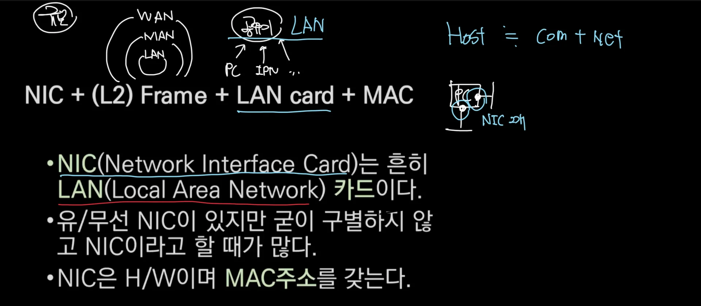
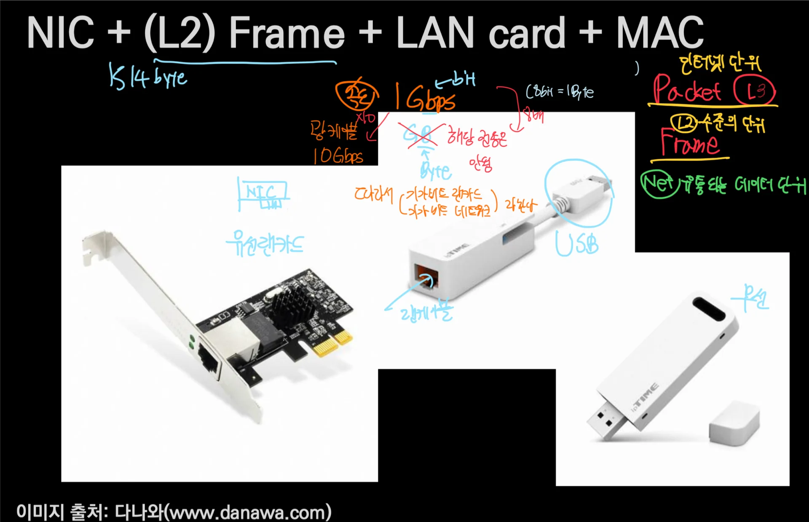
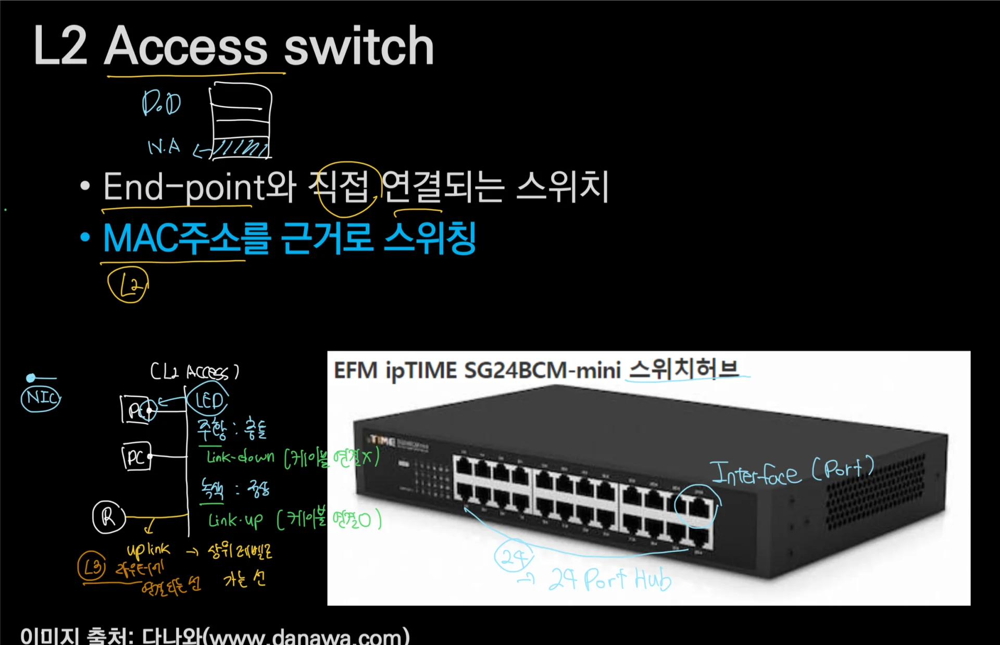
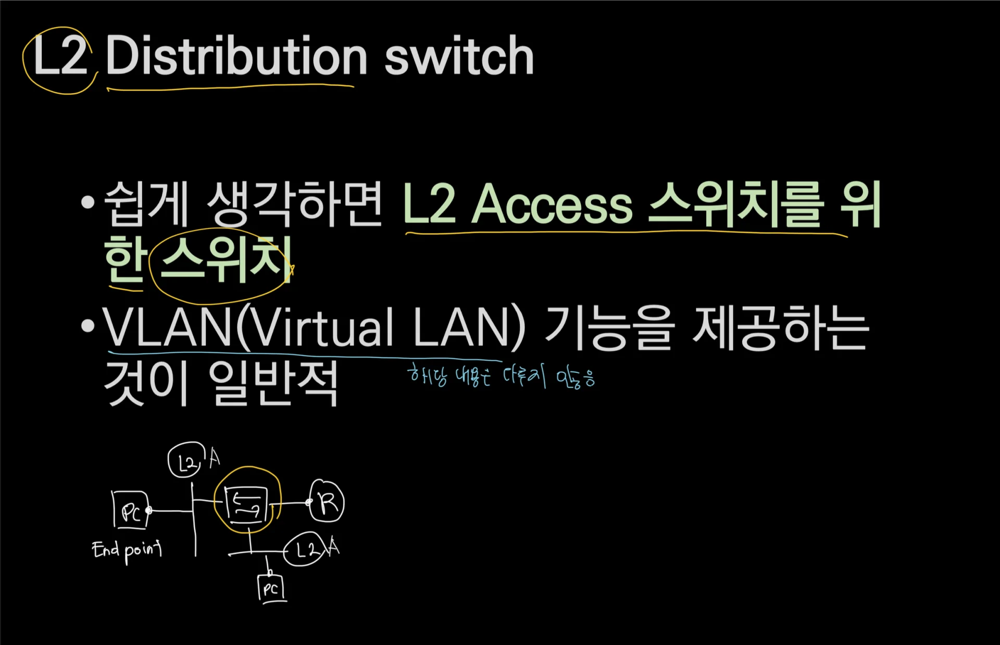
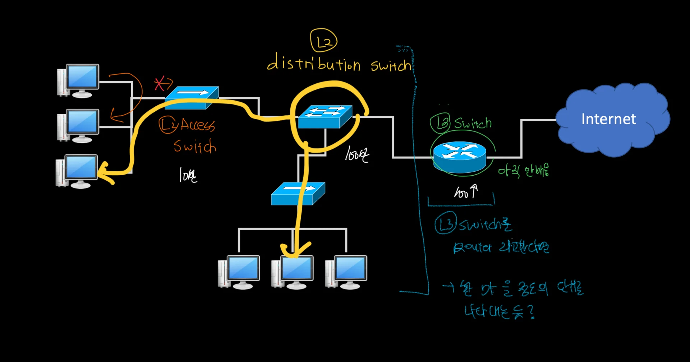
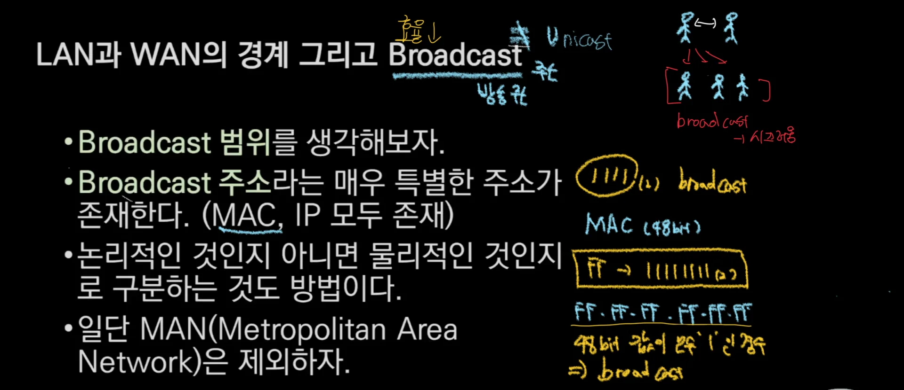
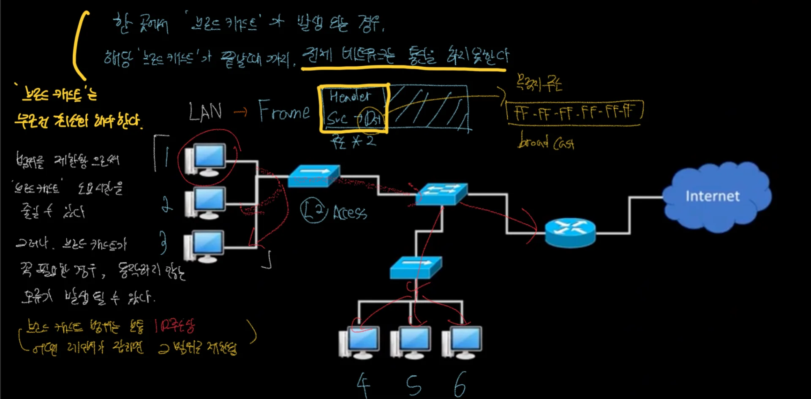
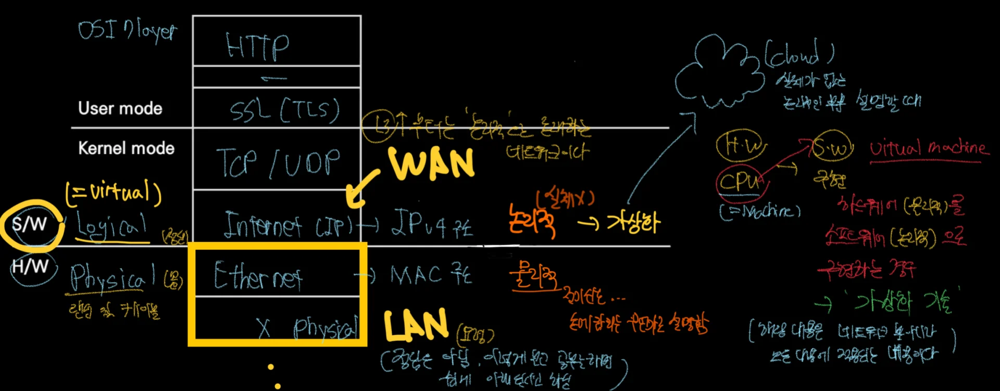

## 1&#46; NIC

## 2&#46; L2  Access Switch

## 3&#46; L2 Distribute Switch 

## 4&#46; L2 Broadcast

## 5&#46; Virtual ( 가상화 ) 

> LAN 과 WAN 은  강사님이 제시하는 팁으로 추후 공부 시, 이해하는데 도움이 될 것이라고 함

컴퓨터?(인터넷? 명칭이 애매&#46;&#46;)  는  H/W를 물리적(Physical) , S/W를 논리적(Logical)이라 한다&#46;

<code>Logical</code>은 Physical 처럼 <strong><u>실체가 존재하지 않</u></strong>아 다른 말로 <code>Virtual(가상화)</code>이라고도 표현된다&#46;  이러한 <code>가상화(Virtual) 기술</code>들은 실제가 없는 <code>구름(cloud</code>) 형태로 많이 표현된다&#46;

 <code>H/W</code>의 <code>CPU </code>다른 말로는 <code>Machine</code> 이라고도 부른다&#46; 따라서 <code>CPU</code>를 <code>S/W</code>로 구현한 기술을 <code>Virtual Machine</code> 이라 부른다&#46;
