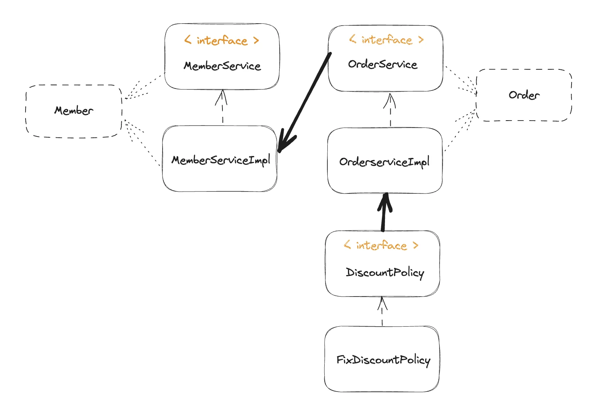

<a id="1c3eda9b0fe181c9af6ae981dcaad446"></a>

## 순수 자바 → Test

<a id="1c3eda9b0fe18143b11dd4ea98539ed1"></a>

```java
package hello.core;

import hello.core.member.Grade;
import hello.core.member.Member;
import hello.core.member.service.MemberService;
import hello.core.member.service.MemberServiceImpl;
import hello.core.order.Order;
import hello.core.order.OrderService;
import hello.core.order.OrderServiceImpl;

public class OrderApp {
    public static void main(String[] args) {
        MemberService memberService = new MemberServiceImpl();
        OrderService orderService = new OrderServiceImpl();
        long memberId = 1L;
        Member member = new Member(memberId, "memberA", Grade.VIP);
        memberService.join(member);

        Order order = orderService.createOrder(memberId, "itemA", 10000);
        System.out.println("order = " + order);

    }
}
```

<a id="1c3eda9b0fe181699c93c41ca8bd4f91"></a>

## Junit 사용한 테스트(권장)

<a id="1c3eda9b0fe181e69354ce37e6940a2d"></a>

```java
package hello.core.discount;

import hello.core.member.Grade;
import hello.core.member.Member;
import hello.core.member.service.MemberService;
import hello.core.member.service.MemberServiceImpl;
import hello.core.order.Order;
import hello.core.order.OrderService;
import hello.core.order.OrderServiceImpl;
import org.assertj.core.api.Assertions;
import org.junit.jupiter.api.DisplayName;
import org.junit.jupiter.api.Test;

import java.util.zip.Adler32;

class OrderServiceTest {
    MemberService memberService = new MemberServiceImpl();
    OrderService orderService = new OrderServiceImpl();

    @Test
    @DisplayName("VIP 회원은 1000원 할인 되어야 한다")
    void createOrder() {
        //given
        Long memberId = 1L;
        Member memberA = new Member(memberId, "memberA", Grade.VIP);
        memberService.join(memberA);

        //when
        Order order = orderService.createOrder(memberId, "itemA", 10000);
//        System.out.println("order = " + order);
        int isDiscountPrice = order.getItemPrice() - order.getDiscountPrice();

        //then
        Assertions.assertThat(isDiscountPrice).isEqualTo(order.calculatePrice());
    }

    @DisplayName("일반(BASIC) 회원은 정액 할인이 되지 않아야 한다")
    @Test
    void createOrder2() {
        // given
        Long memeberId = 2L;
        Member meberBASIC = new Member(memeberId, "meberBASIC", Grade.BASIC);
        memberService.join(meberBASIC);

        // when
        Order order = orderService.createOrder(memeberId, "itemB", 10000);
        int price = order.calculatePrice();

        // then
        Assertions.assertThat(price).isEqualTo(10000);
    }


}
```
