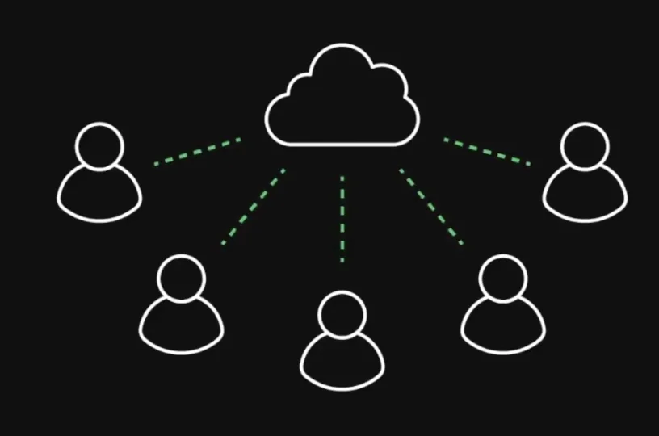
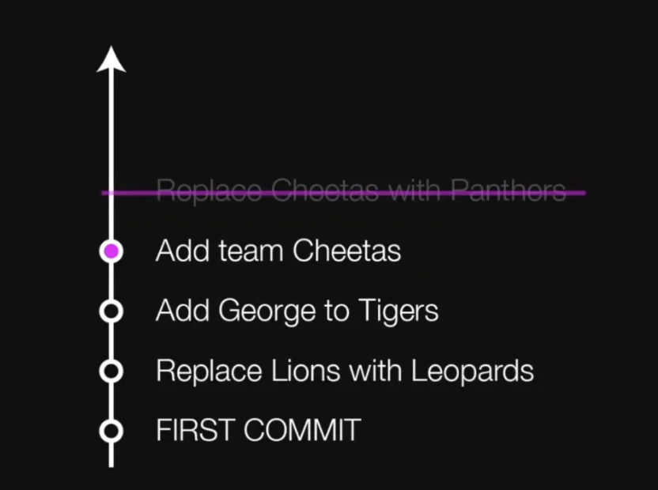

<a id="1c3eda9b0fe1818788ecc95ff570410f"></a>

<a href="#/post/1c3eda9b-0fe1-8136-9ee1-e1f7b953e3c0">페이지</a>

> ⚠️ <strong>reset</strong>을 협업에서 사용하는 경우 다른 사람들의 history와 충돌이 발생되어 심각한 오류가 발생된다&#46;  따라서 <strong>한번 공유가 된 코드는  </strong><strong><code>revert</code></strong><strong>를 사용하야 되돌려야 한다&#46;</strong>
> 
> 

<a id="1c3eda9b0fe1810dab9af02a71ac8d4b"></a>

돌아가고자 하는 <strong>이전 commit으로 돌아가</strong>  <strong><u>해당 commit 이후 내용들은 history에서 지워진다&#46; </u></strong>



> <code>—hard</code>&#58; 강제 실행<br><code>&#60;hash&#62;</code>&#58; git log 로 확인

<a id="1c3eda9b0fe181e3805cd7b7ba764c15"></a>

```bash
git reset --hard  <hash>
```

- git log 확인 
    
