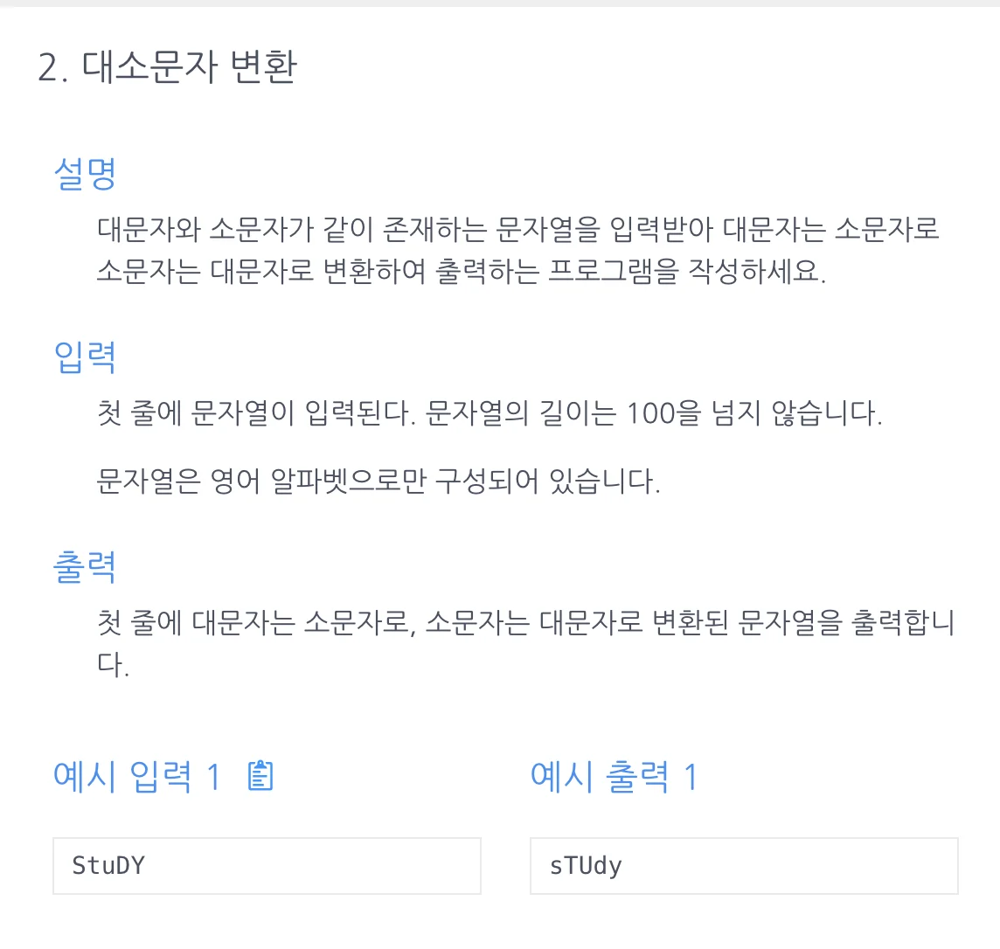

<a id="1c3eda9b0fe18164abcbc18857a258ec"></a>

# 문제



<a id="1c3eda9b0fe1818483d3c40dc0e9c280"></a>

# 풀이)

<a id="1c3eda9b0fe1815cb0cfc248555e52b9"></a>

### 풀이1) 대문자, 소문자 판별

<a id="1c3eda9b0fe1814aa0a4d822da0f7827"></a>

```java
import java.util.Scanner;

public class Main {
    public String solution(String str){
        String answer = "";   // Sting 데이터, 수식과 같이 더하기로 추가 가능
        // for문 돌리기
        //  1) if 소문자 판별: Character.isLowerCase(word) -> 대문자 변환: Character.toUpperCase(word);
        //  2) else 대문자 판별(Character.isUpperCase()), 입력값은 모두 영문자임, 위 소문자 판별을 제외하면 나머지는 대문자인 경우만 존재함. 따라서 실행 코드만 작성하면됨.
        //     -> 소문자 변환: Character.toLowerCase(word);
        for (char word : str.toCharArray()){
            if (Character.isLowerCase(word)) answer += Character.toUpperCase(word);
            else answer += Character.toLowerCase(word);
        }
        return answer;
    }
    public static void main(String[] args){
        Main m = new Main();
        Scanner sc = new Scanner(System.in);
        String str = sc.next();
        System.out.print(m.solution(str));
    }
};
```

<a id="1c3eda9b0fe181058af2c58bbe426514"></a>

### 풀이2 아스키코드  → 대문자(or 소문자) 판별

> 암시적인 형변환이 많이 일어남 → 권장하지 않음

<a id="1c3eda9b0fe181999fc8ce88f67adeff"></a>

```java
import java.util.Scanner;

public class Main {
    public String solution(String s) {
        String answer = "";
        for (char x : s.toCharArray()) {
            if(65 <= x && x<=90) answer += Character.toLowerCase(x);
            else answer += Character.toUpperCase(x);
        }
        return answer;

    }

    public static void main(String[] args){
        Main m = new Main();
        Scanner sc = new Scanner(System.in);
        String s = sc.next();
        System.out.print(m.solution(s));
    }
};s
```
