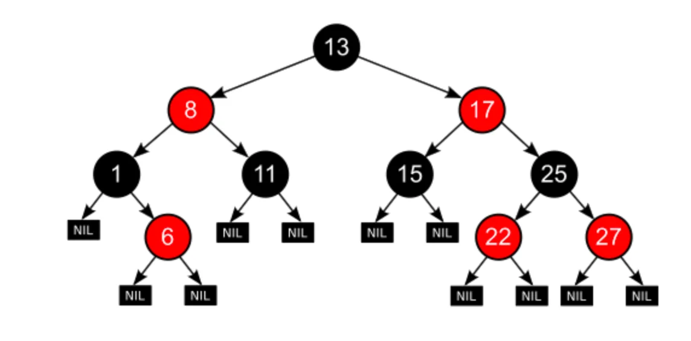
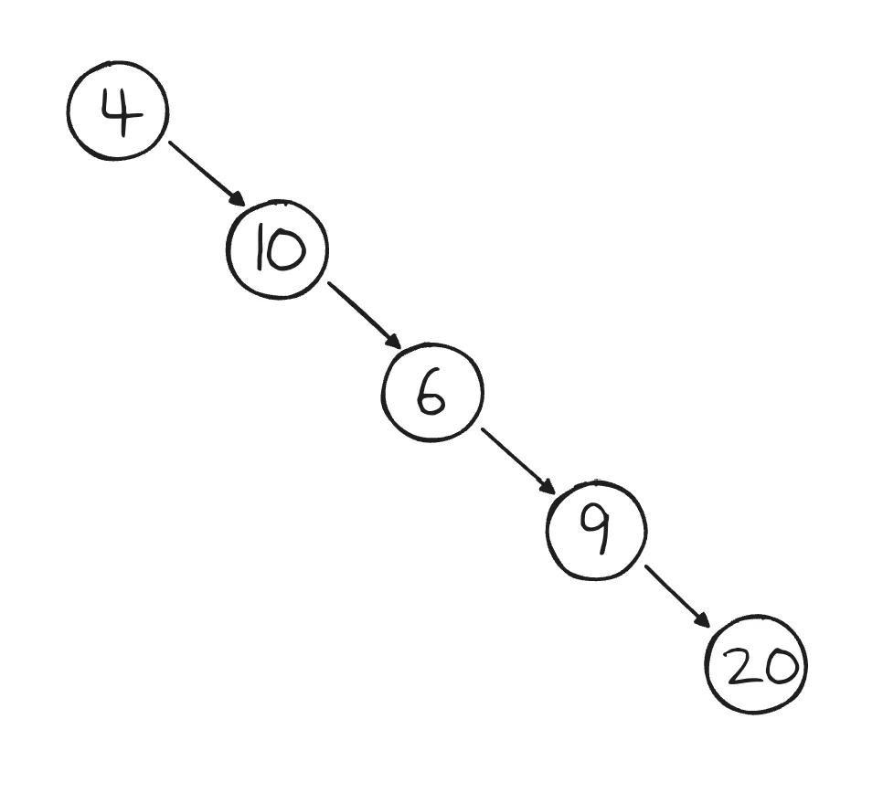
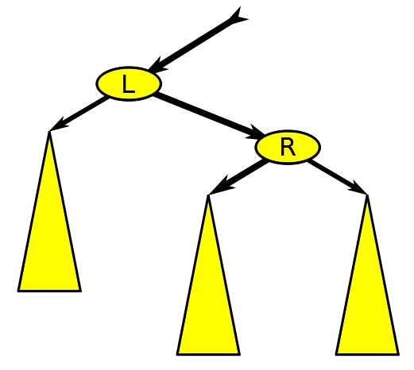

<details>
<summary>reference</summary>

<a id="1d0eda9b0fe1807f826aceefd86d7483"></a>

‣

<a id="1d0eda9b0fe180288fa8c047d9246065"></a>

‣

<a id="1d0eda9b0fe180a1868fd8b18c67a2a8"></a>

‣

<a id="1d0eda9b0fe1801ba3d3cc7aa96d03a8"></a>

‣

<a id="1d0eda9b0fe1800dbaced17319e0a7a3"></a>

‣

</details>

<a id="1d0eda9b0fe18078ba81d7565faff2ec"></a>

### 레드 블랙 트리

> 📖 
> 
> <a id="1d0eda9b0fe180d68030cc611beab7e9"></a>
> 
> <strong>레드&#45;블랙 트리 ( Red&#45;Black Tree )</strong>
> 
> ---
> 
> 
> 
> <a id="1d0eda9b0fe1809ba611ccfb2384c33a"></a>
> 
> <strong>이진 탐색 트리(BST)</strong>의 일종 <strong><u>트리의 높이를 균형 있게 유지</u></strong>해서 <strong><u>삽입, 삭제, 탐색 연산</u></strong>을 <strong>O(log n)</strong> 시간 안에 수행할 수 있도록 보장하는 <strong><u>자기 균형 이진 탐색 트리(</u></strong><u>self&#45;balancing binary search tree)</u>의 일종이다&#46;
> 
> - <strong><code>Node</code></strong>&#58; 🔴 <strong>Red, </strong>⚫ <strong>Black</strong>

<details>
<summary><strong> 레드&#45;블랙 트리의 5가지 규칙</strong></summary>

<a id="1d0eda9b0fe18005b1ccc46e371f710f"></a>

레드 블랙 트리는 아래 5가지 규칙을 항상 만족해야 한다&#46;

> ✅ 
> 
> <a id="1d0eda9b0fe1809badc2e02998025eac"></a>
> 
> <strong>레드&#45;블랙 트리의 5가지 규칙</strong>
> 
> ---
> 
> 1. <code>노드 색상</code>&#58; 노드는 빨강 또는 검정이다&#46; &#91; 🔴 <strong>Red, </strong>⚫ <strong>Black &#93;</strong>
> 
> 1. <code>루트 노드</code>&#58; 루트 노드는 항상 검정이다&#46; &#91; ⚫ <strong>Black &#93;</strong>
> 
> 1. <code>리프 노드</code>&#58; 모든 리프 노트(NIL, 즉 NULL 노드)는 검정이다&#46; &#91; ⚫ <strong>Black &#93;</strong>
> 
> 1. 빨강 노드는 연속으로 올 수 없다&#46; &#91; 🔴 <strong>Red → </strong>⚫ <strong>Black  &#93;</strong>
>     - 즉, 빨간 노드의 자식 노드는 반드시 검은색이다&#46;
> 
> 1. 어떤 노드에서 리프 노드까지 가는 모든 경로는 동일한 수의 검정 노드를 가져야 한다&#46; 

</details>

<details>
<summary>🧐 <strong>왜 레드 블랙 트리를 사용하는가?</strong></summary>

<a id="1d0eda9b0fe1809d8cbbe12665f8cef2"></a>

<strong>이진 탐색 트리 ( Binary Search Tree)</strong>의 경우<u> 데이터를 정렬된 상태로 저장</u>하여 일반적으로 <strong>빠른 탐색이 가능</strong>하다&#46; 

- 일반적인 탐색 시간복잡도&#58; <code class="language-math">O(logn)</code>

<a id="1d0eda9b0fe180f1877cc572d00314d5"></a>

하지만 최악의 경우 아래와 같이 <u>연결리스트</u>와 동일한 형태가 된다&#46; 즉, 연산에 <strong><u>선형 시간</u></strong>(<code>O(N</code>)이 소요된다&#46; 

- 탐색 시간복잡도&#58; <code class="language-math">O(n)</code>
    

<a id="1d0eda9b0fe180f8b840f7a7e0365c28"></a>

이러한 문제점을 해결하기 위해 <strong>균형 이진 탐색 트리(Balanced Binary Search Tree)</strong>가 등장했다&#46;

<a id="1d0eda9b0fe18074a820c9590defe06c"></a>

<strong>균형 이진 탐색 트리</strong>는 <u>삽입, 삭제 작업을 수행</u>할 때마다 <strong><u>자동으로 균형을 유지</u></strong>해, 최악의 경우에도 탐색 시간이 <code class="language-math">O(logn)</code>이 되도록 보장한다&#46; 

<a id="1d0eda9b0fe180d4bb1af631535aa443"></a>

<code>레드 블랙 트리</code>는 <u>균형 이진 탐색 트리의 일종</u>으로<strong> </strong><strong><u>최악의 경우</u></strong>에도 <strong>트리의 높이</strong>를 <code class="language-math">log(n)</code>으로 유지하여 탐색 성능을 보장한다&#46;

</details>

<details>
<summary><strong>🧐 NIL 노드</strong></summary>

<a id="1d0eda9b0fe180ed9f16f2ae7d370758"></a>

Sentinel은 데이터 구조의 끝을 나타내는 데에 사용하는 것을 의미하는데, 레드 블랙 트리의 경우 트리의 말단을 나타내는 Sentinel로서 NIL 노드가 사용된다&#46;

<a id="1d0eda9b0fe1802e8b3ace394afe6f93"></a>

NIL 노드를 사용했을 때의 장점은 <strong><u>삽입, 삭제 등의 연산들 수행할 때 NULL 포인터 체크를 하지 않</u></strong>아도 된다는 점이다&#46;

</details>

<details>
<summary>레드 블랙 트리의 균형</summary>

<a id="1d1eda9b0fe18004940ed8dd2f713e21"></a>

위 다섯 가지 규칙을 통해 <strong><u>트리의 균형을 유지</u></strong>하여 최악의 경우에도 탐색, 삽입, 삭제 연산의 시간 복잡도<code class="language-math">O(logn)</code> 으로 보장한다

<a id="1d1eda9b0fe18089aac7eef889d91581"></a>

<strong>균형 맞추는 방법</strong>

1. 삽입 후 재조정
    - 삽입된 노드는 기본적으로 빨간색으로 설정된다&#46;

    - 삽입 후 다음 과정을 통해 균형을 맞춘다&#46;
        - <code>재색칠(Recoloring)</code>
            - 부모와 삼촌 노드의 색상을 변경하여 규칙을 만족시킵니다&#46;

        - <code>회전(Rotation)</code>
            - 불균형이 발생할 경우 좌회전(Left Rotation) 또는 우회전(Right Rotation)을 수행하여 트리를 재구성한다&#46;

1. 삭제 후 재조정
    - 노드를 삭제하면 블랙 높이가 깨질 수 있습니다&#46; 이를 해결하기 위해&#58;

    - 더블 블랙(Double Black) 상태를 처리하며, 형제 노드와 부모 노드의 색상을 변경하거나 회전을 수행한다&#46;

    - 필요 시 재색칠 및 회전을 반복하여 블랙 높이를 동일하게 유지한다&#46;

<a id="1d1eda9b0fe180b9bbe1fb85e4d631a9"></a>

<strong>회전 연산</strong>

> ✏️ 
> 
> <a id="1d0eda9b0fe180ae9cadda58e6e25935"></a>
> 
> 불균형이 발생할 경우 좌회전(Left Rotation) 또는 우회전(Right Rotation)을 수행하여 트리를 재구성한다&#46;
> 
> - <strong>좌회전(Left Rotation)</strong>
>     - 현재 노드를 기준으로 오른쪽 자식을 부모로 이동시키는 연산
> 
> - <strong>우회전(Right Rotation)</strong>
>     - 현재 노드를 기준으로 오른쪽 자식을 부모로 이동시키는 연산&#46;
> 
> ---
> 
> 
> 
> 

- 예를 들어, 삽입 후 “Double Red” 문제가 발생하면 삼촌 노드의 색상과 구조에 따라 회전을 통해 문제를 해결할 수 있다&#46;

- 레드 블랙 트리는 이러한 규칙과 연산을 통해 항상 균형을 유지하며, 효율적인 데이터 검색 및 수정 작업을 지원한다&#46;


</details>

<a id="1d0eda9b0fe1806f8500d1e4cdcb077c"></a>

### 구현

<details>
<summary>&#91; 코드 &#93; RedBlackTree</summary>

<a id="1d0eda9b0fe180699550cad195ae5bdf"></a>

```java
package collection.black_red_tree;

import java.util.Objects;

public class RedBlackTree<E extends Comparable<E>> {

    private static final int RED = 1;
    private static final int BLACK = 0;

    private Node<E> root;

    public static class Node<E> {
        E value;
        int color;
        Node<E> left, right, parent;

        Node(E value) {
            this.value = value;
            this.color = RED;
        }

        public E getValue() {
            return value;
        }

        public Node<E> getLeft() {
            return this.left;
        }

        public Node<E> getRight() {
            return this.right;
        }

        public boolean isBlack() {
            return color == BLACK;
        }

        public boolean isRed() {
            return color == RED;
        }
    }

    public void insert(E value) {
        Node<E> newNode = new Node<>(value);
        if (root == null) {
            root = newNode;
            root.color = BLACK;
        } else {
            if (!insertNode(root, newNode)) {
                return; // 중복된 값이면 삽입하지 않음
            }
            fixInsert(newNode);
        }
    }

    private boolean insertNode(Node<E> current, Node<E> newNode) {
        int cmp = newNode.value.compareTo(current.value);
        if (cmp < 0) {
            if (current.left == null) {
                current.left = newNode;
                newNode.parent = current;
                return true;
            }
            return insertNode(current.left, newNode);
        } else if (cmp > 0) {
            if (current.right == null) {
                current.right = newNode;
                newNode.parent = current;
                return true;
            }
            return insertNode(current.right, newNode);
        } else {
            return false; // 중복
        }
    }

    private void fixInsert(Node<E> node) {
        while (node != root && node.parent.color == RED && node.parent.parent != null) {
            Node<E> parent = node.parent;
            Node<E> grandParent = parent.parent;

            if (parent == grandParent.left) {
                Node<E> uncle = grandParent.right;

                if (uncle != null && uncle.color == RED) {
                    parent.color = BLACK;
                    uncle.color = BLACK;
                    grandParent.color = RED;
                    node = grandParent;
                } else {
                    if (node == parent.right) {
                        node = parent;
                        rotateLeft(node);
                    }
                    node.parent.color = BLACK;
                    grandParent.color = RED;
                    rotateRight(grandParent);
                }
            } else {
                Node<E> uncle = grandParent.left;

                if (uncle != null && uncle.color == RED) {
                    parent.color = BLACK;
                    uncle.color = BLACK;
                    grandParent.color = RED;
                    node = grandParent;
                } else {
                    if (node == parent.left) {
                        node = parent;
                        rotateRight(node);
                    }
                    node.parent.color = BLACK;
                    grandParent.color = RED;
                    rotateLeft(grandParent);
                }
            }
        }

        while (node.parent != null) {
            node = node.parent;
        }
        root = node;
        root.color = BLACK;
    }

    private void rotateLeft(Node<E> node) {
        Node<E> rightChild = node.right;
        node.right = rightChild.left;

        if (rightChild.left != null) {
            rightChild.left.parent = node;
        }

        rightChild.parent = node.parent;

        if (node.parent == null) {
            root = rightChild;
        } else if (node == node.parent.left) {
            node.parent.left = rightChild;
        } else {
            node.parent.right = rightChild;
        }

        rightChild.left = node;
        node.parent = rightChild;
    }

    private void rotateRight(Node<E> node) {
        Node<E> leftChild = node.left;
        node.left = leftChild.right;

        if (leftChild.right != null) {
            leftChild.right.parent = node;
        }

        leftChild.parent = node.parent;

        if (node.parent == null) {
            root = leftChild;
        } else if (node == node.parent.right) {
            node.parent.right = leftChild;
        } else {
            node.parent.left = leftChild;
        }

        leftChild.right = node;
        node.parent = leftChild;
    }

    public void printTree() {
        printTree(root, "", true);
    }

    private void printTree(Node<E> current, String indent, boolean isLast) {
        if (current != null) {
            System.out.println(indent + (isLast ? "└── " : "├── ") + current.value + "(" + (current.color == RED ? "RED" : "BLACK") + ")");
            printTree(current.left, indent + (isLast ? "    " : "│   "), false);
            printTree(current.right, indent + (isLast ? "    " : "│   "), true);
        }
    }

    public Node<E> getRoot() {
        return root;
    }

    public boolean contains(E value) {
        Node<E> current = root;
        while (current != null) {
            int cmp = value.compareTo(current.value);
            if (cmp < 0) current = current.left;
            else if (cmp > 0) current = current.right;
            else return true;
        }
        return false;
    }

    @Override
    public boolean equals(Object object) {
        if (this == object) return true;
        if (object == null || getClass() != object.getClass()) return false;
        RedBlackTree<?> that = (RedBlackTree<?>) object;
        return Objects.equals(root, that.root);
    }

    @Override
    public int hashCode() {
        return Objects.hash(root);
    }
}
```

</details>

<details>
<summary>&#91; 코드 &#93; RedBlackTreeTest</summary>

<a id="1d0eda9b0fe180fe8954e977dd4ec002"></a>

```java
package collection.black_red_tree;
import org.junit.jupiter.api.DisplayName;
import org.junit.jupiter.api.Test;

import static org.junit.jupiter.api.Assertions.*;

public class RedBlackTreeTest {

    @Test
    public void testInsertionAndSearch() {
        RedBlackTree<Integer> tree = new RedBlackTree<>();

        tree.insert(10);
        tree.insert(20);
        tree.insert(30);
        tree.insert(15);

        assertTrue(tree.contains(10));
        assertTrue(tree.contains(15));
        assertTrue(tree.contains(20));
        assertTrue(tree.contains(30));
        assertFalse(tree.contains(5));
    }

    @Test
    public void testRootIsBlack() {
        RedBlackTree<Integer> tree = new RedBlackTree<>();
        tree.insert(10);
        tree.insert(5);
        tree.insert(15);

        assertEquals(10, tree.getRoot().getValue()); // 루트 값 확인
    }

    @Test
    public void testDuplicateInsert() {
        RedBlackTree<Integer> tree = new RedBlackTree<>();
        tree.insert(10);
        tree.insert(10); // 중복 삽입 시도

        int count = countNodes(tree); // 중복 없이 한 개만 들어가야 함
        assertEquals(1, count);
    }

    private int countNodes(RedBlackTree<Integer> tree) {
        Counter counter = new Counter(0);

        // Reflection으로 root 접근
        try {
            java.lang.reflect.Field rootField = RedBlackTree.class.getDeclaredField("root");
            rootField.setAccessible(true);
            Object root = rootField.get(tree);
            countRecursively(root, counter);
        } catch (Exception e) {
            fail("Reflection failed");
        }

        return counter.count;
    }

    private void countRecursively(Object nodeObj, Counter counter) throws Exception {
        if (nodeObj == null) return;

        Class<?> nodeClass = nodeObj.getClass();
        java.lang.reflect.Field leftField = nodeClass.getDeclaredField("left");
        java.lang.reflect.Field rightField = nodeClass.getDeclaredField("right");
        leftField.setAccessible(true);
        rightField.setAccessible(true);

        Object left = leftField.get(nodeObj);
        Object right = rightField.get(nodeObj);

        counter.count++;
        countRecursively(left, counter);
        countRecursively(right, counter);
    }

    static class Counter {
        int count;

        public Counter(int count) {
            this.count = count;
        }
    }

    @DisplayName("LL 회전 (Left-Left 회전) 케이스")
    @Test
    public void testLLRotation() {
        RedBlackTree<Integer> tree = new RedBlackTree<>();
        tree.insert(30);
        tree.insert(20);
        tree.insert(10);
        RedBlackTree.Node<Integer> root = tree.getRoot();
        assertEquals(Integer.valueOf(20), root.getValue());          // 회전 후 루트는 20
        assertEquals(Integer.valueOf(10), root.getLeft().getValue()); // 왼쪽 자식은 10
        assertEquals(Integer.valueOf(30), root.getRight().getValue()); // 오른쪽 자식은 30
        assertTrue(root.isBlack());             // 새 루트 20은 검정색
        assertTrue(root.getLeft().isRed());     // 10은 빨강색
        assertTrue(root.getRight().isRed());    // 30은 빨강색
    }

    @DisplayName("LR 회전 (Left-Right 회전) 케이스")
    @Test
    public void testLRRotation() {
        RedBlackTree<Integer> tree = new RedBlackTree<>();
        tree.insert(30);
        tree.insert(10);
        tree.insert(20);
        RedBlackTree.Node<Integer> root = tree.getRoot();
        assertEquals(Integer.valueOf(20), root.getValue());           // 회전 후 루트 20
        assertEquals(Integer.valueOf(10), root.getLeft().getValue());  // 왼쪽 자식 10
        assertEquals(Integer.valueOf(30), root.getRight().getValue()); // 오른쪽 자식 30
        assertTrue(root.isBlack());              // 20은 검정색
        assertTrue(root.getLeft().isRed());      // 10은 빨강색
        assertTrue(root.getRight().isRed());     // 30은 빨강색
    }

    @DisplayName("RL 회전 (Right-Left 회전) 케이스")
    @Test
    public void testRLRotation() {
        RedBlackTree<Integer> tree = new RedBlackTree<>();
        tree.insert(10);
        tree.insert(30);
        tree.insert(20);
        RedBlackTree.Node<Integer> root = tree.getRoot();
        assertEquals(Integer.valueOf(20), root.getValue());            // 회전 후 루트 20
        assertEquals(Integer.valueOf(10), root.getLeft().getValue());   // 왼쪽 자식 10
        assertEquals(Integer.valueOf(30), root.getRight().getValue());  // 오른쪽 자식 30
        assertTrue(root.isBlack());               // 20은 검정색
        assertTrue(root.getLeft().isRed());       // 10은 빨강색
        assertTrue(root.getRight().isRed());      // 30은 빨강색
    }


    @DisplayName("RR 회전 (Right-Right 회전) 케이스")
    @Test
    public void testRRRotation() {
        RedBlackTree<Integer> tree = new RedBlackTree<>();
        tree.insert(10);
        tree.insert(20);
        tree.insert(30);
        RedBlackTree.Node<Integer> root = tree.getRoot();
        assertEquals(Integer.valueOf(20), root.getValue());            // 회전 후 루트 20
        assertEquals(Integer.valueOf(10), root.getLeft().getValue());   // 왼쪽 자식 10
        assertEquals(Integer.valueOf(30), root.getRight().getValue());  // 오른쪽 자식 30
        assertTrue(root.isBlack());                // 20은 검정색 (루트는 항상 검정)
        assertTrue(root.getLeft().isRed());        // 10은 빨강색
        assertTrue(root.getRight().isRed());       // 30은 빨강색
    }
}
```

</details>

<a id="1d0eda9b0fe18002b951e3f45be5ec0d"></a>

### <strong>레드&#45;블랙 트리의 LL, LR, RL, RR 회전 </strong><strong>테스트</strong>

<details>
<summary><strong>LL 회전 (Left&#45;Left 회전) 케이스</strong></summary>

<a id="1d0eda9b0fe18033b161f5194b01a447"></a>

```java
@Test
public void testLLRotation() {
    RedBlackTree<Integer> tree = new RedBlackTree<>();
    tree.insert(30);
    tree.insert(20);
    tree.insert(10);
    Node<Integer> root = tree.getRoot();
    assertEquals(Integer.valueOf(20), root.getValue());          // 회전 후 루트는 20
    assertEquals(Integer.valueOf(10), root.getLeft().getValue()); // 왼쪽 자식은 10
    assertEquals(Integer.valueOf(30), root.getRight().getValue()); // 오른쪽 자식은 30
    assertTrue(root.isBlack());             // 새 루트 20은 검정색
    assertTrue(root.getLeft().isRed());     // 10은 빨강색
    assertTrue(root.getRight().isRed());    // 30은 빨강색
}
```

</details>

<details>
<summary><strong>LR 회전 (Left&#45;Right 회전) 케이스</strong></summary>

> <strong>삽입 순서 예&#58;</strong> 30 → 10 → 20

<a id="1d0eda9b0fe180f19510d0372b4ad15b"></a>

```java
@Test
public void testLRRotation() {
    RedBlackTree<Integer> tree = new RedBlackTree<>();
    tree.insert(30);
    tree.insert(10);
    tree.insert(20);
    Node<Integer> root = tree.getRoot();
    assertEquals(Integer.valueOf(20), root.getValue());           // 회전 후 루트 20
    assertEquals(Integer.valueOf(10), root.getLeft().getValue());  // 왼쪽 자식 10
    assertEquals(Integer.valueOf(30), root.getRight().getValue()); // 오른쪽 자식 30
    assertTrue(root.isBlack());              // 20은 검정색
    assertTrue(root.getLeft().isRed());      // 10은 빨강색
    assertTrue(root.getRight().isRed());     // 30은 빨강색
}
```

</details>

<details>
<summary><strong>RL 회전 (Right&#45;Left 회전) 케이스</strong></summary>

<a id="1d0eda9b0fe180ec97bdc1c65be99fad"></a>

```java
@Test
public void testRLRotation() {
    RedBlackTree<Integer> tree = new RedBlackTree<>();
    tree.insert(10);
    tree.insert(30);
    tree.insert(20);
    Node<Integer> root = tree.getRoot();
    assertEquals(Integer.valueOf(20), root.getValue());            // 회전 후 루트 20
    assertEquals(Integer.valueOf(10), root.getLeft().getValue());   // 왼쪽 자식 10
    assertEquals(Integer.valueOf(30), root.getRight().getValue());  // 오른쪽 자식 30
    assertTrue(root.isBlack());               // 20은 검정색
    assertTrue(root.getLeft().isRed());       // 10은 빨강색
    assertTrue(root.getRight().isRed());      // 30은 빨강색
}
```

</details>

<details>
<summary><strong>RR 회전 (Right&#45;Right 회전) 케이스</strong></summary>

<a id="1d0eda9b0fe18030af39f171c3e4cdce"></a>

```java
@Test
public void testRRRotation() {
    RedBlackTree<Integer> tree = new RedBlackTree<>();
    tree.insert(10);
    tree.insert(20);
    tree.insert(30);
    Node<Integer> root = tree.getRoot();
    assertEquals(Integer.valueOf(20), root.getValue());            // 회전 후 루트 20
    assertEquals(Integer.valueOf(10), root.getLeft().getValue());   // 왼쪽 자식 10
    assertEquals(Integer.valueOf(30), root.getRight().getValue());  // 오른쪽 자식 30
    assertTrue(root.isBlack());                // 20은 검정색 (루트는 항상 검정)
    assertTrue(root.getLeft().isRed());        // 10은 빨강색
    assertTrue(root.getRight().isRed());       // 30은 빨강색
}
```

</details>

> 🗒️ 
> 
> <a id="1d1eda9b0fe1804d8a90e20685716ec5"></a>
> 
> 각 예제에서 보았듯이, LL이나 RR처럼 <strong>일직선으로 늘어선 경우에는 단일 회전</strong>으로 충분하고, LR이나 RL처럼 <strong>부모&#45;자식&#45;조부모가 꺾인(triangle) 경우에는 두 번의 회전</strong>이 필요하다&#46;
> 
> <a id="1d1eda9b0fe18017aeb5fe8d7c2ee6f0"></a>
> 
> 이러한 회전은 삽입으로 인한 레드&#45;블랙 트리 속성 위반(연속된 빨강 노드)을 해결하고 트리를 균형 상태로 유지 해준다&#46;
