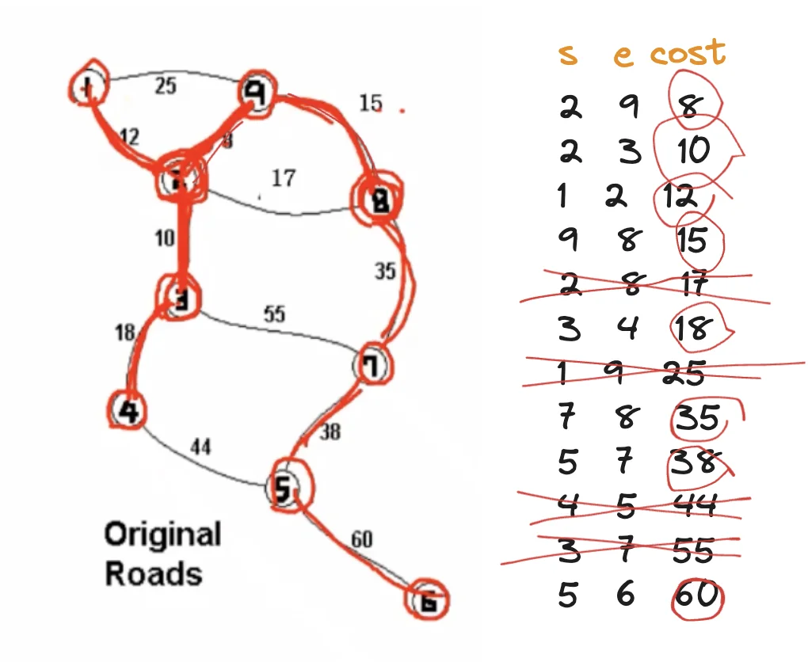

<a id="1c3eda9b0fe181d68e55eef9f6316c45"></a>

# 문제

<a id="1c3eda9b0fe181a29f43d070753d9b12"></a>

## <strong>7&#46; 원더랜드(최소스패닝트리)</strong>

<a id="1c3eda9b0fe181d08b81cfe52b400075"></a>

### 설명

<a id="1c3eda9b0fe181288670e527111cb0ff"></a>

원더랜드에 문제가 생겼다&#46; 원더랜드의 각 도로를 유지보수하는 재정이 바닥난 것이다&#46;

<a id="1c3eda9b0fe181b2ba49ebbaf96c3e64"></a>

원더랜드는 모든 도시를 서로 연결하면서 최소의 유지비용이 들도록 도로를 선택하고 나머지 도로는 폐쇄하려고 한다&#46;

<a id="1c3eda9b0fe181528bb7c568d520d9c7"></a>

아래의 그림은 그 한 예를 설명하는 그림이다&#46;


<a id="1c3eda9b0fe181309f4dd5a0dfe29564"></a>

위의 지도는 각 도시가 1부터 9로 표현되었고, 지도의 오른쪽은 최소비용 196으로 모든 도시를 연결하는 방법을 찾아낸 것이다&#46;

<a id="1c3eda9b0fe1815d8672d4c73ce3ac2d"></a>

### 입력

<a id="1c3eda9b0fe1810ea431f9f978a98e7b"></a>

첫째 줄에 도시의 개수 V(1≤V≤100)와 도로의 개수 E(1≤E≤1,000)가 주어진다&#46;

<a id="1c3eda9b0fe181beaf58cb3ed9e1fe16"></a>

다음 E개의 줄에는 각 도로에 대한 정보를 나타내는 세 정수 A, B, C가 주어진다&#46;

<a id="1c3eda9b0fe18130897af1b5a7675858"></a>

이는 A번 도시와 B번 도시가 유지비용이 C인 도로로 연결되어 있다는 의미이다&#46;

<a id="1c3eda9b0fe1815b9bfaf811ae97af51"></a>

### 출력

<a id="1c3eda9b0fe181859ca2c93f9fe6154c"></a>

모든 도시를 연결하면서 드는 최소비용을 출력한다&#46;

---

<a id="1c3eda9b0fe181ab8e8cfb16825b9d90"></a>

### 예시 입력 1

<a id="1c3eda9b0fe181e2b199e8327ea51f79"></a>

```plaintext
9 12 
1 2 12
1 9 25
2 3 10
2 8 17
2 9 8
3 4 18
3 7 55
4 5 44
5 6 60
5 7 38
7 8 35
8 9 15

```

<a id="1c3eda9b0fe181b181e1cd2a1497162b"></a>

### 예시 출력 1

<a id="1c3eda9b0fe18154ac0cea384ed2d677"></a>

```plaintext
196
```

<a id="1c3eda9b0fe18197a22ce065331eb347"></a>

# 풀이



<a id="1c3eda9b0fe1816c931ef62188b7db0e"></a>

## 풀이1) <strong><code>최소 스패닝 트리</code></strong><strong>, </strong><strong><code>union&#45;find</code></strong>

<a id="1c3eda9b0fe181118da7c0f5f0608ccb"></a>

```java
import java.util.*;

class Edge implements Comparable<Edge>{
    int v1, v2, cost;
    Edge(int v1, int v2, int cost){
        this.v1 = v1;
        this.v2 = v2;
        this.cost = cost;
    }

    @Override
    public int compareTo(Edge o){
        return this.cost - o.cost;
    }
}

public class Main {
    static int[] unf;

    public  static int Find(int v){
        if(v==unf[v]) return v;
        else return unf[v]=Find(unf[v]);
    }

    public static void Union(int a, int b){
        int fa=Find(a);
        int fb=Find(b);
        if(fa!=fb) unf[fa]=fb;
    }

    public static void main(String[] args) {
        Main T = new Main();
        Scanner sc = new Scanner(System.in);
        int n=sc.nextInt();
        int m=sc.nextInt();
        unf = new int[n+1];
        ArrayList<Edge> arr = new ArrayList<>();
        for(int i=1; i<=n; i++) unf[i]=i;
        for(int i=0; i<m; i++) {
          int a=sc.nextInt();
          int b=sc.nextInt();
          int c=sc.nextInt();
          arr.add(new Edge(a, b, c));
        }

        int answer=0;
        Collections.sort(arr);
        for(Edge ob : arr){
            int fv1=Find(ob.v1);
            int fv2=Find(ob.v2);
            if(fv1!=fv2){
                answer+=ob.cost;
                Union(ob.v1, ob.v2);
            }
        }
        System.out.println(answer);
    }
}
```

<a id="1c3eda9b0fe18173a83fda7ae0bf84e3"></a>

## 풀이2) 

<a id="1c3eda9b0fe1814d81a5dade55f72d36"></a>

### 1차시도  &#45; Error ( 3/5)

<details>
<summary><strong>Fail case</strong></summary>

<details>
<summary>1)</summary>

<a id="1c3eda9b0fe1813aad91f94097cbef12"></a>

```plaintext
11 17
1 2 4
1 3 1
1 4 2
1 5 3
2 6 4
3 4 2
4 6 4
4 7 4
5 6 4
6 10 2
6 11 4
7 8 3
7 9 3
7 10 4
8 9 2
9 10 2
10 11 1
```

</details>

<details>
<summary>2) </summary>

<a id="1c3eda9b0fe181feb9f1fb04aa36879e"></a>

```plaintext
13 22
1 2 4
1 3 1
1 4 2
1 5 3
2 6 4
3 4 2
4 6 4
4 7 4
5 6 4
6 10 2
6 11 4
7 8 3
7 9 3
7 10 4
8 9 2
9 10 2
10 11 1
11 12 3
12 13 5
9 13 2
1 8 5
1 9 1
```

</details>

</details>

<details>
<summary>code </summary>

<a id="1c3eda9b0fe181308f29c9d5067c96b7"></a>

```java
import java.util.*;


class Road implements Comparable<Road>{
    int v1, v2, cost;
    Road(int v1, int v2, int cost){
        this.v1 = v1;
        this.v2 = v2;
        this.cost = cost;
    }

    @Override
    public  int compareTo(Road o){
        return this.cost - o.cost;
    }
}

public class Main {
    static int answer=0;
    static int[] unf;
    static int Find(int v){
        if(unf[v]==v) return v;
        else return unf[v]=unf[unf[v]];
    }

    static void Union(int a, int b, int cost){
        int fa = Find(a);
        int fb = Find(b);
        if(fa != fb) {
            unf[fa]=fb;
            answer+=cost;
        }
    }

    public static void main(String[] args) {
        Scanner sc = new Scanner(System.in);
        int n= sc.nextInt();
        int m = sc.nextInt();
        unf = new int[n+1];
        ArrayList<Road> arr = new ArrayList<>();
        for(int i=1; i<=n; i++) unf[i]=i;
        for(int i=0; i<m; i++){
            int a = sc.nextInt();
            int b = sc.nextInt();
            int c = sc.nextInt();
            arr.add(new Road(a, b, c));
        }

        Collections.sort(arr);
        for(Road ob : arr){
            Union(ob.v1, ob.v2, ob.cost);
        }

        System.out.println(answer);

    }
}
```

</details>

<a id="1c3eda9b0fe18154b7a5e77c4a09568c"></a>

### 2차시도 &#45; 해결

<a id="1c3eda9b0fe1816b86edd6e4b746f5c7"></a>

Find Method 리턴 값 잘못 설계함

<details>
<summary>code </summary>

<a id="1c3eda9b0fe18118b524d6dae30c8b71"></a>

```java
import java.util.*;


class Road implements Comparable<Road>{
    int v1, v2, cost;
    Road(int v1, int v2, int cost){
        this.v1 = v1;
        this.v2 = v2;
        this.cost = cost;
    }

    @Override
    public  int compareTo(Road o){
        return this.cost - o.cost;
    }
}

public class Main {
    static int answer=0;
    static int[] unf;
    static int Find(int v){
        if(unf[v]==v) return v;
        else return unf[v]=Find(unf[v]);
    }

    static void Union(int a, int b, int cost){
        int fa = Find(a);
        int fb = Find(b);
        if(fa != fb) {
            unf[fa]=fb;
            answer+=cost;
        }
    }

    public static void main(String[] args) {
        Scanner sc = new Scanner(System.in);
        int n= sc.nextInt();
        int m = sc.nextInt();
        unf = new int[n+1];
        ArrayList<Road> arr = new ArrayList<>();
        for(int i=1; i<=n; i++) unf[i]=i;
        for(int i=0; i<m; i++){
            int a = sc.nextInt();
            int b = sc.nextInt();
            int c = sc.nextInt();
            arr.add(new Road(a, b, c));
        }

        Collections.sort(arr);
        for(Road ob : arr){
            Union(ob.v1, ob.v2, ob.cost);
        }

        System.out.println(answer);
    }
}
```

</details>
