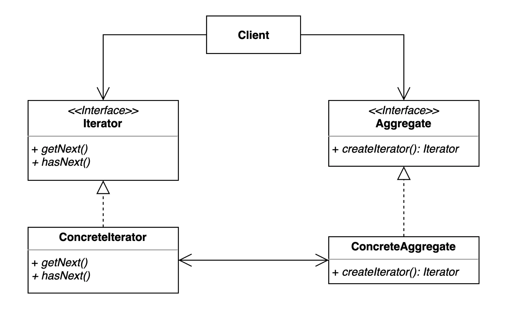
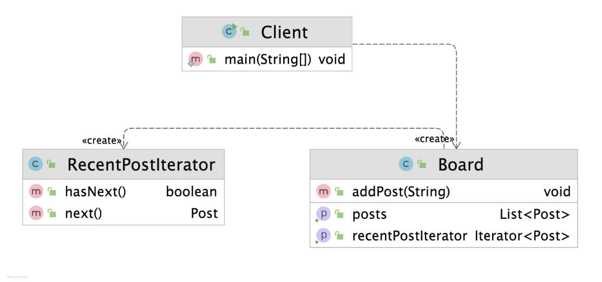
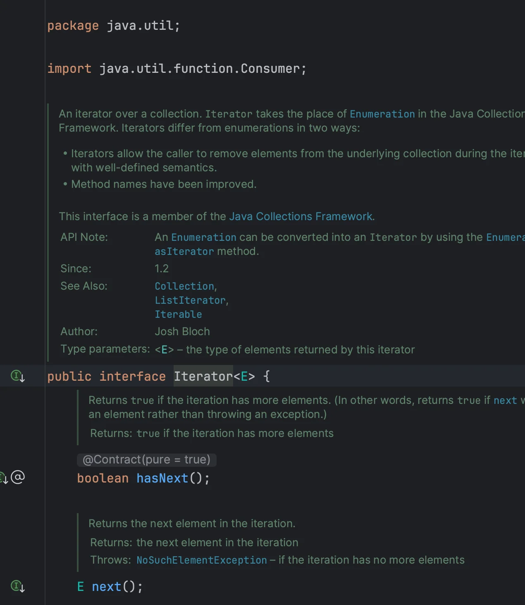

> 📝 
> 
> <a id="1daeda9b0fe1805ab64acb2aabab96b8"></a>
> 
> <strong>질문</strong>
> 
> <details>
> <summary>이터레이터 패턴이란 무엇인가?</summary>
> 
> 
> 
> </details>
> 
> <details>
> <summary>이터레이터 패턴의 장•단점은?</summary>
> 
> 
> 
> </details>
> 
> <details>
> <summary>실무 사용 예제는?</summary>
> 
> 
> 
> </details>

<a id="1daeda9b0fe180c688e8d3dfc7262801"></a>

## 이터레이터 패턴

---

> 📖 
> 
> <a id="1daeda9b0fe18049b6e8c69aa0146681"></a>
> 
> <strong>이터레이터 패턴</strong>
> 
> ---
> 
> > <code>집합 객체 ( 컬렉션&#91;리스트, 배열, 트리…&#93; )</code>의 <strong><u>내부 구조를 노출시키지 않</u></strong>고 <strong>순회 방법을 제공</strong>하는 패턴
> 
> 
> 
> <details>
> <summary>구성 요소</summary>
> 
> - <code>Aggregate</code>&#58; 이터레이터를 생성하는 인터페이스
> 
> - <code>ConcreteAggregate</code>&#58; 실제 데이터 집합체(컬렉션) 구현체
> 
> - <code>Iterator</code>&#58; 순회에 필요한 인터페이스
> 
> - <code>ConcreteIterator</code>&#58; 실제 순회 알고리즘을 구현한 이터레이터 구현체
> 
> ---
> 
> <details>
> <summary>ex)</summary>
> 
> <a id="1daeda9b0fe180148b90f271e01966c3"></a>
> 
> ```java
> public interface Iterator {
>     boolean next();
>     Object current();
> }
> 
> public interface Aggregator {
>     Iterator iterator();
> }
> 
> public class Array implements Aggregator {
>     private Item[] items;
>     public Array(Item[] items) { this.items = items; }
>     public Iterator iterator() { return new ArrayIterator(this); }
>     // ...
> }
> 
> public class ArrayIterator implements Iterator {
>     private Array array;
>     private int index = -1;
>     public boolean next() { index++; return index < array.getCount(); }
>     public Object current() { return array.getItem(index); }
> }
> ```
> 
> </details>
> 
> </details>
> 
> <details>
> <summary>장•단점</summary>
> 
> > <strong>장점</strong>
> 
> - <code>내부 구조 은닉</code>
>     - 컬렉션의 내부 구현 (배열, 트리, 해시 등)을 클라이언트에게 숨긴다&#46; 
> 
>     - 클라이언트는 iterator를 통해서만 요소에 접근한다&#46; 
>         - 컬렉션 내부 구조에 의존하지 않고 요소에 접근할 수 있다&#46; 
> 
> - <code>순회 방법 다양성</code>
>     - 여러가지 순회 전략(ex&#46; 최근순, 작성순, 깊이 우선, 너비 우선 등)을 구현할 수 있다&#46; 
> 
> - <code>클라이언트 코드와의 느슨한 결합(</code><strong><code>loosely coupling)</code></strong><strong>  → </strong><strong><code>OCP 준수</code></strong>
>     - 컬렉션의 종류나 구조가 바뀌어도 <strong><u>클라이언트 코드는 변경이 거의 필요없</u></strong>다&#46;
> 
> - <code>응집도 및 유지보수성 </code>
>     - 컬렉션과 순회 알고리즘을 분리하려 코드의 응집도를 높이고 유지보수를 쉽게 만든다&#46; 
> 
>     - <code>SRP 준수</code>
>         - <code>컬렉션</code>&#58; 데이터 관리
> 
>         - <code>이터레이터</code>&#58; 데이터 순회
> 
> > <strong>단점</strong>
> 
> - <code>메모리 사용량 증가</code>
>     - 이터레이터 객체가 많아질 경우 메모리 사용 증가할 수 있다&#46; 
> 
> - <code>컬렉션에 따른 iterator 동기화 필요</code>
>     - 컬렉션이 변경될 때 <code>iterator</code> 동기화 필요하다&#46;
> 
> </details>
> 
> <details>
> <summary>활용 예시</summary>
> 
> - Java의 Collection Framework에서 <code>Iterator</code> 인터페이스
>     - Java에서는 <code>Iterator&#60;E&#62;</code> 인터페이스가 표준 라이브러리에 정의 되어있다&#46; (  <code>java&#46;util&#46;Iterator</code> )
> 
>     - List, Set, Map 같은 컬렉션들도 내부적으로 이터레이터 패턴을 사용해서 구현 되어있다&#46; 
> 
> - Python의 <code>for &#46;&#46;&#46; in</code> 구문
> 
> - C&#35;의 <code>foreach</code> 구문 등
> 
> </details>

<a id="1daeda9b0fe1807fba1bc1337f21bd5c"></a>

### 1&#46; 기본 예제

<a id="1daeda9b0fe18093b724d38a43871d2e"></a>

### 코드

<details>
<summary>&#91; 코드 &#93; Board</summary>

<a id="1daeda9b0fe1808bbcbeef84183bd791"></a>

```java
package _03_behavioral_patterns._16_iterator._01_before;

import java.util.ArrayList;
import java.util.List;

public class Board {

    List<Post> posts = new ArrayList<>();

    public List<Post> getPosts() {
        return posts;
    }

    public void setPosts(List<Post> posts) {
        this.posts = posts;
    }

    public void addPost(String content) {
        this.posts.add(new Post(content));
    }
}
```

</details>

<details>
<summary>&#91; 코드 &#93; Post</summary>

<a id="1daeda9b0fe18047b0bccae32b51e5d4"></a>

```java
package _03_behavioral_patterns._16_iterator._01_before;

import java.time.LocalDateTime;

public class Post {

    private String title;

    private LocalDateTime createdDateTime;

    public Post(String title) {
        this.title = title;
        this.createdDateTime = LocalDateTime.now();
    }

    public String getTitle() {
        return title;
    }

    public void setTitle(String title) {
        this.title = title;
    }

    public LocalDateTime getCreatedDateTime() {
        return createdDateTime;
    }

    public void setCreatedDateTime(LocalDateTime createdDateTime) {
        this.createdDateTime = createdDateTime;
    }
}
```

</details>

<details>
<summary>&#91; 코드 &#93; Client</summary>

<a id="1daeda9b0fe18035b2dccfd807ad57e7"></a>

```java
package _03_behavioral_patterns._16_iterator._01_before;

import java.util.Collections;
import java.util.List;

public class Client {

    public static void main(String[] args) {
        Board board = new Board();
        board.addPost("디자인 패턴 게임");
        board.addPost("디자인 패턴 하나 학습 하시겠습니까?");
        board.addPost("지금 이 자리에 계신 여러분들은 모두 디자인 패턴을 학습하고 계신 분들 입니다.");

        // TODO: 들어간 순서대로 순회하기
        List<Post> posts = board.getPosts();
        for(int i=0; i<posts.size(); i++) {
            Post post = posts.get(i);
            System.out.println(post.getTitle());
        }

        // TODO: 가장 최신 글 먼저 순회하기
        Collections.sort(posts, (p1, p2) -> p2.getCreatedDateTime().compareTo(p1.getCreatedDateTime()));
        for(int i=0; i<posts.size(); i++) {
            Post post = posts.get(i);
            System.out.println(post.getTitle());
        }
    }
}

```

</details>

<a id="1daeda9b0fe180f4b828f0eb1d951ca0"></a>

### 2&#46; 패턴 적용

<a id="1daeda9b0fe180988a83fa78c9a3001e"></a>

### 코드



<details>
<summary>&#91; 코드 &#93; Board</summary>

<a id="1daeda9b0fe1808d83f9c61789b9232d"></a>

```java
package _03_behavioral_patterns._16_iterator._02_after;

import _03_behavioral_patterns._16_iterator._01_before.Post;

import java.util.ArrayList;
import java.util.Iterator;
import java.util.List;

public class Board {

    List<Post> posts = new ArrayList<>();

    public List<Post> getPosts() {
        return posts;
    }

    public void addPost(String content) {
        this.posts.add(new Post(content));
    }

    public Iterator<Post> getRecentPostIterator() {
        return new RecentPostIterator(this.posts);
    }
}

```

</details>

<details>
<summary>&#91; 코드 &#93; RecentPostIterator</summary>

<a id="1daeda9b0fe180e095d0d5991e7d2b26"></a>

```java
package _03_behavioral_patterns._16_iterator._02_after;

import _03_behavioral_patterns._16_iterator._01_before.Post;

import java.util.Collections;
import java.util.Iterator;
import java.util.List;

public class RecentPostIterator implements Iterator<Post> {

    private final Iterator<Post> internalIterator;

    public RecentPostIterator(List<Post> posts) {
        Collections.sort(posts, (p1, p2) -> p2.getCreatedDateTime().compareTo(p1.getCreatedDateTime()));
        this.internalIterator = posts.iterator();
    }

    @Override
    public boolean hasNext() {
        return this.internalIterator.hasNext();
    }

    @Override
    public Post next() {
        return this.internalIterator.next();
    }
}
```

<details>
<summary><code>java&#46;util</code>에 <code>Iterator</code> 인터페이스가 이미 정의되어 있다&#46; </summary>



</details>

<details>
<summary>내림차순 정렬</summary>

<a id="1daeda9b0fe180d0aa27f74a3ed04431"></a>

```java
Collections.sort(posts, (p1, p2) 
  -> p2.getCreatedDateTime().compareTo(p1.getCreatedDateTime()));
```

- <code>p2&#46;getCreatedDateTime()</code>&#58; 두 번째 객체의 생성 시간

- <code>p1&#46;getCreatedDateTime()</code>&#58; 첫 번째 객체의 생성 시간

<details>
<summary><code>compareTo()</code>&#58; 두 날짜 비교</summary>

- <code>음수(&#45;)</code>&#58;  앞의 값이 더 작다&#46;

- <code>0</code>&#58; 두 값이 같다&#46;

- <code>양수(&#43;)</code>&#58; 앞의 값이 더 크다&#46;<br><br><br><br>

</details>

<a id="1daeda9b0fe180c99037dacb6f1184e8"></a>

  ⇒ 최신 글이 먼저 오는 내림차순 정렬이 된다&#46;

</details>

<details>
<summary>추가) 오름차순 정렬</summary>

<a id="1daeda9b0fe180ce9586e552b219bd02"></a>

```java
Collections.sort(posts, (p1, p2) -> p1.getCreatedDateTime().compareTo(p2.getCreatedDateTime()));
```

- 더작은 p1을 비교 기준으로 둔다&#46; 

</details>

<details>
<summary>추가) <code>List&#46;sort()</code></summary>

<a id="1daeda9b0fe180f0adbbc4c8e26ffa26"></a>

```java
posts.sort((p1, p2) -> p2.getCreatedDateTime().compareTo(p1.getCreatedDateTime()));
```

- 최신 자바 버전에는 <strong><code>List</code></strong><code>&#46;sort()</code>를 통해 정렬 가능하기 때문에 <code>Collections&#46;sort()</code>를 안써도 된다&#46;  

</details>

</details>

<details>
<summary>&#91; 코드 &#93; Client</summary>

<a id="1daeda9b0fe1809e8240faec73c1ea05"></a>

```java
package _03_behavioral_patterns._16_iterator._02_after;

import _03_behavioral_patterns._16_iterator._01_before.Post;

import java.util.Iterator;
import java.util.List;

public class Client {

    public static void main(String[] args) {
        Board board = new Board();
        board.addPost("디자인 패턴 게임");
        board.addPost("선생님, 저랑 디자인 패턴 하나 학습하시겠습니까?");
        board.addPost("지금 이 자리에 계신 여러분들은 모두 디자인 패턴을 학습하고 계신 분들입니다.");

        // TODO: 들어간 순서대로 순회하기
        List<Post> posts = board.getPosts();
        Iterator<Post> iterator = posts.iterator();
        System.out.println(iterator.getClass());

        for (int i = 0; i < posts.size(); i++) {
            Post post = posts.get(i);
            System.out.println(post.getTitle());
        }

        // TODO: 가장 최신 글 먼저 순회하기
        Iterator<Post> recentPostIterator = board.getRecentPostIterator();
        while (recentPostIterator.hasNext()) {
            System.out.println(recentPostIterator.next().getTitle());
        }
    }
}

```

</details>

<a id="1daeda9b0fe1802ba97dd2e4ec044194"></a>

### 2&#46;2추가 예제 

<details>
<summary>&#91; 코드 &#93; Book &#45; 데이터 객체</summary>

<a id="1daeda9b0fe180428bf6cf3d1ee20d06"></a>

```java
// 데이터 객체
public class Book {
		private String name;
		
		public Book(String name) {
				this.name = name;
		}
		
		public String getName() {
				return name;
		}
}
```

</details>

<details>
<summary>&#91; 코드 &#93; BookShelf ( 컬렉션, <code>ConcreteAggregate</code> )</summary>

<a id="1daeda9b0fe180fb9846ed9d73a039bd"></a>

```java
import java.util.ArrayList;
import java.util.List;

public class BookShelf implements Iterable<Book> {
		private List<Book> books = new ArrayList<>();
		
		public void addBook(Book book) {
				books.add(book);
		}
		
    public Book getBookAt(int index) {
        return books.get(index);
    }
		
		public int getLength() {
				return books.size();
		}
		
		@Override
		public BookShelfIterator iterator() {
				return new BookShelfIterator(this);
		}
}
```

</details>

<details>
<summary>&#91; 코드 &#93; Iterator ( 인터페이스 )</summary>

<a id="1daeda9b0fe18097bdf8e69a36bd210f"></a>

```java
// Iterator ( 인터페이스 )
public interface Iterator<T> {
		boolean hasNext();
		T next();
}
```

</details>

<details>
<summary>&#91; 코드 &#93; BookShelfIterator ( <code>ConcreteIterator</code> )</summary>

<a id="1daeda9b0fe180beae60c51198b1a764"></a>

```java
public class BookShelfIterator implements Iterator<Book> {
		private BookShelf bookShelf;
		private int index = 0;
		
		public BookShelfIterator(BookShelf bookShelf) {
				this.bookShelf = bookShelf;
		}
		
		@Override 
		public boolean hasNext() {
				return index < bookShelf.getLength();
		}
		
		@Override
		public Book next() {
				return bookShelf.getBookAt(index++);
		}
}
```

</details>

<details>
<summary>&#91; 코드 &#93; App ( Client )</summary>

<a id="1daeda9b0fe1800d8529c9abdfb6aff0"></a>

```java
public class Main {
		public static void main(String[] args) {
				BookShelf bookShelf = new BookShelf();
				bookShelf.addBook(new Book("자바 기초"));
				bookShelf.addBook(new Book("디자인 패턴"));
				bookShelf.addBook(new Book("클린 코드"));
				
				Iterator<Book> iterator = bookShelf.iterator();
				while (iterator.hasNext()) {
						Book book = iterator.next();
						System.out.println(book.getName());
				}
		}
}
```

<a id="1daeda9b0fe180dfb581ff9a6a430b13"></a>

```plaintext
자바 기초
디자인 패턴
클린 코드
```

</details>

<a id="1daeda9b0fe180199e09f2edc599ca91"></a>

### 3&#46; 장•단점

- 장점
    - 집합 객체가 가지고 있는 객체들에 손쉽게 접근할 수 있다&#46;

    - 일관된 인터페이스를 사용해 여러 형태의 집합 구조를 순회할 수 있다&#46;

- 단점
    - 클래스가 늘어나고 복잡도가 증가한다&#46;

<a id="1daeda9b0fe180b9a756c653b1f38206"></a>

### 4&#46; 실무 활용

> ✏️ 
> 
> > 자바
> 
> - <code>java&#46;util&#46;Enumeration</code>과 <code>java&#46;util&#46;Iterator</code>
> 
> - Java StAX (Streaming API for XML)의 Iterator 기반 API
> 
> - <code>XmlEventReader</code>, <code>XmlEventWriter</code>
> 
> > 스프링
> 
> - <code>CompositeIterator</code>

<a id="1daeda9b0fe18083847ef0f07087d16c"></a>

### 코드

<details>
<summary>&#91; 코드 &#93; IteratorInJava</summary>

<a id="1daeda9b0fe180fc908dfd7f8a343a03"></a>

```java
package _03_behavioral_patterns._16_iterator._03_java;

import _03_behavioral_patterns._16_iterator._01_before.Board;

import javax.xml.namespace.QName;
import javax.xml.stream.XMLEventReader;
import javax.xml.stream.XMLInputFactory;
import javax.xml.stream.XMLStreamException;
import javax.xml.stream.events.Attribute;
import javax.xml.stream.events.StartElement;
import javax.xml.stream.events.XMLEvent;
import java.io.FileInputStream;
import java.io.FileNotFoundException;
import java.util.Enumeration;
import java.util.Iterator;

public class IteratorInJava {

    public static void main(String[] args) throws XMLStreamException, FileNotFoundException {
        Enumeration enumeration;
        Iterator iterator;

        Board board = new Board();
        board.addPost("디자인 패턴 게임");
        board.addPost("선생님, 저랑 디자인 패턴 하나 학습하시겠습니까?");
        board.addPost("지금 이 자리에 계신 여러분들은 모두 디자인 패턴을 학습하고 계신 분들입니다.");

        //  board.getPosts().iterator().forEachRemaining(p -> System.out.println(p.getTitle()));

        // TODO: Streaming API for XML(StAX), 이터레이터 기반 API
        XMLInputFactory xmlInputFactory = XMLInputFactory.newInstance();
        XMLEventReader reader = xmlInputFactory.createXMLEventReader(new FileInputStream("Book.xml"));

        while (reader.hasNext()) {
            XMLEvent nextEvent = reader.nextEvent();
            if (nextEvent.isStartElement()) {
                StartElement startElement = nextEvent.asStartElement();
                QName name = startElement.getName();
                if (name.getLocalPart().equals("book")) {
                    Attribute title = startElement.getAttributeByName(new QName("title"));
                    System.out.println(title.getValue());
                }
            }
        }
    }
}

```

</details>

<details>
<summary>&#91; 코드 &#93; InteratorInSpring</summary>

<a id="1daeda9b0fe180f4a4a4d050c1eeeb75"></a>

```java
package _03_behavioral_patterns._16_iterator._03_java;

import org.springframework.util.CompositeIterator;

public class InteratorInSpring {

    public static void main(String[] args) {
        CompositeIterator iterator;
    }
}

```

</details>
