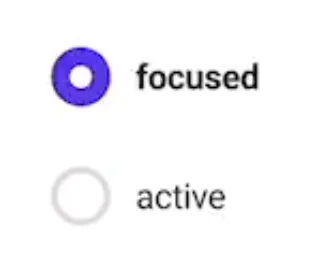

<a id="1c3eda9b0fe181858ad0c65e09a3f0e9"></a>

## 

---

> 📖 

<details>
<summary>&#91; 코드 &#93;</summary>

<a id="1c3eda9b0fe1811aaa01e26ea76dc1fc"></a>

```javascript

```

</details>

<details>
<summary>Checkbox &#45; 스타일</summary>



- <code>&#60;input type=”checkbox” /&#62;</code>

- input checkbox를 위와 같이 스타일링 하려면, input을 <code>display=none</code>으로 숨긴 후,<br>새로운 &#60;span/&#62; 을 통해 style 해야한다&#46;

</details>

> ✏️ 
> 
> <a id="1c3eda9b0fe1811e8954e6e6b63e25a8"></a>
> 
> Styled Components 내부는 <code>SCSS</code> 이다&#46; 따라서<strong><u> 부모 컴포넌트에서 하위 컴포넌트를 선택</u></strong>하고 스타일링 할 수 있다&#46;  
> 
> <details>
> <summary>ex)</summary>
> 
> <a id="1c3eda9b0fe18176a7a8e2bb0697076d"></a>
> 
> ```css
> 
> ```
> 
> </details>
