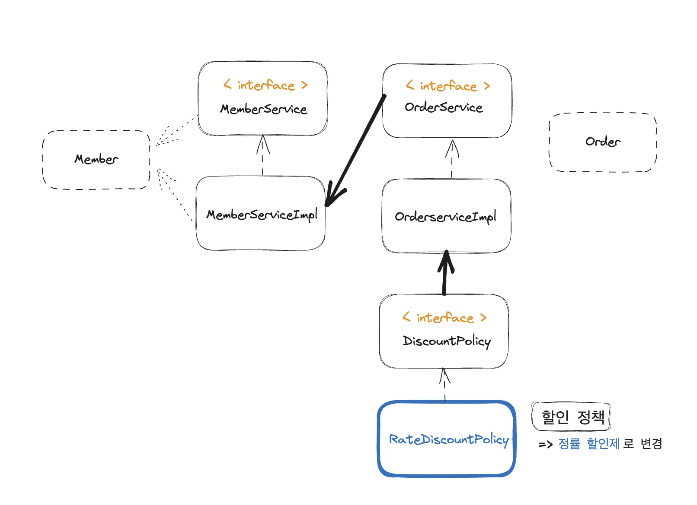
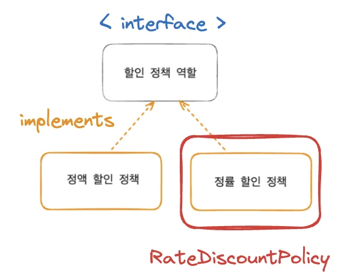

<a id="1c3eda9b0fe1814aab89c03bdd04715c"></a>

### 새로운 할인 정책 확장

> <strong>할인 정책 변경</strong>&#58;  <strong><code>정액 할인제</code></strong> → <strong><code>정률 할인제</code></strong>

<details>
<summary>시나리오( 강의 PPT에서 자출 )</summary>

> 참고&#58;<a href="https://agilemanifesto.org/iso/ko/manifesto.html"> 애자일 소프트웨어 개발 선언</a>

- &#42;<strong>악덕 기획자</strong>&#42;&#58; 서비스 오픈 직전에 할인 정책을 지금처럼 고정 금액 할인이 아니라 좀 더 합리적인 주문 금액당 할인하는 정률% 할인으로 변경하고 싶어요&#46; 예를 들어서 기존 정책은 VIP가 10000원을 주문하든 20000원을 주문하든 항상 1000원을 할인했는데, 이번에 새로 나온 정책은 10%로 지정해두면 고객이 10000원 주문시 1000원을 할인해주고, 20000원 주문시에 2000원을 할인해주는 거에요&#33;

- <strong>순진 개발자</strong>&#58; 제가 처음부터 고정 금액 할인은 아니라고 했잖아요&#46;

- <strong>악덕 기획자</strong>&#58; 애자일 소프트웨어 개발 선언 몰라요? “계획을 따르기보다 변화에 대응하기를”

- <strong>순진 개발자</strong>&#58; &#46;&#46;&#46; (하지만 난 유연한 설계가 가능하도록 객체지향 설계 원칙을 준수했지 후후)

</details>

<a id="1c3eda9b0fe181a6b68dee25d643df63"></a>

## 정률 할인 도메인 설계

<a id="1c3eda9b0fe18188bd82cda390bf0ddc"></a>

### 전체 클래스 다이어그램



<a id="1c3eda9b0fe181f2a03ac113dfe5870c"></a>

### 할인 정책 구현체 변경

> <strong><u>10% 할인</u></strong>되는 <strong><code>정률 할인제</code></strong>로 할인 정책 변경



<a id="1c3eda9b0fe18156b912e28702448441"></a>

## 정률 할인 도메인 개발

<a id="1c3eda9b0fe1817cbb5cf0d164668a7b"></a>

### 정률 할인 구현체 ( RateDiscountPolicy )

<a id="1c3eda9b0fe181b7a46bdf15f38e624e"></a>

```java
package hello.core.discount;

import hello.core.member.Grade;
import hello.core.member.Member;

public class RateDiscountPolicy implements DiscountPolicy{
    private int discountPercent = 10; // 10% 할인
    @Override
    public int discount(Member member, int price) {
        if(member.getGrade() == Grade.VIP){
            return price * discountPercent / 100;
        }
        return 0;
    }
}
```

<a id="1c3eda9b0fe181c1a7f9cf9f1e58ee55"></a>

### 정률 할인 테스트 ( RateDiscountPolicyTest )

<details>
<summary>내가 작성한 테스트</summary>

> 이전에 주문, 할인 테스트에서 작성한 방식을 따라함&#46;<br>→ 설정한 정률 할인 가격만 확인하면됨(<code>RateDiscountPolicy</code> 만 확인)

<a id="1c3eda9b0fe1814a9d52cd24a045f970"></a>

```java
package hello.core.discount;

import hello.core.member.Grade;
import hello.core.member.Member;
import hello.core.member.service.MemberService;
import hello.core.member.service.MemberServiceImpl;
import hello.core.order.Order;
import hello.core.order.OrderService;
import hello.core.order.OrderServiceImpl;
import org.assertj.core.api.Assertions;
import org.junit.jupiter.api.DisplayName;
import org.junit.jupiter.api.Test;

import static org.junit.jupiter.api.Assertions.*;

class RateDiscountPolicyTest {
    MemberService memberService = new MemberServiceImpl();
    OrderService orderService = new OrderServiceImpl();

    @DisplayName("VIP 회원은 10% 할인 되어야 한다")
    @Test
    void vip_o() {
        // given
        Long memberId = 1L;
        Member member = new Member(memberId, "memberVIP", Grade.VIP);
        memberService.join(member);

        // when
        Order order = orderService.createOrder(memberId, "itemA", 7000);
        System.out.println("order = " + order);

        // then
        Assertions.assertThat(order.getDiscountPrice()).isEqualTo(700);
    }
    
    @DisplayName("일반(BASIC) 회원은 할인이 적용되지 않아야 한다. ")
    @Test
    void vip_x() {
        // given
        Long memberId = 2L;
        Member member = new Member(memberId, "memberBASIC", Grade.BASIC);
        memberService.join(member);

        // when
        Order order = orderService.createOrder(memberId, "itemB", 7000);

        // then
        Assertions.assertThat(order.getDiscountPrice()).isEqualTo(0);
    }
}
```

</details>

<a id="1c3eda9b0fe18155adf9f17518e595c2"></a>

### 강의 테스트 (<code>최적화</code>)

<a id="1c3eda9b0fe181e3a172cb6be3e5ff40"></a>

주문 확인이 아닌 <u>할인이 적용되는지, 값만 확인</u>하는 것이다&#46; 

<a id="1c3eda9b0fe1814b91bcdf59f08473cb"></a>

따라서, <code>RateDiscountPolicy</code>에서 정상 값이 도출 되는지만 확인하면 된다&#46;  

<a id="1c3eda9b0fe18114aac7f6fc802b3580"></a>

```java
package hello.core.discount;

import hello.core.member.Grade;
import hello.core.member.Member;
import hello.core.member.service.MemberService;
import hello.core.member.service.MemberServiceImpl;
import hello.core.order.Order;
import hello.core.order.OrderService;
import hello.core.order.OrderServiceImpl;
import org.assertj.core.api.Assertions;
import org.junit.jupiter.api.DisplayName;
import org.junit.jupiter.api.Test;

import static org.junit.jupiter.api.Assertions.*;

class RateDiscountPolicyTest {
    DiscountPolicy discountPolicy = new RateDiscountPolicy();

    @DisplayName("VIP 회원은 10% 할인이 적용 되어야 한다")
    @Test
    void vip_o() {
        // given
        Member member = new Member(1L, "memberVIP", Grade.VIP);

        // when
        int discount = discountPolicy.discount(member, 7000);

        // then
        Assertions.assertThat(discount).isEqualTo(700);
    }
    
    @DisplayName("VIP 회원이 아니면 할인이 적용 되지 않아야 한다. ")
    @Test
    void vip_x() {
        // given
        Member member = new Member(2L, "memberBASIC", Grade.BASIC);

        // when
        int discount = discountPolicy.discount(member, 7000);

        // then
        Assertions.assertThat(discount).isEqualTo(0);
    }
}
```
