<a id="1c3eda9b0fe18108a1d9cf3cc4aa355b"></a>

추가 정리 내용

<a id="1c3eda9b0fe181918217eba3b73f9487"></a>

### Thymeleaf 문법 

<details>
<summary>🧐 Tymeleaf를 사용하여 html 파일 <strong><u>컴포넌트화</u></strong></summary>

<details>
<summary>1&#46; tymelef 적용</summary>

<a id="1c3eda9b0fe1819f9f1eece7ff2b09fe"></a>

```html
<html xmlns:th="http://www.thymeleaf.org">
```

</details>

<details>
<summary>2&#46; 컴포넌트화 (<code>fragment</code>)</summary>

> <code>path</code> &#58; resources/templates/fragments/<strong><u>컴포넌트들</u></strong>

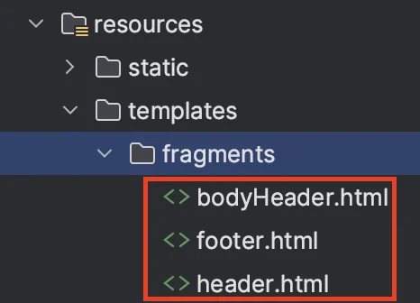

- header&#46;html
    <a id="1c3eda9b0fe1813b97abd18bc027a3c0"></a>

    ```html
    <!DOCTYPE html>
    <html xmlns:th="http://www.thymeleaf.org">
    <head th:fragment="header">
    		
    		. . .  
    ```

- bodyHeader&#46;html
    <a id="1c3eda9b0fe1816781f0eb73efc3c9ea"></a>

    ```html
    <!DOCTYPE html>
    <html xmlns:th="http://www.thymeleaf.org">
    <div class="header" th:fragment="bodyHeader">

       .   .  .
    ```

</details>

<details>
<summary>3&#46; 컴포넌트(html) 불러오기 ( <code>replace</code>)</summary>

<a id="1c3eda9b0fe1812fbfe0c143a0c388d5"></a>

```html
<- header.html->
<head th:replace="fragments/header :: header">

<- bodyHeader.html->
<div th:replace="fragments/bodyHeader :: bodyHeader" />

<- footer.html->
<div th:replace="fragments/footer :: footer" />
```

</details>

</details>

<details>
<summary>🧐 Thymeleaf 문법</summary>

<details>
<summary><code>th&#58;object=&#34;&#36;{객체}</code></summary>

<details>
<summary>🧐 모델에서  객체(memberForm) 전달</summary>

- 회원 등록 폼 화면 GET 요청 시, 모델에 MemberForm 객체를 생성하여 전달

<a id="1c3eda9b0fe1816a94cdd1576b6bec41"></a>

```java
@GetMapping(value = "/members/new")
public String createForm(Model model) {
    model.addAttribute("memberForm", new MemberForm());
    return "members/createMemberForm";
}
```

</details>

- 모델에서 전달 받은 객체 Thymeleaf 폼에 바인딩

</details>

<details>
<summary><code>th&#58;for={필드}</code> </summary>

- html for 태그하고 동일, <code>th&#45;필드</code>하고 매칭

</details>

<details>
<summary><code>th&#58;field=&#34;&#42;{필드}”</code></summary>

- 바인딩 된 <u><code>th&#45;객체</code></u>에서 해당하는 필드 값 매칭

</details>

<details>
<summary><code>&#60;p th&#58;if=&#34;&#36;{&#35;fields&#46;hasErrors(&#39;name&#39;)}&#34; th&#58;errors=&#34;&#42;{name}&#34;&#62;Incorrect data&#60;/p&#62;</code></summary>

- <code>th&#58;if=&#34;&#36;{&#35;fields&#46;hasErrors(&#39;name&#39;)}&#34;</code>&#58; name 필드에 오류가 있을 때만 이 &#60;p&#62; 태그 렌더링

- <code>th&#58;errors=&#34;&#42;{name}”</code>&#58; name 필드와 관련된 오류 메시지를 표시, 유효성 검증 실패 시 이 필드에 해당 오류 메시지가 출력됨

</details>

</details>

<details>
<summary>🧐 Thymeleaf for문 사용</summary>

- <code>th&#58;each</code>를  통해 list에서 for문처럼 요소 반복 연산 처리 가능
    - <code>th&#58;value</code>&#58;  태그의 값(value)을 설정,

    - <code>th&#58;text&#58; </code>HTML 태그의 텍스트 내용 설정

    <details>
    <summary>ex) Array( <code>members</code> )에서  각 요소(<code>member</code>)의 <code>id</code>, <code>name</code> 값 출력하기 </summary>

    <a id="1c3eda9b0fe181e28be9d5420fa459a0"></a>

    ```java
    <option th:each="member : ${members}"
    	        th:value="${member.id}"
    	        th:text="${member.name}"
    />
    ```

    <a id="1c3eda9b0fe181f0ac0df84d96384d90"></a>

    <strong>실행 결과 </strong>

    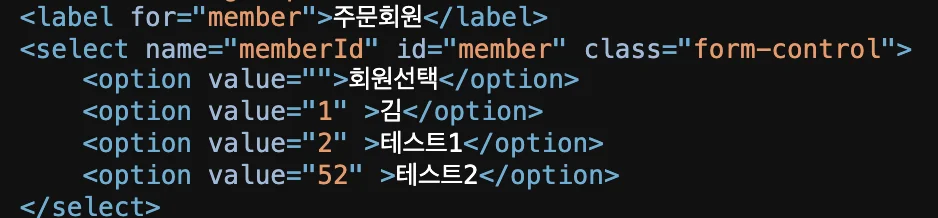

    - <code>th&#58;each</code>를 통해  members 배열을 for문처럼 처리
        - <code>th&#58;value</code> →  value 

        - <code>th&#58;text</code> → 태그의 텍스트 

    </details>

</details>

<a id="1c3eda9b0fe181a494aff4ee930f0912"></a>

### 스프링 MVC

<details>
<summary>🧐<strong> </strong>어떻게 model에 담은 객체들이 thymeleaf를 통해 뷰에 바인딩 될 수 있는가?</summary>

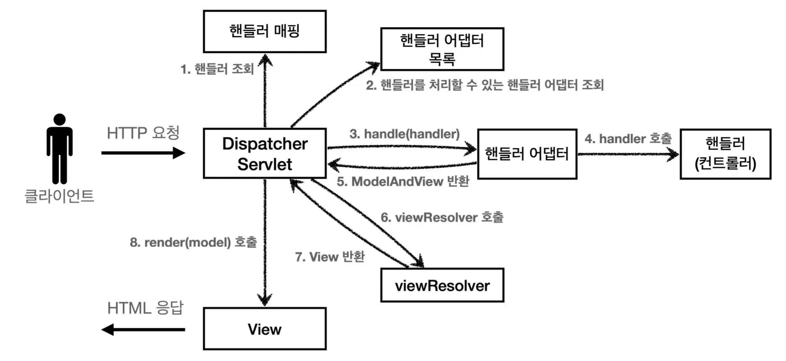

<details>
<summary>1&#46;  <strong>요청 수신, 핸들러 매핑</strong></summary>

- <strong><u>사용자</u></strong>가 <strong>브라우저</strong>에서 <strong><u>URL 요청(HTTP GET 요청 메세지)을 보내</u></strong>면, 스프링 MVC의 <code>DispatcherServlet</code>이 해당 요청을 수신한다&#46;

- DispatcherServlet이 <code>HandlerMapping</code>을 사용하여 <strong><u>요청 받은 URL</u></strong>에 따라 <strong><u>적절한 Controller의 메서드를 찾</u></strong>아준다 <br>

</details>

<details>
<summary>2&#46;  <strong>Controller에서 요청 처리</strong></summary>

- 매핑된 Controller 메서드가 실행된다&#46;

- 서비스 로직이 실행되거 데이터를 처리한 후,<br>결과를 <strong><u>Model 객체에 담</u></strong>는다&#46; 

- <strong><u>Model 객체에 추가된 데이터</u></strong>는 <code>DispatcherServlet</code>을 통해 <strong><u>뷰에 전달</u></strong>된다&#46; <br>

</details>

<details>
<summary>3&#46;  <strong>ViewResolver 동작</strong></summary>

- Controller가 실행된 후, 반환된 뷰 이름이 <code>DispatcherServlet</code>에 의해 처리 된다&#46; 

- DispatcherServlet은 <code>ViewResolver</code>를 사용하여 <strong><u>해당 이름의 뷰(예&#58; Thymeleaf 템플릿 파일)를 찾</u></strong>는다&#46; 

<details>
<summary>일반적으로 Thymeleaf 설정 파일에 기본 경로가 설정되어 있고, 해당 파일의 경로와 확장자가 추가된다&#46; </summary>

<a id="1c3eda9b0fe181eaa84dc4bb8e9f42b6"></a>

```java
spring.thymeleaf.prefix=classpath:/templates/
spring.thymeleaf.suffix=.html
```

<details>
<summary>ex)</summary>

<a id="1c3eda9b0fe181d99957edbc675d2d97"></a>

```java
@Controller
public class MyController {
    @GetMapping("/example")
    public String example(Model model) {
        model.addAttribute("message", "Hello, Thymeleaf!");
        return "example"; // 반환된 뷰 이름
    }
}
```

<a id="1c3eda9b0fe1812f83c6d5c4c7b322b5"></a>

위 메서드에서 반환된 뷰 이름인 ‘example’은 <code>classpath&#58;/templates/example&#46;html</code> 로 해석된다&#46; 

</details>

</details>

</details>

<details>
<summary>5&#46;  <strong>응답 반환</strong></summary>

- 템플릿이 렌더링되면, <code>DispatcherServlet</code>은 <code>완성된 HTML 페이지</code>를 <u>사용자 브라우저에 응답으로 전송</u>한다&#46;

</details>

- <strong>요약</strong>
    - 사용자의 브라우저가 <code>HTTP GET 요청 메시지</code> 보냄

    - dispatcherServlet이 요청을 받아 HanlderMapping을 통해 요청받은 url에 매핑되는 Controller의 메서드를 호출

    - Controller에서 Model에 데이터를 담고 뷰 이름 반환

    - ViewResolver가 반환된 뷰 이름을 기반으로 알맞은 Thymeleaf 템플릿(htm파일)을 찾음
        <a id="1c3eda9b0fe1812dbdc9da7f4aa8ce21"></a>

        이때, Model에 담긴 데이터가 Thymeleaf에 전달됨

    - Thymeleaf 엔진이 전달받은 Model 데이터를 사용해 템플릿에 동적으로 데이터를 바인딩함

    - 렌더링된 HTML 파일이 DIspatcherServlet을 통해 응답 메세지에 담겨 사용자의 브라우저에 전송됨&#46;

</details>

<details>
<summary>🧐 <strong>ThymeleafView</strong></summary>

- Spring Framework와 Thymeleaf가 통합되어 동작하는 핵심 클래스 중 하나

- <strong><u>스프링 MVC</u></strong>에서 <strong><u>뷰 렌더링 역할</u></strong>을 하는 <strong><u><code>View 인터페이스</code></u></strong>의 <strong><u>구현체</u></strong>이다

<a id="1c3eda9b0fe181fab9b0c47111ec1e67"></a>

<strong>동작 방식</strong>

- ViewResolver가 Thymeleaf 템플릿 파일을 찾아야 할 때, ThymeleafViewResolver가 적절한 템플릿을 로드한다&#46;

- ThymeleafView는 로드된 템플릿 파일을 렌더링하고, 이를 DispatcherServlet에 전달하여 클라이언트에게 응답으로 보낸다&#46;

- 즉, ThymeleafView는 Model에 담긴 데이터를 Thymeleaf 템플릿에 전달하고, 템플릿을 HTML로 렌더링하는 과정을 담당한다&#46;

</details>

<details>
<summary><strong>🧐 ThymeleafViewResolver</strong></summary>

<details>
<summary>스프링 MVC에서 <strong><u>view 찾</u></strong>는 <strong><u><code>viewResolver</code></u></strong><strong><u>의 구현체</u></strong></summary>

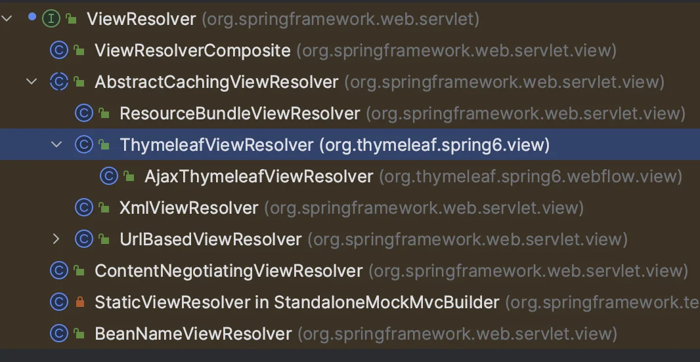

</details>

- <strong>Thymeleaf 템플릿 파일 찾고 </strong>ThymeleafView를 호출하며 HTML 파일을 생성한다&#46; 

<details>
<summary>&#91; 코드 &#93; ThymeleafViewResolver (주석 제거 )</summary>

<a id="1c3eda9b0fe1817bacbcf2ed2eddd999"></a>

```java
public class ThymeleafViewResolver
     extends AbstractCachingViewResolver
        implements Ordered {
        
    private static final Logger vrlogger = LoggerFactory.getLogger(org.thymeleaf.spring6.view.ThymeleafViewResolver.class);


    public static final String REDIRECT_URL_PREFIX = "redirect:";


    public static final String FORWARD_URL_PREFIX = "forward:";

    private boolean redirectContextRelative = true;
    private boolean redirectHttp10Compatible = true;

    private boolean alwaysProcessRedirectAndForward = true;

    private boolean producePartialOutputWhileProcessing = AbstractThymeleafView.DEFAULT_PRODUCE_PARTIAL_OUTPUT_WHILE_PROCESSING;

    private Class<? extends AbstractThymeleafView> viewClass = ThymeleafView.class;
    private String[] viewNames = null;
    private String[] excludedViewNames = null;
    private int order = Integer.MAX_VALUE;


    private final Map<String, Object> staticVariables = new LinkedHashMap<String, Object>(10);
    private String contentType = null;
    private boolean forceContentType = false;
    private String characterEncoding = null;

    private ISpringTemplateEngine templateEngine;


    public ThymeleafViewResolver() {
        super();
    }
    
    public void setViewClass(final Class<? extends AbstractThymeleafView> viewClass) {
        if (viewClass == null || !AbstractThymeleafView.class.isAssignableFrom(viewClass)) {
            throw new IllegalArgumentException(
                    "Given view class [" + (viewClass != null ? viewClass.getName() : null) +
                            "] is not of type [" + AbstractThymeleafView.class.getName() + "]");
        }
        this.viewClass = viewClass;
    }


    protected Class<? extends AbstractThymeleafView> getViewClass() {
        return this.viewClass;
    }


    public ISpringTemplateEngine getTemplateEngine() {
        return this.templateEngine;
    }


    public void setTemplateEngine(final ISpringTemplateEngine templateEngine) {
        this.templateEngine = templateEngine;
    }


    public Map<String,Object> getStaticVariables() {
        return Collections.unmodifiableMap(this.staticVariables);
    }


    public void addStaticVariable(final String name, final Object value) {
        this.staticVariables.put(name, value);
    }


    public void setStaticVariables(final Map<String, ?> variables) {
        if (variables != null) {
            for (final Map.Entry<String, ?> entry : variables.entrySet()) {
                addStaticVariable(entry.getKey(), entry.getValue());
            }
        }
    }


    public void setOrder(final int order) {
        this.order = order;
    }


    public int getOrder() {
        return this.order;
    }


    public void setContentType(final String contentType) {
        this.contentType = contentType;
    }


    public String getContentType() {
        return this.contentType;
    }


    public boolean getForceContentType() {
        return this.forceContentType;
    }


    public void setForceContentType(final boolean forceContentType) {
        this.forceContentType = forceContentType;
    }


    public void setCharacterEncoding(final String characterEncoding) {
        this.characterEncoding = characterEncoding;
    }


    public String getCharacterEncoding() {
        return this.characterEncoding;
    }


    public void setRedirectContextRelative(final boolean redirectContextRelative) {
        this.redirectContextRelative = redirectContextRelative;
    }


    public boolean isRedirectContextRelative() {
        return this.redirectContextRelative;
    }
    
    public void setRedirectHttp10Compatible(final boolean redirectHttp10Compatible) {
        this.redirectHttp10Compatible = redirectHttp10Compatible;
    }


    public boolean isRedirectHttp10Compatible() {
        return this.redirectHttp10Compatible;
    }


    public void setAlwaysProcessRedirectAndForward(final boolean alwaysProcessRedirectAndForward) {
        this.alwaysProcessRedirectAndForward = alwaysProcessRedirectAndForward;
    }


    public boolean getAlwaysProcessRedirectAndForward() {
        return this.alwaysProcessRedirectAndForward;
    }


    public boolean getProducePartialOutputWhileProcessing() {
        return this.producePartialOutputWhileProcessing;
    }


    public void setProducePartialOutputWhileProcessing(final boolean producePartialOutputWhileProcessing) {
        this.producePartialOutputWhileProcessing = producePartialOutputWhileProcessing;
    }


    public void setViewNames(final String[] viewNames) {
        this.viewNames = viewNames;
    }


    public String[] getViewNames() {
        return this.viewNames;
    }


    public void setExcludedViewNames(final String[] excludedViewNames) {
        this.excludedViewNames = excludedViewNames;
    }


    public String[] getExcludedViewNames() {
        return this.excludedViewNames;
    }


    protected boolean canHandle(final String viewName, @SuppressWarnings("unused") final Locale locale) {
        final String[] viewNamesToBeProcessed = getViewNames();
        final String[] viewNamesNotToBeProcessed = getExcludedViewNames();
        return ((viewNamesToBeProcessed == null || PatternMatchUtils.simpleMatch(viewNamesToBeProcessed, viewName)) &&
                (viewNamesNotToBeProcessed == null || !PatternMatchUtils.simpleMatch(viewNamesNotToBeProcessed, viewName)));
    }
    
    
    @Override
    protected View createView(final String viewName, final Locale locale) throws Exception {
        if (!this.alwaysProcessRedirectAndForward && !canHandle(viewName, locale)) {
            vrlogger.trace("[THYMELEAF] View \"{}\" cannot be handled by ThymeleafViewResolver. Passing on to the next resolver in the chain.", viewName);
            return null;
        }
        if (viewName.startsWith(REDIRECT_URL_PREFIX)) {
            vrlogger.trace("[THYMELEAF] View \"{}\" is a redirect, and will not be handled directly by ThymeleafViewResolver.", viewName);
            final String redirectUrl = viewName.substring(REDIRECT_URL_PREFIX.length(), viewName.length());
            final RedirectView view = new RedirectView(redirectUrl, isRedirectContextRelative(), isRedirectHttp10Compatible());
            return (View) getApplicationContext().getAutowireCapableBeanFactory().initializeBean(view, REDIRECT_URL_PREFIX);
        }
        if (viewName.startsWith(FORWARD_URL_PREFIX)) {
            vrlogger.trace("[THYMELEAF] View \"{}\" is a forward, and will not be handled directly by ThymeleafViewResolver.", viewName);
            final String forwardUrl = viewName.substring(FORWARD_URL_PREFIX.length(), viewName.length());
            return new InternalResourceView(forwardUrl);
        }
        if (this.alwaysProcessRedirectAndForward && !canHandle(viewName, locale)) {
            vrlogger.trace("[THYMELEAF] View \"{}\" cannot be handled by ThymeleafViewResolver. Passing on to the next resolver in the chain.", viewName);
            return null;
        }
        vrlogger.trace("[THYMELEAF] View {} will be handled by ThymeleafViewResolver and a " +
                "{} instance will be created for it", viewName, getViewClass().getSimpleName());
        return loadView(viewName, locale);
    }
	
// 너무 기니까 인식이 안됨...
```

<a id="1c3eda9b0fe18181b76ed754714643ac"></a>

```java
    @Override
    protected View loadView(final String viewName, final Locale locale) throws Exception {

        final AutowireCapableBeanFactory beanFactory = getApplicationContext().getAutowireCapableBeanFactory();

        final boolean viewBeanExists = beanFactory.containsBean(viewName);
        final Class<?> viewBeanType = viewBeanExists? beanFactory.getType(viewName) : null;

        final AbstractThymeleafView view;
        if (viewBeanExists && viewBeanType != null && AbstractThymeleafView.class.isAssignableFrom(viewBeanType)) {

            final BeanDefinition viewBeanDefinition =
                    (beanFactory instanceof ConfigurableListableBeanFactory ?
                            ((ConfigurableListableBeanFactory)beanFactory).getBeanDefinition(viewName) :
                            null);

            if (viewBeanDefinition == null || !viewBeanDefinition.isPrototype()) {
                final AbstractThymeleafView viewInstance = BeanUtils.instantiateClass(getViewClass());
                view = (AbstractThymeleafView) beanFactory.configureBean(viewInstance, viewName);
            } else {
                view = (AbstractThymeleafView) beanFactory.getBean(viewName);
            }

        } else {

            final AbstractThymeleafView viewInstance = BeanUtils.instantiateClass(getViewClass());

            if (viewBeanExists && viewBeanType == null) {

                beanFactory.autowireBeanProperties(viewInstance, AutowireCapableBeanFactory.AUTOWIRE_NO, false);
                beanFactory.applyBeanPropertyValues(viewInstance, viewName);
                view = (AbstractThymeleafView) beanFactory.initializeBean(viewInstance, viewName);

            } else {

                beanFactory.autowireBeanProperties(viewInstance, AutowireCapableBeanFactory.AUTOWIRE_NO, false);
                view = (AbstractThymeleafView) beanFactory.initializeBean(viewInstance, viewName);

            }

        }

        view.setTemplateEngine(getTemplateEngine());
        view.setStaticVariables(getStaticVariables());


        if (view.getTemplateName() == null) {
            view.setTemplateName(viewName);
        }

        if (!view.isForceContentTypeSet()) {
            view.setForceContentType(getForceContentType());
        }
        if (!view.isContentTypeSet() && getContentType() != null) {
            view.setContentType(getContentType());
        }
        if (view.getLocale() == null && locale != null) {
            view.setLocale(locale);
        }
        if (view.getCharacterEncoding() == null && getCharacterEncoding() != null) {
            view.setCharacterEncoding(getCharacterEncoding());
        }
        if (!view.isProducePartialOutputWhileProcessingSet()) {
            view.setProducePartialOutputWhileProcessing(getProducePartialOutputWhileProcessing());
        }

        return view;

    }

}
```

</details>

</details>

<details>
<summary>🧐 ThymeleafViewResolver에서 어떻게 Thymeleaf 템플릿 파일 찾는가?</summary>

<details>
<summary>1&#46; <strong><code>createView()</code></strong><strong>&#58; 뷰 이름 확인 및 처리</strong></summary>

<details>
<summary><strong>&#91; 코드 &#93; creatView()</strong></summary>

<a id="1c3eda9b0fe1812caa8bf4768347f35f"></a>

```java
@Override
protected View createView(final String viewName, final Locale locale) throws Exception {
    // First possible call to check "viewNames": before processing redirects and forwards
    if (!this.alwaysProcessRedirectAndForward && !canHandle(viewName, locale)) {
        vrlogger.trace("[THYMELEAF] View \"{}\" cannot be handled by ThymeleafViewResolver. Passing on to the next resolver in the chain.", viewName);
        return null;
    }
    // Process redirects (HTTP redirects)
    if (viewName.startsWith(REDIRECT_URL_PREFIX)) {
        vrlogger.trace("[THYMELEAF] View \"{}\" is a redirect, and will not be handled directly by ThymeleafViewResolver.", viewName);
        final String redirectUrl = viewName.substring(REDIRECT_URL_PREFIX.length(), viewName.length());
        final RedirectView view = new RedirectView(redirectUrl, isRedirectContextRelative(), isRedirectHttp10Compatible());
        return (View) getApplicationContext().getAutowireCapableBeanFactory().initializeBean(view, REDIRECT_URL_PREFIX);
    }
    // Process forwards (to JSP resources)
    if (viewName.startsWith(FORWARD_URL_PREFIX)) {
        // The "forward:" prefix will actually create a Servlet/JSP view, and that's precisely its aim per the Spring
        // documentation. See http://docs.spring.io/spring-framework/docs/4.2.4.RELEASE/spring-framework-reference/html/mvc.html#mvc-redirecting-forward-prefix
        vrlogger.trace("[THYMELEAF] View \"{}\" is a forward, and will not be handled directly by ThymeleafViewResolver.", viewName);
        final String forwardUrl = viewName.substring(FORWARD_URL_PREFIX.length(), viewName.length());
        return new InternalResourceView(forwardUrl);
    }
    // Second possible call to check "viewNames": after processing redirects and forwards
    if (this.alwaysProcessRedirectAndForward && !canHandle(viewName, locale)) {
        vrlogger.trace("[THYMELEAF] View \"{}\" cannot be handled by ThymeleafViewResolver. Passing on to the next resolver in the chain.", viewName);
        return null;
    }
    vrlogger.trace("[THYMELEAF] View {} will be handled by ThymeleafViewResolver and a " +
                    "{} instance will be created for it", viewName, getViewClass().getSimpleName());
    return loadView(viewName, locale);
}
```

</details>

<a id="1c3eda9b0fe1816cb098dd7fcd1987b0"></a>

ThymeleafViewResolver는 <strong>뷰 이름</strong>을 받아서 그에 해당하는 <strong>View 객체</strong>를 반환한다 

<a id="1c3eda9b0fe1811eb041f1b912075ebc"></a>

즉, createView() 메소드는 다음과 같은 역할을 한다&#46;

- <strong>리다이렉트</strong> or <strong>포워드 요청</strong> 처리
    - 뷰 이름이 redirect&#58; 또는 forward&#58;로 시작하는지 확인

    - 만약 redirect&#58;로 시작하면, RedirectView를 생성해 반환

    - 만약 forward&#58;로 시작하면, InternalResourceView를 반환&#46;

- <strong>뷰 이름에 해당하는 템플릿을 처리할 수 있는지 확인</strong>
    - canHandle() 메소드로 뷰 이름을 처리할 수 있는지 확인

- <strong>뷰를 직접 처리해야 하는 경우</strong>
    - 위 두 가지가 아닌 경우에는, 실제로 loadView() 메소드를 호출해 템플릿 파일을 찾아 뷰를 로드

<a id="1c3eda9b0fe1816895daced988bb8c0c"></a>

```java
@Override
protected View createView(final String viewName, final Locale locale) throws Exception {
    if (!this.alwaysProcessRedirectAndForward && !canHandle(viewName, locale)) {
        return null; // Thymeleaf가 이 뷰를 처리하지 않음
    }
    // redirect: 또는 forward: 처리
    if (viewName.startsWith(REDIRECT_URL_PREFIX)) {
        // RedirectView 처리
        ...
    }
    if (viewName.startsWith(FORWARD_URL_PREFIX)) {
        // InternalResourceView 처리
        ...
    }
    return loadView(viewName, locale); // Thymeleaf 템플릿을 찾고 뷰를 로드
}
```

</details>

<details>
<summary>2&#46; <strong><code>loadView()</code></strong><strong>&#58; 실제 뷰 로드</strong></summary>

<details>
<summary><strong>&#91; 코드 &#93; loadView()</strong></summary>

<a id="1c3eda9b0fe181369729efdac5819f50"></a>

```java
@Override
protected View loadView(final String viewName, final Locale locale) throws Exception {

    final AutowireCapableBeanFactory beanFactory = getApplicationContext().getAutowireCapableBeanFactory();

    final boolean viewBeanExists = beanFactory.containsBean(viewName);
    final Class<?> viewBeanType = viewBeanExists? beanFactory.getType(viewName) : null;

    final AbstractThymeleafView view;
    if (viewBeanExists && viewBeanType != null && AbstractThymeleafView.class.isAssignableFrom(viewBeanType)) {
       
        final BeanDefinition viewBeanDefinition =
                (beanFactory instanceof ConfigurableListableBeanFactory ?
                        ((ConfigurableListableBeanFactory)beanFactory).getBeanDefinition(viewName) :
                        null);

        if (viewBeanDefinition == null || !viewBeanDefinition.isPrototype()) {

            final AbstractThymeleafView viewInstance = BeanUtils.instantiateClass(getViewClass());
            view = (AbstractThymeleafView) beanFactory.configureBean(viewInstance, viewName);
        } else {
            
            view = (AbstractThymeleafView) beanFactory.getBean(viewName);
        }

    } else {

        final AbstractThymeleafView viewInstance = BeanUtils.instantiateClass(getViewClass());

        if (viewBeanExists && viewBeanType == null) {
            
            beanFactory.autowireBeanProperties(viewInstance, AutowireCapableBeanFactory.AUTOWIRE_NO, false);
            
            beanFactory.applyBeanPropertyValues(viewInstance, viewName);
            
            view = (AbstractThymeleafView) beanFactory.initializeBean(viewInstance, viewName);

        } else {
            
            beanFactory.autowireBeanProperties(viewInstance, AutowireCapableBeanFactory.AUTOWIRE_NO, false);
            
            view = (AbstractThymeleafView) beanFactory.initializeBean(viewInstance, viewName);

        }

    }

    view.setTemplateEngine(getTemplateEngine());
    view.setStaticVariables(getStaticVariables());


    
    if (view.getTemplateName() == null) {
        view.setTemplateName(viewName);
    }

    if (!view.isForceContentTypeSet()) {
        view.setForceContentType(getForceContentType());
    }
    if (!view.isContentTypeSet() && getContentType() != null) {
        view.setContentType(getContentType());
    }
    if (view.getLocale() == null && locale != null) {
        view.setLocale(locale);
    }
    if (view.getCharacterEncoding() == null && getCharacterEncoding() != null) {
        view.setCharacterEncoding(getCharacterEncoding());
    }
    if (!view.isProducePartialOutputWhileProcessingSet()) {
        view.setProducePartialOutputWhileProcessing(getProducePartialOutputWhileProcessing());
    }

    return view;

}
```

</details>

> Thymeleaf 템플릿 파일을 로드하고, 템플릿 엔진에 전달할 ThymeleafView<strong> 객체</strong>를 생성한다&#46;

<a id="1c3eda9b0fe181be988bd8c2b1a04600"></a>

템플릿 파일을 찾는 방식은 크게 두 가지이다&#46; 

- 1&#46; <strong>뷰 이름에 해당하는 빈(Bean)이 있는 경우</strong>
    - 스프링의 빈 팩토리에서 뷰 이름과 일치하는 빈을 찾고, 그 빈이 Thymeleaf 뷰인지 확인

    - 일치하는 경우 해당 빈을 사용해 뷰를 설정

- 2&#46; <strong>뷰 이름에 해당하는 빈이 없는 경우</strong>
    - viewClass(기본적으로 ThymeleafView&#46;class)로 새로운 뷰 객체를 생성, 이를 빈 팩토리에서 초기화

    - 이후, 이 뷰 객체에 <strong>템플릿 엔진</strong>과 <strong>정적 변수</strong> 등을 설정하고, 최종적으로 템플릿 이름을 설정

<a id="1c3eda9b0fe1813ab045c9f5dfbd561e"></a>

```java
@Override
protected View loadView(final String viewName, final Locale locale) throws Exception {
    // 스프링 빈 팩토리에서 뷰 이름과 일치하는 빈이 있는지 확인
    final boolean viewBeanExists = beanFactory.containsBean(viewName);

    final AbstractThymeleafView view;
    if (viewBeanExists && viewBeanType != null && AbstractThymeleafView.class.isAssignableFrom(viewBeanType)) {
        view = (AbstractThymeleafView) beanFactory.getBean(viewName);
    } else {
        // 새 뷰 객체 생성
        view = BeanUtils.instantiateClass(getViewClass());
        beanFactory.autowireBeanProperties(view, AutowireCapableBeanFactory.AUTOWIRE_NO, false);
        beanFactory.initializeBean(view, viewName);
    }

    // 템플릿 엔진 설정
    view.setTemplateEngine(getTemplateEngine());
    view.setTemplateName(viewName); // 템플릿 파일 이름 설정 (viewName에 해당)

    return view; // Thymeleaf 뷰 객체 반환
}
```

</details>

<details>
<summary>3&#46; 템플릿 찾는 과정</summary>

<a id="1c3eda9b0fe181ad9765e1f272ecc66b"></a>

<code>view&#46;setTemplateName(viewName)</code> 부분에서 <strong><u>뷰 이름</u></strong>을 템플릿 파일 이름으로 사용하며

<a id="1c3eda9b0fe181cd97d2f92e3ff65cd1"></a>

Thymeleaf 템플릿 엔진은 기본적으로 설정된 <strong>템플릿 경로</strong>와 뷰 이름을 조합하여 템플릿 파일을 찾는다&#46; 

- 예를 들어, 뷰 이름이 <code>home</code>이면 ThymeleafViewResolver는 기본적으로 <code>/templates/home&#46;html</code>이라는 템플릿 파일을 찾는다&#46;

- 이 경로는 보통 ThymeleafViewResolver<strong>의 </strong>prefix<strong>와 </strong>suffix<strong> 속성</strong>에 의해 결정된다&#46; 

- 예를 들어, prefix가 /templates/이고 suffix가 &#46;html로 설정되어 있으면, home이라는 뷰 이름은 /templates/home&#46;html 템플릿 파일을 가리킨다&#46; 
    <a id="1c3eda9b0fe1814a9713e25c32f59fda"></a>

    ```java
    @Bean
    public ViewResolver thymeleafViewResolver() {
        ThymeleafViewResolver resolver = new ThymeleafViewResolver();
        resolver.setTemplateEngine(templateEngine()); // 템플릿 엔진 설정
        resolver.setPrefix("/templates/");
        resolver.setSuffix(".html");
        return resolver;
    }
    ```

</details>

<a id="1c3eda9b0fe18142bc80d819561805d8"></a>

정리

- createView()&#58; 뷰 이름을 처리하고 리다이렉트/포워드를 처리하거나 템플릿을 렌더링할 준비를 함&#46;

- loadView()&#58; 실제로 Thymeleaf 템플릿 파일을 찾아 ThymeleafView 객체를 생성하고, 템플릿 파일을 렌더링할 준비를 함&#46;

- <strong>템플릿 찾는 과정</strong>&#58; 뷰 이름(viewName)을 템플릿 파일 이름으로 사용하여, 미리 설정된 prefix, suffix를 통해 템플릿 파일을 찾음&#46;

</details>

<details>
<summary>🧐 <strong>Thymeleaf 엔진</strong></summary>

<a id="1c3eda9b0fe181c68167dd34dfe918fb"></a>

Thymeleaf 템플릿 파일(HTML)을 처리하여 동적으로 컨텐츠를 생성하는 템플릿 엔진 

<a id="1c3eda9b0fe1814a8e8efbae4648fd02"></a>

즉, Model<strong> 객체의 데이터를 해당하는 HTML 파일에 동적으로 바인딩하여 생성한다&#46;</strong>

- <strong>내부 동작</strong>
    1. <strong>템플릿 파싱&#58;</strong> HTML 파일을 분석하여, &#36;{} 같은 표현식을 찾음

    1. <strong>컨텍스트 바인딩</strong>&#58; 스프링 MVC에서 전달한 Model 데이터를 Thymeleaf의 Context 객체에 매핑

    1. <strong>표현식 평가&#58; </strong>&#36;{} 안에 들어 있는 표현식을 평가하여, 실제 값으로 변환
        - ex) <code>&#36;{message}</code> , Model 안에 담긴 <code>&#34;Hello, Thymeleaf&#33;”</code> 로 변환

    1. <strong>최종 HTML 생성</strong>&#58; 변환된 데이터를 사용해 최종 HTML 파일을 렌더링하고, 이를 브라우저로 전달

- <strong>Thymeleaf 엔진 예시 코드</strong>
    <a id="1c3eda9b0fe18167b17df2409de62406"></a>

    ```java
    // Thymeleaf Template Engine 사용 예시
    TemplateEngine engine = new TemplateEngine();
    Context context = new Context();
    context.setVariable("message", "Hello, Thymeleaf!");

    // 템플릿 엔진이 템플릿과 데이터를 결합하여 최종 HTML 생성
    String result = engine.process("example.html", context);
    ```

<a id="1c3eda9b0fe181758143cf79fe1fa271"></a>

동적 HTML 생성

- ThymeleafView&#58; 스프링 MVC와 Thymeleaf 간의 통로 역할을 하며, 컨트롤러에서 받은 데이터를 템플릿에 전달하고, 이를 렌더링하는 클래스&#46;

- Thymeleaf 엔진&#58; 템플릿을 파싱하고, 데이터를 바인딩하여 최종 HTML을 생성하는 역할을 하는 템플릿 엔진&#46;

<a id="1c3eda9b0fe181dbbbc7e37d691af57c"></a>

이 두 가지 요소가 함께 동작하여, 서버의 데이터를 동적으로 HTML로 변환해 클라이언트에게 보여준다&#46;

</details>

<details>
<summary>🧐<strong> Forward</strong></summary>

<a id="1c3eda9b0fe181b888ece253f65995d7"></a>

<strong>서버 내부</strong>에서 일어나는 요청 처리 방식 중 하나로, <strong><u>현재 요청을 다른 서버 리소스(예&#58; 다른 컨트롤러, JSP 파일 등)</u></strong>로 넘겨주는 역할을 한다&#46;

<a id="1c3eda9b0fe181c9a002c4e765f4d25f"></a>

이때  <strong><u>Forward는 서버 내부에서만 처리</u></strong>되기 때문에 <strong>클라이언트(브라우저)</strong>는 이 과정이 일어났다는 사실을 알지 못하며 <strong><u>새로운 요청을 보내지 않</u></strong>고 <strong><u>URL도 변경되지 않</u></strong>는다&#46;

<a id="1c3eda9b0fe18194b4b2eb880974febb"></a>

<strong>Forward vs Redirect</strong>

|  |  |
| --- | --- |
| <strong>Forward</strong> | <strong>Redirect</strong> |
| <strong>서버 내부</strong>에서 요청을 처리함 | <strong>클라이언트</strong>(브라우저)에게 새로운 URL로 <strong>재요청</strong>을 시킴 |
| URL이 바뀌지 않음 (클라이언트는 원래 요청한 URL을 그대로 유지) | URL이 바뀜 (클라이언트가 새로운 URL로 재요청) |
| 클라이언트는 서버에서 요청이 다른 리소스로 전달되었는지 모름 | 클라이언트가 새로운 요청을 보냈음을 알게 됨 |
| 주로 서버 내 리소스 간 데이터 전달 시 사용 | 페이지 이동, 세션이나 상태 정보 초기화 등 클라이언트에게 명시적인 이동이 필요할 때 사용 |

<a id="1c3eda9b0fe1810b8bf2ec3a70ad7751"></a>

<strong>사용 방법</strong>

<a id="1c3eda9b0fe1819dbf26fa97a4cfd989"></a>

Spring MVC에서 Forward를 사용하는 경우, 컨트롤러 메서드에서 <code>forward&#58;</code> 접두사를 사용하여 요청을 전달한다&#46;

<details>
<summary>ex) Spring에서의 Forward 사용</summary>

<a id="1c3eda9b0fe181448d5ec43748731000"></a>

```java
@Controller
public class MyController {

    @GetMapping("/login")
    public String login() {
        // 로그인 후 홈 페이지로 포워드
        return "forward:/home";
    }

    @GetMapping("/home")
    public String home() {
        return "home"; // home.html 템플릿을 렌더링
    }
}
```

</details>

<a id="1c3eda9b0fe181d0bca8c70b2f55fabc"></a>

언제 Forward를 사용하는가?

- 데이터 유지
    - 같은 요청 내, 데이터를 유지하면서 다른 리소를 넘길 때 유용하다&#46;

- 클라이언트가 모르게 내부적으로 페이지 전화시 사용한다&#46; 

- 리소스간의 요청 처리를 넘길 때
    - 예를 들어, 컨트롤러에서 다른 JSP 파일로 넘기거나 다른 컨트롤러로 넘길 때 사용한다&#46; 

</details>

---

<a id="1c3eda9b0fe181de8042d93ca2a201a2"></a>

## 홈 화면, 레이아웃

<details>
<summary>☝🏻 참고 &#45; <code>spring&#45;boot&#45;devtools</code> 사용 시 서버를 재시작하지 않고도 변경 사항을 바로 볼 수 있다&#46; ( <code>recompile</code> 필요)</summary>

<details>
<summary><code>spring&#45;boot&#45;devtools</code>  의존성 추가</summary>

<a id="1c3eda9b0fe181029b34f4c25ff890ad"></a>

해당 의존성 추가 후,  프로젝트를 다시 빌드하면, devtools가 작동한다&#46; 

<a id="1c3eda9b0fe18156838cc19bfc89d155"></a>

```groovy
dependencies {
    developmentOnly 'org.springframework.boot:spring-boot-devtools'
}
```

</details>

<details>
<summary><strong>IntelliJ에서 Recompile하는 방법</strong></summary>

- Build 메뉴에서 Recompile 옵션을 선택

<details>
<summary>IntelliJ에서 변경된 HTML 파일이 자동으로 다시 컴파일되도록 설정</summary>

- <strong>Preferences</strong> (Command &#43; ,)

- <strong>Build, Execution, Deployment</strong> &#62; <strong>Compiler</strong> &#62; <strong>Build project automatically</strong> 옵션을 활성화

-  <strong>Advanced Settings</strong>를 클릭하고, <strong>Allow auto&#45;make to start even if developed application is running</strong> 옵션화

</details>

</details>

</details>

<details>
<summary>👉 Dos) <a href="https://www.thymeleaf.org/doc/tutorials/3.1/thymeleafspring.html#the-springstandard-dialect">Thymleaf</a></summary>

<a id="1c3eda9b0fe181e6ac59ffec45fadec1"></a>

버전 업데이트 시  해당 <a href="https://www.thymeleaf.org/documentation.html">링크</a> 참조

</details>

<details>
<summary>스프링부트 타임리프 기본 설정</summary>

<a id="1c3eda9b0fe181b29f0aeb76a8bfa8d1"></a>

```xml
spring:
   thymeleaf:
	    prefix: classpath:/templates/
	    suffix: .html
```

</details>

<details>
<summary>스프링 부트 타임리프 viewName 매핑</summary>

- <code>resources&#58;templates/</code> &#43;{ViewName}&#43; <code>&#46;html</code>
    - ex) <code>resources&#58;templates/home&#46;html</code>

</details>

<details>
<summary><a href="https://getbootstrap.com/docs/5.3/getting-started/download/">bootstrap </a>적용 </summary>

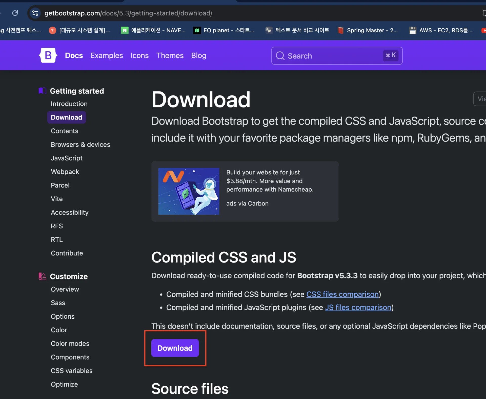

- 다운 받은 파일 압축 풀고

- resources/static에 전부 붙여넣기 
    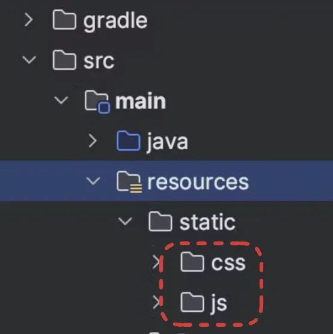

</details>

<details>
<summary>css 추가 적용 </summary>

<details>
<summary>jumbotron&#45;narrow&#46;css</summary>

<a id="1c3eda9b0fe181609f3ed830893c6584"></a>

```css
/* Space out content a bit */
body {
padding-top: 20px;
padding-bottom: 20px;
}
/* Everything but the jumbotron gets side spacing for mobile first views */
.header,
.marketing,
.footer {
padding-left: 15px;
padding-right: 15px;
}
/* Custom page header */
.header {
border-bottom: 1px solid #e5e5e5;
}
/* Make the masthead heading the same height as the navigation */
.header h3 {
margin-top: 0;
margin-bottom: 0;
line-height: 40px;
padding-bottom: 19px;
}
/* Custom page footer */
.footer {
padding-top: 19px;
color: #777;
border-top: 1px solid #e5e5e5;
}
/* Customize container */
@media (min-width: 768px) {
.container {
max-width: 730px;
}
}
.container-narrow > hr {
margin: 30px 0;
}
/* Main marketing message and sign up button */
.jumbotron {
text-align: center;
border-bottom: 1px solid #e5e5e5;
}
.jumbotron .btn {
font-size: 21px;
padding: 14px 24px;
}
/* Supporting marketing content */
.marketing {
margin: 40px 0;
}
.marketing p + h4 {
margin-top: 28px;
}
/* Responsive: Portrait tablets and up */
@media screen and (min-width: 768px) {
/* Remove the padding we set earlier */
.header,
.marketing,
.footer {
padding-left: 0;
padding-right: 0;
}
/* Space out the masthead */
.header {
margin-bottom: 30px;
}
/* Remove the bottom border on the jumbotron for visual effect */
.jumbotron {
border-bottom: 0;
} }
```

</details>

</details>

<a id="1c3eda9b0fe181b6a9cacd069c58be2d"></a>

### <strong>메인(홈) 화면 렌더링</strong>

<details>
<summary>&#91; 코드 &#93; HomeController</summary>

<a id="1c3eda9b0fe181d39b6bcad5cf1e29b5"></a>

```sql
package jpabook.jpashop.web;
 import lombok.extern.slf4j.Slf4j;
 import org.springframework.stereotype.Controller;
 import org.springframework.web.bind.annotation.RequestMapping;
 @Controller
 @Slf4j
 public class HomeController {
     @RequestMapping("/")
     public String home() {
         log.info("home controller");
         return "home"; 
     }
}
```

</details>

<a id="1c3eda9b0fe181ecb76bf4a447227871"></a>

### <strong>레이아웃 ( html )</strong>

<details>
<summary>🧐 Tymeleaf를 사용하여 html 파일 <strong><u>컴포넌트화</u></strong></summary>

<details>
<summary>1&#46; tymelef 적용</summary>

<a id="1c3eda9b0fe1811f8248f13a47f0696b"></a>

```html
<html xmlns:th="http://www.thymeleaf.org">
```

</details>

<details>
<summary>2&#46; 컴포넌트화 (<code>fragment</code>)</summary>

> <code>path</code> &#58; resources/templates/fragments/<strong><u>컴포넌트들</u></strong>


- header&#46;html
    <a id="1c3eda9b0fe1811f87afd0ced96b9204"></a>

    ```html
    <!DOCTYPE html>
    <html xmlns:th="http://www.thymeleaf.org">
    <head th:fragment="header">
    		
    		. . .  
    ```

- bodyHeader&#46;html
    <a id="1c3eda9b0fe181749190c9e88371398d"></a>

    ```html
    <!DOCTYPE html>
    <html xmlns:th="http://www.thymeleaf.org">
    <div class="header" th:fragment="bodyHeader">

       .   .  .
    ```

</details>

<details>
<summary>3&#46; 컴포넌트(html) 불러오기 ( <code>replace</code>)</summary>

<a id="1c3eda9b0fe1816fa511c6f99c1c973f"></a>

```html
<- header.html->
<head th:replace="fragments/header :: header">

<- bodyHeader.html->
<div th:replace="fragments/bodyHeader :: bodyHeader" />

<- footer.html->
<div th:replace="fragments/footer :: footer" />
```

</details>

</details>

<details>
<summary>home&#46;html</summary>

<a id="1c3eda9b0fe181ca97dfd4c437cded15"></a>

````sql
<!DOCTYPE HTML>
<html xmlns:th="http://www.thymeleaf.org">
<head th:replace="fragments/header :: header">
    <title>Hello</title>
    <meta http-equiv="Content-Type" content="text/html; charset=UTF-8" />
</head>
<body>
<div class="container">
    <div th:replace="fragments/bodyHeader :: bodyHeader" />
    <div class="jumbotron"> <h1>HELLO SHOP</h1>
        <p class="lead">회원 기능</p> <p>
            <a class="btn btn-lg btn-secondary" href="/members/new">회원 가입</a>
            <a class="btn btn-lg btn-secondary" href="/members">회원 목록</a> </p>
        <p class="lead">상품 기능</p> <p>
            <a class="btn btn-lg btn-dark" href="/items/new">상품 등록</a>
            <a class="btn btn-lg btn-dark" href="/items">상품 목록</a> </p>
        <p class="lead">주문 기능</p>
        <p>
            <a class="btn btn-lg btn-info" href="/order">상품 주문</a>
            <a class="btn btn-lg btn-info" href="/orders">주문 내역</a>
        </p> </div>
    <div th:replace="fragments/footer :: footer" />
</div> <!-- /container -->
</body>
</html>
```

````

</details>

<details>
<summary>컴포넌트</summary>

<details>
<summary>header&#46;html</summary>

<a id="1c3eda9b0fe181149cb5d7290ce2526a"></a>

```sql
<!DOCTYPE html>
<html xmlns:th="http://www.thymeleaf.org">
<head th:fragment="header">
    <!-- Required meta tags -->
    <meta charset="utf-8">
    <meta name="viewport" content="width=device-width, initial-scale=1, shrink-
 to-fit=no">
    <!-- Bootstrap CSS -->
    <link rel="stylesheet" href="/css/bootstrap.min.css" integrity="sha384-
 ggOyR0iXCbMQv3Xipma34MD+dH/1fQ784/j6cY/iJTQUOhcWr7x9JvoRxT2MZw1T"
          crossorigin="anonymous">
    <!-- Custom styles for this template -->
    <link href="/css/jumbotron-narrow.css" rel="stylesheet">
    <title>Hello, world!</title>
</head>
```

</details>

<details>
<summary>bodyHeader&#46;html</summary>

<a id="1c3eda9b0fe181c08ae7f2ecda7b3b55"></a>

```sql
<!DOCTYPE html>
<html xmlns:th="http://www.thymeleaf.org">
<div class="header" th:fragment="bodyHeader">
    <ul class="nav nav-pills pull-right">
        <li><a href="/">Home</a></li>
    </ul>
    <a href="/"><h3 class="text-muted">HELLO SHOP</h3></a>
</div>
```

</details>

<details>
<summary>footer&#46;html</summary>

<a id="1c3eda9b0fe181cb8c2ecd91cc2f1439"></a>

```sql
<!DOCTYPE html>
<html xmlns:th="http://www.thymeleaf.org">
<div class="footer" th:fragment="footer">
  <p>&copy; Hello Shop V2</p>
</div>
```

</details>

</details>

<a id="1c3eda9b0fe181b79d9fd431916e5b33"></a>

## 회원  &#45; 등록, 목록 조회

<details>
<summary>🧐 이름(name) 서버에서 검증(서버사이드) ,아래와 같이 클라이언트에도 반영</summary>

> 7&#46;2 회원 등록 &#45; 17분 부터 다시보기

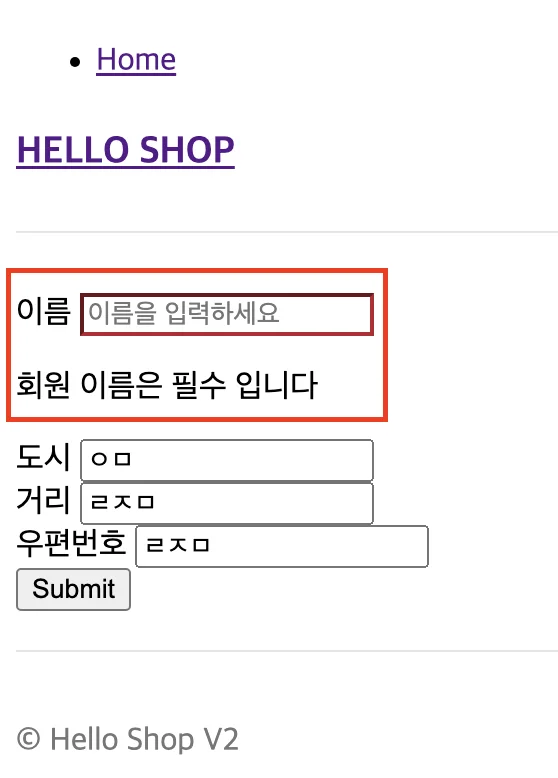

<a id="1c3eda9b0fe181a29a38dd8f4f14b2fa"></a>

 

> 폼 객체(<code>MemberForm</code>) 유효성 검사  

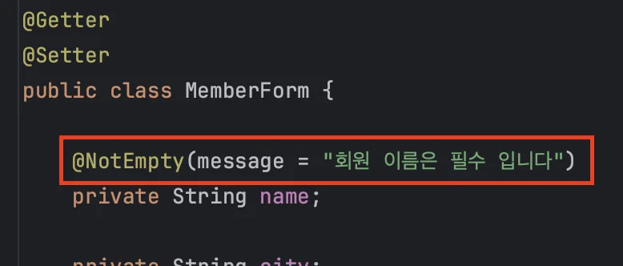

> 컨트롤러(MemberController

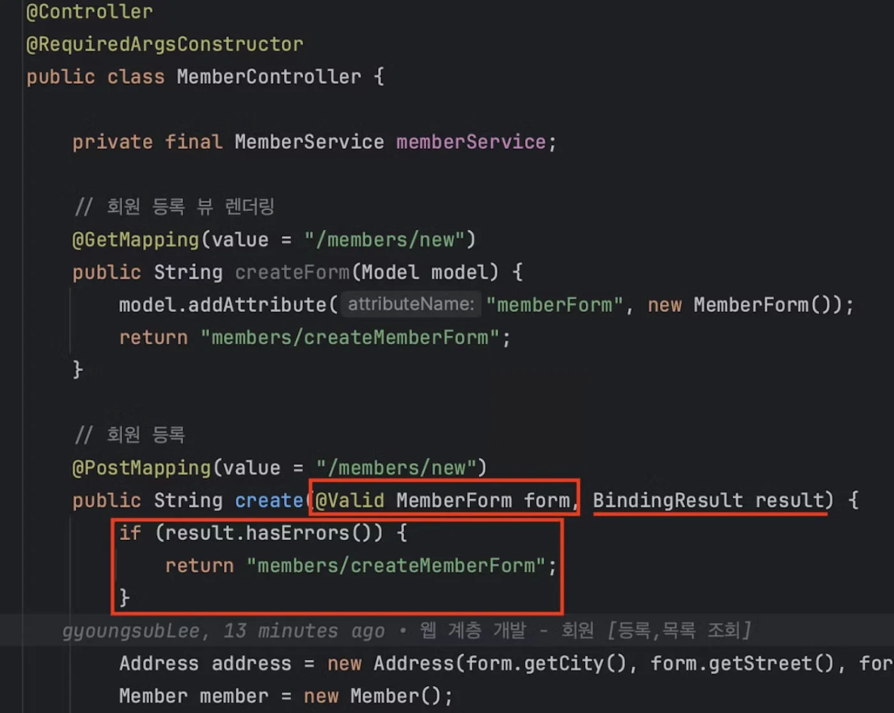

> 뷰 ( <code>createMemberForm&#46;html</code> )

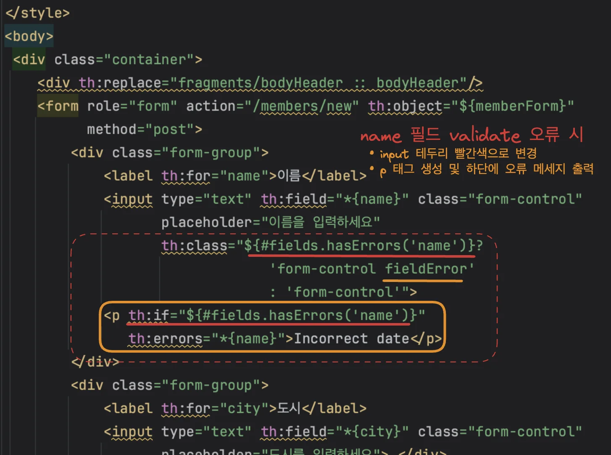

</details>

<details>
<summary><strong>🧐 왜 화면 계층 과 서비스 계층을 분리해야 하는가? ( DTO vs 엔티티 )</strong></summary>

<a id="1c3eda9b0fe18128882fdf78321b4bbe"></a>

요구사항이 정말 단순할 때는 <strong><u>DTO </u></strong>나 <strong><u>폼 객체</u></strong>(<code>MemberForm</code>) 없이 <br><code>엔티티(Member)</code>를 직접 등록 및 수정 화면에서 사용해도 되지만,

<a id="1c3eda9b0fe1819d942cff774230f41b"></a>

<u>요구사항이 복잡</u>해질 수록, <u>엔티티에 화면을 처리하기 위한 기능이 점점 증가</u>하고 <br>결과적으로 엔티티는 점점 화면에 종속적으로 변해, <strong>화면 기능때문에 </strong><strong><u>하드코딩</u></strong><strong>된 엔티티는 결국 </strong><strong><u>유지보수하기 어려워</u></strong><strong>진다&#46;</strong> 

<a id="1c3eda9b0fe181ba8bbef543727cc64e"></a>

<strong><u>실무</u></strong>에서 <code>엔티티</code>는 <strong><u>핵심 비지니스 로직만 가지고 있</u></strong>고, <strong><u>화면을 위한 로직은 없</u></strong>어야 한다

<a id="1c3eda9b0fe18116a339eac0c171420d"></a>

 <strong>화면</strong><strong>이나</strong><strong> API</strong><strong>에 맞는</strong><strong> </strong><strong><u><code>폼 객체</code></u></strong><strong>나</strong><strong> </strong><strong><u><code>DTO</code></u></strong><strong>를</strong><strong> 사용</strong>하여 <u>화면이나 API 요구사항들을 처리</u>해 <strong><u><code>화면 계층</code></u></strong><u>과 </u><strong><u><code>서비스 계층</code></u></strong><u>을 </u><strong><u>분리</u></strong>하고  <strong><u>엔티티</u></strong><u>를 최대한 </u><strong><u>순수</u></strong><u>하게 유지</u>해야 한다&#46;  <br>

</details>

<a id="1c3eda9b0fe18100ac5ee39a504110ef"></a>

### 등록

> ☝🏻 <strong><u>폼 객체</u></strong><strong> 사용 </strong><br>⇒ <strong><u>화면 계층</u></strong>과 <strong><u>서비스 계층</u></strong>을 분리

<details>
<summary><code>회원 등록 폼 화면</code>&#58; <strong>createMemberForm&#46;html</strong></summary>

> templates/members/createMemberForm&#46;html

<details>
<summary>🧐 Thymeleaf 문법</summary>

<details>
<summary><code>th&#58;object=&#34;&#36;{객체}</code></summary>

<details>
<summary>🧐 모델에서  객체(memberForm) 전달</summary>

- 회원 등록 폼 화면 GET 요청 시, 모델에 MemberForm 객체를 생성하여 전달

<a id="1c3eda9b0fe181c3911fca9426278a3d"></a>

```java
@GetMapping(value = "/members/new")
public String createForm(Model model) {
    model.addAttribute("memberForm", new MemberForm());
    return "members/createMemberForm";
}
```

</details>

- 모델에서 전달 받은 객체 Thymeleaf 폼에 바인딩

</details>

<details>
<summary><code>th&#58;for={필드}</code> </summary>

- html for 태그하고 동일, <code>th&#45;필드</code>하고 매칭

</details>

<details>
<summary><code>th&#58;field=&#34;&#42;{필드}”</code></summary>

- 바인딩 된 <u><code>th&#45;객체</code></u>에서 해당하는 필드 값 매칭

</details>

<details>
<summary><code>th&#58;if=&#34;&#36;{}&#34;</code>, <code>th&#58;errors=&#34;&#42;{필드}&#34;</code></summary>

- <code>th&#58;if=&#34;&#36;{&#35;fields&#46;hasErrors(&#39;name&#39;)}&#34;</code>&#58; name 필드에 오류가 있을 때만 이 &#60;p&#62; 태그 렌더링

- <code>th&#58;errors=&#34;&#42;{name}”</code>&#58; name 필드와 관련된 오류 메시지를 표시, 유효성 검증 실패 시 이 필드에 해당 오류 메시지가 출력됨

</details>

</details>

<details>
<summary><strong><code>&#60;form /&#62; </code></strong><strong> &#45;   사용자로부터 데이터 받아오기 </strong></summary>

<details>
<summary><code>th&#58;object=&#34;&#36;{memberForm}</code></summary>

- 모델에서 전달받은 객체(memberForm)를 Thymeleaf 폼에 바인딩

<a id="1c3eda9b0fe1810ca295cb092020c4d7"></a>

```html
<form role="form" 
			action="/members/new" 
			th:object="${memberForm}" 
			method="post"
>
```

</details>

<details>
<summary><code>th&#58;for</code>&#58; 모델에 바인딩된 필드와 연결</summary>

- <code>memberForm</code>의 <code>name</code> 필드와 연결

<a id="1c3eda9b0fe181738f6ef30efee97182"></a>

```html
<label th:for="name">이름</label>
<input type="text" th:field="*{name}" class="form-control"
       placeholder="이름을 입력하세요"
       th:class="${#fields.hasErrors('name')}? 
					       'form-control fieldError' :
					       'form-control'"
 />
```

</details>

<details>
<summary><code>th&#58;field=&#34;&#42;{필드명}”</code>&#58; 바인딩 된 model 객체 즉, <code>memberForm</code>의 <code>필드</code>하고 매칭</summary>

<a id="1c3eda9b0fe18126809cee42d42c79df"></a>

```html
<-- memberForm - name 필드 매칭 -->
<input type="text" th:field="*{name}" ... >

<-- memberForm - city 필드 매칭 -->
<input type="text" th:field="*{city}" ... >

<-- memberForm - street 필드 매칭 -->
<input type="text" th:field="*{street}" ... >

<-- memberForm - zipcode 필드 매칭 -->
<input type="text" th:field="*{zipcode}" ... > 
```

</details>

<details>
<summary><code>&#60; button /&#62;</code>&#45; <strong>submit</strong></summary>

- 클라이언트에서 버튼 클릭 시 form 객체 데이터 전송 

<details>
<summary>즉, <strong><u><code>‘/members/new’</code></u></strong><strong><u> POST 요청 전송</u></strong></summary>

<a id="1c3eda9b0fe1810eba86e93a02880453"></a>

```html
<form role="form" 
			action="/members/new" 

				. . .

			method="post"
>
```

</details>

<a id="1c3eda9b0fe1819a8741f60b6c65a084"></a>

```html
<button type="submit" class="btn btn-primary">Submit</button>
```

</details>

</details>

<a id="1c3eda9b0fe181b59232ef54b1155fc6"></a>

```html
<!DOCTYPE HTML>
<html xmlns:th="http://www.thymeleaf.org">
<head th:replace="fragments/header :: header" />
<style>
    .fieldError {
        border-color: #bd2130;
    }
</style>
<body>
<div class="container">
    <div th:replace="fragments/bodyHeader :: bodyHeader"/>
    <form role="form" action="/members/new" th:object="${memberForm}"
          method="post">
        <div class="form-group">
            <label th:for="name">이름</label>
            <input type="text" th:field="*{name}" class="form-control"
                   placeholder="이름을 입력하세요"
                   th:class="${#fields.hasErrors('name')}? 'form-control
fieldError' : 'form-control'">
            <p th:if="${#fields.hasErrors('name')}"
               th:errors="*{name}">Incorrect date</p>
        </div>
        <div class="form-group">
            <label th:for="city">도시</label>
            <input type="text" th:field="*{city}" class="form-control"
                   placeholder="도시를 입력하세요"> </div>
        <div class="form-group">
            <label th:for="street">거리</label>
            <input type="text" th:field="*{street}" class="form-control"
                   placeholder="거리를 입력하세요"> </div>
        <div class="form-group">
            <label th:for="zipcode">우편번호</label>
            <input type="text" th:field="*{zipcode}" class="form-control"
                   placeholder="우편번호를 입력하세요"> </div>
        <button type="submit" class="btn btn-primary">Submit</button>
    </form>
    <br/>
    <div th:replace="fragments/footer :: footer" />
</div> <!-- /container -->
</body>
</html>
```

</details>

---

<details>
<summary><code>회원 등록 </code><u><code>폼 객체</code></u>&#58;  &#91; 코드 &#93; <strong>MemberForm</strong></summary>

<a id="1c3eda9b0fe1811aafe1c9410a0dd1fe"></a>

```groovy
package com.prac.jpa1.controller;

import jakarta.validation.constraints.NotEmpty;
import lombok.Getter;
import lombok.Setter;

@Getter
@Setter
public class MemberForm {
    
    @NotEmpty(message = "회원 이름은 필수 입니다")
    private String name;

    private String city;
    private String street;
    private String zipcode;
}

```

</details>

<details>
<summary><code>회원 등록 컨트롤러</code>&#58;  &#91; 코드 &#93; <strong>MemberController</strong></summary>

<details>
<summary>회원 등록 폼 화면 &#45; 렌더링</summary>

<details>
<summary><code>model&#46;addAttribute()</code></summary>

- 회원 등록 폼 객체(MemberForm) 생성 후 전달

</details>

<details>
<summary><code>return members/createMemberForm</code></summary>

> Tymeleaf를 사용하여 자동 매칭

- resources/template/members/createMemberFrom&#46;html 파일

- http 메세지에 담아서 클라이언트로 전달
    - get 요청  

    - path&#58; <code>/members/new</code> 

</details>

<a id="1c3eda9b0fe181839819ed326884630c"></a>

```java
@GetMapping(value = "/members/new")
public String createForm(Model model) {
    model.addAttribute("memberForm", new MemberForm());
    return "members/createMemberForm";
}
```

</details>

<details>
<summary>회원 등록 폼 객체 받아옴</summary>

<details>
<summary>&#64;Valid&#58; 유효성 검사</summary>


</details>

<details>
<summary>BindingResult </summary>

<a id="1c3eda9b0fe1811bad04d46741554a66"></a>

```java
if (result.hasErrors()) {
  return "members/createMemberForm";
}
```

</details>

<details>
<summary><code>return &#34;redirect&#58;/&#34;</code></summary>

- path&#58; <code>/</code>  반환?

</details>

<details>
<summary>테스트 데이터 summit  후 , DB에 값이 잘 들어가는지 확인</summary>

- 테스트 데이터 입력 후, summit
    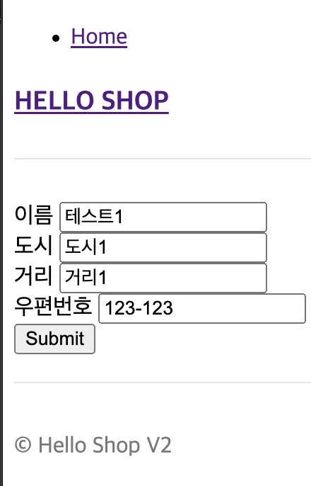

<details>
<summary>생성되는 쿼리</summary>

<a id="1c3eda9b0fe18175bd0fce6f02453c79"></a>

```java
Hibernate: 
    /* select
        m 
    from
        Member m 
    where
        m.name = :name */ select
            m1_0.member_id,
            m1_0.city,
            m1_0.street,
            m1_0.zipcode,
            m1_0.name 
        from
            member m1_0 
        where
            m1_0.name=?
Hibernate: 
    select
        next_val as id_val 
    from
        member_seq for update
Hibernate: 
    update
        member_seq 
    set
        next_val= ? 
    where
        next_val=?
Hibernate: 
    /* insert for
        com.prac.jpa1.domain.Member */insert 
    into
        member (city, street, zipcode, name, member_id) 
    values
        (?, ?, ?, ?, ?)
```

</details>

- jpa1 DB에 해당 데이터가 잘 들어가는 것을 확인 가능
    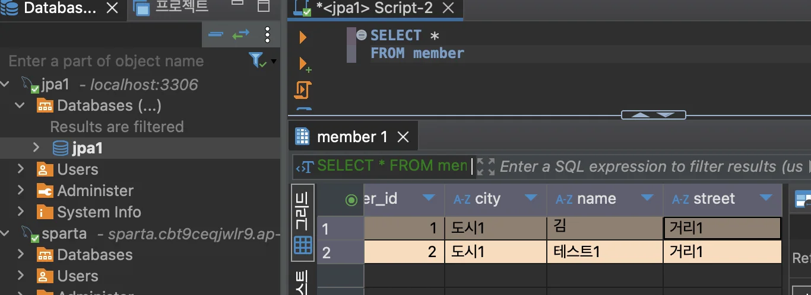

</details>

<a id="1c3eda9b0fe181b7befbf488796c23a8"></a>

```java
@PostMapping(value = "/members/new")
public String create(@Valid MemberForm form, BindingResult result) {
    if (result.hasErrors()) {
        return "members/createMemberForm";
    }

    Address address = new Address(form.getCity(), form.getStreet(),form.getZipcode());
    Member member = new Member();
    member.setName(form.getName());
    member.setAddress(address);
    memberService.join(member);

    return "redirect:/";
}
```

</details>

<a id="1c3eda9b0fe181f8b7e2d14ca330cf62"></a>

```groovy
@Controller
@RequiredArgsConstructor
public class MemberController {

    private final MemberService memberService;

		/** 
		 * 회원 등록 폼
		 */
    @GetMapping(value = "/members/new")
    public String createForm(Model model) {
        model.addAttribute("memberForm", new MemberForm());
        return "members/createMemberForm";
    }
		
		/** 
		 * 회원 등록
		 */
    @PostMapping(value = "/members/new")
    public String create(@Valid MemberForm form, BindingResult result) {
        if (result.hasErrors()) {
            return "members/createMemberForm";
        }

        Address address = new Address(form.getCity(), form.getStreet(),form.getZipcode());
        Member member = new Member();
        member.setName(form.getName());
        member.setAddress(address);
        memberService.join(member);

        return "redirect:/";
    }
}
```

</details>

<a id="1c3eda9b0fe1811ea97bc227b515fd9e"></a>

### 목록 조회

<details>
<summary><code>회원 목록 뷰</code>&#58;<strong> memberList&#46;html</strong></summary>

> ⚠️ 
> 
> <a id="1c3eda9b0fe1818b8f3ec7c01b7a4997"></a>
> 
>  타임리프에서 ?를 사용하면 &#96;null&#96; 을 무시

<a id="1c3eda9b0fe181359951e533d3b9660c"></a>

```html
<!DOCTYPE HTML>
<html xmlns:th="http://www.thymeleaf.org">
<head th:replace="fragments/header :: header" />
<body>

<div class="container">
    <div th:replace="fragments/bodyHeader :: bodyHeader" />
    <div>
        <table class="table table-striped">
            <thead>
            <tr>
                <th>#</th>
                <th>이름</th>
                <th>도시</th>
                <th>주소</th>
                <th>우편번호</th>
            </tr>
            </thead>
            <tbody>
            <tr th:each="member : ${members}">
                <td th:text="${member.id}"></td>
                <td th:text="${member.name}"></td>
                <td th:text="${member.address?.city}"></td>
                <td th:text="${member.address?.street}"></td>
                <td th:text="${member.address?.zipcode}"></td>
            </tr>
            </tbody>
        </table>
    </div>
    
    <div th:replace="fragments/footer :: footer" />
    
</div> <!-- /container -->
</body>
</html>
```

</details>

---

<details>
<summary><code>회원 등록 컨트롤러</code>&#58;  &#91; 코드 &#93; <strong>MemberController</strong></summary>

<details>
<summary>회원 목록 조회 </summary>

- 조회한 회원 정보들을 뷰(<code>memberList&#46;html</code>)에 전달하기 위해 스프링 MVC가 제공하는 <strong><code>모델(Model) </code></strong>객체에 보관

- 뷰(<code>memberList&#46;html</code>) 이름 반환

<a id="1c3eda9b0fe18196931ec773358da234"></a>

```java
@GetMapping(value = "/members")
public String list(Model model) {
    List<Member> members = memberService.findMembers();
    model.addAttribute("members", members);
    return "members/memberList";
}
```

</details>

<a id="1c3eda9b0fe181ef8524ce1aecfb01ac"></a>

```groovy
@Controller
@RequiredArgsConstructor
public class MemberController {

    private final MemberService memberService;
		
		  .  .  .
		
    /** 
		* 회원 목록 조회
		*/
		@GetMapping(value = "/members")
		public String list(Model model) {
		    List<Member> members = memberService.findMembers();
		    model.addAttribute("members", members);
		    return "members/memberList";
		}
}
```

</details>

<a id="1c3eda9b0fe1813fae6add7a3b83918f"></a>

## 상품 &#45; 등록, 목록 조회, 수정

<details>
<summary><strong>🤬 &#91; </strong><strong><code>Error</code></strong><strong> &#93;</strong> Model에 폼 객체 담을 시, thymeleaf 바인딩 오류</summary>

<a id="1c3eda9b0fe181beaeabf386db02d3fe"></a>

강의랑 다르게 모델에 폼 객체 넣을 때, key 값을 ‘bookForm’으로 넣음

<a id="1c3eda9b0fe1819daafef714323584bb"></a>

→ 타임리프 객체 바딩인 에러 발생

- 동일한 key 값 설정 시, 정상 실행됨
    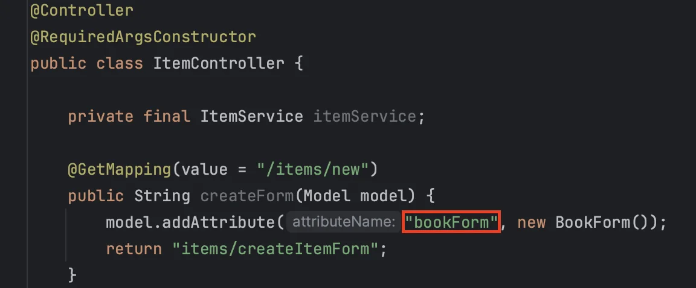


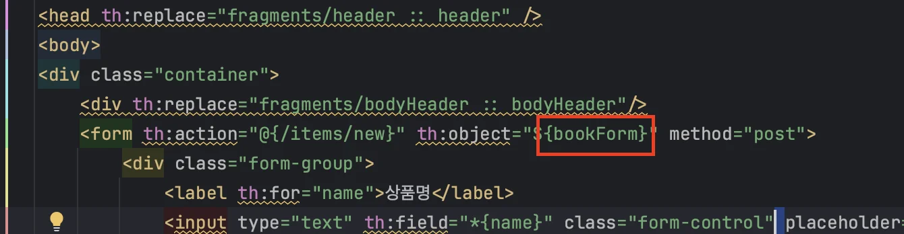

</details>

<details>
<summary>🧐 로깅 &#45; 받아오는 form 데이터 확인</summary>

- BookFrom &#45; toString()
    - toString 메서드를 오버라이드 해서 필드 값들을 String 값으로 자동 출력함

    <a id="1c3eda9b0fe1818293f1c272792c2ec0"></a>

    ```java
    @Getter @Setter
    public class BookForm {

    	.  .  .
    	
    	@Override
      public String toString() {
          return "Form{name='" + name +
                  "', price=" + price +
                  ", stockQuantity='" + stockQuantity+
                  ", author='" + author+
                  ", isbn='" + isbn +
                  "'}";
      }
    ```

- 출력
    <a id="1c3eda9b0fe181ea8a23c5fee7a03889"></a>

    ```java
     log.info("Form object: {}", form);
    ```

    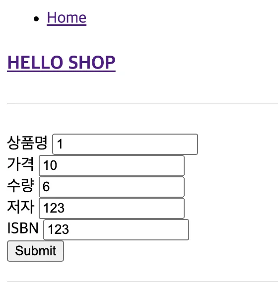

    <a id="1c3eda9b0fe181abbc62f255906b652f"></a>

    테스트 데이터 입력 시 <br>

    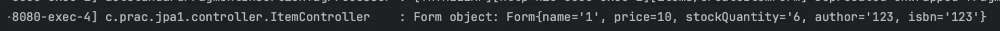

    <a id="1c3eda9b0fe181c689d1de79f88b8931"></a>

    위 같이 로그가 출력되어 form 데이터를 정상적으로 받아오는지 확인할 수 있다&#46; 

</details>

<details>
<summary><code>🧐 &#64;PathVariable</code></summary>


</details>

<details>
<summary><code>🧐 &#64;ModelAttribute</code></summary>


</details>

<a id="1c3eda9b0fe181198842f5761e495dc9"></a>

### 등록

<details>
<summary><strong>&#91; 뷰 &#93; createItemForm&#46;html</strong></summary>

<a id="1c3eda9b0fe1818bb05cc6f88f5681bb"></a>

```java
<!DOCTYPE HTML>
<html xmlns:th="http://www.thymeleaf.org">
<head th:replace="fragments/header :: header" />
<body>
<div class="container">
    <div th:replace="fragments/bodyHeader :: bodyHeader"/>
    
    <form th:action="@{/items/new}" th:object="${bookForm}" method="post">
        <div class="form-group">
            <label th:for="name">상품명</label>
            <input type="text" th:field="*{name}" class="form-control" placeholder="이름을 입력하세요">
        </div>
        <div class="form-group">
            <label th:for="price">가격</label>
            <input type="number" th:field="*{price}" class="form-control" placeholder="가격을 입력하세요">
        </div>
        <div class="form-group">
            <label th:for="stockQuantity">수량</label>
            <input type="number" th:field="*{stockQuantity}" class="form- control" placeholder="수량을 입력하세요">
        </div>
        <div class="form-group">
            <label th:for="author">저자</label>
            <input type="text" th:field="*{author}" class="form-control" placeholder="저자를 입력하세요">
        </div>
        <div class="form-group">
            <label th:for="isbn">ISBN</label>
            <input type="text" th:field="*{isbn}" class="form-control" placeholder="ISBN을 입력하세요">
        </div>
        <button type="submit" class="btn btn-primary">Submit</button>
    </form>
    
    <div th:replace="fragments/footer :: footer" />
</div> <!-- /container -->
</body>
</html>
```

</details>

---

<details>
<summary><strong>&#91; 코드 &#93; BookForm</strong></summary>

<a id="1c3eda9b0fe1817c91c2ea10163611b6"></a>

```java
package com.prac.jpa1.controller;

import lombok.Getter;
import lombok.Setter;

@Getter
@Setter
public class BookForm {

    private Long id;

    private String name;
    private int price;
    private int stockQuantity;

    private String author;
    private String isbn;
}

```

</details>

<details>
<summary><strong>&#91; 코드 &#93; ItemController</strong></summary>

<details>
<summary>상품 등록 폼</summary>

<a id="1c3eda9b0fe1812ba6fffbb81c80ed8e"></a>

```java
@GetMapping(value = "/items/new")
public String createForm(Model model) {
    model.addAttribute("bookForm", new BookForm());
    return "items/createItemForm";
}
```

</details>

<details>
<summary>상품 등록</summary>

<a id="1c3eda9b0fe181f1a85bd9194dba0832"></a>

```java
@PostMapping(value = "/items/new")
public String create(BookForm form) {
    Book book = new Book();
    book.setName(form.getName());
    book.setPrice(form.getPrice());
    book.setStockQuantity(form.getStockQuantity());
    book.setAuthor(form.getAuthor());
    book.setIsbn(form.getIsbn());

    itemService.saveItem(book);

    return "redirect:/items";
}
```

</details>

<a id="1c3eda9b0fe181a7a3e8f1f9a06fd473"></a>

```java
@Controller
@RequiredArgsConstructor
public class ItemController {

    private final ItemService itemService;

		/**
     * 상품 등록 폼
     */
    @GetMapping(value = "/items/new")
    public String createForm(Model model) {
        model.addAttribute("bookForm", new BookForm());
        return "items/createItemForm";
    }
    
    /**
     * 상품 등록
     */
    @PostMapping(value = "/items/new")
    public String create(BookForm form) {
        Book book = new Book();
        book.setName(form.getName());
        book.setPrice(form.getPrice());
        book.setStockQuantity(form.getStockQuantity());
        book.setAuthor(form.getAuthor());
        book.setIsbn(form.getIsbn());

        itemService.saveItem(book);

        return "redirect:/items";
    }
}

```

</details>

<a id="1c3eda9b0fe181ad81b9f5332b30c0d6"></a>

### 목록 조회

<details>
<summary><strong>&#91; 뷰 &#93; itemList&#46;html</strong></summary>

<a id="1c3eda9b0fe181d4b825dd3fcb31dba7"></a>

```java
<!DOCTYPE HTML>
<html xmlns:th="http://www.thymeleaf.org">
<head th:replace="fragments/header :: header" />
<body>

<div class="container">
    <div th:replace="fragments/bodyHeader :: bodyHeader"/>
    <div>
        <table class="table table-striped">
            <thead> <tr>
                <th>#</th> <th>상품명</th> <th>가격</th> <th>재고수량</th> <th></th>
            </tr>
            </thead>
            <tbody>
            <tr th:each="item : ${items}">
                <td th:text="${item.id}"></td>
                <td th:text="${item.name}"></td>
                <td th:text="${item.price}"></td>
                <td th:text="${item.stockQuantity}"></td>
                <td>
                    <a href="#" th:href="@{/items/{id}/edit (id=${item.id})}" class="btn btn-primary" role="button">수정</a>
                </td> </tr>
            </tbody>
        </table>
    </div>
    <div th:replace="fragments/footer :: footer"/>
</div> <!-- /container -->

</body>
</html>
```

</details>

---

<details>
<summary><strong>&#91; 코드 &#93; ItemController</strong></summary>

<details>
<summary>상품 목록</summary>

<a id="1c3eda9b0fe181edad48f55f60bb237e"></a>

```java
@GetMapping(value = "/items")
public String list(Model model) {
    List<Item> items = itemService.findItems();
    model.addAttribute("items", items);  // key 값 작은 따옴표('') 사용 시 오류 발생, why?
    return "items/itemList";
}
```

</details>

<a id="1c3eda9b0fe181588fb2c6903bd7114e"></a>

```java
@Controller
@RequiredArgsConstructor
public class ItemController {

    private final ItemService itemService;

			. . .
			
	  /**
     * 상품 목록
     */
    @GetMapping(value = "/items")
    public String list(Model model) {
        List<Item> items = itemService.findItems();
        model.addAttribute("items", items);  // key 값 작은 따옴표('') 사용 시 오류 발생, why?
        return "items/itemList";
    }
}

```

</details>

<a id="1c3eda9b0fe18157b9a1e5afbfd308f7"></a>

### 수정

<details>
<summary><strong>&#91; 뷰 &#93; updateItemForm&#46;html</strong></summary>

<a id="1c3eda9b0fe18137bb08cd293b6dda69"></a>

```java
<!DOCTYPE HTML>
<html xmlns:th="http://www.thymeleaf.org">
<head th:replace="fragments/header :: header" />
<body>
<div class="container">
    <div th:replace="fragments/bodyHeader :: bodyHeader"/>
    <form th:object="${form}" method="post">
        <!-- id -->
        <input type="hidden" th:field="*{id}" />
        <div class="form-group">
            <label th:for="name">상품명</label>
            <input type="text" th:field="*{name}" class="form-control"
                   placeholder="이름을 입력하세요" /> </div>
        <div class="form-group">
            <label th:for="price">가격</label>
            <input type="number" th:field="*{price}" class="form-control"
                   placeholder="가격을 입력하세요" /> </div>
        <div class="form-group">
            <label th:for="stockQuantity">수량</label>
            <input type="number" th:field="*{stockQuantity}" class="form-
control" placeholder="수량을 입력하세요" /> </div>
        <div class="form-group">
            <label th:for="author">저자</label>
            <input type="text" th:field="*{author}" class="form-control"
                   placeholder="저자를 입력하세요" /> </div>
        <div class="form-group">
            <label th:for="isbn">ISBN</label>
            <input type="text" th:field="*{isbn}" class="form-control"
                   placeholder="ISBN을 입력하세요" /> </div>
        <button type="submit" class="btn btn-primary">Submit</button>
    </form>
    <div th:replace="fragments/footer :: footer" />
</div> <!-- /container -->
</body>
</html>
```

</details>

---

<details>
<summary><strong>&#91; 코드 &#93; ItemController</strong></summary>

<details>
<summary>상품 수정 폼</summary>

<a id="1c3eda9b0fe1815ea7fac5846f505727"></a>

```java
@GetMapping(value = "/items/{itemId}/edit")
public String updateItemForm(@PathVariable("itemId") Long itemId, Model model) {
    // 하위 엔티티로 형변환
    Book item = (Book) itemService.findOne(itemId);

    BookForm form = new BookForm();

    form.setId(item.getId());
    form.setName(item.getName());
    form.setPrice(item.getPrice());
    form.setStockQuantity(item.getStockQuantity());
    form.setAuthor(item.getAuthor());
    form.setIsbn(item.getIsbn());

    model.addAttribute("form", form);
    return "items/updateItemForm";
}
```

</details>

<details>
<summary>상품 수정</summary>

<a id="1c3eda9b0fe18120b3abc5163badbc6e"></a>

```java
@PostMapping(value = "/items/{id}/edit")
public String updateItem(@ModelAttribute("form") BookForm form) {

    Book book = new Book();
    book.setId(form.getId());
    book.setName(form.getName());
    book.setPrice(form.getPrice());
    book.setStockQuantity(form.getStockQuantity());
    book.setAuthor(form.getAuthor());
    book.setIsbn(form.getIsbn());

    itemService.saveItem(book);
    return "redirect:/items";
}
```

</details>

<a id="1c3eda9b0fe181d4b015c8200f2f890e"></a>

```java
@Controller
@RequiredArgsConstructor
public class ItemController {

    private final ItemService itemService;
    
	    .  .  .

		/**
     * 상품 수정 폼
     */
    @GetMapping(value = "/items/{itemId}/edit")
    public String updateItemForm(@PathVariable("itemId") Long itemId, Model model) {
        // 하위 엔티티로 형변환
        Book item = (Book) itemService.findOne(itemId);

        BookForm form = new BookForm();

        form.setId(item.getId());
        form.setName(item.getName());
        form.setPrice(item.getPrice());
        form.setStockQuantity(item.getStockQuantity());
        form.setAuthor(item.getAuthor());
        form.setIsbn(item.getIsbn());

        model.addAttribute("form", form);
        return "items/updateItemForm";
    }

    /**
     * 상품 수정
     */
    @PostMapping(value = "/items/{id}/edit")
    public String updateItem(@ModelAttribute("form") BookForm form) {

        Book book = new Book();
        book.setId(form.getId());
        book.setName(form.getName());
        book.setPrice(form.getPrice());
        book.setStockQuantity(form.getStockQuantity());
        book.setAuthor(form.getAuthor());
        book.setIsbn(form.getIsbn());

        itemService.saveItem(book);
        return "redirect:/items";
    }
}

```

</details>

<a id="1c3eda9b0fe18180a16ac97ff09528e6"></a>

## 변경감지, 병합(merge)

> ☝🏻 
> 
> <a id="1c3eda9b0fe1816693eacf2e27574ca5"></a>
> 
> <strong>엔티티 변경 시, 항상</strong><strong><u> 변경 감지 </u></strong><strong>사용</strong>
> 
> - 컨트롤러에 어설프게 엔티티를 생성하면 안된다&#46; 
> 
> - <strong><u>트랜잭션이 있는 서비스 계층</u></strong>에 <strong><u>식별자(id)</u></strong>와 <strong><u>변경할 데이터</u></strong>를 <strong>명확하게 전달</strong>해야 한다&#46; ( <code>파라미터</code>, <code>DTO</code>)
> 
> - <strong><u>트랜잭션이 있는 서비스 계층</u></strong>에서 <strong><u>영속 상태의 엔티티를 조회</u></strong>하고, <strong><u>엔티티의 데이터를 직접 변경</u></strong>해야 한다&#46;  
> 
> - <strong><u>트랜젝션 커밋 시점</u></strong>에 <strong>변경 감지가 실행</strong>된다&#46; 

<a id="1c3eda9b0fe18187ac44da37d10f2791"></a>

## 준영속 엔티티

> 영속성 컨텍스트가 더는 관리하지 않는 엔티티

<details>
<summary>ex) DB에서 조회하여 가져온 상품 객체(<code>item</code>) </summary>

- ItemController &#45; updateItemForm()

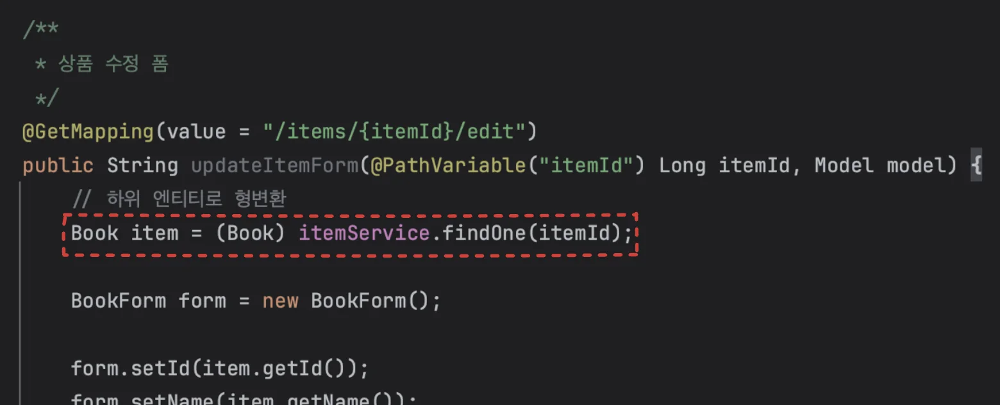

<a id="1c3eda9b0fe181ae9862f0d2401f88a9"></a>

 

- ItemService &#45; findOne()

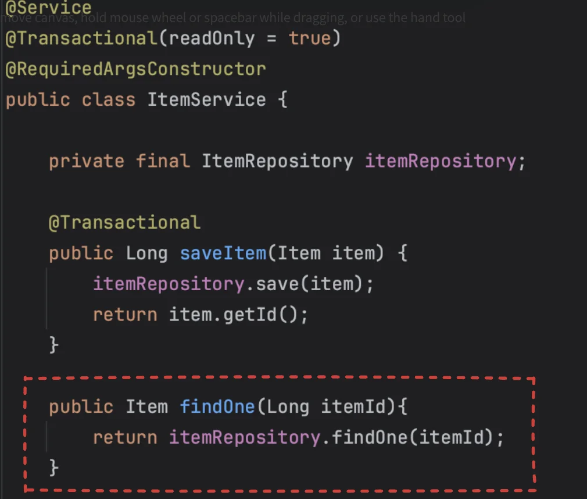

- ItemRepository &#45; findOne()
    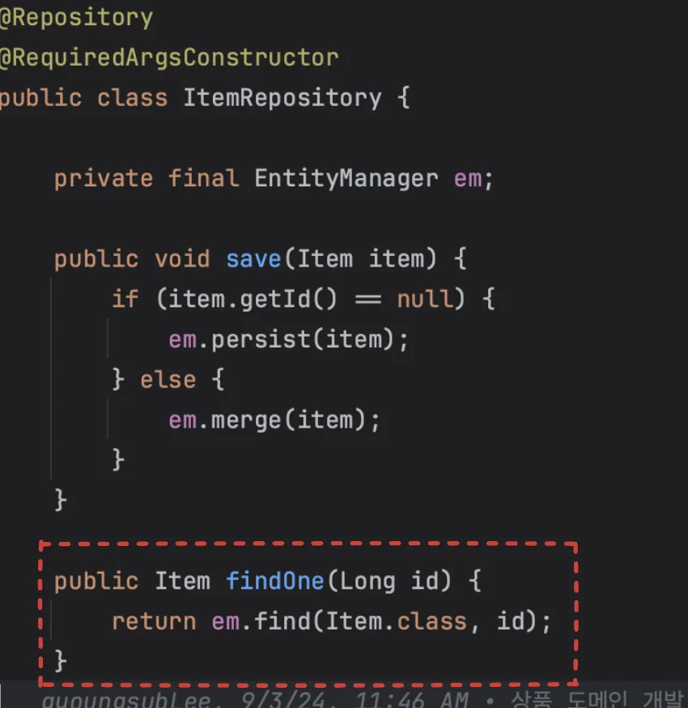

</details>

<a id="1c3eda9b0fe181f4b2a3dbd8803038a0"></a>

DB에 저장 시, 해당하는 엔티티는  식별자(ID)가 자동으로 생성된다&#46;(<code>&#64;GereratedValue</code>)

<a id="1c3eda9b0fe1816a9777ed895cee58a6"></a>

따라서 아래처럼 <strong><u>조회하여 임의로 생성한 엔티티</u></strong><strong>(</strong><strong><code>item</code></strong><strong>)</strong>도 <strong><u>기존의 식별자</u></strong><strong><u>를 가지고 있기 </u></strong><strong>때문</strong>에 <strong><u>준영속 상태엔티티</u></strong> 이다&#46;


<a id="1c3eda9b0fe1811f8618fc5797cb5573"></a>

이러한 준영속 엔티티를 수정하는 방법은 아래와 같다&#46;  

<a id="1c3eda9b0fe18148be3aceebf4210e61"></a>

### 변경 감지 ( dirty checking )

> 영속성 컨텍스트에서 엔티티를 다시 조회한 후 데이터 수정하는 방법

1. 트랜젝션 안에서 엔티티티를 다시 조회, 변경할 값 선택

1. 트랜잭션 커밋 시점에서 변경 감지(Dirty Checking)이 동작해서 데이터베이스에 UPDATE SQL 실행함

<a id="1c3eda9b0fe1814eb97dda74d19a7f95"></a>

```java
@Transactional
void update(Item itemParam) { //itemParam: 파리미터로 넘어온 준영속 상태의 엔티티
		Item findItem = em.find(Item.class, itemParam.getId()); //같은 엔티티를 조회한다.
		findItem.setPrice(itemParam.getPrice()); //데이터를 수정한다. 
}
```

<a id="1c3eda9b0fe181318e0bd93e741b2e5f"></a>

### 병합 ( merge )

> 준영속 상태의 엔티티를 영속 상태로 변경할 때 사용하는 기능

<a id="1c3eda9b0fe1817daa77d9354a13ee9b"></a>

```java
@Transactional
void update(Item itemParam) { //itemParam: 파리미터로 넘어온 준영속 상태의 엔티티
     Item mergeItem = em.merge(itemParam);
}
```

<details>
<summary><strong>동작 방식</strong></summary>

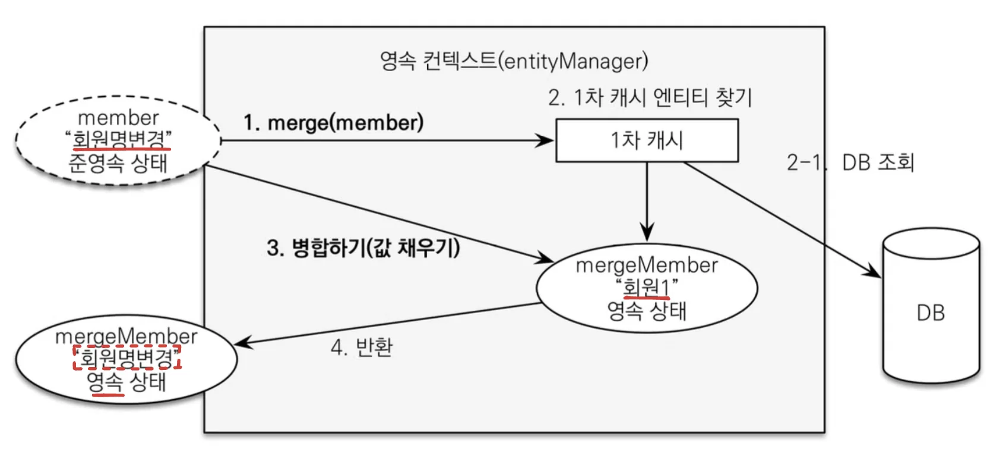

1. <code>merge()</code> 실행

1. <strong><u>파라미터로 넘어온 준영속 엔티티의 식별자 값</u></strong>으로 <u>1차 캐시</u>에서 엔티티<u> 조회</u>
    <a id="1c3eda9b0fe181f3a96efb4aae253b56"></a>

    2&#45;1&#46; 만약 1차 캐시에 엔티티가 없으면, DB에서 엔티티 조회 후 1차 캐시에 저장

1. 조회한 영속 엔티티(mergeMember)에 member 엔티티의 값이 채워진다&#46; 
    > member 엔티티의 모든 값을 mergeMember에 밀어 넣음,  ‘회원1’ → ‘회원명변경’

1. 영속 상태인 mergeMember 반환

</details>

> ⚠️ 
> 
> <a id="1c3eda9b0fe18181ad3ae623996b1d73"></a>
> 
> <strong><u>변경 감지 기능</u></strong> 사용 시 <strong><u>원하는 속성만 선택해서 변경 가능</u></strong>하지만,
> 
> <a id="1c3eda9b0fe18158bbe5d45ca58b6c26"></a>
> 
> <strong><u>병합</u></strong> 사용 시 <strong><u>모든 속성(필드)이 교체</u></strong>된다 즉 <strong><u>병합</u></strong> 시 <strong><u>값이 없</u></strong>으면 <strong><code>null</code></strong>로 <strong><u>업데이트</u></strong> 될 수 있다&#46; <br><br><strong>실무</strong>에서는 보통 <strong><u>업데이트 기능이 매우 제한적</u></strong>이다&#46; 그런데 <strong>병합</strong>은 <strong>모든 필드를 변경</strong>해버리고, <strong>데이터가 없으면 null로 업데이트</strong> 해버린다&#46; 병합을 사용하면서 해당 문제를 해결하려면, <strong>변경 폼 화면에 모든 데이터를 항상 유지</strong>해야 한다&#46; <strong><u>실무</u></strong><strong>에서는 </strong><strong><u>보통 변경가능한 데이터만 노출</u></strong>하기 때문에, <strong><u>병합을 사용하는 것이 오히려 번거롭다&#46;</u></strong> 
> 
> <a id="1c3eda9b0fe1811c8a57fcd9802fbfed"></a>
> 
> <br>따라서<strong><u> </u></strong><strong><u>엔티티를 변경 시</u></strong>에는 항상 <strong><u>변경 감지</u></strong>를 사용해야 한다&#46; 

<a id="1c3eda9b0fe1815a962ed34ce71e763e"></a>

### 권장)  <u>변경 감지 기능</u>으로 엔티티 업데이트 하기

<details>
<summary>기존 상품 리포지토리(ItemRepository) 저장 메서드</summary>

- <code>save(Item item)</code>
    - 식별자(id) 값이 없으면 새로운 엔티티로 판단하여 영속화(persist)

    - 식별자가 있으면 준영속 상태로 판단하고 병합merge<br>

<a id="1c3eda9b0fe181c19e70c3319b186452"></a>

```java
@Repository
public class ItemRepository {

   @PersistenceContext EntityManager em;
   
   public void save(Item item) {
   
       if (item.getId() == null) {
           em.persist(item);
       } else {
           em.merge(item);
       }
	}

//...

}
```

</details>

> ☝🏻 
> 
> <a id="1c3eda9b0fe181c0943ec0ca093c4648"></a>
> 
> Controller 에서 어설프게 엔티티 생성 ❌ <br>→ Service 에서 생성

<details>
<summary>트랜젝션이 있는 서비스 계층에 식별자와 변경할 데이터를 <strong><u>명확하게 전달</u></strong> ( <code>파라미터</code>, <code>dto</code>)</summary>

<a id="1c3eda9b0fe1810383b8f29fdf1e0d95"></a>

```java
// ItemController
@PostMapping(value = "/items/{itemId}/edit")
public String updateItem(@PathVariable Long itemId, @ModelAttribute("form") BookForm form) {
    itemService.updateItem(itemId, form.getName(), form.getPrice(), form.getStockQuantity());
    return "redirect:/items";
}
```

</details>

<details>
<summary>트랜젝션 안에서 엔티티를 조회해야 영속 상태로 조회가 된다&#46; </summary>

<a id="1c3eda9b0fe1816f9203e81756018e77"></a>

```java
// ItemService
@Transactional
public void updateItem(Long id, String name, int price, int stockQuantity) {
    Item item = itemRepository.findOne(id);
```

</details>

<details>
<summary>트랜잰션 안에서 변경이 이뤄져야 변경 감지(dirty checking)이 일어난다&#46; </summary>

<a id="1c3eda9b0fe1812aa069c6afa1ca65c3"></a>

```java
// ItemService
@Transactional
public void updateItem(Long id, String name, int price, int stockQuantity) {
    Item item = itemRepository.findOne(id);
    item.setName(name);
    item.setPrice(price);
    item.setStockQuantity(stockQuantity);
}
```

</details>

<details>
<summary>&#91; 코드 &#93; ItemController</summary>

<a id="1c3eda9b0fe181589c14c9863fdf5240"></a>

```java
/**
 * 상품 수정, 권장 코드
 */
@PostMapping(value = "/items/{itemId}/edit")
public String updateItem(@PathVariable Long itemId, @ModelAttribute("form") BookForm form) {

    itemService.updateItem(itemId, form.getName(), form.getPrice(), form.getStockQuantity());
    return "redirect:/items";
}
```

</details>

<details>
<summary>&#91; 코드 &#93; ItemService</summary>

<a id="1c3eda9b0fe181abb1aae3324fb2b932"></a>

```java
/**
 * 변경 감자 ( Dirty Checking ) 
 */
@Transactional
public void updateItem(Long id, String name, int price, int stockQuantity) {
    Item item = itemRepository.findOne(id);
    item.setName(name);
    item.setPrice(price);
    item.setStockQuantity(stockQuantity);
}
```

</details>

<a id="1c3eda9b0fe18142b920d03b5d0103c8"></a>

## 주문 &#45; 상품 주문, 주문 목록 검색, 취소

<details>
<summary>🧐<strong> </strong>어떻게 model에 담은 객체들이 thymeleaf를 통해 뷰에 바인딩 될 수 있는가?</summary>


<details>
<summary>1&#46;  <strong>요청 수신, 핸들러 매핑</strong></summary>

- <strong><u>사용자</u></strong>가 <strong>브라우저</strong>에서 <strong><u>URL 요청(HTTP GET 요청 메세지)을 보내</u></strong>면, 스프링 MVC의 <code>DispatcherServlet</code>이 해당 요청을 수신한다&#46;

- DispatcherServlet이 <code>HandlerMapping</code>을 사용하여 <strong><u>요청 받은 URL</u></strong>에 따라 <strong><u>적절한 Controller의 메서드를 찾</u></strong>아준다 <br>

</details>

<details>
<summary>2&#46;  <strong>Controller에서 요청 처리</strong></summary>

- 매핑된 Controller 메서드가 실행된다&#46;

- 서비스 로직이 실행되거 데이터를 처리한 후,<br>결과를 <strong><u>Model 객체에 담</u></strong>는다&#46; 

- <strong><u>Model 객체에 추가된 데이터</u></strong>는 <code>DispatcherServlet</code>을 통해 <strong><u>뷰에 전달</u></strong>된다&#46; <br>

</details>

<details>
<summary>3&#46;  <strong>ViewResolver 동작</strong></summary>

- Controller가 실행된 후, 반환된 뷰 이름이 <code>DispatcherServlet</code>에 의해 처리 된다&#46; 

- DispatcherServlet은 <code>ViewResolver</code>를 사용하여 <strong><u>해당 이름의 뷰(예&#58; Thymeleaf 템플릿 파일)를 찾</u></strong>는다&#46; 

<details>
<summary>일반적으로 Thymeleaf 설정 파일에 기본 경로가 설정되어 있고, 해당 파일의 경로와 확장자가 추가된다&#46; </summary>

<a id="1c3eda9b0fe1812498b2fdd21409e143"></a>

```java
spring.thymeleaf.prefix=classpath:/templates/
spring.thymeleaf.suffix=.html
```

<details>
<summary>ex)</summary>

<a id="1c3eda9b0fe1812b9912f6b60d857e8d"></a>

```java
@Controller
public class MyController {
    @GetMapping("/example")
    public String example(Model model) {
        model.addAttribute("message", "Hello, Thymeleaf!");
        return "example"; // 반환된 뷰 이름
    }
}
```

<a id="1c3eda9b0fe181b891e3ed1019d3508b"></a>

위 메서드에서 반환된 뷰 이름인 ‘example’은 <code>classpath&#58;/templates/example&#46;html</code> 로 해석된다&#46; 

</details>

</details>

</details>

<details>
<summary>5&#46;  <strong>응답 반환</strong></summary>

- 템플릿이 렌더링되면, <code>DispatcherServlet</code>은 <code>완성된 HTML 페이지</code>를 <u>사용자 브라우저에 응답으로 전송</u>한다&#46;

</details>

- <strong>요약</strong>
    - 사용자의 브라우저가 <code>HTTP GET 요청 메시지</code> 보냄

    - dispatcherServlet이 요청을 받아 HanlderMapping을 통해 요청받은 url에 매핑되는 Controller의 메서드를 호출

    - Controller에서 Model에 데이터를 담고 뷰 이름 반환

    - ViewResolver가 반환된 뷰 이름을 기반으로 알맞은 Thymeleaf 템플릿(htm파일)을 찾음
        <a id="1c3eda9b0fe181e0b296c8c2d5954644"></a>

        이때, Model에 담긴 데이터가 Thymeleaf에 전달됨

    - Thymeleaf 엔진이 전달받은 Model 데이터를 사용해 템플릿에 동적으로 데이터를 바인딩함

    - 렌더링된 HTML 파일이 DIspatcherServlet을 통해 응답 메세지에 담겨 사용자의 브라우저에 전송됨&#46;

</details>

<details>
<summary>🧐 <strong>ThymeleafView</strong></summary>

- Spring Framework와 Thymeleaf가 통합되어 동작하는 핵심 클래스 중 하나

- <strong><u>스프링 MVC</u></strong>에서 <strong><u>뷰 렌더링 역할</u></strong>을 하는 <strong><u><code>View 인터페이스</code></u></strong>의 <strong><u>구현체</u></strong>이다

<a id="1c3eda9b0fe181079fe9e699ec1c1ec5"></a>

<strong>동작 방식</strong>

- ViewResolver가 Thymeleaf 템플릿 파일을 찾아야 할 때, ThymeleafViewResolver가 적절한 템플릿을 로드한다&#46;

- ThymeleafView는 로드된 템플릿 파일을 렌더링하고, 이를 DispatcherServlet에 전달하여 클라이언트에게 응답으로 보낸다&#46;

- 즉, ThymeleafView는 Model에 담긴 데이터를 Thymeleaf 템플릿에 전달하고, 템플릿을 HTML로 렌더링하는 과정을 담당한다&#46;

</details>

<details>
<summary><strong>🧐 ThymeleafViewResolver</strong></summary>

<details>
<summary>스프링 MVC에서 <strong><u>view 찾</u></strong>는 <strong><u><code>viewResolver</code></u></strong><strong><u>의 구현체</u></strong></summary>


</details>

- <strong>Thymeleaf 템플릿 파일 찾고 </strong>ThymeleafView를 호출하며 HTML 파일을 생성한다&#46; 

<details>
<summary>&#91; 코드 &#93; ThymeleafViewResolver (주석 제거 )</summary>

<a id="1c3eda9b0fe181e4b0e4c70250e4d0d1"></a>

```java
public class ThymeleafViewResolver
     extends AbstractCachingViewResolver
        implements Ordered {
        
    private static final Logger vrlogger = LoggerFactory.getLogger(org.thymeleaf.spring6.view.ThymeleafViewResolver.class);


    public static final String REDIRECT_URL_PREFIX = "redirect:";


    public static final String FORWARD_URL_PREFIX = "forward:";

    private boolean redirectContextRelative = true;
    private boolean redirectHttp10Compatible = true;

    private boolean alwaysProcessRedirectAndForward = true;

    private boolean producePartialOutputWhileProcessing = AbstractThymeleafView.DEFAULT_PRODUCE_PARTIAL_OUTPUT_WHILE_PROCESSING;

    private Class<? extends AbstractThymeleafView> viewClass = ThymeleafView.class;
    private String[] viewNames = null;
    private String[] excludedViewNames = null;
    private int order = Integer.MAX_VALUE;


    private final Map<String, Object> staticVariables = new LinkedHashMap<String, Object>(10);
    private String contentType = null;
    private boolean forceContentType = false;
    private String characterEncoding = null;

    private ISpringTemplateEngine templateEngine;


    public ThymeleafViewResolver() {
        super();
    }
    
    public void setViewClass(final Class<? extends AbstractThymeleafView> viewClass) {
        if (viewClass == null || !AbstractThymeleafView.class.isAssignableFrom(viewClass)) {
            throw new IllegalArgumentException(
                    "Given view class [" + (viewClass != null ? viewClass.getName() : null) +
                            "] is not of type [" + AbstractThymeleafView.class.getName() + "]");
        }
        this.viewClass = viewClass;
    }


    protected Class<? extends AbstractThymeleafView> getViewClass() {
        return this.viewClass;
    }


    public ISpringTemplateEngine getTemplateEngine() {
        return this.templateEngine;
    }


    public void setTemplateEngine(final ISpringTemplateEngine templateEngine) {
        this.templateEngine = templateEngine;
    }


    public Map<String,Object> getStaticVariables() {
        return Collections.unmodifiableMap(this.staticVariables);
    }


    public void addStaticVariable(final String name, final Object value) {
        this.staticVariables.put(name, value);
    }


    public void setStaticVariables(final Map<String, ?> variables) {
        if (variables != null) {
            for (final Map.Entry<String, ?> entry : variables.entrySet()) {
                addStaticVariable(entry.getKey(), entry.getValue());
            }
        }
    }


    public void setOrder(final int order) {
        this.order = order;
    }


    public int getOrder() {
        return this.order;
    }


    public void setContentType(final String contentType) {
        this.contentType = contentType;
    }


    public String getContentType() {
        return this.contentType;
    }


    public boolean getForceContentType() {
        return this.forceContentType;
    }


    public void setForceContentType(final boolean forceContentType) {
        this.forceContentType = forceContentType;
    }


    public void setCharacterEncoding(final String characterEncoding) {
        this.characterEncoding = characterEncoding;
    }


    public String getCharacterEncoding() {
        return this.characterEncoding;
    }


    public void setRedirectContextRelative(final boolean redirectContextRelative) {
        this.redirectContextRelative = redirectContextRelative;
    }


    public boolean isRedirectContextRelative() {
        return this.redirectContextRelative;
    }
    
    public void setRedirectHttp10Compatible(final boolean redirectHttp10Compatible) {
        this.redirectHttp10Compatible = redirectHttp10Compatible;
    }


    public boolean isRedirectHttp10Compatible() {
        return this.redirectHttp10Compatible;
    }


    public void setAlwaysProcessRedirectAndForward(final boolean alwaysProcessRedirectAndForward) {
        this.alwaysProcessRedirectAndForward = alwaysProcessRedirectAndForward;
    }


    public boolean getAlwaysProcessRedirectAndForward() {
        return this.alwaysProcessRedirectAndForward;
    }


    public boolean getProducePartialOutputWhileProcessing() {
        return this.producePartialOutputWhileProcessing;
    }


    public void setProducePartialOutputWhileProcessing(final boolean producePartialOutputWhileProcessing) {
        this.producePartialOutputWhileProcessing = producePartialOutputWhileProcessing;
    }


    public void setViewNames(final String[] viewNames) {
        this.viewNames = viewNames;
    }


    public String[] getViewNames() {
        return this.viewNames;
    }


    public void setExcludedViewNames(final String[] excludedViewNames) {
        this.excludedViewNames = excludedViewNames;
    }


    public String[] getExcludedViewNames() {
        return this.excludedViewNames;
    }


    protected boolean canHandle(final String viewName, @SuppressWarnings("unused") final Locale locale) {
        final String[] viewNamesToBeProcessed = getViewNames();
        final String[] viewNamesNotToBeProcessed = getExcludedViewNames();
        return ((viewNamesToBeProcessed == null || PatternMatchUtils.simpleMatch(viewNamesToBeProcessed, viewName)) &&
                (viewNamesNotToBeProcessed == null || !PatternMatchUtils.simpleMatch(viewNamesNotToBeProcessed, viewName)));
    }
    
    
    @Override
    protected View createView(final String viewName, final Locale locale) throws Exception {
        if (!this.alwaysProcessRedirectAndForward && !canHandle(viewName, locale)) {
            vrlogger.trace("[THYMELEAF] View \"{}\" cannot be handled by ThymeleafViewResolver. Passing on to the next resolver in the chain.", viewName);
            return null;
        }
        if (viewName.startsWith(REDIRECT_URL_PREFIX)) {
            vrlogger.trace("[THYMELEAF] View \"{}\" is a redirect, and will not be handled directly by ThymeleafViewResolver.", viewName);
            final String redirectUrl = viewName.substring(REDIRECT_URL_PREFIX.length(), viewName.length());
            final RedirectView view = new RedirectView(redirectUrl, isRedirectContextRelative(), isRedirectHttp10Compatible());
            return (View) getApplicationContext().getAutowireCapableBeanFactory().initializeBean(view, REDIRECT_URL_PREFIX);
        }
        if (viewName.startsWith(FORWARD_URL_PREFIX)) {
            vrlogger.trace("[THYMELEAF] View \"{}\" is a forward, and will not be handled directly by ThymeleafViewResolver.", viewName);
            final String forwardUrl = viewName.substring(FORWARD_URL_PREFIX.length(), viewName.length());
            return new InternalResourceView(forwardUrl);
        }
        if (this.alwaysProcessRedirectAndForward && !canHandle(viewName, locale)) {
            vrlogger.trace("[THYMELEAF] View \"{}\" cannot be handled by ThymeleafViewResolver. Passing on to the next resolver in the chain.", viewName);
            return null;
        }
        vrlogger.trace("[THYMELEAF] View {} will be handled by ThymeleafViewResolver and a " +
                "{} instance will be created for it", viewName, getViewClass().getSimpleName());
        return loadView(viewName, locale);
    }
	
// 너무 기니까 인식이 안됨...
```

<a id="1c3eda9b0fe181c1b8f1df50bc6767fb"></a>

```java
    @Override
    protected View loadView(final String viewName, final Locale locale) throws Exception {

        final AutowireCapableBeanFactory beanFactory = getApplicationContext().getAutowireCapableBeanFactory();

        final boolean viewBeanExists = beanFactory.containsBean(viewName);
        final Class<?> viewBeanType = viewBeanExists? beanFactory.getType(viewName) : null;

        final AbstractThymeleafView view;
        if (viewBeanExists && viewBeanType != null && AbstractThymeleafView.class.isAssignableFrom(viewBeanType)) {

            final BeanDefinition viewBeanDefinition =
                    (beanFactory instanceof ConfigurableListableBeanFactory ?
                            ((ConfigurableListableBeanFactory)beanFactory).getBeanDefinition(viewName) :
                            null);

            if (viewBeanDefinition == null || !viewBeanDefinition.isPrototype()) {
                final AbstractThymeleafView viewInstance = BeanUtils.instantiateClass(getViewClass());
                view = (AbstractThymeleafView) beanFactory.configureBean(viewInstance, viewName);
            } else {
                view = (AbstractThymeleafView) beanFactory.getBean(viewName);
            }

        } else {

            final AbstractThymeleafView viewInstance = BeanUtils.instantiateClass(getViewClass());

            if (viewBeanExists && viewBeanType == null) {

                beanFactory.autowireBeanProperties(viewInstance, AutowireCapableBeanFactory.AUTOWIRE_NO, false);
                beanFactory.applyBeanPropertyValues(viewInstance, viewName);
                view = (AbstractThymeleafView) beanFactory.initializeBean(viewInstance, viewName);

            } else {

                beanFactory.autowireBeanProperties(viewInstance, AutowireCapableBeanFactory.AUTOWIRE_NO, false);
                view = (AbstractThymeleafView) beanFactory.initializeBean(viewInstance, viewName);

            }

        }

        view.setTemplateEngine(getTemplateEngine());
        view.setStaticVariables(getStaticVariables());


        if (view.getTemplateName() == null) {
            view.setTemplateName(viewName);
        }

        if (!view.isForceContentTypeSet()) {
            view.setForceContentType(getForceContentType());
        }
        if (!view.isContentTypeSet() && getContentType() != null) {
            view.setContentType(getContentType());
        }
        if (view.getLocale() == null && locale != null) {
            view.setLocale(locale);
        }
        if (view.getCharacterEncoding() == null && getCharacterEncoding() != null) {
            view.setCharacterEncoding(getCharacterEncoding());
        }
        if (!view.isProducePartialOutputWhileProcessingSet()) {
            view.setProducePartialOutputWhileProcessing(getProducePartialOutputWhileProcessing());
        }

        return view;

    }

}
```

</details>

</details>

<details>
<summary>🧐 ThymeleafViewResolver에서 어떻게 Thymeleaf 템플릿 파일 찾는가?</summary>

<details>
<summary>1&#46; <strong><code>createView()</code></strong><strong>&#58; 뷰 이름 확인 및 처리</strong></summary>

<details>
<summary><strong>&#91; 코드 &#93; creatView()</strong></summary>

<a id="1c3eda9b0fe181728dfbe0039b2fbc96"></a>

```java
@Override
protected View createView(final String viewName, final Locale locale) throws Exception {
    // First possible call to check "viewNames": before processing redirects and forwards
    if (!this.alwaysProcessRedirectAndForward && !canHandle(viewName, locale)) {
        vrlogger.trace("[THYMELEAF] View \"{}\" cannot be handled by ThymeleafViewResolver. Passing on to the next resolver in the chain.", viewName);
        return null;
    }
    // Process redirects (HTTP redirects)
    if (viewName.startsWith(REDIRECT_URL_PREFIX)) {
        vrlogger.trace("[THYMELEAF] View \"{}\" is a redirect, and will not be handled directly by ThymeleafViewResolver.", viewName);
        final String redirectUrl = viewName.substring(REDIRECT_URL_PREFIX.length(), viewName.length());
        final RedirectView view = new RedirectView(redirectUrl, isRedirectContextRelative(), isRedirectHttp10Compatible());
        return (View) getApplicationContext().getAutowireCapableBeanFactory().initializeBean(view, REDIRECT_URL_PREFIX);
    }
    // Process forwards (to JSP resources)
    if (viewName.startsWith(FORWARD_URL_PREFIX)) {
        // The "forward:" prefix will actually create a Servlet/JSP view, and that's precisely its aim per the Spring
        // documentation. See http://docs.spring.io/spring-framework/docs/4.2.4.RELEASE/spring-framework-reference/html/mvc.html#mvc-redirecting-forward-prefix
        vrlogger.trace("[THYMELEAF] View \"{}\" is a forward, and will not be handled directly by ThymeleafViewResolver.", viewName);
        final String forwardUrl = viewName.substring(FORWARD_URL_PREFIX.length(), viewName.length());
        return new InternalResourceView(forwardUrl);
    }
    // Second possible call to check "viewNames": after processing redirects and forwards
    if (this.alwaysProcessRedirectAndForward && !canHandle(viewName, locale)) {
        vrlogger.trace("[THYMELEAF] View \"{}\" cannot be handled by ThymeleafViewResolver. Passing on to the next resolver in the chain.", viewName);
        return null;
    }
    vrlogger.trace("[THYMELEAF] View {} will be handled by ThymeleafViewResolver and a " +
                    "{} instance will be created for it", viewName, getViewClass().getSimpleName());
    return loadView(viewName, locale);
}
```

</details>

<a id="1c3eda9b0fe181cabbacc0d5c5eb9f94"></a>

ThymeleafViewResolver는 <strong>뷰 이름</strong>을 받아서 그에 해당하는 <strong>View 객체</strong>를 반환한다 

<a id="1c3eda9b0fe1812b8394f0726d2f1105"></a>

즉, createView() 메소드는 다음과 같은 역할을 한다&#46;

- <strong>리다이렉트</strong> or <strong>포워드 요청</strong> 처리
    - 뷰 이름이 redirect&#58; 또는 forward&#58;로 시작하는지 확인

    - 만약 redirect&#58;로 시작하면, RedirectView를 생성해 반환

    - 만약 forward&#58;로 시작하면, InternalResourceView를 반환&#46;

- <strong>뷰 이름에 해당하는 템플릿을 처리할 수 있는지 확인</strong>
    - canHandle() 메소드로 뷰 이름을 처리할 수 있는지 확인

- <strong>뷰를 직접 처리해야 하는 경우</strong>
    - 위 두 가지가 아닌 경우에는, 실제로 loadView() 메소드를 호출해 템플릿 파일을 찾아 뷰를 로드

<a id="1c3eda9b0fe181c5a8a4e69cd6e0f700"></a>

```java
@Override
protected View createView(final String viewName, final Locale locale) throws Exception {
    if (!this.alwaysProcessRedirectAndForward && !canHandle(viewName, locale)) {
        return null; // Thymeleaf가 이 뷰를 처리하지 않음
    }
    // redirect: 또는 forward: 처리
    if (viewName.startsWith(REDIRECT_URL_PREFIX)) {
        // RedirectView 처리
        ...
    }
    if (viewName.startsWith(FORWARD_URL_PREFIX)) {
        // InternalResourceView 처리
        ...
    }
    return loadView(viewName, locale); // Thymeleaf 템플릿을 찾고 뷰를 로드
}
```

</details>

<details>
<summary>2&#46; <strong><code>loadView()</code></strong><strong>&#58; 실제 뷰 로드</strong></summary>

<details>
<summary><strong>&#91; 코드 &#93; loadView()</strong></summary>

<a id="1c3eda9b0fe181998187f8bb5253d022"></a>

```java
@Override
protected View loadView(final String viewName, final Locale locale) throws Exception {

    final AutowireCapableBeanFactory beanFactory = getApplicationContext().getAutowireCapableBeanFactory();

    final boolean viewBeanExists = beanFactory.containsBean(viewName);
    final Class<?> viewBeanType = viewBeanExists? beanFactory.getType(viewName) : null;

    final AbstractThymeleafView view;
    if (viewBeanExists && viewBeanType != null && AbstractThymeleafView.class.isAssignableFrom(viewBeanType)) {
       
        final BeanDefinition viewBeanDefinition =
                (beanFactory instanceof ConfigurableListableBeanFactory ?
                        ((ConfigurableListableBeanFactory)beanFactory).getBeanDefinition(viewName) :
                        null);

        if (viewBeanDefinition == null || !viewBeanDefinition.isPrototype()) {

            final AbstractThymeleafView viewInstance = BeanUtils.instantiateClass(getViewClass());
            view = (AbstractThymeleafView) beanFactory.configureBean(viewInstance, viewName);
        } else {
            
            view = (AbstractThymeleafView) beanFactory.getBean(viewName);
        }

    } else {

        final AbstractThymeleafView viewInstance = BeanUtils.instantiateClass(getViewClass());

        if (viewBeanExists && viewBeanType == null) {
            
            beanFactory.autowireBeanProperties(viewInstance, AutowireCapableBeanFactory.AUTOWIRE_NO, false);
            
            beanFactory.applyBeanPropertyValues(viewInstance, viewName);
            
            view = (AbstractThymeleafView) beanFactory.initializeBean(viewInstance, viewName);

        } else {
            
            beanFactory.autowireBeanProperties(viewInstance, AutowireCapableBeanFactory.AUTOWIRE_NO, false);
            
            view = (AbstractThymeleafView) beanFactory.initializeBean(viewInstance, viewName);

        }

    }

    view.setTemplateEngine(getTemplateEngine());
    view.setStaticVariables(getStaticVariables());


    
    if (view.getTemplateName() == null) {
        view.setTemplateName(viewName);
    }

    if (!view.isForceContentTypeSet()) {
        view.setForceContentType(getForceContentType());
    }
    if (!view.isContentTypeSet() && getContentType() != null) {
        view.setContentType(getContentType());
    }
    if (view.getLocale() == null && locale != null) {
        view.setLocale(locale);
    }
    if (view.getCharacterEncoding() == null && getCharacterEncoding() != null) {
        view.setCharacterEncoding(getCharacterEncoding());
    }
    if (!view.isProducePartialOutputWhileProcessingSet()) {
        view.setProducePartialOutputWhileProcessing(getProducePartialOutputWhileProcessing());
    }

    return view;

}
```

</details>

> Thymeleaf 템플릿 파일을 로드하고, 템플릿 엔진에 전달할 ThymeleafView<strong> 객체</strong>를 생성한다&#46;

<a id="1c3eda9b0fe1812098adf2533b5ad2bc"></a>

템플릿 파일을 찾는 방식은 크게 두 가지이다&#46; 

- 1&#46; <strong>뷰 이름에 해당하는 빈(Bean)이 있는 경우</strong>
    - 스프링의 빈 팩토리에서 뷰 이름과 일치하는 빈을 찾고, 그 빈이 Thymeleaf 뷰인지 확인

    - 일치하는 경우 해당 빈을 사용해 뷰를 설정

- 2&#46; <strong>뷰 이름에 해당하는 빈이 없는 경우</strong>
    - viewClass(기본적으로 ThymeleafView&#46;class)로 새로운 뷰 객체를 생성, 이를 빈 팩토리에서 초기화

    - 이후, 이 뷰 객체에 <strong>템플릿 엔진</strong>과 <strong>정적 변수</strong> 등을 설정하고, 최종적으로 템플릿 이름을 설정

<a id="1c3eda9b0fe1811cb998d422defc111f"></a>

```java
@Override
protected View loadView(final String viewName, final Locale locale) throws Exception {
    // 스프링 빈 팩토리에서 뷰 이름과 일치하는 빈이 있는지 확인
    final boolean viewBeanExists = beanFactory.containsBean(viewName);

    final AbstractThymeleafView view;
    if (viewBeanExists && viewBeanType != null && AbstractThymeleafView.class.isAssignableFrom(viewBeanType)) {
        view = (AbstractThymeleafView) beanFactory.getBean(viewName);
    } else {
        // 새 뷰 객체 생성
        view = BeanUtils.instantiateClass(getViewClass());
        beanFactory.autowireBeanProperties(view, AutowireCapableBeanFactory.AUTOWIRE_NO, false);
        beanFactory.initializeBean(view, viewName);
    }

    // 템플릿 엔진 설정
    view.setTemplateEngine(getTemplateEngine());
    view.setTemplateName(viewName); // 템플릿 파일 이름 설정 (viewName에 해당)

    return view; // Thymeleaf 뷰 객체 반환
}
```

</details>

<details>
<summary>3&#46; 템플릿 찾는 과정</summary>

<a id="1c3eda9b0fe18146b8fcdbdac14c4d00"></a>

<code>view&#46;setTemplateName(viewName)</code> 부분에서 <strong><u>뷰 이름</u></strong>을 템플릿 파일 이름으로 사용하며

<a id="1c3eda9b0fe1816dad55da09b80c5901"></a>

Thymeleaf 템플릿 엔진은 기본적으로 설정된 <strong>템플릿 경로</strong>와 뷰 이름을 조합하여 템플릿 파일을 찾는다&#46; 

- 예를 들어, 뷰 이름이 <code>home</code>이면 ThymeleafViewResolver는 기본적으로 <code>/templates/home&#46;html</code>이라는 템플릿 파일을 찾는다&#46;

- 이 경로는 보통 ThymeleafViewResolver<strong>의 </strong>prefix<strong>와 </strong>suffix<strong> 속성</strong>에 의해 결정된다&#46; 

- 예를 들어, prefix가 /templates/이고 suffix가 &#46;html로 설정되어 있으면, home이라는 뷰 이름은 /templates/home&#46;html 템플릿 파일을 가리킨다&#46; 
    <a id="1c3eda9b0fe18172839bf0b63dac6193"></a>

    ```java
    @Bean
    public ViewResolver thymeleafViewResolver() {
        ThymeleafViewResolver resolver = new ThymeleafViewResolver();
        resolver.setTemplateEngine(templateEngine()); // 템플릿 엔진 설정
        resolver.setPrefix("/templates/");
        resolver.setSuffix(".html");
        return resolver;
    }
    ```

</details>

<a id="1c3eda9b0fe1810398e0ed916243d0aa"></a>

정리

- createView()&#58; 뷰 이름을 처리하고 리다이렉트/포워드를 처리하거나 템플릿을 렌더링할 준비를 함&#46;

- loadView()&#58; 실제로 Thymeleaf 템플릿 파일을 찾아 ThymeleafView 객체를 생성하고, 템플릿 파일을 렌더링할 준비를 함&#46;

- <strong>템플릿 찾는 과정</strong>&#58; 뷰 이름(viewName)을 템플릿 파일 이름으로 사용하여, 미리 설정된 prefix, suffix를 통해 템플릿 파일을 찾음&#46;

</details>

<details>
<summary>🧐 <strong>Thymeleaf 엔진</strong></summary>

<a id="1c3eda9b0fe1813689d4c6645024c38b"></a>

Thymeleaf 템플릿 파일(HTML)을 처리하여 동적으로 컨텐츠를 생성하는 템플릿 엔진 

<a id="1c3eda9b0fe181f996deeaa1cf3ef925"></a>

즉, Model<strong> 객체의 데이터를 해당하는 HTML 파일에 동적으로 바인딩하여 생성한다&#46;</strong>

- <strong>내부 동작</strong>
    1. <strong>템플릿 파싱&#58;</strong> HTML 파일을 분석하여, &#36;{} 같은 표현식을 찾음

    1. <strong>컨텍스트 바인딩</strong>&#58; 스프링 MVC에서 전달한 Model 데이터를 Thymeleaf의 Context 객체에 매핑

    1. <strong>표현식 평가&#58; </strong>&#36;{} 안에 들어 있는 표현식을 평가하여, 실제 값으로 변환
        - ex) <code>&#36;{message}</code> , Model 안에 담긴 <code>&#34;Hello, Thymeleaf&#33;”</code> 로 변환

    1. <strong>최종 HTML 생성</strong>&#58; 변환된 데이터를 사용해 최종 HTML 파일을 렌더링하고, 이를 브라우저로 전달

- <strong>Thymeleaf 엔진 예시 코드</strong>
    <a id="1c3eda9b0fe181ddbfcdd75e887146fb"></a>

    ```java
    // Thymeleaf Template Engine 사용 예시
    TemplateEngine engine = new TemplateEngine();
    Context context = new Context();
    context.setVariable("message", "Hello, Thymeleaf!");

    // 템플릿 엔진이 템플릿과 데이터를 결합하여 최종 HTML 생성
    String result = engine.process("example.html", context);
    ```

<a id="1c3eda9b0fe1811db87be028414d912e"></a>

동적 HTML 생성

- ThymeleafView&#58; 스프링 MVC와 Thymeleaf 간의 통로 역할을 하며, 컨트롤러에서 받은 데이터를 템플릿에 전달하고, 이를 렌더링하는 클래스&#46;

- Thymeleaf 엔진&#58; 템플릿을 파싱하고, 데이터를 바인딩하여 최종 HTML을 생성하는 역할을 하는 템플릿 엔진&#46;

<a id="1c3eda9b0fe181c1a587e58c1532c344"></a>

이 두 가지 요소가 함께 동작하여, 서버의 데이터를 동적으로 HTML로 변환해 클라이언트에게 보여준다&#46;

</details>

<details>
<summary>🧐<strong> Forward</strong></summary>

<a id="1c3eda9b0fe181299959e7ab7ce45f07"></a>

<strong>서버 내부</strong>에서 일어나는 요청 처리 방식 중 하나로, <strong><u>현재 요청을 다른 서버 리소스(예&#58; 다른 컨트롤러, JSP 파일 등)</u></strong>로 넘겨주는 역할을 한다&#46;

<a id="1c3eda9b0fe1815fa4cce8944383873f"></a>

이때  <strong><u>Forward는 서버 내부에서만 처리</u></strong>되기 때문에 <strong>클라이언트(브라우저)</strong>는 이 과정이 일어났다는 사실을 알지 못하며 <strong><u>새로운 요청을 보내지 않</u></strong>고 <strong><u>URL도 변경되지 않</u></strong>는다&#46;

<a id="1c3eda9b0fe181b984cdf47c9b1d8b20"></a>

<strong>Forward vs Redirect</strong>

|  |  |
| --- | --- |
| <strong>Forward</strong> | <strong>Redirect</strong> |
| <strong>서버 내부</strong>에서 요청을 처리함 | <strong>클라이언트</strong>(브라우저)에게 새로운 URL로 <strong>재요청</strong>을 시킴 |
| URL이 바뀌지 않음 (클라이언트는 원래 요청한 URL을 그대로 유지) | URL이 바뀜 (클라이언트가 새로운 URL로 재요청) |
| 클라이언트는 서버에서 요청이 다른 리소스로 전달되었는지 모름 | 클라이언트가 새로운 요청을 보냈음을 알게 됨 |
| 주로 서버 내 리소스 간 데이터 전달 시 사용 | 페이지 이동, 세션이나 상태 정보 초기화 등 클라이언트에게 명시적인 이동이 필요할 때 사용 |

<a id="1c3eda9b0fe1813fb9cfcad8a18078bf"></a>

<strong>사용 방법</strong>

<a id="1c3eda9b0fe181fd833ad439ba11f5b0"></a>

Spring MVC에서 Forward를 사용하는 경우, 컨트롤러 메서드에서 <code>forward&#58;</code> 접두사를 사용하여 요청을 전달한다&#46;

<details>
<summary>ex) Spring에서의 Forward 사용</summary>

<a id="1c3eda9b0fe1819ba7f2e5438ac8ba83"></a>

```java
@Controller
public class MyController {

    @GetMapping("/login")
    public String login() {
        // 로그인 후 홈 페이지로 포워드
        return "forward:/home";
    }

    @GetMapping("/home")
    public String home() {
        return "home"; // home.html 템플릿을 렌더링
    }
}
```

</details>

<a id="1c3eda9b0fe181f2b15ce2df6e0a03c6"></a>

언제 Forward를 사용하는가?

- 데이터 유지
    - 같은 요청 내, 데이터를 유지하면서 다른 리소를 넘길 때 유용하다&#46;

- 클라이언트가 모르게 내부적으로 페이지 전화시 사용한다&#46; 

- 리소스간의 요청 처리를 넘길 때
    - 예를 들어, 컨트롤러에서 다른 JSP 파일로 넘기거나 다른 컨트롤러로 넘길 때 사용한다&#46; 

</details>

<a id="1c3eda9b0fe181f98b7cdcab47968e88"></a>

### 상품 주문

<details>
<summary>&#91; 뷰 &#93; orderForm&#46;html</summary>

<a id="1c3eda9b0fe1814988aac14ba670692f"></a>

```html
<!DOCTYPE HTML>
<html xmlns:th="http://www.thymeleaf.org">

<head th:replace="fragments/header :: header" />

<body>
<div class="container">

    <div th:replace="fragments/bodyHeader :: bodyHeader"/>

    <form role="form" action="/order" method="post">
        <div class="form-group">
            <label for="member">주문회원</label>
            <select name="memberId" id="member" class="form-control">
                <option value="">회원선택</option>
                <option th:each="member : ${members}"
                        th:value="${member.id}"
                        th:text="${member.name}"
                />
            </select>
        </div>
        <div class="form-group">
            <label for="item">상품명</label>
            <select name="itemId" id="item" class="form-control">
                <option value="">상품선택</option>
                <option th:each="item : ${items}"
                        th:value="${item.id}"
                        th:text="${item.name}" />
            </select>
        </div>
        <div class="form-group">
            <label for="count">주문수량</label>
            <input type="number" name="count" class="form-control" id="count" placeholder="주문 수량을 입력하세요">
        </div>
        <button type="submit" class="btn btn-primary">Submit</button>
    </form>
    <br/>
    <div th:replace="fragments/footer :: footer" />
</div> <!-- /container -->
</body>
</html>
```

</details>

<details>
<summary>&#91; 코드 &#93; OrderController</summary>

<details>
<summary>주문 폼 화면 </summary>

- model 객체 ( MVC)에 회원 데이터, 상품 데이터들을 담아서 뷰(<code>orderForm&#46;html</code>) 렌더링 (thymeleaf)

<details>
<summary>thymeleaf를 통해 model객체에서 값을 바인딩</summary>

<details>
<summary>🧐 Thymeleaf for문 사용</summary>

- <code>th&#58;each</code>를  통해 list에서 for문처럼 요소 반복 연산 처리 가능
    - <code>th&#58;value</code>&#58;  태그의 값(value)을 설정,

    - <code>th&#58;text&#58; </code>HTML 태그의 텍스트 내용 설정

    <details>
    <summary>ex) Array( <code>members</code> )에서  각 요소(<code>member</code>)의 <code>id</code>, <code>name</code> 값 출력하기 </summary>

    <a id="1c3eda9b0fe181e694d7edda710edacb"></a>

    ```java
    <option th:each="member : ${members}"
    	        th:value="${member.id}"
    	        th:text="${member.name}"
    />
    ```

    <a id="1c3eda9b0fe181b9b429ccbd2f072b0b"></a>

    <strong>실행 결과 </strong>

    

    - <code>th&#58;each</code>를 통해  members 배열을 for문처럼 처리
        - <code>th&#58;value</code> →  value 

        - <code>th&#58;text</code> → 태그의 텍스트 

    </details>

</details>

<a id="1c3eda9b0fe181f49807c231331c9f50"></a>

```java
<option value="">회원선택</option>
<option th:each="member : ${members}"
	        th:value="${member.id}"
	        th:text="${member.name}" />
```

<a id="1c3eda9b0fe181fb81ccedfb1a87aa3e"></a>

```java
<option value="">회원선택</option>
<option th:each="member : ${members}"
		      th:value="${member.id}"
		      th:text="${member.name}" />
```

</details>

<a id="1c3eda9b0fe1810f9e26c3763184abdd"></a>

 

<a id="1c3eda9b0fe18166813fd621a15d2917"></a>

```java
@GetMapping(value = "/order")
public String createForm(Model model) {
    List<Member> members = memberService.findMembers();
    List<Item> items = itemService.findItems();
    model.addAttribute("members", members);
    model.addAttribute("items", items);
    return "order/orderForm";
}
```

</details>

<details>
<summary>주문 </summary>

- 주문할 회원과 상품 그리고 수량을 선택해서 Submit 버튼을 누르면 <code>/order</code> URL을 POST 방식으로 호출

- 컨트롤러의 <code>order()</code> 메서드를 실행

- 이 메서드는 고객 식별자( <code>memberId</code> ), 주문할 상품 식별자( <code>itemId </code>), 수량( <code>count</code> ) 정보를 받아서 주문 서비스에 주문을 요청

- 주문이 끝나면 상품 주문 내역이 있는 <code>/orders</code> URL로 리다이렉트<br>

<a id="1c3eda9b0fe1815abf87ef8a26ec3e47"></a>

```java
@PostMapping(value = "/order")
public String order(@RequestParam("memberId") Long memberId,
                    @RequestParam("itemId") Long itemId, @RequestParam("count") int count) {
    orderService.order(memberId, itemId, count);
    return "redirect:/orders";
}
```

</details>

<a id="1c3eda9b0fe1814ab8e4eb48371b4594"></a>

```java
@Controller
@RequiredArgsConstructor
public class OrderController {

    private final OrderService orderService;
    private final MemberService memberService;
    private final ItemService itemService;

    @GetMapping(value = "/order")
    public String createForm(Model model) {
        List<Member> members = memberService.findMembers();
        List<Item> items = itemService.findItems();
        model.addAttribute("members", members);
        model.addAttribute("items", items);
        return "order/orderForm";
    }

    @PostMapping(value = "/order")
    public String order(@RequestParam("memberId") Long memberId,
                        @RequestParam("itemId") Long itemId, @RequestParam("count") int count) {
        orderService.order(memberId, itemId, count);
        return "redirect:/orders";
    }
}
```

</details>

<a id="1c3eda9b0fe18193aec1e46141b7783b"></a>

### 주문 목록 검색

<details>
<summary>&#91; 뷰 &#93; orderList&#46;html</summary>

<a id="1c3eda9b0fe181d483a2ee1dc89b4620"></a>

```html
<!DOCTYPE HTML>
<html xmlns:th="http://www.thymeleaf.org">
<head th:replace="fragments/header :: header"/>
<body>
<div class="container">
  <div th:replace="fragments/bodyHeader :: bodyHeader"/>

  <div>
    <div>
      <form th:object="${orderSearch}" class="form-inline">
        <div class="form-group mb-2">
          <input type="text" th:field="*{memberName}" class="form- control" placeholder="회원명"/>
        </div>
        <div class="form-group mx-sm-1 mb-2">
          <select th:field="*{orderStatus}" class="form-control"> <option value="">주문상태</option>
            <option th:each="status:${T(com.prac.jpa1.domain.enums.OrderStatus).values()}"
                    th:value="${status}"
                    th:text="${status}">option
            </option>
          </select>
        </div>
        <button type="submit" class="btn btn-primary mb-2">검색</button>
      </form>
    </div>
    <table class="table table-striped">
      <thead>
        <tr>
          <th>#</th>
          <th>회원명</th>
          <th>대표상품 이름</th>
          <th>대표상품 주문가격</th>
          <th>대표상품 주문수량</th>
          <th>상태</th>
          <th>일시</th>
          <th></th>
        </tr>
      </thead>
      <tbody>
      <tr th:each="item : ${orders}">
        <td th:text="${item.id}"></td>
        <td th:text="${item.member.name}"></td>
        <td th:text="${item.orderItems[0].item.name}"></td>
        <td th:text="${item.orderItems[0].orderPrice}"></td>
        <td th:text="${item.orderItems[0].count}"></td>
        <td th:text="${item.status}"></td>
        <td th:text="${item.orderDate}"></td>
        <td>
          <a th:if="${item.status.name() == 'ORDER'}" href="#"
             th:href="'javascript:cancel('+${item.id}+')'"
             class="btn btn-danger">CANCEL</a>
        </td>
      </tr>
      </tbody>
    </table>
  </div>

  <div th:replace="fragments/footer :: footer"/>

</div> <!-- /container -->

</body>
<script>
  function cancel(id) {
      var form = document.createElement("form");
      form.setAttribute("method", "post");
      form.setAttribute("action", "/orders/" + id + "/cancel");
      document.body.appendChild(form);
      form.submit();
  }
</script>
</html>
```

</details>

<details>
<summary>&#91; 코드 &#93; OrderController</summary>

<details>
<summary>동작</summary>

<details>
<summary><code>orderService&#46;findOrders()</code></summary>

<a id="1c3eda9b0fe181da9e50c6fa6a86bc24"></a>

```java
/** 주문 검색 */
public List<Order> findOrders(OrderSearch orderSearch){
    return orderRepository.findAllByString(orderSearch);
}
```

</details>

<details>
<summary><code>OrderRepository&#46;findAllByString</code></summary>

<a id="1c3eda9b0fe1819ca625e57bc1dbf707"></a>

```java
public List<Order> findAllByString(OrderSearch orderSearch) {
        //language=JPAQL
        String jpql = "select o From Order o join o.member m";

        boolean isFirstCondition = true;

        //주문 상태 검색
        if (orderSearch.getOrderStatus() != null) {
            if (isFirstCondition) {
                jpql += " where";
            isFirstCondition = false;
        } else {
            jpql += " and";
        }
        jpql += " o.status = :status";
    }

    //회원 이름 검색
    if (StringUtils.hasText(orderSearch.getMemberName())) {
        if (isFirstCondition) {
            jpql += " where";
            isFirstCondition = false;
        } else {
            jpql += " and";
        }
        jpql += " m.name like :name";
    }

    TypedQuery<Order> query = em.createQuery(jpql, Order.class).setMaxResults(1000); //최대 1000건

    if (orderSearch.getOrderStatus() != null) {
        query = query.setParameter("status", orderSearch.getOrderStatus());
    }

    if (StringUtils.hasText(orderSearch.getMemberName())) {
        query = query.setParameter("name", orderSearch.getMemberName());
    }

    return query.getResultList();
}
```

</details>

</details>

<details>
<summary>필터링된 order 리스트를 Model에 Thymeleaf 템플릿(<code>orderList&#46;html</code>)(에 동적으로 바인딩</summary>

<a id="1c3eda9b0fe18147bab4ed177192944e"></a>

```java
<form th:object="${orderSearch}" class="form-inline">
   
. . . 
   
<input type="text" th:field="*{memberName}" class="form- control" placeholder="회원명"/>
 
 . . .

<option th:each="status:${T(com.prac.jpa1.domain.enums.OrderStatus).values()}"
        th:value="${status}"
        th:text="${status}">option
</option>
```

<a id="1c3eda9b0fe1814c92ffdefa969602d4"></a>

```java
<tr th:each="item : ${orders}">        
	<td th:text="${item.id}"></td>        
	<td th:text="${item.member.name}"></td>        
	<td th:text="${item.orderItems[0].item.name}"></td>        
	<td th:text="${item.orderItems[0].orderPrice}"></td>        
	<td th:text="${item.orderItems[0].count}"></td>        
	<td th:text="${item.status}"></td>        
	<td th:text="${item.orderDate}"></td>        
	<td>          
		<a th:if="${item.status.name() == 'ORDER'}" href="#"             th:href="'javascript:cancel('+${item.id}+')'"             class="btn btn-danger">CANCEL</a>        
	</td>      
</tr>
```

</details>

<a id="1c3eda9b0fe181178dabedb43df29513"></a>

```java
/**
 * 주문 검색
 */
@GetMapping(value = "/orders")
public String orderList(@ModelAttribute("orderSearch") OrderSearch orderSearch, Model model) {
    List<Order> orders = orderService.findOrders(orderSearch);
    model.addAttribute("orders", orders);
    return "order/orderList";
}
```

</details>

<a id="1c3eda9b0fe181a9bbdad3a545da531f"></a>

### 취소

<details>
<summary>&#91; 코드 &#93; OrderController </summary>

<details>
<summary>주문 취소 시</summary>

- 주문 상태 → 취소( OrderStatus&#46;CANCEL )

- 상품 수량 원상 복수

> 동작

<details>
<summary>1&#46; OrderService &#45; cancelOrder()</summary>

<a id="1c3eda9b0fe181779d37e8be03c1b5ba"></a>

```java
/** 주문 취소 */
@Transactional
public void cancelOrder(Long orderId){

    // 주문 엔티티 조회
    Order order = orderRepository.findOne(orderId);

    // 주문 취소
    order.cancel();
}
```

</details>

<details>
<summary>2&#46; Order&#46;cancel()</summary>

<a id="1c3eda9b0fe18132b718dbdd9c109a45"></a>

```java
//==비지니스 로직==//
/** 주문 취소 */
public void cancel() {
    if (delivery.getStatus() == DeliveryStatus.COMPLETE) {
        throw new FailToCancelOrderComplitedDeliveryException("이미 배송이 완료된 상품은 취소가 불가능 합니다.");
    }

    this.setStatus(OrderStatus.CANCEL);
    for (OrderItem orderItem : orderItems) {
        orderItem.cancel();
    }
}
```

</details>

<details>
<summary>3&#46; OrderItem&#46;cancel()</summary>

<a id="1c3eda9b0fe1815e8516df95911cc4f2"></a>

```java
//== 비지니스 로직==//
/** 주문 취소 시 해당하는 상품의 취소된 수량을 복구*/
public void cancel() {
		getItem().addStock(count);  // this 생략 가능
}
```

</details>

<details>
<summary>4&#46; Item&#46;cancel()</summary>

<a id="1c3eda9b0fe18156925ae48f9e76017f"></a>

```java
//== 비지니스 로직 ==//
public void addStock(int quantity){
    this.stockQuantity += quantity;
}

```

</details>

</details>

<a id="1c3eda9b0fe181d0b7eacab023971185"></a>

```java
/**
 * 주문 취소
 */
@PostMapping(value = "/orders/{orderId}/cancel")
public String cancelOrder(@PathVariable("orderId") Long orderId) {
    orderService.cancelOrder(orderId);
    return "redirect:/orders";
}
```

</details>
